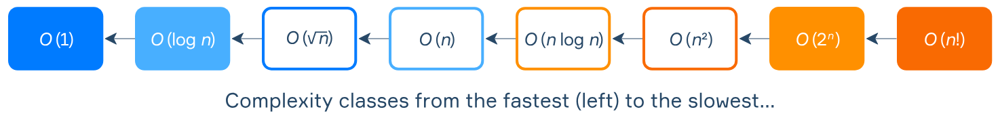
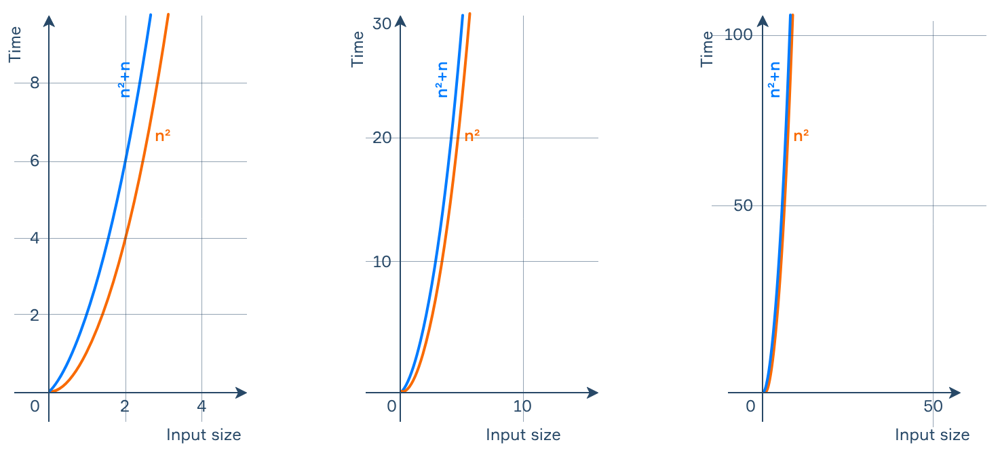

# Ký hiệu Big O

Giả sử bạn cần chọn một trong một số thuật toán để giải quyết vấn đề. 
Làm thế nào bạn có thể chọn cái tốt nhất? Để làm được điều đó, bạn cần phải đo lường hiệu quả của thuật toán bằng cách nào đó.


## Kích thước đầu vào

thời gian chạy của thuật toán phụ thuộc vào dữ liệu đầu vào.
Nếu chúng ta có thể ước tính số lượng thao tác phụ thuộc vào kích thước đầu vào như thế nào, chúng ta sẽ có thước đo độ phức tạp thuật toán độc lập với máy. 

## Hiểu độ phức tạp từ mã

**Ký hiệu Big O** giống như một cách viết tắt để nói về tốc độ phát triển của thuật toán khi kích thước đầu vào tăng lên.


Hãy cùng khám phá khái niệm này thông qua các ví dụ về mã giả:

**Độ phức tạp tuyến tính** xảy ra khi thời gian thực thi của thuật toán tăng tuyến tính với kích thước đầu vào `n`.

Mỗi lần lặp của vòng lặp thực hiện các phép toán có thời gian không đổi và khi kích thước đầu vào tăng lên, thời gian thực hiện cũng tăng theo tỷ lệ:


```
for i = 1 to n:
    // Constant-time operations
    // ...
```

Các vòng lặp lồng nhau, như trong ví dụ bên dưới, dẫn đến độ phức tạp thời gian bậc hai **O(n)^2**, vì với mỗi lần lặp của vòng lặp bên ngoài, vòng lặp bên trong sẽ lặp qua toàn bộ phạm vi của `n`, dẫn đến tổng tương tác `n^2`

```
for i = 1 to n:
    for j = 1 to n:
        // Constant-time operations
        // ...
```

##Tốc độ tăng trưởng chung

Dưới đây là, từ tốt nhất đến tệ nhất, một số giá trị phổ biến của hàm Big O cho độ phức tạp thời gian, còn được gọi là các lớp độ phức tạp.

- **O(1) (thời gian không đổi)**. Thuật toán thực hiện một số thao tác không đổi.
Điều quan trọng là nó không phụ thuộc vào kích thước đầu vào.
- **O(log n) (thời gian logarit)**. Theo định nghĩa, log a x = y bằng a^y = x. do đó log 2 n bằng số lần `n` phải chia cho 2 để được 1. Nói như vậy, không khó để đoán rằng các thuật toán như vậy chia kích thước đầu vào thành hai nửa ở mỗi bước

- **O(n) (thời gian tuyến tính)**. Thời gian tỷ lệ thuận với kích thước đầu vào, tức là thời gian tăng tuyến tính khi kích thước đầu vào tăng. 
Thông thường, các thuật toán như vậy chỉ được lặp lại một lần. 
Chúng xảy ra khá thường xuyên vì thường phải xem qua từng phần tử đầu vào trước khi tính ra đáp án cuối cùng. 

- **O(n^2) (thời gian bậc hai)**. Thông thường, các thuật toán như vậy duyệt qua tất cả các cặp phần tử đầu vào
Tại sao? Chà, toán học rất hào phóng, nó liên tục cung cấp cho chúng ta những kết quả quan trọng: 
trong trường hợp này, phép toán cơ bản xác nhận rằng số cặp không có thứ tự trong một tập hợp
Phần tử `n` bằng `n(n-1)/2`, như chúng ta sẽ tìm hiểu trong chủ đề sau, là `O(n^2)`.

- **O(2^n) (thời gian hàm mũ)**. Để đề phòng, hãy đề cập rằng `2^n` giống như việc nhân `2` với chính `n` lần. Một lần nữa, toán học phát biểu rằng số lượng tập hợp con của một tập hợp `n`. các phần tử bằng `2^n`, do đó, thật hợp lý khi kỳ vọng rằng các thuật toán như vậy sẽ quét tất cả các tập hợp con của các phần tử đầu vào. Điều đáng chú ý là lớp này cực kỳ kém hiệu quả trong thực tế; ngay cả đối với kích thước đầu vào nhỏ, thời gian thực hiện thuật toán sẽ rất cao.




Bây giờ chúng ta hãy tập hợp tất cả các lớp lại với nhau và sắp xếp chúng từ tốt nhất đến kém nhất để các bạn nhớ được lớp nào hiệu quả nhất và lớp nào bạn nên tránh xa.

Điều cần thiết là phải hiểu rằng các giá trị độ phức tạp về thời gian thấp hơn sẽ mang lại hiệu suất nhanh hơn. 
Tuy nhiên, việc giảm độ phức tạp của thuật toán không phải lúc nào cũng khả thi vì một số vấn đề vốn đòi hỏi mức độ phức tạp nhất định.

## Tính độ phức tạp: hằng số

Để có thể tự mình tính toán độ phức tạp, điều cần thiết là bạn phải làm quen với các tính chất cơ bản của Big O:

- **Bỏ qua các hằng số**. Chúng tôi chỉ tập trung vào hoạt động của thuật toán với kích thước đầu vào lớn.  Chính thức, chúng tôi viết `c*O(n) = O (n)`.

- **Áp dụng quy trình**. Điều gì sẽ xảy ra nếu bạn cần xem lại phần tử `n` `n` lần. Nó không còn là hằng số nữa vì nó phụ thuộc vào kích thước đầu vào. 
Trong trường hợp này, độ phức tạp về thời gian trở thành `O(n^2)` Vì `n * O(n) = O(n^2)`.

- **Điều khoản nhỏ hơn không thành vấn đề**. Ví dụ: bạn duyệt qua các phần tử `n` `n` lần rồi duyệt lại các phần tử `n`. Trong trường hợp này, độ phức tạp vẫn là O(n^2) Vì `O(n) + O(n^2) = O(n^2)`. Nói chung, hãy luôn giữ thuật ngữ lớn nhất trong Big O và quên đi tất cả những thuật ngữ khác. Đương nhiên, một câu hỏi được đặt ra: tại sao việc bỏ qua các thuật ngữ nhỏ hơn lại đúng? Hãy minh họa ví dụ trên:



## tham khảo:
- https://hyperskill.org/learn/step/35900
- https://hyperskill.org/learn/step/35901

