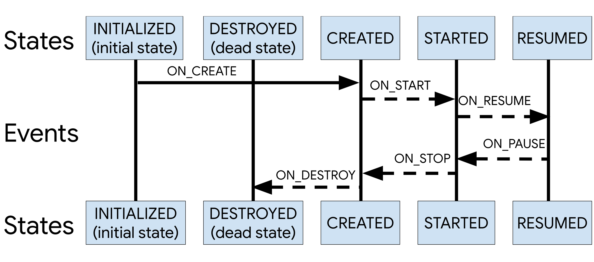

#Thành phần dịch vụ

`Service` là một thành phần ứng dụng có thể thực hiện các hoạt động chạy trong nền trong thời gian dài. Nó không cung cấp user interface. Sau khi bắt đầu, một dịch vụ có thể tiếp tục chạy trong một thời gian, ngay cả sau khi người dùng chuyển sang ứng dụng khác. Ngoài ra, một thành phần có thể liên kết với một dịch vụ để tương tác với dịch vụ đó và thậm chí thực hiện giao tiếp giữa các quá trình (IPC). Ví dụ: một dịch vụ có thể xử lý các giao dịch mạng, phát nhạc, thực hiện I/O tệp hoặc tương tác với content provider, tất cả đều ở chế độ nền.

> [!NOTE]
> Sự khác biệt giữa WorkManager API và Dịch vụ nằm ở chức năng và trường hợp sử dụng của chúng. WorkManager cung cấp một cách linh hoạt để lên lịch tác vụ và có thể chạy chúng dưới dạng dịch vụ nền trước nếu cần, đảm bảo thực thi ngay cả khi ứng dụng không chạy. Nó hỗ trợ lập lịch dựa trên các điều kiện hệ thống như kết nối mạng hoặc trạng thái pin. Ngược lại, Dịch vụ xử lý các tác vụ chạy nền thường xuyên hoặc lâu dài, như phát nhạc hoặc tải xuống dữ liệu, nhưng không cung cấp cùng mức độ lên lịch hoặc quản lý tình trạng hệ thống. Mặc dù WorkManager thường thích hợp hơn cho các tác vụ yêu cầu thực thi được đảm bảo, nhưng foreground service vẫn cần thiết cho các tác vụ yêu cầu hoạt động liên tục và độ trễ thấp.


## Loại dịch vụ
Đây là ba loại dịch vụ khác nhau:
- Tiền cảnh
- Bối cảnh
- Ràng buộc

## Hướng dẫn cơ bản về tạo và quản lý Services trong Android

Để tạo một dịch vụ, bạn phải tạo một lớp con của `Service` hoặc sử dụng một trong các lớp con hiện có của dịch vụ đó.

Trong quá trình triển khai, bạn phải ghi đè một số phương thức callback xử lý các khía cạnh chính của dịch vụ lifecycle và cung cấp cơ chế cho phép các thành phần liên kết với dịch vụ, nếu thích hợp. Đây là những phương thức callback quan trọng nhất mà bạn nên ghi đè:

### onStartCommand()

        Hệ thống gọi phương thức này bằng cách gọi `startService()` khi một thành phần khác (chẳng hạn như một hoạt động) yêu cầu khởi động dịch vụ. Khi phương thức này thực thi, dịch vụ sẽ được khởi động và có thể chạy ở chế độ nền vô thời hạn. Nếu bạn triển khai điều này, bạn có trách nhiệm dừng dịch vụ khi công việc của nó hoàn tất bằng cách gọi `stopSelf()` hoặc `stopService()`. Nếu bạn chỉ muốn cung cấp ràng buộc, bạn DON'T NEED để triển khai phương pháp này.

Lưu ý rằng phương thức `onStartCommand()` phải trả về một số nguyên. Số nguyên là một giá trị mô tả cách hệ thống sẽ tiếp tục dịch vụ trong trường hợp hệ thống tắt nó. Giá trị trả về từ `onStartCommand()` phải là một trong các hằng số sau:

`START_NOT_STICKY`

        Nếu hệ thống tắt dịch vụ sau khi `onStartCommand()` trả về, **DO NOT** sẽ tạo lại dịch vụ trừ khi có ý định phân phối đang chờ xử lý. Đây là tùy chọn an toàn nhất để tránh chạy dịch vụ của bạn khi không cần thiết và khi ứng dụng của bạn có thể khởi động lại mọi công việc còn dang dở.

`START_STICKY`

        Nếu hệ thống tắt dịch vụ sau khi `onStartCommand()` trả về, hãy tạo lại dịch vụ và gọi `onStartCommand()`, nhưng **DO NOT** cung cấp lại ý định cuối cùng. Thay vào đó, hệ thống gọi `onStartCommand()` với mục đích vô giá trị trừ khi có ý định bắt đầu dịch vụ đang chờ xử lý. Trong trường hợp đó, những ý định đó được thực hiện. Điều này phù hợp với những trình phát đa phương tiện (hoặc các dịch vụ tương tự) không thực thi lệnh nhưng đang chạy vô thời hạn và chờ công việc.

`START_REDELIVER_INTENT`

        Nếu hệ thống tắt dịch vụ sau khi `onStartCommand()` trả lại, hãy tạo lại dịch vụ và gọi `onStartCommand()` với ý định cuối cùng đã được gửi tới dịch vụ. Mọi ý định đang chờ xử lý sẽ được phân phối lần lượt. Điều này phù hợp với các dịch vụ đang tích cực thực hiện công việc cần được tiếp tục ngay lập tức, chẳng hạn như tải xuống một tệp.


### onBind()

         Hệ thống gọi phương thức này bằng cách gọi `bindService()`. Khi một thành phần khác muốn liên kết với dịch vụ (chẳng hạn như để thực hiện RPC). Khi triển khai phương thức này, bạn phải cung cấp giao diện mà máy khách sử dụng để giao tiếp với dịch vụ bằng cách trả về IBinder. Bạn MUST ALWAYS triển khai phương pháp này; tuy nhiên, nếu bạn không muốn cho phép liên kết, bạn nên trả về giá trị rỗng.

### onCreate()

            Hệ thống gọi phương thức này để thực hiện quy trình thiết lập một lần khi dịch vụ được tạo lần đầu (trước khi nó gọi `onStartCommand()` hoặc `onBind()` ). Nếu dịch vụ đang chạy thì phương thức này sẽ không được gọi.

### onDestroy()

        Hệ thống gọi phương thức này khi dịch vụ không còn được sử dụng và đang bị hủy. Dịch vụ của bạn nên triển khai điều này để dọn sạch mọi tài nguyên như luồng, trình nghe đã đăng ký hoặc trình nhận. Đây là cuộc gọi cuối cùng mà dịch vụ nhận được.


### Khai báo một dịch vụ trong bảng kê khai

Bạn phải khai báo tất cả các dịch vụ trong tệp kê khai của ứng dụng, giống như bạn làm đối với các hoạt động và các thành phần khác.

Để khai báo dịch vụ của bạn, hãy thêm phần tử `service` làm phần tử con của phần tử `application`. Đây là một ví dụ:


```xml
<manifest ... >
  ...
  <application ... >
      <service android:name=".ExampleService" />
      ...
  </application>
</manifest>
```

> [!CAUTION]
> Để đảm bảo ứng dụng của bạn được an toàn, hãy luôn sử dụng ý định rõ ràng khi khởi động `Service` và không khai báo bộ lọc ý định cho dịch vụ của bạn. Việc sử dụng một mục đích tiềm ẩn để bắt đầu một dịch vụ là một mối nguy hiểm về bảo mật vì bạn không thể chắc chắn về dịch vụ sẽ phản hồi lại ý định đó và người dùng không thể biết dịch vụ nào sẽ bắt đầu. Bắt đầu với Android 5.0 (API cấp 21), hệ thống sẽ đưa ra một ngoại lệ nếu bạn gọi `bindService()` với mục đích ngầm.

Bạn có thể đảm bảo rằng dịch vụ chỉ được cung cấp cho ứng dụng của bạn bằng cách thêm thuộc tính [android:exported](https://developer.android.com/guide/topics/manifest/service-element#exported) và đặt thuộc tính này thành `false`. Điều này có hiệu quả ngăn các ứng dụng khác khởi động dịch vụ của bạn, ngay cả khi sử dụng mục đích rõ ràng.

`Intent` phải chứa tên lớp đầy đủ của việc triển khai dịch vụ cụ thể để bắt đầu hoặc tên gói cụ thể để nhắm mục tiêu. 

## Quản lý lifecycle của một dịch vụ

### Tạo một dịch vụ đã bắt đầu


Dịch vụ đã bắt đầu là dịch vụ mà một thành phần khác bắt đầu bằng cách gọi `startService()`, dẫn đến lệnh gọi đến phương thức `onStartCommand()` của dịch vụ.

Khi một dịch vụ được khởi động, nó có lifecycle độc lập với thành phần đã khởi động nó. Dịch vụ có thể chạy ở chế độ nền vô thời hạn, ngay cả khi thành phần khởi động dịch vụ đó bị phá hủy. Do đó, dịch vụ sẽ tự dừng khi công việc của nó hoàn thành bằng cách gọi `stopSelf()` hoặc một thành phần khác có thể dừng dịch vụ bằng cách gọi `stopService()`.

Một thành phần ứng dụng, chẳng hạn như một hoạt động, có thể khởi động dịch vụ bằng cách gọi `startService()` và chuyển Intent chỉ định dịch vụ và bao gồm mọi dữ liệu để dịch vụ sử dụng. Dịch vụ nhận được Intent này trong phương thức `onStartCommand()`.

Ví dụ: giả sử một hoạt động cần lưu một số dữ liệu vào cơ sở dữ liệu trực tuyến. Hoạt động này có thể bắt đầu một dịch vụ đồng hành và cung cấp dữ liệu để lưu bằng cách chuyển ý định tới `startService()`. Dịch vụ nhận được ý định trong `onStartCommand()`, kết nối với Internet và thực hiện giao dịch cơ sở dữ liệu. Khi giao dịch hoàn tất, dịch vụ sẽ tự dừng và bị hủy.

> [!CAUTION]
> Một dịch vụ chạy trong cùng process với ứng dụng được khai báo và trong thread chính của ứng dụng đó theo mặc định. Nếu dịch vụ của bạn thực hiện các thao tác chuyên sâu hoặc chặn trong khi người dùng tương tác với một hoạt động từ cùng một ứng dụng thì dịch vụ sẽ làm chậm hiệu suất hoạt động. Để tránh ảnh hưởng đến hiệu suất ứng dụng, hãy khởi động thread mới hoặc sử dụng coroutine bên trong dịch vụ.


Android framework cũng cung cấp lớp con `IntentService` của `Service` sử dụng một worker thread để xử lý tất cả các yêu cầu bắt đầu, mỗi lần một yêu cầu. Bạn không nên sử dụng lớp này cho các ứng dụng mới vì nó sẽ không hoạt động tốt khi bắt đầu với Android 8 Oreo do giới thiệu [Giới hạn thực thi trong nền](https://developer.android.com/about/versions/oreo/background#services). Hơn nữa, nó không được dùng nữa kể từ Android 11. Bạn có thể sử dụng `JobIntentService` để thay thế cho IntentService tương thích với các phiên bản Android mới hơn. Nhưng `JobIntentService` cũng không được dùng nữa. Bởi vì Android Jetpack cung cấp thư viện `WorkManager`, giúp dễ dàng lên lịch các tác vụ không đồng bộ, có thể trì hoãn dự kiến ​​sẽ chạy ngay cả khi ứng dụng thoát hoặc thiết bị khởi động lại.

**Các phần sau đây mô tả cách bạn có thể triển khai dịch vụ tùy chỉnh của riêng mình**, tuy nhiên, bạn nên cân nhắc sử dụng `WorkManager` thay thế cho hầu hết các trường hợp sử dụng. Hãy tham khảo [hướng dẫn xử lý nền trên Android](https://developer.android.com/guide/background) để xem có giải pháp nào phù hợp với nhu cầu của bạn hay không.

#### Triển khai Dịch vụ tùy chỉnh bằng cách mở rộng lớp Dịch vụ
Bạn có thể mở rộng lớp `Service` để xử lý từng ý định đến. Đây là cách triển khai cơ bản:

```kotlin
class HelloService : Service() {

    private var serviceLooper: Looper? = null
    private var serviceHandler: ServiceHandler? = null

    // Handler that receives messages from the thread
    private inner class ServiceHandler(looper: Looper) : Handler(looper) {

        override fun handleMessage(msg: Message) {
            // Normally we would do some work here, like download a file.
            // For our sample, we just sleep for 5 seconds.
            try {
                Thread.sleep(5000)
            } catch (e: InterruptedException) {
                // Restore interrupt status.
                Thread.currentThread().interrupt()
            }

            // Stop the service using the startId, so that we don't stop
            // the service in the middle of handling another job
            stopSelf(msg.arg1)
        }
    }

    override fun onCreate() {
        // Start up the thread running the service.  Note that we create a
        // separate thread because the service normally runs in the process's
        // main thread, which we don't want to block.  We also make it
        // background priority so CPU-intensive work will not disrupt our UI.
        HandlerThread("ServiceStartArguments", Process.THREAD_PRIORITY_BACKGROUND).apply {
            start()

            // Get the HandlerThread's Looper and use it for our Handler
            serviceLooper = looper
            serviceHandler = ServiceHandler(looper)
        }
    }

    override fun onStartCommand(intent: Intent, flags: Int, startId: Int): Int {
        Toast.makeText(this, "service starting", Toast.LENGTH_SHORT).show()

        // For each start request, send a message to start a job and deliver the
        // start ID so we know which request we're stopping when we finish the job
        serviceHandler?.obtainMessage()?.also { msg ->
            msg.arg1 = startId
            serviceHandler?.sendMessage(msg)
        }

        // If we get killed, after returning from here, restart
        return START_STICKY
    }

    override fun onBind(intent: Intent): IBinder? {
        // We don't provide binding, so return null
        return null
    }

    override fun onDestroy() {
        Toast.makeText(this, "service done", Toast.LENGTH_SHORT).show()
    }
}
```

### Bắt đầu một dịch vụ

Bạn có thể bắt đầu dịch vụ từ một hoạt động hoặc thành phần ứng dụng khác bằng cách chuyển `Intent` tới `startService()` hoặc `startForegroundService()`. Hệ thống Android gọi phương thức `onStartCommand()` của dịch vụ và chuyển cho nó `Intent`, phương thức này chỉ định dịch vụ nào sẽ bắt đầu.

Ví dụ: một hoạt động có thể khởi động dịch vụ mẫu trong phần trước (HelloService) bằng cách sử dụng ý định rõ ràng với `startService()`, như được hiển thị ở đây:

```kotlin
startService(Intent(this, HelloService::class.java))
```

> [!WARNING]
> Lưu ý: Nếu ứng dụng của bạn nhắm mục tiêu API cấp 26 trở lên, hệ thống sẽ áp đặt các hạn chế đối với việc sử dụng hoặc tạo các dịch vụ nền trừ khi chính ứng dụng đó ở nền trước. Nếu một ứng dụng cần tạo foreground service, ứng dụng đó sẽ gọi startForegroundService(). Phương thức đó tạo ra background service, nhưng phương thức này báo hiệu cho hệ thống rằng dịch vụ sẽ tự quảng bá lên nền trước. Khi dịch vụ đã được tạo, dịch vụ phải gọi phương thức startForeground() của nó trong vòng năm giây.

### Dừng dịch vụ

**Một dịch vụ đã bắt đầu phải quản lý lifecycle của chính nó**. Nghĩa là, hệ thống không dừng hoặc hủy dịch vụ trừ khi nó phải khôi phục bộ nhớ hệ thống và dịch vụ tiếp tục chạy sau khi `onStartCommand()` quay trở lại. Dịch vụ phải tự dừng bằng cách gọi `stopSelf()` hoặc thành phần khác có thể dừng dịch vụ bằng cách gọi `stopService()`.

Sau khi được yêu cầu dừng với `stopSelf()` hoặc `stopService()`, hệ thống sẽ hủy dịch vụ càng sớm càng tốt.

## Quản lý lifecycle của một dịch vụ

Dịch vụ lifecycle—từ khi được tạo cho đến khi bị hủy—có thể đi theo một trong hai đường dẫn sau:
 - Một dịch vụ bắt đầu
Dịch vụ được tạo khi một thành phần khác gọi `startService()`. Dịch vụ sau đó chạy vô thời hạn và phải tự dừng bằng cách gọi `stopSelf()`. Một thành phần khác cũng có thể dừng dịch vụ bằng cách gọi `stopService()`. Khi dịch vụ bị dừng, hệ thống sẽ hủy dịch vụ đó.
 - Một dịch vụ ràng buộc
Dịch vụ được tạo khi một thành phần khác (máy khách) gọi `bindService()`. Sau đó, khách hàng sẽ liên lạc với dịch vụ thông qua giao diện `IBinder`. Máy khách có thể đóng kết nối bằng cách gọi `unbindService()`. Nhiều máy khách có thể liên kết với cùng một dịch vụ và **khi tất cả chúng hủy liên kết, hệ thống sẽ hủy dịch vụ. Dịch vụ không cần phải tự dừng.**

    Hai con đường này không hoàn toàn tách biệt. Bạn có thể liên kết với một dịch vụ đã được bắt đầu bằng `startService()`. Ví dụ: bạn có thể bắt đầu dịch vụ nhạc nền bằng cách gọi `startService()` bằng `Intent` xác định nhạc sẽ phát. Sau này, có thể khi người dùng muốn thực hiện một số quyền kiểm soát đối với trình phát hoặc lấy thông tin về bài hát hiện tại, một hoạt động có thể liên kết với dịch vụ bằng cách gọi đến `bindService()`. Trong những trường hợp như vậy, `stopService()` hoặc `stopSelf()` không thực sự dừng dịch vụ cho đến khi tất cả khách hàng hủy liên kết.

### Triển khai lệnh gọi lại lifecycle

```kotlin
class ExampleService : Service() {
    private var startMode: Int = 0             // indicates how to behave if the service is killed
    private var binder: IBinder? = null        // interface for clients that bind
    private var allowRebind: Boolean = false   // indicates whether onRebind should be used

    override fun onCreate() {
        // The service is being created
    }

    override fun onStartCommand(intent: Intent?, flags: Int, startId: Int): Int {
        // The service is starting, due to a call to startService()
        return startMode
    }

    override fun onBind(intent: Intent): IBinder? {
        // A client is binding to the service with bindService()
        return binder
    }

    override fun onUnbind(intent: Intent): Boolean {
        // All clients have unbound with unbindService()
        return allowRebind
    }

    override fun onRebind(intent: Intent) {
        // A client is binding to the service with bindService(),
        // after onUnbind() has already been called
    }

    override fun onDestroy() {
        // The service is no longer used and is being destroyed
    }
}
```

