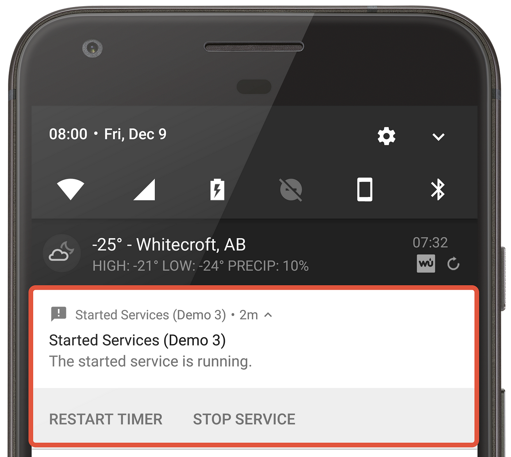

#Foreground Service

**foreground service** thực hiện một số thao tác mà người dùng có thể nhận thấy.

Ví dụ về các ứng dụng sử dụng dịch vụ trên nền trước bao gồm:

- Ứng dụng trình phát nhạc phát nhạc trên foreground service. Thông báo có thể hiển thị bài hát hiện tại đang được phát.
- Một ứng dụng thể dục ghi lại hoạt động chạy của người dùng trên foreground service sau khi nhận được sự cho phép của người dùng. Thông báo có thể hiển thị quãng đường mà người dùng đã di chuyển trong buổi tập thể dục hiện tại.

       Khi bạn sử dụng **foreground service**, bạn phải hiển thị thông báo để người dùng chủ động biết rằng dịch vụ đang chạy. Không thể loại bỏ thông báo này trừ khi dịch vụ bị dừng hoặc bị xóa khỏi nền trước.



#### Người dùng có thể bỏ qua thông báo theo mặc định

Bắt đầu từ Android 13 (API cấp 33), người dùng có thể loại bỏ thông báo liên quan đến foreground service theo mặc định. Để làm như vậy, người dùng thực hiện cử chỉ vuốt trên thông báo. Theo truyền thống, thông báo sẽ không bị loại bỏ trừ khi foreground service bị dừng hoặc bị xóa khỏi nền trước.

Nếu bạn muốn người dùng không thể loại bỏ thông báo, hãy chuyển `true` vào phương thức `setOngoing()` khi bạn tạo thông báo bằng `Notification.Builder`.


#### Dịch vụ hiển thị thông báo ngay lập tức

Nếu foreground service có ít nhất một trong các đặc điểm sau, thì hệ thống sẽ hiển thị thông báo liên quan ngay sau khi dịch vụ bắt đầu, ngay cả trên các thiết bị chạy **Android 12 trở lên**:

- Dịch vụ được liên kết với thông báo bao gồm các nút hành động.
- Dịch vụ có foregroundServiceType là mediaPlayback, mediaProjection hoặc phoneCall.
- Dịch vụ cung cấp trường hợp sử dụng liên quan đến cuộc gọi điện thoại, điều hướng hoặc phát lại phương tiện, như được xác định trong thuộc tính danh mục của thông báo.
- Dịch vụ đã từ chối thay đổi hành vi bằng cách chuyển `FOREGROUND_SERVICE_IMMEDIATE` vào `setForegroundServiceBehavior()` khi thiết lập thông báo.
> [!NOTE]
> Trên Android 13 (API cấp 33) trở lên, nếu người dùng từ chối quyền thông báo, họ vẫn thấy các thông báo liên quan đến dịch vụ trên nền trước trong [Trình quản lý tác vụ](https://developer.android.com/develop/background-work/services/foreground-services#handle-user-initiated-stop) **nhưng không thấy chúng trong ngăn thông báo.**

#### Khai báo các dịch vụ nền trước trong bảng kê khai của bạn

Trong tệp kê khai của ứng dụng, hãy khai báo từng dịch vụ trên nền trước của ứng dụng bằng phần tử `<service>`. Đối với mỗi dịch vụ, hãy sử dụng thuộc tính `android:foregroundServiceType` để khai báo loại công việc mà dịch vụ thực hiện.

> [!CAUTION]
> Quan trọng: Tất cả các nội dung khai báo foreground service phải tuân thủ các yêu cầu trong [Chính sách lạm dụng mạng và thiết bị của Google Play.](https://support.google.com/googleplay/android-developer/answer/9888379)


Ví dụ: nếu ứng dụng của bạn tạo foreground service phát nhạc, bạn có thể khai báo dịch vụ như sau:

```xml
<manifest xmlns:android="http://schemas.android.com/apk/res/android" ...>
  <application ...>

    <service
        android:name=".MyMediaPlaybackService"
        android:foregroundServiceType="mediaPlayback"
        android:exported="false">
    </service>
  </application>
</manifest>
```

Nếu nhiều loại áp dụng cho dịch vụ của bạn, hãy tách chúng bằng dấu | nhà điều hành. Ví dụ: một dịch vụ sử dụng máy ảnh và micrô sẽ khai báo như sau:

```xml
android:foregroundServiceType="mediaPlayback|camera|microphone"
```

Tùy thuộc vào cấp độ API mà ứng dụng của bạn nhắm đến, bạn có thể được yêu cầu khai báo các dịch vụ trên nền trước trong bảng kê khai ứng dụng:
- **API cấp 29 trở lên**: Bạn phải khai báo tất cả các dịch vụ nền trước sử dụng thông tin vị trí, sử dụng loại dịch vụ vị trí.
- **API cấp 30 trở lên**: Bạn phải khai báo tất cả các dịch vụ trên nền trước sử dụng máy ảnh hoặc micrô, sử dụng máy ảnh hoặc 
loại dịch vụ micrô tương ứng.
- **API cấp 34 trở lên**: Bạn phải khai báo tất cả các dịch vụ trên nền trước cùng với loại dịch vụ của chúng.
Nếu bạn cố gắng tạo foreground service và loại của nó không được khai báo trong tệp kê khai, hệ thống sẽ đưa ra một 
`MissingForegroundServiceTypeException` khi gọi `startForeground()`.
Ngay cả khi không bắt buộc, best practice vẫn dùng để khai báo tất cả các dịch vụ trên nền trước của bạn và cung cấp các loại dịch vụ của chúng.

#### Request quyền foreground service

Các ứng dụng nhắm mục tiêu Android 9 (API cấp 28) trở lên và sử dụng các dịch vụ trên nền trước cần request `FOREGROUND_SERVICE` trong tệp kê khai ứng dụng, như minh họa trong đoạn mã sau. **Đây là quyền thông thường nên hệ thống sẽ tự động cấp quyền cho ứng dụng yêu cầu.**

Ngoài ra, nếu ứng dụng nhắm mục tiêu API cấp 34 trở lên, **ứng dụng phải request loại quyền thích hợp cho loại công việc mà foreground service sẽ thực hiện**. Mỗi loại foreground service có một loại quyền tương ứng.

Ví dụ: nếu một ứng dụng khởi chạy foreground service sử dụng máy ảnh, bạn phải request cả quyền `FOREGROUND_SERVICE` và `FOREGROUND_SERVICE_CAMERA`. Đây đều là các quyền thông thường nên hệ thống sẽ tự động cấp chúng nếu chúng được liệt kê trong tệp kê khai.

```xml
<manifest xmlns:android="http://schemas.android.com/apk/res/android" ...>

    <uses-permission android:name="android.permission.FOREGROUND_SERVICE"/>
    <uses-permission android:name="android.permission.FOREGROUND_SERVICE_CAMERA"/>

    <application ...>
        ...
    </application>
</manifest>
```

#### Điều kiện tiên quyết của Foreground service
Nếu một ứng dụng nhắm mục tiêu API cấp 28 trở lên cố gắng tạo foreground service mà không request quyền `FOREGROUND_SERVICE` thì hệ thống sẽ gửi `SecurityException`. Tương tự, nếu một ứng dụng nhắm mục tiêu API cấp 34 trở lên và không yêu cầu quyền cụ thể phù hợp thì hệ thống sẽ loại bỏ `SecurityException`.

Vì lý do này, bạn phải xác nhận rằng các điều kiện tiên quyết bắt buộc được đáp ứng trước khi bạn khởi động foreground service. Tài liệu loại foreground service liệt kê các điều kiện tiên quyết cần thiết cho từng loại foreground service.

#### Bắt đầu foreground service

Trước khi bạn request hệ thống chạy một dịch vụ dưới dạng foreground service, hãy tự khởi động dịch vụ đó:

```kotlin
val foregroundServiceIntent = Intent(context, PlaybackService::class.java)
context.startForegroundService(foregroundServiceIntent)
```

Bên trong dịch vụ, thường là trong `onStartCommand()`, bạn có thể request dịch vụ của mình chạy ở nền trước. Để làm như vậy, hãy gọi `ServiceCompat.startForeground(service, notification, foregroundServiceType)` (có sẵn trong androidx-core 1.12 trở lên). Phương thức này có các tham số sau:

- Dịch vụ
- Một số nguyên dương xác định duy nhất thông báo trên thanh trạng thái
- Bản thân đối tượng Thông báo
- Các loại [foreground service](https://developer.android.com/develop/background-work/services/fg-service-types) xác định công việc được thực hiện bởi dịch vụ
Các loại này có thể là tập hợp con của các loại được khai báo trong tệp kê khai, tùy thuộc vào trường hợp sử dụng cụ thể. Sau đó, nếu bạn cần thêm nhiều loại dịch vụ hơn, bạn có thể gọi lại `startForeground()`.

Tạo bản demo code block đầy đủ **Foreground Service**:

```kotlin
class MyCameraService: Service() {
  val notification = createNotification()
  private fun startForeground() {
    // Before starting the service as foreground check that the app has the
    // appropriate runtime permissions. In this case, verify that the user has
    // granted the CAMERA permission.
    val cameraPermission =
            PermissionChecker.checkSelfPermission(this, Manifest.permission.CAMERA)
    if (cameraPermission != PermissionChecker.PERMISSION_GRANTED) {
        // Without camera permissions the service cannot run in the foreground
        // Consider informing user or updating your app UI if visible.
        stopSelf()
        return
    }

    try {
        val notification = NotificationCompat.Builder(this, "CHANNEL_ID")
            // Create the notification to display while the service is running
            .build()
        ServiceCompat.startForeground(
            /* service = */ this,
            /* id = */ 100, // Cannot be 0
            /* notification = */ notification,
            /* foregroundServiceType = */
            if (Build.VERSION.SDK_INT >= Build.VERSION_CODES.R) {
                ServiceInfo.FOREGROUND_SERVICE_TYPE_CAMERA
            } else {
                0
            },
        )
    } catch (e: Exception) {
        if (Build.VERSION.SDK_INT >= Build.VERSION_CODES.S
                && e is ForegroundServiceStartNotAllowedException) {
            // App not in a valid state to start foreground service
            // (e.g. started from bg)
        }
        // ...
    }
  }

    private fun createNotification(
        context: Context,
        mediaSession: MediaSessionCompat,
    ): Notification {
        return NotificationCompat.Builder(context, context.getString(R.string.app_name))
            .setPriority(NotificationCompat.PRIORITY_HIGH)
            .setForegroundServiceBehavior(NotificationCompat.FOREGROUND_SERVICE_IMMEDIATE)
            .setSmallIcon(R.drawable.logo_splash)
            .setContentTitle("notification title")
            .setContentText("notification content")
            .setContentIntent(
                PendingIntent.getActivity(
                    context,
                    0,
                    Intent(context, MainActivity::class.java).apply {
                        putExtra(IS_FROM_NOTIFICATION, true)
                    },
                    PendingIntent.FLAG_UPDATE_CURRENT or PendingIntent.FLAG_IMMUTABLE
                )
            )
            .setStyle(
                androidx.media.app.NotificationCompat.MediaStyle()
                    .setMediaSession(mediaSession.sessionToken)
            )
            //Show controls on lock screen even when user hides sensitive content.
            .setVisibility(NotificationCompat.VISIBILITY_PUBLIC)
            .setSound(null)
            .setAutoCancel(false)
            .setOngoing(true)
            .setOnlyAlertOnce(true)
            .build()
    }
}
```

#### Xóa dịch vụ khỏi nền trước

Để xóa dịch vụ khỏi nền trước, hãy gọi `stopForeground()`. Phương thức này sử dụng một boolean, cho biết có nên xóa thông báo trên thanh trạng thái hay không. Lưu ý rằng dịch vụ vẫn tiếp tục chạy.

Nếu bạn dừng dịch vụ khi nó chạy ở nền trước, thông báo của nó sẽ bị xóa.

#### Xử lý việc dừng ứng dụng do người dùng thực hiện đang chạy dịch vụ trên nền trước

Bắt đầu từ Android 13 (API cấp 33), người dùng có thể hoàn thành quy trình làm việc từ ngăn thông báo để dừng một ứng dụng đang chạy các dịch vụ trên nền trước, bất kể phiên bản SDK mục tiêu của ứng dụng đó là gì. Khả năng chi trả này, được gọi là **Trình quản lý tác vụ**, hiển thị danh sách các ứng dụng hiện đang chạy foreground service.

Danh sách này được gắn nhãn Ứng dụng đang hoạt động. Bên cạnh mỗi ứng dụng là nút Dừng. **Hình bên dưới** minh họa quy trình làm việc **Trình quản lý tác vụ** trên thiết bị chạy Android 13.


Khi người dùng nhấn nút Dừng bên cạnh ứng dụng của bạn trong Trình quản lý tác vụ, các hành động sau sẽ xảy ra:

- Hệ thống xóa ứng dụng của bạn khỏi bộ nhớ. Do đó, toàn bộ ứng dụng của bạn dừng lại, không chỉ foreground service đang chạy.
- Hệ thống sẽ xóa hoạt động back stack của ứng dụng của bạn.
- Mọi hoạt động phát lại phương tiện đều dừng lại.
- Thông báo liên quan đến foreground service đã bị xóa.
- Ứng dụng của bạn vẫn còn trong lịch sử.
- Các công việc theo lịch trình được thực hiện đúng thời gian đã định.
- Báo thức tắt vào thời gian đã lên lịch hoặc cửa sổ thời gian.

**Trình quản lý tác vụ** có một số Miễn trừ, hãy xem [tại đây](https://developer.android.com/develop/background-work/services/foreground-services#exemptions).

#### Sử dụng API được xây dựng có mục đích thay vì các dịch vụ nền trước

Đối với nhiều trường hợp sử dụng, có các API nền tảng hoặc Jetpack mà bạn có thể sử dụng để thực hiện công việc mà bạn có thể sử dụng foreground service. Nếu có API được thiết kế theo mục đích phù hợp, bạn hầu như luôn nên sử dụng nó thay vì sử dụng foreground service. API được xây dựng có mục đích thường cung cấp thêm các khả năng cụ thể cho từng trường hợp sử dụng mà bạn sẽ phải tự xây dựng.

Ví dụ: `Bubbles API` xử lý logic UI phức tạp cho các ứng dụng nhắn tin cần triển khai các tính năng bong bóng trò chuyện.

Tài liệu dành cho [các loại foreground service](https://developer.android.com/develop/background-work/services/fg-service-types) liệt kê các lựa chọn thay thế tốt để sử dụng thay vì các dịch vụ trên nền trước.


#### Hạn chế khi khởi động foreground service từ nền

Các ứng dụng nhắm mục tiêu Android 12 trở lên **không thể khởi động các dịch vụ trên nền trước trong khi ứng dụng đang chạy ở chế độ nền**,
ngoại trừ một số trường hợp đặc biệt:
- Ứng dụng của bạn chuyển đổi từ trạng thái hiển thị cho người dùng, chẳng hạn như một hoạt động.
- Ứng dụng của bạn có thể bắt đầu một hoạt động từ nền, ngoại trừ trường hợp ứng dụng có hoạt động trong back stack của tác vụ hiện có.
- Ứng dụng của bạn nhận được tin nhắn có mức độ ưu tiên cao bằng cách sử dụng Nhắn tin qua đám mây của Firebase.
- Người dùng thực hiện hành động trên phần tử UI liên quan đến ứng dụng của bạn. Ví dụ: họ có thể tương tác với [bong bóng](https://developer.android.com/guide/topics/ui/bubbles), [thông báo](https://developer.android.com/develop/ui/views/notifications), [widget](https://developer.android.com/guide/topics/appwidgets/overview) hoặc hoạt động.
- Ứng dụng của bạn gọi [báo động chính xác](https://developer.android.com/training/scheduling/alarms#exact) để hoàn thành hành động mà người dùng request.
- Ứng dụng của bạn là [phương thức nhập hiện tại của thiết bị](https://developer.android.com/guide/topics/text/creating-input-method).
- Ứng dụng của bạn nhận được một sự kiện liên quan đến chuyển đổi tính năng định vị địa lý hoặc nhận dạng hoạt động.
- Sau khi thiết bị khởi động lại và nhận được hành động có ý định `ACTION_BOOT_COMPLETED`, `ACTION_LOCKED_BOOT_COMPLETED` hoặc `ACTION_MY_PACKAGE_REPLACED` trong broadcast receiver.
- Ứng dụng của bạn nhận được hành động có ý định `ACTION_TIMEZONE_CHANGED`, `ACTION_TIME_CHANGED` hoặc `ACTION_LOCALE_CHANGED` trong broadcast receiver.
- Ứng dụng của bạn nhận được sự kiện `ACTION_TRANSACTION_DETECTED` từ `NfcService`.
- Ứng dụng có vai trò hoặc quyền nhất định của hệ thống, chẳng hạn như chủ sở hữu thiết bị và chủ sở hữu hồ sơ.
- Ứng dụng của bạn sử dụng Trình quản lý thiết bị đồng hành và khai báo quyền `REQUEST_COMPANION_START_FOREGROUND_SERVICES_FROM_BACKGROUND` hoặc quyền `REQUEST_COMPANION_RUN_IN_BACKGROUND`. Bất cứ khi nào có thể, hãy sử dụng `REQUEST_COMPANION_START_FOREGROUND_SERVICES_FROM_BACKGROUND`.
- Ứng dụng của bạn có quyền `SYSTEM_ALERT_WINDOW`.
- Người dùng tắt tính năng tối ưu hóa pin cho ứng dụng của bạn.


> [!NOTE]
> Nếu một ứng dụng cố gắng khởi động foreground service trong khi ứng dụng chạy ở chế độ nền và foreground service không đáp ứng một trong các trường hợp ngoại lệ thì hệ thống sẽ gửi ForegroundServiceStartNotAllowedException.

#### Hạn chế khi bắt đầu các dịch vụ nền trước cần có quyền trong khi sử dụng

Nếu ứng dụng của bạn nhắm mục tiêu Android 14 trở lên, hệ điều hành sẽ kiểm tra khi bạn tạo foreground service để đảm bảo ứng dụng của bạn có tất cả các quyền thích hợp cho loại dịch vụ đó. Ví dụ: khi bạn tạo loại micrô foreground service, hệ điều hành sẽ xác minh rằng ứng dụng của bạn hiện có quyền `RECORD_AUDIO`. Nếu bạn không có quyền đó, hệ thống sẽ đưa ra `SecurityException`.

> [!NOTE]
> Trên các phiên bản Android thấp hơn Android 14, nếu bạn cố gắng tạo một foreground service cần có quyền khi sử dụng trong khi ứng dụng của bạn chạy ở chế độ nền, thì hệ thống sẽ cho phép bạn tạo dịch vụ nhưng dịch vụ đó sẽ không có quyền truy cập vào các tài nguyên cần thiết và nếu cố gắng sử dụng chúng thì bạn sẽ nhận được một ngoại lệ. Trên Android 14 trở lên, ứng dụng của bạn sẽ nhận được ngoại lệ ngay khi cố gắng tạo foreground service.

Vì lý do này, nếu foreground service của bạn cần quyền trong khi sử dụng, bạn phải gọi Context.startForegroundService() hoặc Context.bindService() trong khi ứng dụng của bạn có hoạt động hiển thị, trừ khi dịch vụ rơi vào một trong các trường hợp miễn trừ được xác định.

#### Miễn các hạn chế về quyền trong khi sử dụng

Trong một số trường hợp, ngay cả khi foreground service được khởi động trong khi ứng dụng chạy ở chế độ nền, nó vẫn có thể truy cập thông tin vị trí, máy ảnh và micrô trong khi ứng dụng chạy ở nền trước ("trong khi sử dụng").

Trong những trường hợp tương tự, nếu dịch vụ khai báo loại foreground service của `location` và được khởi động bởi một ứng dụng có quyền `ACCESS_BACKGROUND_LOCATION`, **dịch vụ này có thể truy cập thông tin vị trí mọi lúc, ngay cả khi ứng dụng chạy ở chế độ nền.**

Danh sách sau đây chứa những tình huống này:

- Một thành phần hệ thống khởi động dịch vụ.
- Dịch vụ bắt đầu bằng cách tương tác với các widget ứng dụng.
- Dịch vụ bắt đầu bằng cách tương tác với một thông báo.
- Dịch vụ bắt đầu dưới dạng PendingIntent được gửi từ một ứng dụng hiển thị khác.
- Dịch vụ bắt đầu bằng một ứng dụng là bộ điều khiển chính sách thiết bị chạy ở chế độ chủ sở hữu thiết bị.
- Dịch vụ bắt đầu bằng một ứng dụng cung cấp `VoiceInteractionService`.
- Dịch vụ bắt đầu bằng ứng dụng có quyền đặc quyền `START_ACTIVITIES_FROM_BACKGROUND`.
