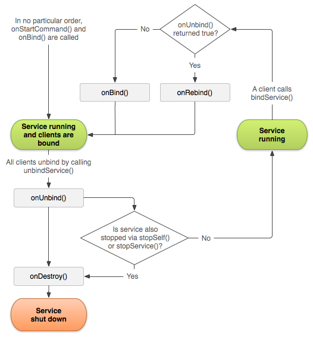

#Background Service

   background service thực hiện một thao tác mà người dùng không nhận thấy trực tiếp. Ví dụ: nếu một ứng dụng sử dụng dịch vụ để xóa bộ nhớ thì đó thường là background service.

> [!NOTE]
> Nếu ứng dụng của bạn nhắm mục tiêu API cấp 26 trở lên, hệ thống sẽ áp đặt các hạn chế đối với việc chạy các dịch vụ nền khi ứng dụng hiện không có trên màn hình. Trong hầu hết các trường hợp, bạn không nên truy cập thông tin vị trí từ chế độ nền. Thay vào đó, hãy lên lịch tác vụ bằng WorkManager.

### Dịch vụ đã bắt đầu và Dịch vụ ràng buộc

Bạn có thể tạo một dịch vụ vừa được bắt đầu vừa bị ràng buộc. Nghĩa là, bạn có thể bắt đầu một dịch vụ bằng cách gọi `startService()`, **cho phép dịch vụ chạy vô thời hạn**. Bạn cũng có thể cho phép khách hàng liên kết với dịch vụ bằng cách gọi `bindService()`.

**Nếu bạn để dịch vụ của mình được khởi động và ràng buộc** thì khi dịch vụ khởi động, **hệ thống sẽ không hủy dịch vụ khi tất cả khách hàng hủy liên kết**. Thay vào đó, bạn phải dừng dịch vụ một cách rõ ràng bằng cách gọi `stopSelf()` hoặc `stopService()`.

Mặc dù bạn thường triển khai `onBind()` hoặc `onStartCommand()` nhưng đôi khi vẫn cần phải triển khai cả hai. Ví dụ: một trình phát nhạc có thể thấy hữu ích khi cho phép dịch vụ của nó chạy vô thời hạn và cũng cung cấp tính ràng buộc. Bằng cách này, một hoạt động có thể khởi động dịch vụ để phát một số bản nhạc và nhạc đó vẫn tiếp tục phát ngay cả khi người dùng rời khỏi ứng dụng. Sau đó, khi người dùng quay lại ứng dụng, hoạt động có thể liên kết với dịch vụ để lấy lại quyền kiểm soát việc phát lại.

Khi máy khách cuối cùng hủy liên kết khỏi dịch vụ, hệ thống sẽ hủy dịch vụ đó, trừ khi dịch vụ được bắt đầu bằng `startService()`.


### Dịch vụ ràng buộc

    Một dịch vụ bị **ràng buộc** khi một thành phần ứng dụng liên kết với dịch vụ đó bằng cách gọi đến `bindService()`. Dịch vụ bị ràng buộc cung cấp giao diện client-server cho phép các thành phần tương tác với dịch vụ, gửi yêu cầu, nhận kết quả và thậm chí thực hiện điều đó trên các quy trình có giao tiếp giữa các quá trình (IPC). Một dịch vụ bị ràng buộc chỉ chạy khi có thành phần ứng dụng khác được liên kết với nó. Nhiều thành phần có thể liên kết với dịch vụ cùng một lúc, nhưng khi tất cả chúng không liên kết thì dịch vụ sẽ bị hủy.

Ví dụ: Khi `Activity` liên kết với một dịch vụ bị ràng buộc, kết nối chỉ được duy trì miễn là `Activity` tồn tại. Nếu `Activity` bị hủy, hệ thống sẽ gọi phương thức `onUnbind()` và sau đó hủy dịch vụ nếu không có thành phần nào khác vẫn bị ràng buộc với nó. **Do đó, khi `Activity` bị phá hủy, kết nối giữa nó và dịch vụ bị ràng buộc cũng bị chấm dứt.**

### Tạo một dịch vụ bị ràng buộc

Phần quan trọng nhất trong quá trình triển khai dịch vụ ràng buộc của bạn là xác định giao diện mà phương thức `onBind()` callback của bạn trả về. Phần sau đây thảo luận về một số cách mà bạn có thể xác định giao diện `IBinder` cho dịch vụ của mình.

Khi tạo một dịch vụ cung cấp liên kết, bạn phải cung cấp IBinder cung cấp giao diện lập trình mà khách hàng có thể sử dụng để tương tác với dịch vụ. Có ba cách bạn có thể xác định giao diện:
- Mở rộng lớp Binder
- Sử dụng Messenger
- Sử dụng AIDL

#### Mở rộng lớp Binder

Nếu dịch vụ của bạn là riêng tư đối với ứng dụng của riêng bạn và chạy trong cùng process với tư cách là ứng dụng khách, điều này là phổ biến, hãy tạo giao diện của bạn bằng cách mở rộng lớp `Binder` và trả về một phiên bản của nó từ `onBind()`. Máy khách nhận được `Binder` và có thể sử dụng nó để truy cập trực tiếp vào các phương thức công khai có sẵn trong quá trình triển khai `Binder` hoặc `Service`.
Đây là kỹ thuật được ưu tiên khi dịch vụ của bạn chỉ đơn thuần là nhân viên chạy nền cho ứng dụng của riêng bạn. Trường hợp sử dụng duy nhất khi đây không phải là cách ưa thích để tạo giao diện của bạn là nếu dịch vụ của bạn được các ứng dụng khác hoặc trên các quy trình riêng biệt sử dụng.


Đây là cách thiết lập nó:

- Trong dịch vụ của bạn, hãy tạo một phiên bản Binder thực hiện một trong những thao tác sau:
  - Chứa các phương thức public mà client có thể gọi.
  - Trả về phiên bản Dịch vụ hiện tại, có các phương thức công khai mà khách hàng có thể gọi.
  - Trả về một thể hiện của một lớp khác được dịch vụ lưu trữ với các phương thức công khai mà máy khách có thể gọi.
- Trả về phiên bản Binder này từ phương thức `onBind()` callback.
- Trong máy khách, nhận Binder từ phương thức `onServiceConnected()` callback và thực hiện cuộc gọi đến dịch vụ bị ràng buộc bằng các phương thức được cung cấp.

Ví dụ:

```kotlin
class LocalService : Service() {
    // Binder given to clients.
    private val binder = LocalBinder()

    // Random number generator.
    private val mGenerator = Random()

    /** Method for clients.  */
    val randomNumber: Int
        get() = mGenerator.nextInt(100)

    /**
     * Class used for the client Binder. Because we know this service always
     * runs in the same process as its clients, we don't need to deal with IPC.
     */
    inner class LocalBinder : Binder() {
        // Return this instance of LocalService so clients can call public methods.
        fun getService(): LocalService = this@LocalService
    }

    override fun onBind(intent: Intent): IBinder {
        return binder
    }
}
```

`LocalBinder` cung cấp phương thức `getService()` cho khách hàng để truy xuất phiên bản hiện tại của `LocalService`. Điều này cho phép khách hàng gọi các phương thức công khai trong dịch vụ. Ví dụ: khách hàng có thể gọi `getRandomNumber()` từ dịch vụ.

Đây là một hoạt động liên kết với `LocalService` và gọi `getRandomNumber()` khi nhấp vào nút:

```kotlin

class BindingActivity : Activity() {
    private lateinit var mService: LocalService
    private var mBound: Boolean = false

    /** Defines callbacks for service binding, passed to bindService().  */
    private val connection = object : ServiceConnection {

        override fun onServiceConnected(className: ComponentName, service: IBinder) {
            // We've bound to LocalService, cast the IBinder and get LocalService instance.
            val binder = service as LocalService.LocalBinder
            mService = binder.getService()
            mBound = true
        }

        override fun onServiceDisconnected(arg0: ComponentName) {
            mBound = false
        }
    }

    override fun onCreate(savedInstanceState: Bundle?) {
        super.onCreate(savedInstanceState)
        setContentView(R.layout.main)
    }

    override fun onStart() {
        super.onStart()
        // Bind to LocalService.
        Intent(this, LocalService::class.java).also { intent ->
            bindService(intent, connection, Context.BIND_AUTO_CREATE)
        }
    }

    override fun onStop() {
        super.onStop()
        unbindService(connection)
        mBound = false
    }

    /** Called when a button is clicked (the button in the layout file attaches to
     * this method with the android:onClick attribute).  */
    fun onButtonClick(v: View) {
        if (mBound) {
            // Call a method from the LocalService.
            // However, if this call is something that might hang, then put this request
            // in a separate thread to avoid slowing down the activity performance.
            val num: Int = mService.randomNumber
            Toast.makeText(this, "number: $num", Toast.LENGTH_SHORT).show()
        }
    }
}

```


#### Sử dụng Messenger

Nếu bạn cần giao diện của mình hoạt động trên nhiều quy trình khác nhau, bạn có thể tạo giao diện cho dịch vụ bằng `Messenger`. Theo cách này, dịch vụ xác định Trình xử lý phản hồi các loại đối tượng Tin nhắn khác nhau.
Trình xử lý này là cơ sở cho `Messenger`, sau đó có thể chia sẻ `IBinder` với máy khách, cho phép máy khách gửi lệnh đến dịch vụ bằng cách sử dụng các đối tượng `Message`. Ngoài ra, khách hàng có thể xác định `Messenger` của riêng mình để dịch vụ có thể gửi tin nhắn trở lại.

Đây là cách đơn giản nhất để thực hiện giao tiếp giữa các quá trình (IPC) mà không cần sử dụng AIDL, vì `Messenger` xếp hàng tất cả các yêu cầu vào một thread duy nhất để bạn không phải thiết kế dịch vụ của mình thành thread an toàn.


Dưới đây là tóm tắt về cách sử dụng Messenger:

- Dịch vụ triển khai `Handler` nhận callback cho mỗi cuộc gọi từ khách hàng.
- Dịch vụ sử dụng Handler để tạo đối tượng `Messenger` (là đối tượng tham chiếu đến `Handler`).
- `Messenger` tạo `IBinder` mà dịch vụ trả về cho khách hàng từ `onBind()`.
- Khách hàng sử dụng `IBinder` để khởi tạo `Messenger` (tham chiếu `Handler` của dịch vụ), khách hàng sử dụng để gửi đối tượng Tin nhắn đến dịch vụ.
- Dịch vụ nhận từng Tin nhắn trong Trình xử lý của nó—cụ thể là trong phương thức `handleMessage()`.

Theo cách này, không có phương pháp nào để khách hàng gọi dịch vụ. Thay vào đó, máy khách sẽ gửi các tin nhắn (đối tượng Tin nhắn) mà dịch vụ nhận được trong Trình xử lý của nó.

Ví dụ:

```kotlin
/** Command to the service to display a message.  */
private const val MSG_SAY_HELLO = 1

class MessengerService : Service() {

    /**
     * Target we publish for clients to send messages to IncomingHandler.
     */
    private lateinit var mMessenger: Messenger

    /**
     * Handler of incoming messages from clients.
     */
    internal class IncomingHandler(
            context: Context,
            private val applicationContext: Context = context.applicationContext
    ) : Handler() {
        override fun handleMessage(msg: Message) {
            when (msg.what) {
                MSG_SAY_HELLO ->
                    Toast.makeText(applicationContext, "hello!", Toast.LENGTH_SHORT).show()
                else -> super.handleMessage(msg)
            }
        }
    }

    /**
     * When binding to the service, we return an interface to our messenger
     * for sending messages to the service.
     */
    override fun onBind(intent: Intent): IBinder? {
        Toast.makeText(applicationContext, "binding", Toast.LENGTH_SHORT).show()
        mMessenger = Messenger(IncomingHandler(this))
        return mMessenger.binder
    }
}
```

Tất cả những gì khách hàng cần làm là tạo một `Messenger` dựa trên `IBinder` được dịch vụ trả về và gửi tin nhắn bằng `send()`. Ví dụ: đây là một hoạt động liên kết với dịch vụ và gửi thông báo `MSG_SAY_HELLO` tới dịch vụ:


```kotlin
class ActivityMessenger : Activity() {
    /** Messenger for communicating with the service.  */
    private var mService: Messenger? = null

    /** Flag indicating whether we have called bind on the service.  */
    private var bound: Boolean = false

    /**
     * Class for interacting with the main interface of the service.
     */
    private val mConnection = object : ServiceConnection {

        override fun onServiceConnected(className: ComponentName, service: IBinder) {
            // This is called when the connection with the service has been
            // established, giving us the object we can use to
            // interact with the service.  We are communicating with the
            // service using a Messenger, so here we get a client-side
            // representation of that from the raw IBinder object.
            mService = Messenger(service)
            bound = true
        }

        override fun onServiceDisconnected(className: ComponentName) {
            // This is called when the connection with the service has been
            // unexpectedly disconnected&mdash;that is, its process crashed.
            mService = null
            bound = false
        }
    }

    fun sayHello(v: View) {
        if (!bound) return
        // Create and send a message to the service, using a supported 'what' value.
        val msg: Message = Message.obtain(null, MSG_SAY_HELLO, 0, 0)
        try {
            mService?.send(msg)
        } catch (e: RemoteException) {
            e.printStackTrace()
        }

    }

    override fun onCreate(savedInstanceState: Bundle?) {
        super.onCreate(savedInstanceState)
        setContentView(R.layout.main)
    }

    override fun onStart() {
        super.onStart()
        // Bind to the service.
        Intent(this, MessengerService::class.java).also { intent ->
            bindService(intent, mConnection, Context.BIND_AUTO_CREATE)
        }
    }

    override fun onStop() {
        super.onStop()
        // Unbind from the service.
        if (bound) {
            unbindService(mConnection)
            bound = false
        }
    }
}
```

#### Sử dụng AIDL

Ngôn ngữ định nghĩa giao diện Android (AIDL) phân tách các đối tượng thành các đối tượng nguyên thủy mà hệ điều hành có thể hiểu và sắp xếp chúng trong các quy trình để thực hiện IPC. Kỹ thuật trước đó, sử dụng `Messenger`, thực sự dựa trên AIDL làm cấu trúc cơ bản của nó.

Như đã đề cập trong phần trước, `Messenger` tạo một hàng đợi gồm tất cả các yêu cầu của máy khách trong một thread duy nhất, do đó dịch vụ sẽ nhận được từng yêu cầu một. Tuy nhiên, nếu bạn muốn dịch vụ của mình xử lý đồng thời nhiều yêu cầu thì bạn có thể sử dụng trực tiếp AIDL. Trong trường hợp này, dịch vụ của bạn phải an toàn với thread và có khả năng multithreading.

Để sử dụng trực tiếp AIDL, hãy tạo tệp `.aidl` xác định giao diện lập trình. Các công cụ Android SDK sử dụng tệp này để tạo một lớp trừu tượng triển khai giao diện và xử lý IPC, sau đó bạn có thể mở rộng lớp này trong dịch vụ của mình.

> [!NOTE]
> Đối với hầu hết các ứng dụng, AIDL không phải là lựa chọn tốt nhất để tạo dịch vụ ràng buộc vì dịch vụ này có thể yêu cầu khả năng của multithreading và có thể dẫn đến việc triển khai phức tạp hơn. Do đó, tài liệu này không thảo luận về cách sử dụng nó cho dịch vụ của bạn. 

Nếu bạn chắc chắn rằng mình cần sử dụng trực tiếp AIDL, hãy xem tài liệu [AIDL](https://developer.android.com/guide/components/aidl).


### Liên kết với một dịch vụ

Các thành phần ứng dụng (máy khách) có thể liên kết với một dịch vụ bằng cách gọi `bindService()`. Sau đó, hệ thống Android gọi phương thức `onBind()` của dịch vụ, phương thức này trả về `IBinder` để tương tác với dịch vụ.

Liên kết không đồng bộ và `bindService()` trả về ngay lập tức mà không trả lại `IBinder` cho máy khách. Để nhận `IBinder`, khách hàng phải tạo một phiên bản `ServiceConnection` và chuyển nó tới `bindService()`. `ServiceConnection` bao gồm phương thức callback mà hệ thống gọi để phân phối `IBinder`.

> [!CAUTION]
> Chỉ các hoạt động, dịch vụ và nhà cung cấp nội dung mới có thể liên kết với một dịch vụ—bạn không thể liên kết với một dịch vụ từ broadcast receiver.

Để liên kết với một dịch vụ từ máy khách của bạn, hãy làm theo các bước sau:

- Triển khai ServiceConnection.
Việc triển khai của bạn **phải** ghi đè hai phương thức callback:

    - `onServiceConnected()` : Hệ thống gọi điều này để phân phối IBinder được trả về bởi phương thức onBind() của dịch vụ.
    - `onServiceDisconnected()` : Hệ thống Android gọi lệnh này khi kết nối với dịch vụ bị mất đột ngột, chẳng hạn như khi dịch vụ gặp sự cố hoặc bị tắt. Điều này không được gọi khi khách hàng hủy liên kết.
- Gọi `bindService()`, chuyển phần triển khai `ServiceConnection`.

> [!NOTE]
> Nếu phương thức trả về sai, máy khách của bạn không có kết nối hợp lệ với dịch vụ. Tuy nhiên, hãy gọi unbindService() trong ứng dụng khách của bạn. Nếu không, ứng dụng khách của bạn sẽ giữ cho dịch vụ không bị tắt khi không hoạt động. Nếu dịch vụ không hỗ trợ liên kết, nó có thể trả về null từ phương thức onBind() của nó. Nếu đúng như vậy thì phương thức onNullBinding() của ServiceConnection sẽ được gọi thay vì onServiceConnected().

- Khi hệ thống gọi phương thức `onServiceConnected()` callback của bạn, bạn có thể bắt đầu thực hiện cuộc gọi đến dịch vụ bằng cách sử dụng các phương thức được xác định bởi giao diện.

- Để ngắt kết nối dịch vụ, hãy gọi `unbindService()`.
Nếu ứng dụng khách của bạn vẫn bị ràng buộc với một dịch vụ khi ứng dụng của bạn hủy ứng dụng khách đó thì việc hủy bỏ ứng dụng khách đó sẽ khiến ứng dụng khách đó hủy liên kết. Cách tốt hơn là hủy liên kết với khách hàng ngay sau khi tương tác xong với dịch vụ. Làm như vậy sẽ cho phép tắt dịch vụ nhàn rỗi.

> [!CAUTION]
> Nếu bạn sử dụng ý định để liên kết với Dịch vụ, hãy đảm bảo ứng dụng của bạn được bảo mật bằng cách sử dụng ý định rõ ràng. Việc sử dụng một ý định ngầm định để bắt đầu một dịch vụ là một mối nguy hiểm về bảo mật vì bạn không thể chắc chắn dịch vụ nào sẽ phản hồi lại ý định đó và người dùng không thể biết dịch vụ nào sẽ bắt đầu. Bắt đầu với Android 5.0 (API cấp 21), hệ thống sẽ đưa ra một ngoại lệ nếu bạn gọi bindService() với mục đích ngầm.

## Những lưu ý quan trọng về việc ràng buộc với một dịch vụ:

- Luôn bẫy các ngoại lệ `DeadObjectException`, ngoại lệ này sẽ được loại bỏ khi kết nối bị hỏng. Đây là ngoại lệ duy nhất được đưa ra bởi các phương thức từ xa.
- Các đối tượng được tính tham chiếu qua các tiến trình.
- Bạn thường ghép nối liên kết và hủy liên kết trong thời điểm kéo lên và gỡ xuống khớp với lifecycle của khách hàng, như được mô tả trong các ví dụ sau:
    - Nếu bạn chỉ cần tương tác với dịch vụ khi hoạt động của bạn hiển thị, hãy liên kết trong `onStart()` và hủy liên kết trong `onStop()`.
    - Nếu bạn muốn hoạt động của mình nhận được phản hồi ngay cả khi nó bị dừng ở chế độ nền, hãy liên kết trong `onCreate()` và hủy liên kết trong `onDestroy()`. Hãy lưu ý rằng điều này ngụ ý rằng hoạt động của bạn cần sử dụng dịch vụ trong suốt thời gian nó chạy, ngay cả ở chế độ nền, vì vậy, khi dịch vụ nằm trong một process khác, thì bạn sẽ tăng trọng lượng của process và nó có nhiều khả năng bị hệ thống loại bỏ hơn.

> [!NOTE]
> Bạn thường không liên kết và hủy liên kết trong các lệnh gọi lại onResume() và onPause() của hoạt động, vì các lệnh gọi lại này xảy ra ở mọi chuyển tiếp lifecycle. Giữ quá trình xử lý xảy ra ở những chuyển đổi này ở mức tối thiểu.
Ngoài ra, nếu nhiều hoạt động trong ứng dụng của bạn liên kết với cùng một dịch vụ và có sự chuyển tiếp giữa hai hoạt động đó thì dịch vụ có thể bị hủy và được tạo lại khi hoạt động hiện tại hủy liên kết (trong khi tạm dừng) trước khi hoạt động tiếp theo được liên kết (trong khi tiếp tục).


#### Quản lý lifecycle của dịch vụ bị ràng buộc

Ngoài ra, nếu dịch vụ của bạn được khởi động và chấp nhận ràng buộc thì khi hệ thống gọi phương thức `onUnbind()`, bạn có thể tùy ý trả về true nếu muốn nhận cuộc gọi đến `onRebind()` vào lần tiếp theo khách hàng liên kết với dịch vụ. `onRebind()` trả về giá trị vô hiệu, nhưng khách hàng vẫn nhận được `IBinder` trong `onServiceConnected()` callback của nó.

