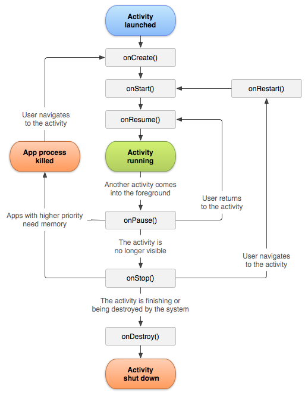

#Activity

Activity là một thành phần độc lập và có thể tái sử dụng, tương tác với người dùng bằng cách cung cấp các tài nguyên liên quan đến user interface. Mỗi ứng dụng Android phải có ít nhất một hoạt động để vào ứng dụng và tương tác với người dùng.

## Activity Lifecycle

Activities trong hệ thống được quản lý dưới dạng ngăn xếp hoạt động. Khi một hoạt động mới được bắt đầu, nó thường được đặt ở đầu ngăn xếp hiện tại và trở thành hoạt động đang chạy, hoạt động trước đó luôn ở bên dưới hoạt động đó trong ngăn xếp và sẽ không xuất hiện trở lại nền trước cho đến khi hoạt động mới thoát ra. Có thể có một hoặc nhiều ngăn xếp hoạt động hiển thị trên màn hình.

Một hoạt động về cơ bản có bốn trạng thái:

- Nếu một hoạt động ở nền trước của màn hình (ở vị trí cao nhất của ngăn xếp trên cùng), thì đó là **ACTIVE (còn gọi là RUNNING)**. Đây thường là hoạt động mà người dùng hiện đang tương tác.
- Nếu một hoạt động bị mất tiêu điểm nhưng vẫn hiển thị cho người dùng thì đó là **VISIBLE**. Có thể xảy ra trường hợp một hoạt động trong suốt hoặc không có kích thước đầy đủ mới tập trung vào đầu hoạt động của bạn, một hoạt động khác có vị trí cao hơn trong chế độ nhiều cửa sổ hoặc bản thân hoạt động đó không thể lấy tiêu điểm ở chế độ cửa sổ hiện tại. Hoạt động như vậy hoàn toàn tồn tại (nó duy trì tất cả thông tin trạng thái và thành viên và vẫn được gắn với trình quản lý cửa sổ).
- Nếu một hoạt động bị che khuất hoàn toàn bởi một hoạt động khác thì đó là **STOPPED (còn gọi là HIDDEN)**. Nó vẫn giữ lại tất cả thông tin trạng thái và thành viên, tuy nhiên, người dùng không còn nhìn thấy nó nữa nên cửa sổ của nó bị ẩn và nó thường sẽ bị hệ thống tắt khi cần bộ nhớ ở nơi khác.
- Hệ thống có thể loại bỏ hoạt động khỏi bộ nhớ bằng cách yêu cầu nó kết thúc hoặc chỉ cần loại bỏ process của nó, biến nó thành **DESTROYED**. Khi nó được hiển thị lại cho người dùng, nó phải được khởi động lại hoàn toàn và khôi phục về trạng thái trước đó.

Có ba vòng chính mà bạn có thể muốn theo dõi trong hoạt động của mình:

- **toàn bộ thời gian** của một hoạt động diễn ra từ lệnh gọi đầu tiên tới `onCreate()` cho đến lệnh gọi cuối cùng tới `onDestroy()`

-  **thời gian hiển thị** của một hoạt động diễn ra giữa lệnh gọi đến `onStart()` cho đến khi có lệnh gọi tương ứng tới `onStop()`. Trong thời gian này, người dùng có thể xem hoạt động trên màn hình, mặc dù hoạt động đó có thể không ở nền trước và tương tác với người dùng.

- **Thời gian tồn tại ở nền trước** của một hoạt động diễn ra giữa lệnh gọi tới `onResume()` cho đến khi có lệnh gọi tương ứng tới `onPause()`
  
  | Phương pháp | Mô tả | Có thể giết được?             | Tiếp theo |
  | ------------------------------------------------------------------------------------------------------------------------------------------------------------- | -------------------------------------------------------------------------------------------------------------------------------------------------------------------------------------------------------------------------------------------------------------------------------------------------------------------------------------------------------------------------------------------------- | ---------------------- | ------- |
  | onCreate() |  Activity hiển thị và sẵn sàng tương tác với người dùng. Ứng dụng vẫn ở trạng thái này cho đến khi có điều gì đó làm gián đoạn nó: một cuộc gọi điện thoại, màn hình tắt, người dùng chuyển sang hoạt động khác, v.v. Bạn có thể sử dụng phương pháp này để tiếp tục mọi thứ vốn chỉ hoạt động khi hiển thị Activity. Nếu nó bị gián đoạn, phương thức `onPause()` sẽ được gọi.                                                                                               |                        |         |
  |  Luôn theo sau là onStart().                                                                                                            | Không | onStart() |         |
  | onRestart() | Được gọi sau khi hoạt động của bạn đã bị dừng, trước khi hoạt động đó được bắt đầu lại.                                                                                                                                                                                                                                                                                                     |                        |         |
  |  Luôn được theo sau bởi onStart() | Không | onStart() |         |
  | onStart() | Được gọi khi hoạt động được hiển thị cho người dùng.                                                                                                                                                                                                                                                                                                                         |                        |         |
  |  Theo sau là onResume() nếu hoạt động xuất hiện ở nền trước hoặc onStop() nếu hoạt động bị ẩn.                                        | Không | onResume() hoặc onStop() |         |
  | onResume() | Được gọi khi hoạt động sẽ bắt đầu tương tác với người dùng. Tại thời điểm này, hoạt động của bạn ở trên cùng của ngăn xếp hoạt động, với thông tin đầu vào của người dùng sẽ được đưa vào hoạt động đó.                                                                                                                                                                                                                      |                        |         |
  |  Luôn theo sau là onPause().                                                                                                            | Không | onPause() |         |
  | onPause() | Được gọi khi hoạt động mất trạng thái tiền cảnh, không thể lấy tiêu điểm được nữa hoặc trước khi chuyển sang trạng thái dừng/ẩn hoặc bị hủy. Hoạt động này vẫn hiển thị với người dùng, vì vậy, bạn nên duy trì hoạt động này một cách trực quan và tiếp tục cập nhật UI. Việc triển khai phương pháp này phải rất nhanh vì hoạt động tiếp theo sẽ không được tiếp tục cho đến khi phương thức này quay trở lại. |                        |         |
  |  Theo sau là onResume() nếu hoạt động quay trở lại phía trước hoặc onStop() nếu hoạt động trở nên ẩn đối với người dùng.                | Xây dựng trước.VERSION_CODES.HONEYCOMB | onResume() hoặc |         |
  |  onStop() |                                                                                                                                                                                                                                                                                                                                                                                   |                        |         |
  | onStop() | Được gọi khi hoạt động không còn hiển thị với người dùng. Điều này có thể xảy ra do một hoạt động mới đang được bắt đầu ở trên cùng, một hoạt động hiện có đang được đưa lên trước hoạt động này hoặc hoạt động này đang bị hủy. Điều này thường được sử dụng để dừng hoạt ảnh và làm mới UI, v.v. |                        |         |
  |  Được theo sau bởi onRestart() nếu hoạt động này quay trở lại để tương tác với người dùng hoặc onDestroy() nếu hoạt động này không còn nữa. | Có | onRestart() hoặc |         |
  |  onDestroy() |                                                                                                                                                                                                                                                                                                                                                                                   |                        |         |
  | onDestroy() | Cuộc gọi cuối cùng bạn nhận được trước khi hoạt động của bạn bị hủy. Điều này có thể xảy ra do hoạt động đang kết thúc (ai đó có tên Activity#finish trên hoạt động đó) hoặc do hệ thống đang tạm thời hủy phiên bản hoạt động này để tiết kiệm dung lượng. Bạn có thể phân biệt giữa hai tình huống này bằng phương thức isFinishing().                                        | Có | không có gì |

