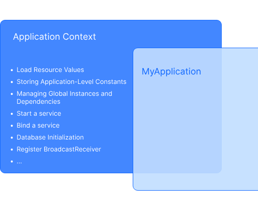
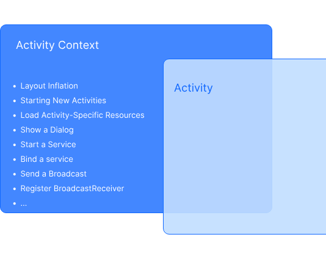

# Ứng dụng và bối cảnh

## Lớp Ứng dụng

Lớp `Application` đóng vai trò trung tâm trong ứng dụng lifecycle và đại diện cho điểm khởi đầu của bất kỳ ứng dụng Android nào. 

Lớp này là lớp cơ bản để giám sát trạng thái chung của ứng dụng và chịu trách nhiệm về một số hoạt động thiết lập nhất định phải diễn ra trước khi các thành phần chính của ứng dụng, như Activities, Dịch vụ hoặc BroadcastReceivers, được khởi tạo.

Khi một ứng dụng được khởi chạy, hệ thống Android sẽ tự động tạo một phiên bản của lớp `Application`. Lớp này có vai trò then chốt là hướng dẫn ứng dụng thông qua toàn bộ lifecycle của nó. Đáng chú ý, chỉ có một phiên bản của lớp Ứng dụng cho mỗi ứng dụng để đảm bảo quản lý nhất quán. Phiên bản duy nhất này bắt đầu hoạt động trước bất kỳ thành phần ứng dụng nào khác và tiếp tục cho đến khi ứng dụng đóng hoặc bị xóa khỏi bộ nhớ của hệ thống.

## Lifecycle của ứng dụng

Lớp `Application` cung cấp cho nhà phát triển các cách để quản lý những gì xảy ra ở các giai đoạn khác nhau trong vòng đời của ứng dụng. Dưới đây là những phần chính:

- **onCreate()**: khi ứng dụng khởi động, việc đầu tiên nó làm là chạy phương thức này. Tại đây, nó chuẩn bị mọi thứ cần thiết để ứng dụng hoạt động bình thường, chẳng hạn như thiết lập tài nguyên và chuẩn bị sẵn sàng các thư viện.

- **onConfigurationChanged()**: khi có thay đổi về cấu hình thiết bị, chẳng hạn như xoay màn hình hoặc cài đặt ngôn ngữ, phương pháp này đảm bảo ứng dụng sẽ điều chỉnh và hoạt động chính xác.

- **onLowMemory()**: nếu thiết bị sắp hết bộ nhớ, phương pháp này sẽ được kích hoạt, nhắc ứng dụng quản lý tài nguyên hiệu quả hơn để tiếp tục hoạt động trơn tru.

- **onTrimMemory()**: Khi hệ thống yêu cầu ứng dụng của bạn giải phóng một số bộ nhớ, phương thức này sẽ được kích hoạt. Nó cung cấp chi tiết cụ thể về lượng bộ nhớ cần được lưu. Sau đó, ứng dụng có thể quyết định cách phản hồi dựa trên mức độ khẩn cấp của tình huống bộ nhớ.


## Phân lớp lớp Ứng dụng

Để tạo triển khai tùy chỉnh, hãy làm theo các bước sau:

1. **Mở rộng lớp Ứng dụng**. Tạo một lớp mới trong dự án Android mở rộng lớp cơ sở `android.app.Application`.
Bây giờ bạn có thể ghi đè các phương thức được đề cập trước đó để quản lý lifecycle của ứng dụng của mình:

```kotlin
package com.example.myapp

import android.app.Application

class MyApp : Application() {

    override fun onCreate() {
        super.onCreate()

        // Initialize and set up your custom global state here
        // For instance, setting up analytics, database, or other services.
    }

    // You can add other methods or override other `Application` methods if needed
}
```

2. **Xác định lớp ứng dụng tùy chỉnh trong tệp kê khai**. Thêm lớp ứng dụng tùy chỉnh vào tệp bằng cách sử dụng các thuộc tính trong phần tử.
Điều này yêu cầu hệ thống Android sử dụng lớp tùy chỉnh của bạn để quản lý trạng thái toàn cầu của ứng dụng.

```xml
<manifest xmlns:android="http://schemas.android.com/apk/res/android"
    package="com.example.myapp">

    <application
        android:name=".MyApp"  <!-- This points to your custom Application subclass -->
        android:icon="@mipmap/ic_launcher"
        android:label="@string/app_name"
        android:theme="@style/AppTheme">

        <!-- Other components like activities, services, etc. -->

    </application>

</manifest>
```

3. **Truy cập các lớp ứng dụng tùy chỉnh**. Sau đó, bạn có thể truy cập các lớp ứng dụng tùy chỉnh trong toàn bộ ứng dụng của mình, cho phép bạn chia sẻ dữ liệu và quản lý tài nguyên trên toàn cầu. Để truy cập lớp ứng dụng tùy chỉnh của bạn, hãy truyền kết quả thuộc tính `applicationContext` của bất kỳ Activity, Dịch vụ hoặc BroadcastReceiver nào vào lớp tùy chỉnh của bạn.

## Bối cảnh

**Ngữ cảnh** là khái niệm cốt lõi giúp kết nối ứng dụng với hệ điều hành Android lớn hơn.
Đó là đường dẫn mà qua đó các ứng dụng có thể truy cập tài nguyên hệ thống, dịch vụ và thông tin cụ thể về môi trường ứng dụng.
Điều này có nghĩa là khi sử dụng Ngữ cảnh, các ứng dụng có thể truy cập vào các dịch vụ hệ thống, truy xuất tài nguyên, khởi chạy hoạt động, truyền phát tin nhắn, truy cập các thư mục cụ thể và quản lý quyền. Về cơ bản, đó là cách ứng dụng hiểu và tương tác với môi trường xung quanh trong hệ sinh thái Android.

Mỗi Activity và Dịch vụ có Ngữ cảnh liên kết riêng, khác với Ngữ cảnh ứng dụng.
Do đó, tổng số Ngữ cảnh trong một ứng dụng được tính bằng tổng của số Activities, số lượng Dịch vụ, cộng với một đại diện cho Ngữ cảnh ứng dụng.

Đối với các thành phần khác như Nhà cung cấp nội dung và Bộ thu phát sóng, không phải là lớp con của Ngữ cảnh: chúng không được tính là Ngữ cảnh riêng biệt.
Tuy nhiên, điều quan trọng cần lưu ý là các thành phần này thường yêu cầu quyền truy cập vào đối tượng `Context` khi chúng được tạo hoặc thực thi để tương tác với hệ thống và tài nguyên Android một cách hiệu quả.

### Truy xuất bối cảnh

Có ba thuộc tính chính để có được Ngữ cảnh:

- **applicationContext**: cung cấp cho bạn bối cảnh rộng hơn bao trùm toàn bộ ứng dụng. Bối cảnh này vẫn tồn tại miễn là ứng dụng của bạn đang chạy. Vì nó không được liên kết cụ thể với bất kỳ thành phần UI nào nên bạn sẽ không sử dụng nó cho các tác vụ như bắt đầu một hoạt động hoặc tăng cường phần tử UI. **Thay vào đó, tính năng này rất phù hợp cho các hành động trên toàn ứng dụng như khởi động dịch vụ hoặc truyền phát tin nhắn.**



- Thuộc tính **context** cung cấp cho bạn một bối cảnh được gắn cụ thể với thành phần bạn đang tham gia, chẳng hạn như Activity hoặc View. Ngữ cảnh này được liên kết với lifecycle của thành phần đó, làm cho nó phù hợp với các tác vụ liên quan đến UI- chẳng hạn như tăng cường bố cục hoặc hiển thị hộp thoại. Khi thành phần (ví dụ: Activity) bị hủy, bối cảnh của nó cũng bị xóa.



- **baseContext** là thuộc tính được liên kết với lớp `ContextWrapper` trong Android. Thuộc tính này cho phép bạn truy xuất Ngữ cảnh gốc hoặc ngữ cảnh cơ bản mà `ContextWrapper` đang bao quanh hoặc ủy quyền. Nói một cách đơn giản hơn, khi bạn có `ContextWrapper` sửa đổi hoặc mở rộng hành vi của Ngữ cảnh, thuộc tính `baseContext` sẽ cung cấp cho bạn quyền truy cập vào Ngữ cảnh gốc, chưa sửa đổi đó bên trong trình bao bọc. Thông thường, bạn hiếm khi cần sử dụng tính năng này. Tuy nhiên, nó trở nên đặc biệt tiện dụng khi bạn muốn đảm bảo rằng không có lớp tạo kiểu hoặc chủ đề bổ sung nào cản trở hoạt động của bạn. Khi sử dụng các dạng xem hoặc thao tác không cần có chủ đề của hoạt động hoặc ứng dụng hiện tại, ngữ cảnh này sẽ trở nên hữu ích.


Tóm lại, mặc dù **applicationContext** cung cấp phạm vi rộng hơn và có thể truy cập hầu hết các chức năng, nhưng nó nên được sử dụng cho các tác vụ không phải UI. Mặt khác, `context` phù hợp hơn cho các hoạt động liên quan đến UI- trong bối cảnh thành phần UI hiện tại. Việc chọn bối cảnh phù hợp dựa trên nhiệm vụ hiện tại là rất quan trọng trong Android để đảm bảo hoạt động trơn tru và tránh những cạm bẫy tiềm ẩn như rò rỉ bộ nhớ.

### Bối cảnh so với applicationContext


|           | **Bối cảnh** | **Bối cảnh ứng dụng** |
|------------------------|---------------------------------------------------------------------------------------------------------------------------------------------------|-------------------------------------------------------------------------------------------------------------------|
| **Phạm vi** | Thành phần cụ thể. Được sử dụng trong giới hạn của thành phần UI cụ thể chẳng hạn như Activity, Fragment hoặc View.                    | Toàn ứng dụng. Đại diện cho trạng thái toàn cầu của toàn bộ ứng dụng.                                          |
| **Tuổi thọ** | Liên kết chặt chẽ với lifecycle của thành phần mẹ. Khi thành phần gốc (như Activity) bị hủy, bối cảnh này cũng bị loại bỏ. | Vẫn tồn tại miễn là process của ứng dụng đang chạy, từ khi bắt đầu ứng dụng cho đến khi chấm dứt.      |
| **Cách sử dụng** | Các thao tác liên quan đến UI- (bố cục, chúc mừng, hộp thoại) | Hoạt động trên toàn ứng dụng (dịch vụ, chương trình phát sóng, tài nguyên cấp ứng dụng) |
| **Chủ đề** | Tuân thủ các cấu hình UI (chủ đề, kiểu dáng) của thành phần gốc, đảm bảo các phần tử UI vẫn nhất quán về hình thức.   | Không mang theo các sửa đổi UI cụ thể |
| **Cạm bẫy tiềm ẩn** | Ví dụ: có thể dẫn đến rò rỉ bộ nhớ nếu tác vụ nền chạy dài tham chiếu bối cảnh Activity và Activity bị hủy trước khi tác vụ hoàn thành. | Mặc dù nó tránh được nhiều cạm bẫy trong các bối cảnh khác, nhưng việc sử dụng nó để trực tiếp thao tác hoặc trình bày UI có thể dẫn đến sự mâu thuẫn. |


