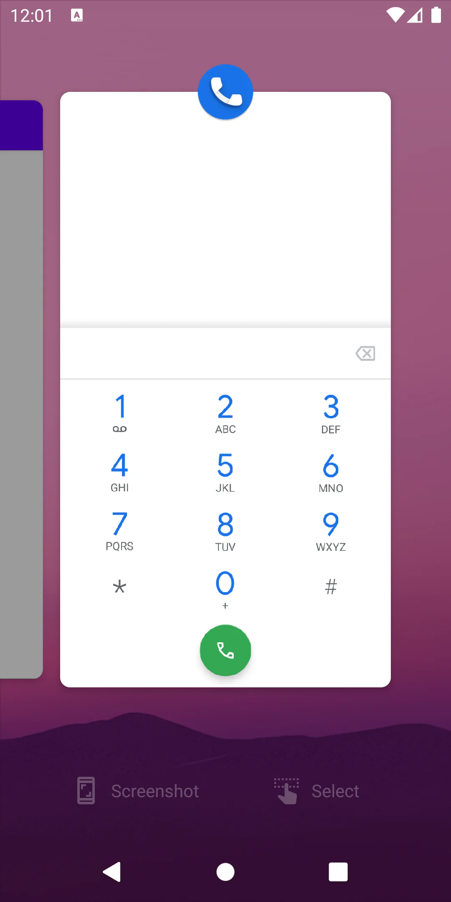
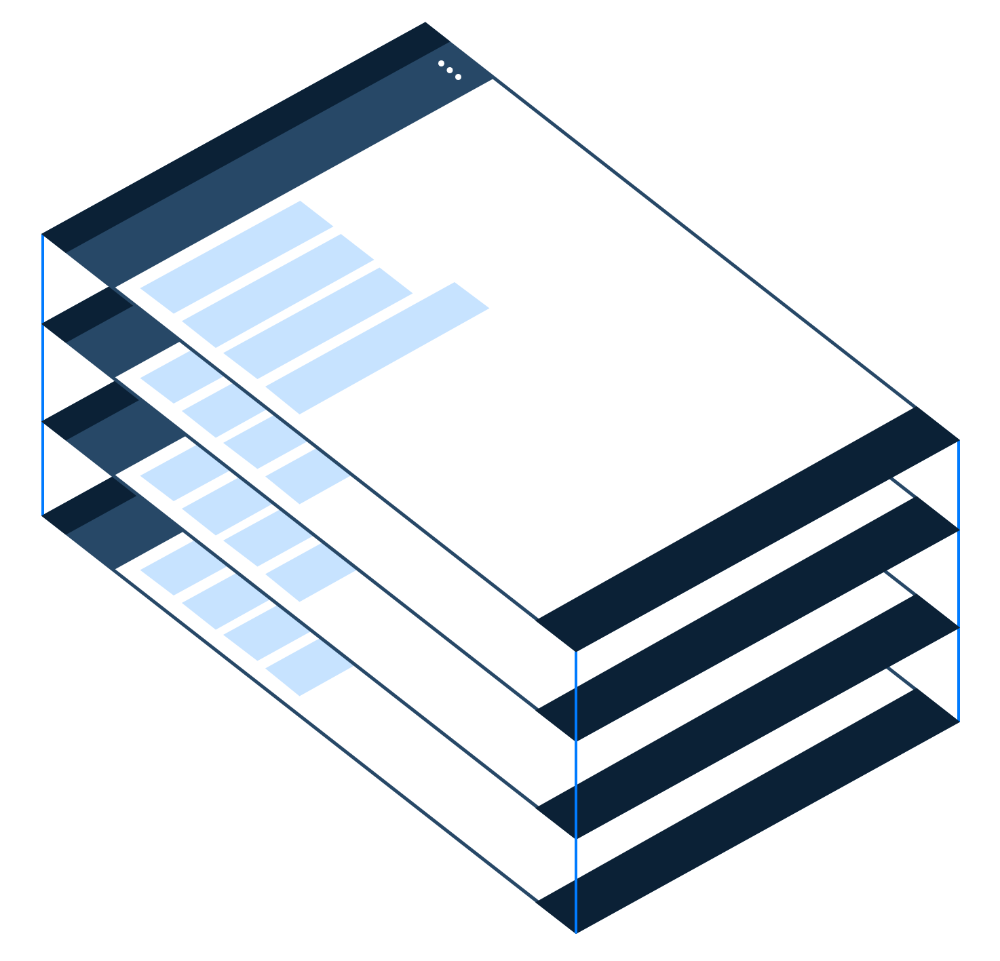
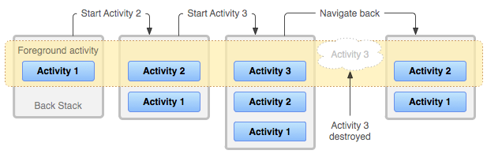
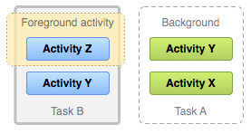
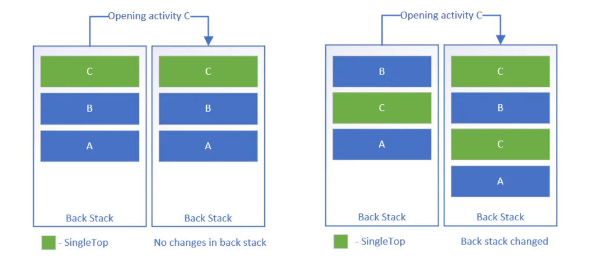
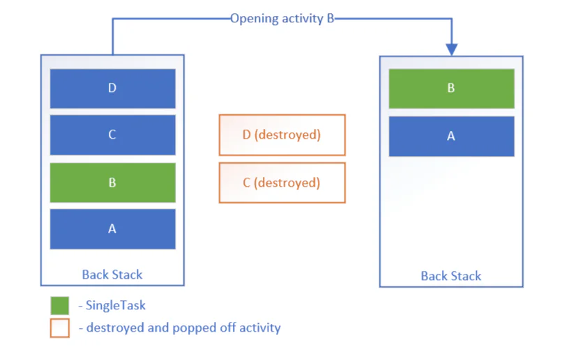
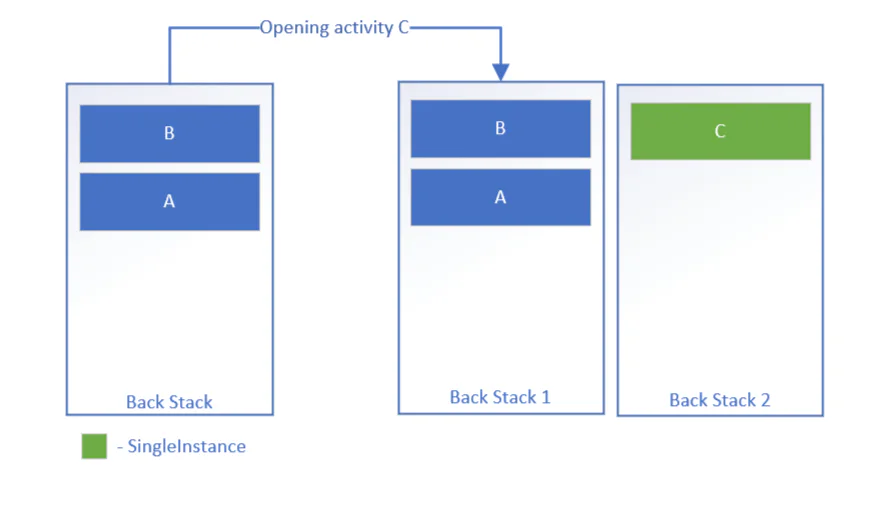

# Nhiệm vụ và back stack

**tác vụ** là collection gồm các hoạt động mà người dùng tương tác khi sử dụng ứng dụng.
Activities được xếp chồng lên nhau trong **back stack** theo thứ tự chúng được mở.
Trong chủ đề này, bạn sẽ tìm hiểu thêm về các tác vụ và back stack.
Bạn sẽ tìm hiểu **chế độ khởi chạy** là gì và cách sử dụng **cờ** Intent khi phát triển ứng dụng của mình.

## Nhiệm vụ và back stack

Nếu bạn nhấp vào nút "Mở gần đây" trên điện thoại của mình, bạn sẽ thấy danh sách các tác vụ:



Các hoạt động trong một nhiệm vụ được sắp xếp thành một ngăn xếp (được gọi là back stack).
Bạn có thể thấy một hình dung về điều này dưới đây:



## Lifecycle của một nhiệm vụ và back stack của nó

Màn hình chính của thiết bị là điểm bắt đầu cho hầu hết các Tác vụ. Khi người dùng chạm vào biểu tượng của ứng dụng hoặc lối tắt trong trình khởi chạy ứng dụng (hoặc trên màn hình chính), tác vụ của ứng dụng đó sẽ được đưa lên nền trước. Nếu không có tác vụ nào cho ứng dụng (ứng dụng chưa được sử dụng gần đây) thì một tác vụ mới sẽ được tạo và hoạt động chính của ứng dụng đó sẽ mở ra dưới dạng hoạt động gốc trên ngăn xếp.


Khi Activity hiện tại khởi động một Activity khác, Activity mới được đẩy lên đầu ngăn xếp và lấy tiêu điểm. Activity trước đó vẫn còn trong ngăn xếp nhưng đã bị dừng.
Khi Activity dừng, hệ thống sẽ giữ nguyên trạng thái hiện tại của user interface.
Khi người dùng thực hiện một hành động quay lại, Activity hiện tại sẽ được bật lên từ đầu ngăn xếp (hoạt động bị hủy) và hoạt động trước đó sẽ tiếp tục lại (trạng thái trước đó của user interface của nó được khôi phục). 

Activities trong ngăn xếp không bao giờ được sắp xếp lại, chỉ được đẩy và bật ra khỏi ngăn xếp—được đẩy lên ngăn xếp khi bắt đầu bởi hoạt động hiện tại và bật ra khi người dùng rời khỏi ngăn xếp đó bằng cách sử dụng nút Quay lại hoặc cử chỉ. Do đó, back stack hoạt động như một cấu trúc đối tượng **vào sau, ra trước**. Hình bên dưới trực quan hóa hành vi này bằng dòng thời gian hiển thị tiến trình giữa các hoạt động cùng với back stack hiện tại tại mỗi thời điểm.



Nếu người dùng tiếp tục nhấn hoặc cử chỉ Quay lại thì mỗi Activity trong ngăn xếp sẽ bật ra để hiển thị Activity trước đó cho đến khi người dùng quay lại Màn hình chính (hoặc bất kỳ Activity nào đang chạy khi tác vụ bắt đầu). Khi tất cả Activities bị xóa khỏi ngăn xếp, Tác vụ sẽ không còn tồn tại.


### Hành vi nhấn quay lại đối với các hoạt động của trình khởi chạy gốc

Hoạt động của trình khởi chạy gốc là các hoạt động khai báo bộ lọc Intent với cả `ACTION_MAIN` và `CATEGORY_LAUNCHER`. Các hoạt động này là duy nhất vì chúng đóng vai trò là điểm truy cập vào ứng dụng của bạn từ trình khởi chạy ứng dụng và được dùng để bắt đầu Tác vụ.

Khi người dùng nhấn hoặc cử chỉ Quay lại từ hoạt động của trình khởi chạy gốc, hệ thống sẽ xử lý sự kiện này theo cách khác nhau tùy thuộc vào phiên bản Android mà thiết bị đang chạy.

Hoạt động của hệ thống trên Android 11 trở xuống:
- Hệ thống kết thúc hoạt động.
Hoạt động của hệ thống trên Android 12 trở lên:
- Hệ thống chuyển hoạt động và nhiệm vụ của nó xuống nền thay vì kết thúc hoạt động. Hành vi này khớp với hành vi mặc định của hệ thống khi điều hướng ra khỏi ứng dụng bằng nút Home hoặc cử chỉ.


Trong hầu hết các trường hợp, hành vi này có nghĩa là người dùng có thể nhanh chóng tiếp tục ứng dụng của bạn từ [trạng thái ấm](https://developer.android.com/topic/performance/vitals/launch-time#warm) thay vì phải khởi động lại hoàn toàn ứng dụng từ [trạng thái lạnh](https://developer.android.com/topic/performance/vitals/launch-time#cold).

Nếu bạn cần [cung cấp điều hướng quay lại tùy chỉnh](https://developer.android.com/guide/navigation/navigation-custom-back), chúng tôi khuyên bạn nên sử dụng API AndroidX Activity, thay vì ghi đè **onBackPressed()**. API AndroidX Activity tự động tuân theo hành vi thích hợp của hệ thống nếu không có thành phần nào chặn hệ thống nhấn nút Quay lại.
Tuy nhiên, nếu ứng dụng của bạn ghi đè onBackPressed() để xử lý điều hướng Quay lại và hoàn thành Activity, hãy cập nhật cách triển khai của bạn để gọi super.onBackPressed() thay vì kết thúc(). Việc gọi super.onBackPressed() sẽ chuyển Activity và Nhiệm vụ của nó xuống nền khi thích hợp và cung cấp trải nghiệm điều hướng nhất quán hơn cho người dùng trên các ứng dụng.

## Tác vụ nền và nền trước

Tác vụ là một đơn vị gắn kết có thể di chuyển xuống nền khi người dùng bắt đầu Tác vụ mới hoặc truy cập Màn hình chính. Mặc dù ở chế độ nền, tất cả Activities trong Nhiệm vụ đều bị dừng nhưng back stack của Nhiệm vụ vẫn còn nguyên—Tác vụ chỉ đơn giản là mất tiêu điểm trong khi một Nhiệm vụ khác diễn ra, như minh họa trong hình. Sau đó, Tác vụ có thể quay lại nền trước để người dùng có thể tiếp tục từ nơi họ đã dừng lại.




## Quản lý tác vụ

Ví dụ: bạn có thể muốn một hoạt động trong ứng dụng của mình bắt đầu một tác vụ mới khi nó được bắt đầu, thay vì được đặt trong tác vụ hiện tại. Hoặc, khi bạn bắt đầu một hoạt động, bạn có thể muốn đưa ra một phiên bản hiện có của hoạt động đó, thay vì tạo một phiên bản mới trên back stack. Hoặc bạn có thể muốn back stack của mình bị xóa khỏi tất cả các hoạt động ngoại trừ hoạt động gốc khi người dùng rời khỏi tác vụ.


Đây là các thuộc tính `<activity>` chính mà bạn có thể sử dụng để quản lý tác vụ:

- taskAffinity
- launchMode
- allowTaskReparenting
- clearTaskOnLaunch
- alwaysRetainTaskState
- finishOnTaskLaunch

## Chế độ khởi chạy

Các chế độ khởi chạy cho phép bạn chỉ định cách liên kết phiên bản mới của Activity với tác vụ hiện tại. Bạn có thể xác định các chế độ khởi chạy khác nhau theo hai cách:

1. Xác định chế độ khởi chạy bằng tệp kê khai
2. Xác định chế độ khởi chạy bằng cờ Intent

### Xác định chế độ khởi chạy bằng cấu hình tệp kê khai

Khi khai báo Activity trong tệp Manifest, bạn có thể chỉ định cách Activity sẽ được liên kết với Tác vụ bằng cách sử dụng thuộc tính `launchMode` của phần tử `<activity>`.

Có bốn chế độ khởi chạy hoạt động có sẵn:
- `standard`

Chế độ khởi chạy mặc định. Hệ thống tạo một hoạt động mới và định tuyến Intent tới hoạt động đó.
Hoạt động này được đẩy lên trên cùng của ngăn xếp, ngay cả khi hoạt động tương tự đã được **nền trước**.

- `singleTop`

Chế độ này hoạt động khác với `standard` nếu hoạt động bạn muốn bắt đầu đã ở trên cùng của ngăn xếp.
Thay vì tạo lại, hệ thống định tuyến Intent đến phiên bản hiện có thông qua lệnh gọi đến phương thức `onNewIntent()`.

Ví dụ:
Ngăn xếp bao gồm ba hoạt động (A-B-C). C nằm ở đầu ngăn xếp với chế độ khởi chạy được đặt thành `singleTop`.

Trong trường hợp này, nếu bạn cố gắng mở lại hoạt động C, ngăn xếp sẽ vẫn giữ nguyên (A-B-C) và phương thức `onNewIntent()` sẽ được gọi.

Tuy nhiên, nếu các hoạt động được sắp xếp khác nhau để bắt đầu bằng (A-C-B), việc gọi lại hoạt động C sẽ thay đổi ngăn xếp (A-C-B-C), như bạn có thể thấy bên dưới.



- `singleTask`

Hãy cẩn thận với chế độ khởi chạy này vì hành vi của nó có vẻ lạ đối với hầu hết người dùng.

Tại một thời điểm, chỉ có thể tồn tại một phiên bản của hoạt động với chế độ khởi chạy này.

Vì vậy, nếu hoạt động này chưa tồn tại trong tác vụ, nó sẽ được tạo và đẩy lên đầu ngăn xếp (giống như với chế độ `standard`).

Nhưng nếu nó tồn tại, tất cả các hoạt động được đặt cao hơn trong ngăn xếp sẽ bị hủy ngay lập tức, để lộ hoạt động đã được gọi và kích hoạt phương thức `onNewIntent()`.

Ví dụ:
Bốn hoạt động đã được đẩy vào ngăn xếp (A-B-C-D) và hoạt động B đã được gán chế độ khởi chạy `singleTask`. Như được hiển thị bên dưới, việc gọi hoạt động B sẽ loại hoạt động C và D ra khỏi ngăn xếp, chỉ còn lại A và B.



Tài liệu chính thức dành cho nhà phát triển Android mô tả hành vi của chế độ này theo cách khác:
"Hệ thống tạo một nhiệm vụ mới và khởi tạo hoạt động ở gốc của nhiệm vụ mới."
"Root" ở đây là mục (hoạt động) đầu tiên trong tác vụ.

Thuộc tính `taskAffinity` được sử dụng để chỉ định tác vụ nào mà hoạt động muốn thuộc về và giá trị mặc định của nó về cơ bản chỉ là tên gói ứng dụng của bạn.

Bạn có thể thay đổi `taskAffinity` trong thẻ `<activity />` có liên quan, thẻ này nằm trong tệp `AndroidManifest.xml`.

Tuy nhiên, hành vi được mô tả trong tài liệu chỉ áp dụng khi thuộc tính `taskAffinity` không được đặt thành giá trị mặc định.
Và sau khi thay đổi `taskAffinity`, `singleTask` sẽ hoạt động chính xác như tài liệu chính thức mô tả.

- `singleInstance`.

Chế độ này giống với `singleTask`, ngoại trừ hoạt động có chế độ khởi chạy này sẽ luôn là thành viên duy nhất của nhiệm vụ. Nếu một hoạt động `singleInstance` khởi chạy một hoạt động khác thì hoạt động đó sẽ được khởi chạy trong một tác vụ khác (Back Stack).

Ví dụ:
Ngăn xếp đã chứa hai hoạt động tiêu chuẩn (A-B). Activity C được đặt thành singleInstance, do đó việc khởi chạy nó sẽ tạo ra một tác vụ mới (A-B)(C), như bạn có thể thấy trong sơ đồ bên dưới.




- `singleInstancePerTask`. 

Activity chỉ có thể chạy dưới dạng hoạt động gốc của một tác vụ, nghĩa là đây là Activity đầu tiên tạo tác vụ, vì vậy chỉ có thể có một phiên bản của Activity này trong một tác vụ. Không giống như chế độ khởi chạy `singleTask`, Activity này có thể được khởi động trong nhiều phiên bản trên các tác vụ khác nhau nếu cờ `FLAG_ACTIVITY_MULTIPLE_TASK` hoặc `FLAG_ACTIVITY_NEW_DOCUMENT` được đặt.


> [!NOTE]
> singleTask và singleInstancePerTask sẽ xóa tất cả các hoạt động nằm trên hoạt động bắt đầu khỏi nhiệm vụ. Ví dụ: giả sử một tác vụ bao gồm hoạt động gốc A với các hoạt động B, C (tác vụ là A-B-C; C ở trên cùng). Một ý định xuất hiện cho một hoạt động thuộc loại A. Nếu chế độ khởi chạy của A là singleTask hoặc singleInstancePerTask, thì phiên bản hiện tại của A sẽ nhận được ý định đó thông qua onNewIntent(). B và C đã hoàn thành và nhiệm vụ bây giờ là A.

---

Chúng được xác định trong tệp `AndroidManifest.xml` trong thẻ hoạt động:

```xml
<manifest xmlns:android="<http://schemas.android.com/apk/res/android>"
    package="com.hyperskill.tasks">

    <application ...> <!-- skipped some attributes -->

        <activity
            android:name=".SecondActivity"
            android:launchMode="standard" />

        <activity ...>
            <!-- intent-filter etc -->
        </activity>
    </application>
</manifest>
```
## Cờ Intent

Việc thực hiện các thay đổi về chế độ khởi chạy trong tệp kê khai sẽ hoạt động tốt khi bạn luôn cần hành vi tương tự nhưng không thể thực hiện được chúng trong runtime.

May mắn thay, cờ Intent mang lại sự linh hoạt hơn.

Ví dụ:

Các ứng dụng thường gửi thông báo tương tác: bạn nhấp vào chúng và một hoạt động sẽ bật lên.

Nếu những thông báo này liên tục lặp lại, việc nhấn nút "Quay lại" hàng triệu lần để đóng tất cả các hoạt động đã tạo sẽ thực sự khó chịu.

Cờ Intent có thể giúp chúng ta giải quyết những vấn đề như thế này, vì vậy hãy cùng tìm hiểu về một số trong số chúng:

- `FLAG_ACTIVITY_SINGLE_TOP` Nếu hoạt động đang được khởi chạy đã ở trên cùng của ngăn xếp tác vụ hiện tại, hệ thống sẽ không tạo phiên bản mới mà thay vào đó sẽ cung cấp ý định mới cho hoạt động hiện có thông qua phương pháp `onNewIntent()`. Hành vi này tương tự như chế độ khởi chạy `singleTop`

- `FLAG_ACTIVITY_NEW_TASK` Cờ này yêu cầu hệ thống khởi chạy hoạt động trong một nhiệm vụ mới. Nếu một tác vụ đã tồn tại cho hoạt động đã khởi chạy thì tác vụ đó sẽ được đưa lên nền trước và hoạt động đó sẽ nhận được mục đích mới trong `onNewIntent()`. Hành vi này tương tự như chế độ khởi chạy `singleTask`.

- `FLAG_ACTIVITY_CLEAR_TOP` xem liệu hoạt động đã tồn tại trong ngăn xếp hay chưa. Nếu đúng như vậy, nó sẽ phá hủy mọi hoạt động ở trên, dẫn đến hoạt động đó nằm ở đầu ngăn xếp. Nếu nó chưa tồn tại, nó sẽ tạo hoạt động theo cách thông thường.
Việc sử dụng cờ này với `FLAG_ACTIVITY_NEW_TASK` sẽ dẫn đến hoạt động tương tự như chế độ khởi chạy `singleTask` nhưng hoạt động sẽ được khởi động lại.
Để tránh khởi động lại và mất trạng thái hoạt động, hãy sử dụng chế độ khởi chạy `singleTask` trong tệp kê khai.

- `FLAG_ACTIVITY_CLEAR_TASK` xóa ngăn xếp và đặt hoạt động mới mở vào thư mục gốc của ngăn xếp. Nó được sử dụng với `FLAG_ACTIVITY_NEW_TASK`.

- `FLAG_ACTIVITY_REORDER_TO_FRONT` sắp xếp lại hoạt động đã mở lên phía trước. Ví dụ: nếu thứ tự ngăn xếp ban đầu là A-B-C-D và hoạt động A được gọi bằng cờ này thì thứ tự mới của ngăn xếp sẽ là B-C-D-A.

- `FLAG_ACTIVITY_NO_HISTORY` ngăn chặn hoạt động được lưu giữ trong ngăn xếp.

Khi bạn đã quyết định cờ nào bạn muốn sử dụng, bạn cần thêm chúng vào Intent hiện có của mình.
Điều này có thể được thực hiện theo cách sau:

```kotlin
val intent = Intent(this, MainActivity::class.java)
intent.addFlags(Intent.FLAG_ACTIVITY_NEW_TASK)
startActivity(intent)

//in case you want to replace previous flags (if there are any) instead of adding them:

val intent = Intent(this, SecondActivity::class.java)
intent.flags = Intent.FLAG_ACTIVITY_NEW_TASK
startActivity(intent)
```
Hoặc, khi bạn cần nhiều hơn một lá cờ:

```kotlin
val intent = Intent(this, SecondActivity::class.java)
intent.addFlags(Intent.FLAG_ACTIVITY_NEW_TASK or Intent.FLAG_ACTIVITY_CLEAR_TOP)
startActivity(intent)

//in case you want to replace previous flags (if there are any) instead of adding them:

val intent = Intent(this, SecondActivity::class.java)
intent.flags = Intent.FLAG_ACTIVITY_CLEAR_TASK or Intent.FLAG_ACTIVITY_NEW_TASK
startActivity(intent)
```

## Xóa back stack

Nếu người dùng rời khỏi một tác vụ trong thời gian dài, hệ thống sẽ xóa tác vụ đó khỏi tất cả các hoạt động ngoại trừ hoạt động gốc. Khi người dùng quay lại tác vụ lần nữa, chỉ hoạt động gốc được khôi phục. Hệ thống hoạt động theo cách này vì sau một khoảng thời gian dài, người dùng có thể đã từ bỏ những gì họ đang làm trước đây và quay lại nhiệm vụ để bắt đầu một cái gì đó mới.

Có một số thuộc tính hoạt động mà bạn có thể sử dụng để sửa đổi hành vi này:

[alwaysRetainTaskState](https://developer.android.com/guide/topics/manifest/activity-element#always)

    Nếu thuộc tính này được đặt thành `true` trong hoạt động gốc của một tác vụ thì hành vi mặc định vừa mô tả sẽ không xảy ra. Tác vụ giữ lại tất cả các hoạt động trong ngăn xếp của nó ngay cả sau một thời gian dài.

[clearTaskOnLaunch](https://developer.android.com/guide/topics/manifest/activity-element#clear)

    Nếu thuộc tính này được đặt thành `true` trong hoạt động gốc của một tác vụ thì tác vụ đó sẽ bị xóa xuống hoạt động gốc bất cứ khi nào người dùng rời khỏi tác vụ và quay lại tác vụ đó. Nói cách khác, nó trái ngược với [alwaysRetainTaskState](https://developer.android.com/guide/topics/manifest/activity-element#always). Người dùng luôn quay lại nhiệm vụ ở trạng thái ban đầu, ngay cả sau khi rời nhiệm vụ chỉ trong giây lát.

> [!NOTE]
> Thuộc tính này bị bỏ qua nếu FLAG_ACTIVITY_RESET_TASK_IF_NEEDED không được đặt.

[finishOnTaskLaunch](https://developer.android.com/guide/topics/manifest/activity-element#finish)

    Thuộc tính này giống như [clearTaskOnLaunch](https://developer.android.com/guide/topics/manifest/activity-element#clear), nhưng nó hoạt động trên một hoạt động duy nhất chứ không phải toàn bộ nhiệm vụ. Nó cũng có thể khiến bất kỳ hoạt động nào kết thúc, ngoại trừ hoạt động gốc. Khi được đặt thành `true`, hoạt động vẫn chỉ là một phần nhiệm vụ trong phiên hiện tại. Nếu người dùng rời đi và sau đó quay lại nhiệm vụ thì nhiệm vụ đó sẽ không còn tồn tại nữa.

> [!NOTE]
> Thuộc tính này bị bỏ qua nếu FLAG_ACTIVITY_RESET_TASK_IF_NEEDED không được đặt.


Trong Android, có ba cách để xóa back stack:

- **Sử dụng cờ Intent**. Bạn có thể sử dụng Cờ Intent để xóa toàn bộ ngăn xếp và bắt đầu Activity mới. Điều này có thể được thực hiện bằng cách thêm Cờ Intent `FLAG_ACTIVITY_CLEAR_TASK` và `FLAG_ACTIVITY_NEW_TASK` vào Intent khi khởi động Activity mới. Thao tác này sẽ xóa tất cả Activities trên đường dẫn của Activity mới và bắt đầu làm mới với Activity mới.

Ví dụ:

```kotlin
val intent = Intent(this, MainActivity::class.java) 
intent.flags = Intent.FLAG_ACTIVITY_CLEAR_TASK or Intent.FLAG_ACTIVITY_NEW_TASK
 startActivity(intent)
```


- **Sử dụng Phương thức finishAffinity()**. Bạn có thể sử dụng phương pháp `finishAffinity()` để chấm dứt tất cả Activities hiện tại và xóa ngăn xếp. Thao tác này sẽ đưa người dùng trở lại Màn hình chính hoặc màn hình khởi chạy ứng dụng.

Ví dụ

    `finishAffinity()`

- **Sử dụng phương thức finish()**. Bạn có thể sử dụng phương thức finish() để chấm dứt Activity hiện tại và quay lại Activity trước đó trên ngăn xếp. Phương pháp này có thể được sử dụng để kết thúc Activities đã chọn hoặc ngăn chúng được lưu trữ trong ngăn xếp.

Ví dụ:

    `finish()`


