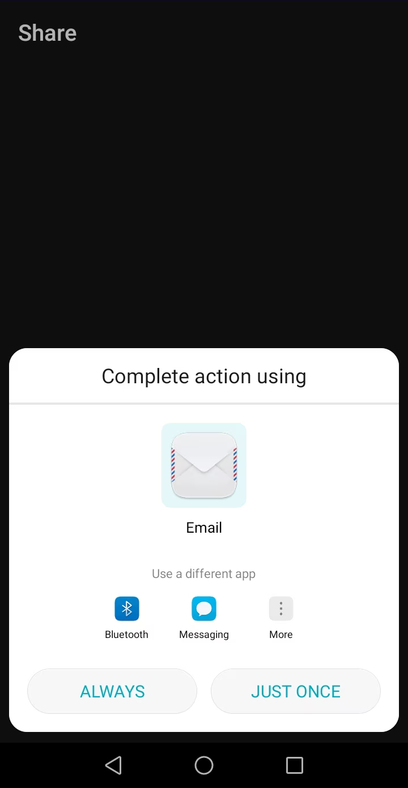

# Bắt đầu Activities: ý định chi tiết

Giao tiếp giữa các thành phần ứng dụng là một phần thiết yếu trong quá trình phát triển Android. Theo thành phần ứng dụng, chúng tôi đang đề cập đến các hoạt động, dịch vụ, bộ thu phát sóng và nhà cung cấp nội dung. Ý tưởng là các thành phần ứng dụng khác nhau, từ cùng một ứng dụng hoặc hai ứng dụng khác nhau, có thể tương tác với nhau.

Ví dụ: giả sử bạn nhấn vào tệp âm thanh trong ứng dụng trình duyệt tệp. Rất có thể ứng dụng trình phát âm thanh sẽ bắt đầu phát tệp âm thanh. Trong trường hợp này, ứng dụng duyệt tệp phải liên lạc với ứng dụng trình phát âm thanh và chuyển vị trí của tệp âm thanh. Một trường hợp khác là trình duyệt tệp có trình phát âm thanh trong một hoạt động khác, chẳng hạn như `PlayerActivity`. Vẫn cần chuyển vị trí tệp âm thanh tới `PlayerActivity`. Để đạt được điều này, chúng ta sẽ sử dụng ý định.

Chủ đề này sẽ chủ yếu tập trung vào giao tiếp giữa **Activities** thông qua **ý định**.

## Ý định


Như bạn đã biết, `Intent` là đối tượng nhắn tin giữa các thành phần ứng dụng. Trong chủ đề Intent, bạn đã biết rằng ý định có thể được sử dụng để khởi chạy các hoạt động và thậm chí truyền dữ liệu giữa các hoạt động. Để làm mới bộ nhớ của bạn, đây là một ví dụ:

```kotlin
val intent = Intent(this, UserActivity::class.java)
intent.putExtra("userName", someData)
startActivity(intent)
```

Với những kiến ​​thức cơ bản về Intent, chúng ta cùng tìm hiểu thêm về chúng nhé!

`Intent` thường chứa một số thông tin. Khi `startActivity()` được gọi, chuyển ý định làm đối số, hệ thống Android chịu trách nhiệm bắt đầu một hoạt động tương ứng. Thông tin trong ý định giúp hệ thống Android tìm ra hoạt động nào sẽ bắt đầu. Trong các phần sau, chúng ta sẽ thảo luận về một số thông tin này.

## Tên thành phần

Đây là tên của thành phần sẽ được bắt đầu. Đây là tùy chọn nhưng cũng là chìa khóa để giải quyết xem `Intent` là **rõ ràng** hay **ngầm**. Khi tên thành phần được cung cấp, ý định sẽ rõ ràng. Tên thành phần có thể được đặt thông qua hàm tạo `Intent`:

```kotlin
// 'this' is the context of an activity assuming we are inside one!
val intent = Intent(this, SomeActivity::class.java)
```

Ở đây, tham chiếu đến hoạt động được viết dưới dạng `NameOfActivity::class.java` được cung cấp dưới dạng tên thành phần (được truyền dưới dạng đối số thứ hai). Khi `startActivity()` được gọi với mục đích trên, hệ thống sẽ mở hoạt động được tham chiếu.

## Hành động

Đây là một chuỗi xác định một hành động sẽ được thực hiện. Một hành động có thể bao gồm chọn một hình ảnh, xem danh bạ, quay số liên hệ, gửi email, v.v. Ví dụ: nếu bạn muốn có ý định khởi chạy ứng dụng điện thoại và quay số, bạn có thể sử dụng hành động `Intent.ACTION_DIAL`, đây là một chuỗi không đổi được xác định trong lớp `Intent`:

```kotlin
// ignore Uri.parse("tel:1234556789") for now
val intent = Intent(Intent.ACTION_DIAL, Uri.parse("tel:123456789"))
startActivity(intent)
```

Vậy nó hoạt động như thế nào? Theo một cách nào đó, ứng dụng điện thoại trong thiết bị của bạn được định cấu hình để chấp nhận ý định bằng hành động được xác định trong `Intent.ACTION_DIAL`. Cách thực hiện việc này là khai báo các bộ lọc ý định với hành động cụ thể cho các hoạt động trong tệp `AndroidManifest.xml` (chúng ta sẽ thảo luận về vấn đề này sau trong chủ đề này). Hệ thống sẽ tìm kiếm các ứng dụng có bộ lọc mục đích phù hợp với mục đích được sử dụng trong `startActivity()`. Nếu tìm thấy một số ứng dụng phù hợp với mục đích, hệ thống sẽ nhắc người dùng chọn một ứng dụng.



> [!NOTE]
> Hành động không phải là thông tin duy nhất được xem xét khi hệ thống lọc các ứng dụng có thể được khởi chạy với mục đích ngầm

Lớp `Intent` có nhiều hằng chuỗi được xác định để tiêu chuẩn hóa, chẳng hạn như `ACTION_SEND` thường được sử dụng để gửi dữ liệu. Bạn có thể chỉ định hành động của riêng mình để sử dụng với ý định. Điều này sẽ được đề cập sau trong chủ đề này!

Như được hiển thị trong đoạn mã ở trên, các hành động có thể được đặt thông qua hàm tạo `Intent()`. Bạn cũng có thể chỉ định các hành động bằng phương thức `setAction()`. Để biết thêm ví dụ, hãy xem một số ý định chung.

## Dữ liệu

Dữ liệu được chuyển đến một ý định dưới dạng đối tượng `Uri` (Mã định danh tài nguyên chung) tham chiếu đến dữ liệu cần xử lý hoặc loại dữ liệu MIME (Phần mở rộng thư Internet đa năng) hoặc cả hai. Như bạn có thể đã đoán, `Uri.parse("tel:123456789")` trong ví dụ trên là dữ liệu. Phương thức `Uri.parse()` được sử dụng để tạo các đối tượng `Uri` từ các chuỗi được định dạng phù hợp. Ví dụ: bạn có thể sử dụng chuỗi "https://www.jetbrains.com/academy/" để tạo đối tượng `Uri` tham chiếu đến trang web của Học viện JetBrains.

Dữ liệu được chỉ định thường đi đôi với hành động. Ví dụ: nếu bạn đang sử dụng hành động `ACTION_VIEW`, dữ liệu có thể là `Uri` trỏ đến vị trí của hình ảnh hoặc tài liệu.

Trong trường hợp URI là `content:` URI, loại được nhà cung cấp đoán từ nội dung nhưng bạn nên chỉ định loại dữ liệu riêng biệt. Điều này là do ứng dụng của bạn chỉ có thể xử lý các loại dữ liệu cụ thể trong khi một số loại dữ liệu có thể có định dạng URI tương tự. Loại MIME bao gồm hai phần: **loại/loại phụ**. Các ví dụ bao gồm: "text/plain", "image/png" hoặc "audio/mpeg". Bạn cũng có thể sử dụng "image/*" hoặc "audio/*" để chỉ bất kỳ loại hình ảnh hoặc âm thanh nào tương ứng. Loại MIME có thể được chỉ định bằng phương pháp `setType()`.

Tham chiếu dữ liệu được chỉ định thông qua hàm tạo Intent hoặc phương thức `setData()`:

```kotlin
val intent = Intent(Intent.ACTION_VIEW)

val webpage: Uri = Uri.parse("https://www.jetbrains.com/academy/")
// Intent.setData(someData) can also be written as Intent.data = someData
intent.data = webpage

startActivity(intent)
```
## Loại

Danh mục đề cập đến một chuỗi chứa thông tin bổ sung về loại thành phần sẽ xử lý ý định. Thông thường, nó không cần thiết cho nhiều ý định. Một danh mục phổ biến bao gồm `Intent.CATEGORY_LAUNCHER`, thường được sử dụng để khởi chạy hoạt động ban đầu của một ứng dụng, chẳng hạn như bởi ứng dụng trình khởi chạy thiết bị. Một số danh mục cũng được định nghĩa là hằng số trong lớp `Intent`.

> [!NOTE]
> Nếu danh mục không được chỉ định, phương thức `startActivity()` luôn xử lý tất cả các ý định đối với danh mục `Intent.CATEGORY_DEFAULT`.

Bạn có thể chỉ định danh mục cho ý định của mình bằng phương thức `addCategory()`.

## Tiện ích bổ sung

Bạn có thể quen thuộc với các tính năng bổ sung. Đây là các cặp khóa-giá trị mang dữ liệu bổ sung. Bạn có thể gửi dữ liệu đến các hoạt động khác bằng cách sử dụng tính năng bổ sung. Để thêm phần bổ sung, hãy sử dụng phương thức `putExtra()`. Phương thức này có một số trường hợp quá tải, mỗi lần lấy một **key** làm đối số đầu tiên và một **giá trị** khác nhau về kiểu dữ liệu làm đối số thứ hai:

```kotlin
val intent = Intent(this, SomeActivity::class.java)
// Defining your keys as string constants in your code is usually good practice
intent.putExtra("customerName", "John")
intent.putExtra("customerAge", 14)
startActivity(intent)
```

Trong ví dụ trên, hệ thống khởi động `SomeActivity` và ý định dùng để bắt đầu hoạt động sẽ được chuyển sang hoạt động đó. Chúng ta có thể truy cập dữ liệu theo mục đích như sau:

```kotlin
// This code is placed inside the class SomeActivity for us to access the intent passed

// The 'name' variable is inferred to String?
val name = intent.getStringExtra("customerName")

// The 'age' variable is inferred to Int
val age = intent.getIntExtra("customerAge", 0)
```

Đầu tiên, `intent` trong đoạn mã trên xuất phát từ phương thức `getIntent()` dùng để lấy lại ý định dùng để khởi chạy hoạt động.

Có nhiều phương pháp khác nhau để nhận các phần bổ sung của bạn tùy thuộc vào loại dữ liệu của những gì có trong phần bổ sung. Một số phương pháp khác là `getCharExtra()`, `getBundleExtra()`, `getIntArrayExtra()`.


Các tính năng bổ sung cũng có thể được sử dụng với các hành động giống như cách dữ liệu có thể được sử dụng với các hành động. Ví dụ: để khởi động một ứng dụng gửi email với người nhận và chủ đề được chỉ định, bạn nên cân nhắc thực hiện một việc như thế này:

```kotlin
button.setOnClickListner {
    val intent = Intent(Intent.ACTION_SEND)
    intent.putExtra(Intent.EXTRA_EMAIL, "myapp@email.com")
    intent.putExtra(Intent.EXTRA_SUBJECT, "App review")
    startActivity(intent)
}
```

> [!NOTE]
> Để gửi các phiên bản của một lớp dưới dạng phần bổ sung, bạn sẽ phải triển khai giao diện `Parcelable` hoặc `Serializable`. Sau đó, bạn có thể sử dụng phương thức `getParcelableExtra<NameOfClass>()` hoặc `getSerializableExtra()` để truy xuất dữ liệu của mình.
>Khi sử dụng các tính năng bổ sung có mục đích, hãy giới hạn ở mức vài kilobyte. Việc truyền kích thước dữ liệu lớn có thể khiến ứng dụng của bạn gặp sự cố.

## Bộ lọc Intent

Đến bây giờ, có lẽ bạn đã tự hỏi làm thế nào các ứng dụng khác, chẳng hạn như ứng dụng điện thoại, trình duyệt hoặc thậm chí là ứng dụng xem hình ảnh, có thể nhận được các ý định ngầm. Câu trả lời cho câu hỏi đó là bộ lọc ý định.

```xml
<manifest>
    ...
    <application>
        ...
        <activity
            android:name=".MainActivity"
            android:exported="true" >
            <intent-filter>
                <action android:name="android.intent.action.MAIN" /> 
                <category android:name="android.intent.category.LAUNCHER" />
            </intent-filter>
        </activity>
    </application>
</manifest>
```

Nếu bạn tạo một dự án mới trong Android Studio, `AndroidManifest.xml` của bạn sẽ trông giống như đoạn mã ở trên (tất nhiên là không có ... được sử dụng ở đây để biểu thị mã còn sót lại). `MainActivity` chứa bộ lọc ý định cho phép khởi chạy nó bằng trình khởi chạy Android.

Tương tự, bạn có thể tạo bộ lọc ý định của riêng mình để khi hệ thống đang tìm kiếm ứng dụng có bộ lọc ý định phù hợp cho một ý định thì ứng dụng của bạn sẽ được đưa vào tìm kiếm. Nếu bộ lọc ý định của bạn phù hợp với ý định thì ứng dụng của bạn sẽ được chọn và khởi chạy trực tiếp hoặc được liệt kê trong số các ứng dụng khác cũng phù hợp với ý định đó để người dùng chọn. Sau đó, nếu ứng dụng của bạn được khởi chạy, ứng dụng sẽ được chuyển qua `Intent` được sử dụng để khởi chạy và bạn có thể sử dụng dữ liệu trong đó.

Trong mỗi thành phần ứng dụng có chứa phần tử `intent-filter`, bạn sẽ phải đặt rõ ràng thuộc tính `android:exported` của thành phần được liên kết. Nó cho biết liệu thành phần này có thể truy cập được vào các ứng dụng khác hay không. Đặt nó thành `true` nếu thành phần này được các ứng dụng khác truy cập. Mặt khác, điều quan trọng là nó vẫn giữ nguyên `false` vì lý do bảo mật.

Bây giờ, hãy thêm phần tử `intent-filter` làm phần tử con của phần tử `activity` được nhắm mục tiêu trong `AndroidManifest.xml`. Bên trong phần tử, bạn sẽ chỉ định loại ý định mà nó chấp nhận dựa trên hành động, dữ liệu và danh mục của ý định đó.

Dưới đây là ví dụ về hoạt động chấp nhận ý định hành động `Intent.ACTION_SEND`, danh mục mặc định và dữ liệu của loại phương tiện "văn bản/thuần túy":

```xml
<activity
    ...
    android:exported="true" >
        <intent-filter>
            <action android:name="android.intent.action.SEND" />
            <category android:name="android.intent.category.DEFAULT" />
            <data android:mimeType="text/plain" />
        </intent-filter>
</activity>    
```

> [!NOTE]
> Hoạt động trên có thể được khởi chạy ngầm hoặc rõ ràng từ một ứng dụng khác vì thuộc tính `android:exported` được đặt thành `true`.

Bạn có thể đã nhận ra rằng hằng số `ACTION_SEND` trong lớp `Intent` chỉ là chuỗi "`android.intent.action.SEND`". Để nhận được ý định ngầm định, cần phải bao gồm bộ lọc danh mục. Trong hầu hết các trường hợp, nó sẽ là `CATEGORY_DEFAULT`.

Cố gắng chia sẻ văn bản từ bất kỳ ứng dụng nào khác. Ứng dụng của bạn phải được liệt kê trong số các ứng dụng bạn có thể chọn trong **bộ chọn** (còn được gọi là **hộp thoại định hướng**). Ở phần sau của chủ đề này, chúng tôi sẽ đề cập đến việc xử lý dữ liệu khi ứng dụng của bạn được khởi chạy.


Bạn có thể thêm nhiều hành động, danh mục hoặc loại trong cùng một bộ lọc ý định hoặc thậm chí thêm nhiều bộ lọc ý định trong một hoạt động:

```xml
<activity 
    ... >
    <intent-filter>
        <action android:name="android.intent.action.SEND" />
        <category android:name="android.intent.category.DEFAULT" />
        <data android:type="video/mp4" />
    </intent-filter>
    <intent-filter>
        <action android:name="android.intent.action.SEND"/>
        <category android:name="android.intent.category.DEFAULT"/>
        <data android:mimeType="text/plain"/>
        <data android:mimeType="image/*"/>
    </intent-filter>
</activity>
```
Việc tạo nhiều bộ lọc ý định đặc biệt hữu ích khi bạn muốn xử lý nhiều loại ý định nhưng chỉ trong các kết hợp hành động, danh mục và kiểu dữ liệu cụ thể. Việc có nhiều mục nhập hành động, danh mục hoặc loại dữ liệu sẽ hữu ích trong các trường hợp khác nhau. Ví dụ: trong đoạn mã ở trên, chúng tôi có thể chấp nhận cả hai loại dữ liệu "text/plain" và "image/*" cho cùng một hành động trong bộ lọc ý định thứ hai.

Bây giờ bạn có thể tạo các hành động độc đáo của riêng mình. Thật đơn giản: chỉ cần thay đổi bộ lọc ý định để khớp với hành động tùy chỉnh `com.example.action.RENDER` và sử dụng bộ lọc đó để tạo ý định của bạn. Chỉ cần đảm bảo bạn bao gồm tên gói ứng dụng của mình. Nó giúp tránh xung đột với các hành động hiện có khác. Bạn có thể thêm hành động dưới dạng hằng số trong mã của mình:

```kotlin
const val ACTION_RENDER = "com.example.action.RENDER"

val intent = Intent(ACTION_RENDER, Uri.parse(someData))
```
## Xử lý dữ liệu

Cách bạn sẽ sử dụng để xử lý dữ liệu theo ý định sẽ khác nhau tùy thuộc vào ý định bạn nhận được. Đây là một ví dụ:

```kotlin
override fun onCreate(savedInstanceState: Bundle?) {
    super.onCreate(savedInstanceState)
    setContentView(R.layout.main)

    if (intent?.type == "text/plain") {
        val text = intent.getStringExtra(Intent.EXTRA_TEXT)
    } else if (intent?.type?.startsWith("image/") == true) {
        (intent.getParcelableExtra<Uri?>(Intent.EXTRA_STREAM))?.let {
            image.setImageURI(it)
        }
    }
}
```

Xin nhắc lại, phần quan trọng cần lưu ý là bạn có thể truy cập vào ý định được chuyển đến hoạt động của mình bằng cách gọi `getIntent()`.


> [!NOTE]
> Lưu ý rằng đối với các ý định có hành động `ACTION_SEND`, dữ liệu được chứa trong phần bổ sung chứ không phải thông tin dữ liệu của ý định. Phần bổ sung có thể có khóa `EXTRA_TEXT` hoặc `EXTRA_STREAM` tùy thuộc vào loại dữ liệu. Nếu loại dữ liệu MIME là "văn bản/thuần túy", thì `EXTRA_TEXT` sẽ được sử dụng. Mặt khác, EXTRA_STREAM được sử dụng (ví dụ: trong đó dữ liệu là URI). Chúng tôi nhận được phần bổ sung dưới dạng Parcelable sau đó chuyển nó sang Uri? như sau: getParcelableExtra<Uri?>(Intent.EXTRA_STREAM). Tại đây, bạn có thể tìm thêm thông tin về hành động ACTION_SEND và các hành động khác.

Đối với một số ý định có hành động như `ACTION_DIAL` và các hành động khác, dữ liệu thường được cung cấp dưới dạng thông tin dữ liệu của ý định và có thể được truy cập như sau:

```kotlin
override fun onCreate(savedInstanceState: Bundle?) {
    super.onCreate(savedInstanceState)
    setContentView(R.layout.main)

    // You can get the intent's data information (if it exists) as follows
    val data: Uri? = intent?.data
}
```

## Mẹo

Nếu muốn luôn hiển thị bộ chọn khi sử dụng ý định ngầm định, bạn có thể làm như vậy bằng cách sử dụng phương pháp `createChooser()`. Điều này cho phép người dùng chọn các ứng dụng khác nhau để xử lý ý định, chẳng hạn như chia sẻ hình ảnh, mỗi khi ý định được khởi chạy. Điều này có thể hữu ích nếu người dùng muốn chia sẻ cùng một nội dung với các ứng dụng hoặc người nhận khác nhau:

```kotlin
val intent = Intent(Intent.ACTION_SEND)

val title = "Share this image with"
val chooser = Intent.createChooser(intent, title)

startActivity(chooser)
```

> [!NOTE]
> Trong đoạn mã trên, chuỗi được mã hóa cứng, điều này không được khuyến khích. Luôn thích sử dụng tài nguyên chuỗi.

## thẩm quyền giải quyết

- [Bắt đầu Activities: Ý định chi tiết](https://hyperskill.org/learn/step/24801)


