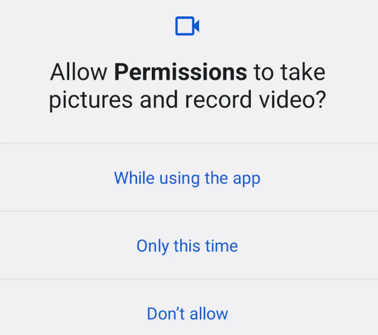

# Quyền
Quyền bảo vệ quyền riêng tư của người dùng bằng cách hạn chế quyền truy cập vào các chức năng nhạy cảm của thiết bị. Bạn có thể đã thấy chúng trước đó: hầu hết mọi ứng dụng đều yêu cầu bạn cấp một số loại quyền.

## Về quyền

Quyền hạn chế quyền truy cập vào các cảm biến hoặc dữ liệu nhạy cảm trên thiết bị của bạn. Trước Android **6.0**, người dùng đã thấy danh sách các quyền cần thiết cho ứng dụng trước khi cài đặt ứng dụng. Bằng cách cài đặt nó, bạn đã tự động cấp tất cả chúng. Điều đó không hề thú vị chút nào vì một số nhà phát triển đã lạm dụng hệ thống này. Ví dụ: ứng dụng đèn pin có thể có quyền xem danh bạ, gửi tin nhắn văn bản hoặc truy cập lịch.

Rất may, hành vi này đã thay đổi: hiện tại, các ứng dụng sẽ hỏi bạn xem bạn có muốn cho phép một số quyền nguy hiểm hay không: quyền truy cập vị trí, máy ảnh, micrô, bộ nhớ, v.v. Quyền này được gọi là **Quyền runtime**. Vẫn còn một số quyền không cần phê duyệt, chẳng hạn như quyền truy cập Internet, chạy khi khởi động, v.v.

Những loại quyền này được gọi là **quyền tại thời điểm cài đặt**. Chúng được coi là vô hại và đó là lý do tại sao chúng không cần được phê duyệt.

Ngoài ra còn có **quyền đặc biệt** nhưng chúng được xác định bởi nhà sản xuất điện thoại và thường bảo vệ quyền truy cập vào các hành động cụ thể, như vẽ trên ứng dụng hoặc xác định cài đặt. Chúng khác nhau đối với mỗi nhà sản xuất.

## Quyền và trải nghiệm người dùng

Request quyền runtime trông giống như một cảnh báo chứa biểu tượng, tên quyền được phê duyệt và hai hoặc ba nút (tùy thuộc vào phiên bản OS):



Đôi khi, những cảnh báo này tự giải thích: khi bạn tải xuống ứng dụng Máy ảnh, ứng dụng này sẽ không hoạt động nếu không có quyền truy cập vào máy ảnh. Tuy nhiên, quyền truy cập danh bạ trong ứng dụng Ghi chú có thể không dễ hiểu như vậy. Đó là lý do tại sao việc request họ vào đúng thời điểm lại quan trọng.

Hãy dành chút thời gian để suy nghĩ về cách xin phép một cách thích hợp trong ứng dụng của bạn. Bạn có thể làm theo các quy tắc sau để làm cho nó dễ dàng hơn:

- Nếu ứng dụng của bạn không thể chạy nếu không có quyền này và lý do hoàn toàn rõ ràng là cần thiết — hãy yêu cầu quyền này ngay lập tức! Nếu người dùng từ chối quyền đó, bạn có thể hiển thị một màn hình giải thích lý do bạn cần quyền này và lý do ứng dụng của bạn không hoạt động nếu không có quyền đó. Ví dụ: bạn có thể hiểu rõ lý do tại sao ứng dụng Máy ảnh cần quyền truy cập vào máy ảnh nên không cần phải giải thích điều đó trước khi xin phép.

- Nếu ứng dụng của bạn không thể chạy nếu không có quyền này nhưng không rõ lý do bạn yêu cầu quyền đó - hãy đưa ra lời giải thích tại sao bạn cần quyền đó, sau đó yêu cầu quyền. Ví dụ: ứng dụng quét Wi-Fi yêu cầu quyền Vị trí. Trước Android 13, bạn cần cấp quyền truy cập vị trí để hoạt động với nội dung liên quan đến Wi-Fi. Điều đó có thể khiến mọi người nhầm lẫn, vì vậy các nhà phát triển thường đưa ra lời giải thích trước lý do tại sao họ cần có quyền truy cập vị trí.

- Nếu ứng dụng của bạn có thể chạy mà không có quyền này, nhưng hoàn toàn rõ ràng rằng việc sử dụng chức năng này sẽ yêu cầu quyền này — hãy yêu cầu quyền này tại thời điểm người dùng cố gắng sử dụng chức năng đó. Ví dụ: Tin nhắn thoại trong ứng dụng nhắn tin - rõ ràng là bạn cần quyền truy cập Micrô để ghi tin nhắn thoại. Nếu quyền bị từ chối, bạn có thể hiển thị lời giải thích như "Ghi tin nhắn thoại yêu cầu quyền truy cập vào micrô".

- Nếu ứng dụng của bạn có thể chạy mà không cần sự cho phép này nhưng không rõ lý do tại sao bạn cần nó - hãy đưa ra lời giải thích rồi request sự cho phép. Ví dụ: lưu thành tích trong trò chơi vào thư viện. Không rõ tại sao trò chơi lại yêu cầu quyền lưu trữ khi bạn nhấn "Chia sẻ". Giải thích lý do bạn cần quyền lưu trữ, sau đó hiển thị yêu cầu.

## Khai báo quyền

Để khai báo quyền (cả thời gian cài đặt và runtime), bạn cần thêm quyền đó vào tệp kê khai. Quyền có thể được thêm vào trong thẻ `<manifest>` trước thẻ `<application>` như thế này:


```xml
<manifest xmlns:android="<http://schemas.android.com/apk/res/android>"
    package="com.hyperskill.permissions">

    <uses-permission android:name="android.permission.CAMERA" />
    <uses-permission android:name="android.permission.READ_EXTERNAL_STORAGE" />

    <application ...>
        ...
    </application>

</manifest>
```

Bạn nên thêm mọi quyền mà ứng dụng của bạn cần để hoạt động. Nếu quyền được yêu cầu là quyền tại thời điểm cài đặt thì người dùng sẽ không cần thực hiện bất kỳ hành động nào để cho phép sau khi cài đặt ứng dụng. Các quyền Runtime yêu cầu nhiều hơn chỉ một vài dòng trong tệp kê khai. Hãy xem cách họ làm việc.

## Đang kiểm tra quyền runtime


Sau khi khai báo quyền trong tệp kê khai, bạn có thể đợi người dùng thực hiện một hành động cụ thể cần có quyền.
Có một phương pháp để kiểm tra xem ứng dụng của bạn đã được cấp quyền cần thiết hay chưa - phương pháp `checkSelfPermission()`:

```kotlin
if (ContextCompat.checkSelfPermission(this, Manifest.permission.CAMERA) ==
    PackageManager.PERMISSION_GRANTED) {
    // continue executing the permission-blocked action
} else {
    // no permission, request it
}
```


Phương thức này lấy `Context` và tên quyền làm tham số rồi trả về Int. Int được trả về là `PackageManager.PERMISSION_GRANTED`, bằng 0 hoặc `PackageManager.PERMISSION_DENIED`, bằng -1. Chúng tôi nên request quyền nếu `checkSelfPermission` trả về `PERMISSION_DENIED`.

Bạn có thể request quyền bằng cách sử dụng API kết quả Activity hoặc `requestPermissions()`. Trước tiên, chúng ta sẽ xem xét API kết quả Activity.

## Yêu cầu quyền sử dụng API kết quả Activity


API kết quả Activity là interface lập trình mới để trao đổi dữ liệu giữa các hoạt động.
Nó cho phép tạo một trình khởi chạy với một hợp đồng được chỉ định và đăng ký callback để được gọi khi có kết quả.

Có hai hợp đồng có thể giúp chúng tôi: 
- `RequestPermission` 
- `RequestMultiplePermissions`.

Đúng như tên gọi của chúng, quyền đầu tiên được sử dụng để request một quyền và quyền thứ hai có thể được sử dụng để request hai hoặc nhiều quyền cùng một lúc. Chúng ta cần đăng ký hợp đồng trong hoạt động. Bạn có thể thực hiện điều đó bằng cách sử dụng `registerForActivityResult()` chấp nhận hợp đồng và callback làm tham số:

```kotlin
private val cameraRequestPermissionLauncher =
    registerForActivityResult(ActivityResultContracts.RequestPermission()) { granted ->
        if (granted) {
            // TODO use camera, take pictures
        } else {
            // User has denied the permission.
        }
    }
```

Hoặc, bạn có thể sử dụng tham chiếu hàm thay vì lambda expression:

```kotlin
private val cameraRequestPermissionLauncher =
    registerForActivityResult(
        ActivityResultContracts.RequestPermission(),
        ::onRequestCameraPermissionResult
    )

private fun onRequestCameraPermissionResult(granted: Boolean) {
    if (granted) {
        // …
    } else {
        // …
    }
}
```

Đối với `RequestMultiplePermissions()`, callback sẽ nhận được `Map<String, Boolean>` kèm theo kết quả cho mỗi request cấp phép:

```kotlin
private val requestAllPermissionsLauncher =
    registerForActivityResult(ActivityResultContracts.RequestMultiplePermissions()) { granted ->
        if (granted.isNotEmpty() && granted.values.all()) {
            // …
        } else {
            // …
        }
    }
```
Để kiểm tra xem quyền có bị từ chối trước đó hay không và bạn cần đưa ra lời giải thích trước khi yêu cầu quyền, hãy sử dụng `shouldShowRequestPermissionRationale()`:

```kotlin
if (ActivityCompat
    .shouldShowRequestPermissionRationale(this, Manifest.permission.CAMERA)) {
    // explain why we need this permission
}
```

Đặt tất cả lại với nhau, kiểm tra quyền, hiển thị lý do căn bản và khởi chạy request cấp phép sẽ như thế này:

```kotlin
cameraButton.setOnClickListener {
    when {
        ContextCompat.checkSelfPermission(this, Manifest.permission.CAMERA) ==
            PackageManager.PERMISSION_GRANTED -> {
            // Camera permission is already granted. Feel free to take photos!
        }
        ActivityCompat.shouldShowRequestPermissionRationale(Manifest.permission.CAMERA) -> {
            // The permission was denied some time before. Show the rationale!
            AlertDialog.Builder(this)
                .setTitle("Permission required")
                .setMessage("This app needs permission to access this feature.")
                .setPositiveButton("Grant") { _, _ ->
                    cameraRequestPermissionLauncher
                        .launch(Manifest.permission.CAMERA)
                }
                .setNegativeButton("Cancel", null)
                .show()
        }
        else -> {
            // The permission is not granted. Ask for it
            cameraRequestPermissionLauncher.launch(Manifest.permission.CAMERA)
        }
    }
}
```

Khi người dùng cấp hoặc từ chối quyền được yêu cầu, callback của chúng tôi sẽ được gọi với một đối số mô tả kết quả. Nếu quyền bị từ chối, chúng tôi có thể kiểm tra xem quyền đó có bị từ chối vĩnh viễn hay không bằng cách gọi lại hàm shouldShowRequestPermissionRationale: nếu nó trả về sai, hộp kiểm "không hỏi lại" đã được đặt và chúng tôi không thể yêu cầu lại quyền này nhưng chúng tôi có thể yêu cầu bật quyền này theo cách thủ công trong Cài đặt.

```kotlin
private fun onRequestCameraPermissionResult(granted: Boolean) {
    if (granted) {
        // Fine. Feel free to take photos!
    } else if (!ActivityCompat
        .shouldShowRequestPermissionRationale(this, Manifest.permission.CAMERA)) {
        // "Don't ask again"
        AlertDialog.Builder(this)
            .setTitle("Permission required")
            .setMessage("This app needs permission to access this feature. " +
                "Please grant it in Settings.")
            .setPositiveButton("Grant") { _, _ ->
                val intent = Intent(
                    Settings.ACTION_APPLICATION_DETAILS_SETTINGS,
                    Uri.fromParts("package", packageName, null),
                )
                try {
                    startActivity(intent)
                } catch (e: ActivityNotFoundException) {
                    Toast.makeText(this, "Cannot open settings", Toast.LENGTH_LONG)
                        .show()
                }
            }
            .setNegativeButton("Cancel", null)
            .show()
    } else {
        // The permission was denied without checking "Don't ask again".
        // Do nothing, wait for better times…
    }
}
```

Trong phương pháp này, chúng tôi đã tạo `AlertDialog`, điều này giải thích một lần nữa lý do tại sao chúng tôi request quyền này và cho phép người dùng chuyển sang Cài đặt và cho phép quyền theo cách thủ công hoặc hủy và quay lại ứng dụng mà không có các quyền này.

## Yêu cầu quyền với `requestPermissions()`


Trong một số ứng dụng hiện có, bạn có thể gặp phải cách request quyền cũ hơn. Không có callback: thay vào đó, bạn chuyển một số tùy ý dưới dạng requestCode cho request cấp quyền và response chứa mã đó, vì vậy, bạn có thể tìm ra yêu cầu nào được phản hồi.

Phương thức `requestPermissions()` là một phần của lớp `Activity` và có thể được gọi trực tiếp trong các lớp con của nó (chẳng hạn như `ComponentActivity` hoặc `AppCompatActivity`). Phải có hai đối số: một mảng quyền và mã request. Mã request là Int bạn muốn sử dụng nhưng lớn hơn hoặc bằng 0.


> [!NOTE]
> Để tương thích ngược với các phiên bản Android cũ hơn (API cấp 22 trở xuống), bạn có thể sử dụng ActivityCompat.requestPermissions(). Phương thức này request bạn chuyển hoạt động làm đối số đầu tiên, theo sau là mảng quyền và mã yêu cầu.

Request cấp phép có thể trông như thế này:

```kotlin
private const val MEDIA_REQUEST_CODE = 1

...

when {
    ContextCompat.checkSelfPermission(this, Manifest.permission.READ_EXTERNAL_STORAGE) ==
        PackageManager.PERMISSION_GRANTED -> {
        Toast.makeText(this, "Storage permission is granted", Toast.LENGTH_SHORT).show()
    }
    ActivityCompat
        .shouldShowRequestPermissionRationale(Manifest.permission.READ_EXTERNAL_STORAGE) -> {
        AlertDialog.Builder(this)
            .setTitle("Permission required")
            .setMessage("This app needs permission to access this feature.")
            .setPositiveButton("Grant") { _, _ ->
                requestPermissions(
                    arrayOf(Manifest.permission.READ_EXTERNAL_STORAGE),
                    MEDIA_REQUEST_CODE
                )
            }
            .setNegativeButton("Cancel", null)
            .show()
    }
    else -> {
        requestPermissions(
            arrayOf(Manifest.permission.READ_EXTERNAL_STORAGE),
            MEDIA_REQUEST_CODE
        )
    }
}
```

Sau khi nhấp vào bất kỳ nút nào (hoặc đóng cảnh báo), phương thức `onRequestPermissionsResult()` sẽ được gọi.

> [!CAUTION]
> Việc sử dụng onRequestPermissionsResult() để xử lý các kết quả request cấp phép không được dùng nữa (ngoại trừ các yêu cầu tương thích). Bạn nên sử dụng API kết quả Activity như được hiển thị trong phần trước.

Để kiểm tra xem ứng dụng có được cấp các quyền được yêu cầu hay không, chúng tôi có thể ghi đè `onRequestPermissionsResult()`. Sau khi người dùng chọn quyền phê duyệt hoặc từ chối, phương thức này sẽ được gọi. Phương thức này có ba tham số: requestCode, mảng quyền và mảng grantResults.

```kotlin
override fun onRequestPermissionsResult(
    requestCode: Int,
    permissions: Array<out String>,
    grantResults: IntArray
) {
    super.onRequestPermissionsResult(requestCode, permissions, grantResults)
}
```

Đây là nơi bạn sẽ cần mã request mà bạn đã chỉ định trong request của mình trước đó. Với sự trợ giúp của nó, chúng tôi sẽ có thể hiểu những hành động nào phải được thực hiện sau request của chúng tôi.

```kotlin
override fun onRequestPermissionsResult(
    requestCode: Int,
    permissions: Array<out String>,
    grantResults: IntArray
) {
    when (requestCode) {
        MEDIA_REQUEST_CODE -> {
            if (grantResults.isNotEmpty() &&
                grantResults[0] == PackageManager.PERMISSION_GRANTED) {
                // permission granted, use the restricted features
            } else {
                // no permission, block access to this feature
            }
        }
        else -> {
            super.onRequestPermissionsResult(requestCode, permissions, grantResults)
        }
    }
}
```

Chúng tôi sẽ sử dụng thời điểm để kiểm tra mã request. `MEDIA_REQUEST_CODE` trong ví dụ này là hằng số bằng 1 (nhưng bạn có thể chọn bất kỳ số nào bạn thích). Vì Android cho phép bạn request nhiều quyền cùng một lúc nên chúng tôi cũng nhận được kết quả dưới dạng mảng.

Hãy nhớ rằng nếu người dùng đóng cảnh báo mà không chọn bất kỳ tùy chọn nào thì mảng kết quả có thể trống. Hãy coi mảng trống là "Bị từ chối" để tránh các sự cố tiềm ẩn với các ngoại lệ bảo mật vì bạn đang cố truy cập một số quyền mà không được phê duyệt.

Mọi thứ khác đều tương tự, bao gồm cả khả năng kiểm tra “Không hỏi lại” với shouldShowRequestPermissionRationale sau khi nhận được kết quả.


## tài liệu tham khảo
- [Quyền](https://hyperskill.org/learn/step/23292)