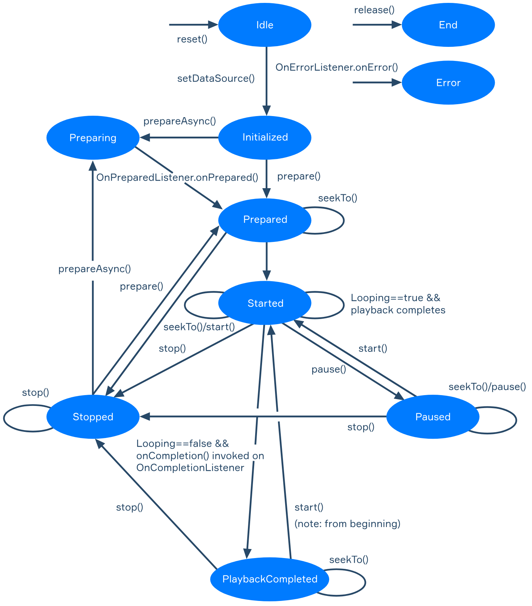

# Phát âm thanh với MediaPlayer

Tất cả chúng ta đều thích nghe nhạc và xem video bằng điện thoại, nhưng nó hoạt động như thế nào? Câu trả lời là trình phát đa phương tiện.
Có một số trong số chúng, chúng khác nhau về độ phức tạp và cung cấp các khả năng tùy chỉnh khác nhau.
Phiên bản phổ biến nhất không thuộc Android framework là `ExoPlayer`, nhưng hiện tại nó quá phức tạp đối với chúng tôi,
vì vậy sẽ tốt hơn nếu bạn xem qua `MediaPlayer` API trước tiên, đây là một phần của Android framework

## Cách phát một bài hát

`MediaPlayer` hỗ trợ nhiều nguồn dữ liệu khác nhau như:

- Tài nguyên ứng dụng
- URI cục bộ sử dụng Trình phân giải nội dung
- URL bên ngoài
Đây là cách dễ nhất để lấy phương tiện từ tài nguyên ứng dụng:

```kotlin
var mediaPlayer = MediaPlayer.create(applicationContext, R.raw.song)

mediaPlayer.setAudioAttributes(
    AudioAttributes.Builder()
        .setContentType(AudioAttributes.CONTENT_TYPE_MUSIC)
        .setUsage(AudioAttributes.USAGE_MEDIA)
        .build()
)

mediaPlayer.start()
```


Chúng tôi chỉ tạo một phiên bản bằng phương thức `MediaPlayer.create()` và bắt đầu phát lại bằng phương thức `start()`. Chúng tôi đã lấy tệp của mình từ `R.raw`, thực tế là `src/main/res/raw` có thể chứa các tệp mà không chỉ định bất kỳ loại cụ thể nào. Tuy nhiên, nó vẫn phải là tệp được mã hóa và định dạng chính xác ở một trong các định dạng được hỗ trợ.

`setAudioAttributes()` có thể đặt một số thuộc tính cung cấp thông tin về luồng âm thanh.
Hai cái chúng tôi sử dụng trong đoạn trích là:

- `Usage`, mô tả "tại sao" bạn đang phát âm thanh, ví dụ: `USAGE_MEDIA` và `USAGE_ALARM`
- `ContentType`, mô tả loại nội dung bạn đang phát, ví dụ: `CONTENT_TYPE_MOVIE` và `CONTENT_TYPE_MUSIC`.


Ngoài ra còn một số loại `AudioAttributes` khác bạn có thể tự nghiên cứu nếu quan tâm.

Tuy nhiên, `MediaPlayer` có thể hoạt động ngay cả khi bạn không chỉ định loại nội dung.
Tuy nhiên, tốt hơn hết bạn nên chỉ định chúng vì thông tin này có thể được nền tảng hoặc âm thanh framework sử dụng để đặt âm lượng tinh tế hơn hoặc xử lý hậu kỳ luồng âm thanh của bạn để có chất lượng tốt hơn.

Nếu bạn muốn phát phương tiện từ URI nội bộ, bạn có thể xem đoạn mã sau:

```kotlin
val myUri: Uri = .... // initialize Uri here

val mediaPlayer = MediaPlayer().apply {
    setAudioAttributes(
        AudioAttributes.Builder()
            .setContentType(AudioAttributes.CONTENT_TYPE_MUSIC)
            .setUsage(AudioAttributes.USAGE_MEDIA)
            .build()
    )
    setDataSource(applicationContext, myUri)
    prepare()
    start()
}
```

Ở đây chúng ta có hai phương thức mới: `setDataSource()` và `prepare()`.
Phần sau là về việc quản lý trạng thái của `MediaPlayer` mà chúng ta sẽ thảo luận sau trong chủ đề này, chúng ta hãy xem phần đầu tiên:

Chúng tôi chỉ định nội dung nào chúng tôi muốn phát lại qua `setDataSource()`.
Trong trường hợp chúng tôi sử dụng URI nội bộ, chúng tôi cũng nên chuyển `Context`.

Cuối cùng, nếu bạn muốn phát lại phương tiện từ URL từ xa, đoạn mã sẽ trông khá giống nhau, nhưng bạn không cần phải chuyển Ngữ cảnh nữa:

```kotlin
val url = "http://........" // your URL here

val mediaPlayer = MediaPlayer().apply {
    setAudioAttributes(
        AudioAttributes.Builder()
            .setContentType(AudioAttributes.CONTENT_TYPE_MUSIC)
            .setUsage(AudioAttributes.USAGE_MEDIA)
            .build()
    )
    setDataSource(url)
    prepare()
    start()
}
```

> [!CAUTION]
> Nếu bạn đang sử dụng loại phương tiện thu thập này, lệnh gọi prepare() có thể mất nhiều thời gian! Vì vậy, có thể là một ý tưởng tốt hơn khi sử dụng prepareAsync() mà chúng ta sẽ thảo luận trong phần sau của chủ đề này.

## Quản lý nhà nước

Một khía cạnh quan trọng của `MediaPlayer` mà bạn nên ghi nhớ là nó dựa trên trạng thái. 
`MediaPlayer` có trạng thái bên trong **bạn phải luôn lưu ý khi viết mã**.
Một số thao tác chỉ có hiệu lực khi người chơi ở trạng thái cụ thể.
Có toàn bộ sơ đồ về các trạng thái `MediaPlayer` có thể có và phương thức nào có thể chuyển từ trạng thái này sang trạng thái khác:



Tuy nhiên, sơ đồ này khá phức tạp và có nhiều thông tin cần tiếp nhận, vì vậy chúng ta hãy xem xét kỹ hơn từng trạng thái này.

- **Nhàn rỗi**. `MediaPlayer` ở trạng thái này khi bạn khởi tạo nó lần đầu tiên hoặc gọi `reset()`.

- **Đã khởi tạo**.`MediaPlayer` đạt trạng thái khi bạn đặt nguồn dữ liệu.
Nếu bạn cố gắng đặt nguồn dữ liệu không ở trạng thái không hoạt động, IllegalStateException sẽ xảy ra.

- **Chuẩn bị**. Trước khi có thể phát bất kỳ phương tiện nào, bạn phải chuẩn bị `MediaPlayer` bằng cách gọi `prepare()`. Bạn cũng có thể gọi `prepareAsync()`, nhưng chúng ta sẽ thảo luận về nó sau trong chủ đề này.
Tuy nhiên, nếu bạn sử dụng `MediaPlayer.create()` để khởi tạo như chúng tôi đã làm trong ví dụ đầu tiên, `MediaPlayer` của bạn sẽ được tạo ở trạng thái đã chuẩn bị.

- **Bắt đầu**. Ngay sau khi `MediaPlayer` của bạn được chuẩn bị, bạn có thể gọi `start()` để đạt trạng thái này. Trong khi phương tiện đang phát, `MediaPlayer` ở trạng thái bắt đầu.

- **Tạm dừng**. Bạn có thể tạm dừng phương tiện của mình bằng cách gọi `pause()`.

- **Dừng lại**. `MediaPlayer` ở trạng thái khi phương tiện dừng lại. Nếu muốn chơi lại thì bạn cần phải chuẩn bị trước.

- **PlaybackCompleted**. Sau khi phát phương tiện, `MediaPlayer` sẽ ở trạng thái này. Bạn có thể phát lại phương tiện bằng cách gọi `start()` và bạn có thể đặt callback qua `setOnCompletionListener()`.

- **Kết thúc**. `MediaPlayer` chuyển sang trạng thái này sau khi `release()` được gọi mà chúng ta sẽ thảo luận sau. Ở trạng thái này, bạn không thể phát hoặc tạm dừng phương tiện.

- **Lỗi**. Nếu bạn cố gắng thực hiện thao tác điều khiển phát lại ở trạng thái bất hợp pháp MediaPlayer, bạn sẽ đạt đến trạng thái này. Bạn có thể gặp lỗi bằng cách đặt callback qua `setOnErrorListener()`

Như bạn có thể thấy, có rất nhiều trạng thái khác nhau và các cách khả thi để chuyển từ trạng thái này sang trạng thái khác.
Tuy nhiên, đôi khi các phương thức sẽ không thay đổi trạng thái. Ví dụ: chúng ta có thể xem `seekTo()` để tìm kiếm phương tiện theo mã thời gian nhất định.

## Sử dụng MediaPlayer hiệu quả


Việc sử dụng `MediaPlayer` có thể khá đơn giản nhưng điều quan trọng cần nhớ là cần phải thực hiện thêm một số điều để sử dụng đúng cách.
Việc gọi `prepare()` có thể mất nhiều thời gian để tìm nạp và giải mã dữ liệu, vì vậy bạn không bao giờ nên gọi nó từ UI thread.
Điều này có thể dẫn đến treo UI và thậm chí ANR. Thay vào đó, tốt hơn hết bạn nên gọi `prepareAsync()` để bắt đầu chuẩn bị dữ liệu của bạn ở chế độ nền. Sau khi quá trình chuẩn bị hoàn tất, nó sẽ gọi callback mà bạn có thể định cấu hình bằng `setOnPreparedListener()`

Đây là ví dụ về cách bạn có thể bắt đầu quá trình chuẩn bị không đồng bộ và bắt đầu phát phương tiện ngay lập tức khi hoàn tất:


```kotlin
val url = ...   
                       
val mediaPlayer = MediaPlayer().apply {
    setDataSource(url)     

    setOnPreparedListener {            
        start()                        
    }            
     
    prepareAsync()                           
}                                      
```

> [!CAUTION]
> Như bạn nhớ, khi chúng ta tạo MediaPlayer bằng MediaPlayer.create(), chúng ta không nên gọi prepare() vì trình tạo sẽ thực hiện việc đó cho chúng ta. Nhưng điều này có nghĩa là không có cách nào để gọi prepareAsync bằng nó!


Một lưu ý quan trọng khác là `MediaPlayer` tiêu tốn tài nguyên hệ thống có giá trị.
Vì vậy, bạn không bao giờ nên có nhiều phiên bản hơn mức bạn cần.
Nếu bạn đã hoàn tất với `MediaPlayer`, bạn nên gọi `release()` để giải phóng tất cả tài nguyên hệ thống đã được phân bổ.
Bạn nên làm điều tương tự khi Activity của bạn nhận được cuộc gọi tới `onStop()` vì không có lý do gì để giữ nó trong khi hoạt động của bạn không tương tác với người dùng (trừ khi bạn muốn phát phương tiện ở chế độ nền mà chúng tôi sẽ không giải thích chi tiết trong chủ đề này). Khi hoạt động được tiếp tục hoặc khởi động lại, bạn có thể tạo và chuẩn bị `MediaPlayer` mới và khôi phục trạng thái của nó.

Dưới đây là ví dụ về cách bạn nên giải phóng và vô hiệu hóa `MediaPlayer` của mình khi bạn hoàn thành việc đó:

```kotlin
mediaPlayer?.release()
mediaPlayer = null
```
 

> [!CAUTION]
> Chúng tôi không có MediaPlayer có thể rỗng trong các ví dụ trước nhưng bạn nên vô hiệu hóa nó.
> Ví dụ: nếu bạn không phát hành MediaPlayer trong onStop() và người dùng xoay thiết bị giữa dọc và ngang, bạn có thể nhanh chóng tiêu tốn tất cả tài nguyên hệ thống vì mỗi thay đổi hướng sẽ tạo ra một MediaPlayer mới sẽ không bao giờ được phát hành.


## tài liệu tham khảo
- [Phát âm thanh với MediaPlayer](https://hyperskill.org/learn/step/26069)