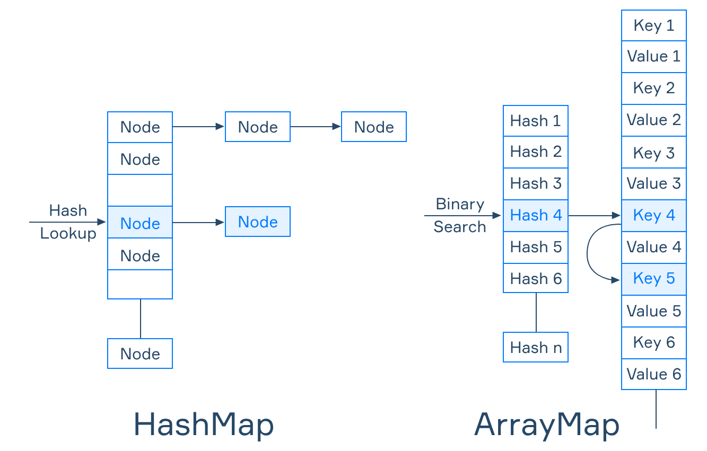

# Cấu trúc dữ liệu tiết kiệm bộ nhớ trong Android

Java và Kotlin hỗ trợ các cấu trúc dữ liệu khác nhau: danh sách, bộ, bản đồ, hàng đợi. Nói về bản đồ, những bản đồ phổ biến nhất là `HashMap`, `LinkedHashMap` và `TreeMap`.

Nhưng chúng tôi có sẵn các cấu trúc dữ liệu trong Android SDK bên cạnh các cấu trúc Java tiêu chuẩn được đề cập ở trên:
dòng `ArrayMap`, `ArraySet` và `SparseArray`, được thiết kế để tiêu thụ ít bộ nhớ hơn so với dòng tiêu chuẩn.

##ArrayMap

Hãy cùng ôn lại kiến ​​thức của bạn về [cách hoạt động của Java HashMap tiêu chuẩn](/General/ComputerScience/2_AlgorithmsAndDataStructures/Algorithms/0_Hasing/2_HashTable.md.md)

`ArrayMap` hoạt động khác nhau:
không có nhóm và danh sách liên kết. Thay vào đó, nó có một mảng các khóa băm được sắp xếp cũng như một mảng các khóa và giá trị.

Thao tác tìm kiếm sử dụng **tìm kiếm nhị phân** để tìm hàm băm chính xác và nếu thành công sẽ kiểm tra khóa tương ứng.

Đây là **hash table có địa chỉ mở và thăm dò tuyến tính** vì các cặp khóa-giá trị không bị khóa ở một vị trí nhất định mà được đặt tuyến tính, lần lượt:




> [!CAUTION]
> Tránh các nhóm có khoảng trống và tham chiếu đến các nút, ArrayMap cung cấp cho chúng tôi bố cục bộ nhớ nhỏ gọn hơn, hy sinh tốc độ tra cứu và chèn.

`ArrayMap` triển khai giao diện `(Mutable)Map` tương tự như `HashMap` và có thể được coi là một sự thay thế dễ dàng.

```kotlin
val cats = ArrayMap<String, Cat>()
cats.put("Barsik", Cat())
cats.put("Murlok", Cat())
cats.put("Vasya", Cat())
cats.forEach { (name, value) ->
    println("$name: $value")
}
```

Như một phần thưởng, ArrayMap có các phương thức `keyAt()` và `valueAt()` cho phép chúng tôi duyệt qua nó mà không cần `.entrySet().iterator()` (được `.forEach {}` sử dụng).

```kotlin
for (i in 0 until cats.size) {
    println("${cats.keyAt(i)}: ${cats.valueAt(i)}")
}
```

##ArraySet

`HashSet` của Java tiêu chuẩn bao bọc `HashMap` và sử dụng các khóa của nó, không sử dụng các giá trị. Vì vậy, `HashSet` chỉ sử dụng lại mã hiện có mà không phát minh lại bất cứ thứ gì nhưng lại lãng phí một số bộ nhớ

Mặt khác, `ArraySet` là phiên bản sửa đổi của `ArrayMap` và không có giá trị nào cả — chỉ có các khóa, giúp tiết kiệm nhiều bộ nhớ hơn.

##SparseArrays

`SparseArray<T>` hoạt động như một `ArrayMap<Int, T>` được tối ưu hóa và đơn giản hóa. Nó cũng có thể được coi như một mảng có khoảng trống.

Tại sao chúng ta cần cấu trúc dữ liệu đặc biệt thay vì chỉ sử dụng `Map<Int, T>` hoặc `Map<Long, T>`? Bởi vì khi sử dụng vùng chứa đa năng cho **giá trị nguyên thủy** trong Java, những số nguyên này cần phải được "đóng hộp", nghĩa là chúng được chuyển thành đối tượng. Điều này gây lãng phí bộ nhớ và tăng khả năng hội thảo con trỏ.

`SparseArray` sử dụng hai mảng, với mảng đầu tiên lưu trữ các khóa số nguyên theo thứ tự và mảng thứ hai lưu trữ các giá trị. Giống như `ArrayMap` sử dụng tìm kiếm nhị phân để tra cứu băm khóa, `SparseArray` sử dụng nó để tự tra cứu khóa.

Ngoài `SparseArray<T>`, còn có một số phiên bản khác: `SparseLongArray`, `SparseIntArray` và `SparseBooleanArray`, có giá trị tương ứng là `Long`, `Int` và `Boolean`, cộng thêm `LongSparseArray<T>` với phím dài.

Trong ví dụ bên dưới, chúng tôi đã tạo 4 loại mảng thưa thớt và điền dữ liệu vào chúng.

```kotlin
val catById = SparseArray<String>()
catById.put(9, "Charlie")
catById.put(34, "Barsik")
catById.put(38, "Molly")

val salaryByEmpId = SparseLongArray()
salaryByEmpId.put(1, 100L)
salaryByEmpId.put(5, 99L)
salaryByEmpId.put(16, 100L)
salaryByEmpId.put(42, 9223372036854775807L)
salaryByEmpId.put(56, 130L)

val interestingEpisodes = SparseBooleanArray()
interestingEpisodes.put(1, true)
interestingEpisodes.put(2, true)
// haven't watched the third episode
interestingEpisodes.put(4, false)

val catOwners = SparseIntArray()
catOwners.put(9, 1)
catOwners.put(34, 1)
catOwners.put(38, 42)
```

Bên cạnh phương pháp `get(key)` tương tự như `Map`, còn có `get(key, defaultValue)`, `contains(key)` và cặp phương thức `keyAt()` và `valueAt()`.


## Tại sao cấu trúc dữ liệu Android SDK không có trong Thư viện Java tiêu chuẩn

### 1. Tối ưu hóa cho môi trường Android
   - Các cấu trúc dữ liệu này được thiết kế riêng cho Android, nơi bộ nhớ bị hạn chế hơn so với các ứng dụng Java SE/EE tiêu chuẩn chạy trên máy tính để bàn hoặc máy chủ.
   - Ngược lại, các thư viện chuẩn Java ưu tiên tính linh hoạt cho mục đích chung và hiệu suất tổng thể hơn là chỉ tiết kiệm bộ nhớ.
### 2. Hiệu suất không phải lúc nào cũng tốt hơn
   - `ArrayMap` sử dụng một mảng thay vì hash table, dẫn đến thời gian tra cứu trong trường hợp xấu nhất của `O(N)`, so với `O(1)` cho HashMap.
   - `SparseArray` hoạt động tốt đối với các tập dữ liệu nhỏ, nhưng `HashMap` có thể nhanh hơn đối với các tập dữ liệu lớn hơn.
   - Vì vậy, trong các ứng dụng Java không có ràng buộc nghiêm ngặt về bộ nhớ, các bộ sưu tập Java tiêu chuẩn thường tối ưu hơn.
### 3. Không tương thích với Bộ sưu tập Java Framework
   - Thư viện Java tiêu chuẩn (java.util.*) tuân theo API (Collection, Map, Set, List) thống nhất, giúp các thư viện khác nhau dễ dàng làm việc cùng nhau.
    Cấu trúc dữ liệu dành riêng cho Android không tuân thủ các giao diện này, khiến việc tích hợp với các thư viện Java tiêu chuẩn trở nên khó khăn hơn.
### 4. Hỗ trợ Generics hạn chế
   - `SparseArray` sử dụng `int` làm khóa thay vì `Integer`, nhưng nó không hỗ trợ đầy đủ các thuốc generic như `HashMap<Integer, V>`, làm giảm tính linh hoạt trong các trường hợp sử dụng thông thường.

## Phần kết luận

Sử dụng `ArrayMap` và `ArraySet` thay vì `HashMap` và `HashSet` để **tiết kiệm một số bộ nhớ nếu bạn sẵn sàng hy sinh tốc độ chèn trên các bộ sưu tập khổng lồ**.
Chọn `SparseArrays` trong số tất cả các tùy chọn có thể nếu **bạn cần khóa số nguyên.**

Hãy nhớ nguyên tắc vàng: bằng cách hy sinh bộ nhớ, chúng ta sẽ tăng hiệu suất và ngược lại.


