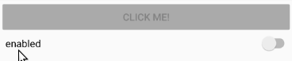

# Có thể vẽ

Đối tượng **Drawable** đại diện cho một thành phần đồ họa. Bất kỳ màu sắc, hình dạng, độ dốc, vectơ hoặc hình ảnh raster nào cũng có thể được biểu diễn dưới dạng Drawable. Thậm chí có thể thực hiện của riêng bạn.

## Màu sắc

Màu là một số nguyên chứa bốn số riêng biệt xác định độ mờ (được gọi là alpha) và độ sáng của các thành phần màu đỏ, xanh lục và xanh lam. Do đó, bất kỳ số nguyên Kotlin nào cũng có thể đóng vai trò là biểu diễn màu hợp lệ.

Ví dụ: Hình vuông màu tím `0xFF8C5AFF.toInt()` hoàn toàn mờ đục (`FF`), khá đỏ (`8C`), một chút xanh lục (`5A`) và rất xanh lam (`FF`).

Màu tương tự có thể được biểu thị dưới dạng `#8C5AFF` hoặc `#FF8C5AFF` trong XML.
Lưu ý rằng thành phần alpha là tùy chọn.

Ví dụ: tài nguyên màu

```xml
<color name="green_lime">#CDDC39</color>
```

có thể được truy cập thông qua `ContextCompat.getColor(context, R.color.green_lime)`. Lệnh gọi này lấy màu từ tài nguyên của ứng dụng và đồng nghĩa với biểu thức Kotlin Lime vuông `0xFFCDDC39.toInt()`.

Màu sắc trong Android có thể được áp dụng theo nhiều cách khác nhau:

- `android:background="@color/green_lime"`

- `setBackgroundColor(0xFFCDDC39.toInt())`

- `setBackgroundResource(R.color.green_lime)`

các phương pháp này về cơ bản tương đương với `setBackground(ColorDrawable(0xFFCDDC39.toInt()))` ở cấp độ triển khai.

### Bộ chọn màu

Ngược lại với các thuộc tính như `background` thường chấp nhận các đối tượng `Drawable`, tồn tại một số thuộc tính trong Android framework vốn không hoạt động với Drawables.
Chúng bao gồm các thuộc tính như `backgroundTint` của `View`, cũng như `textColor`, `hintTextColor` và `drawableTint` của `TextView`.

Mặc dù màu sắc đóng vai trò là giá trị thích hợp cho các thuộc tính này nhưng vẫn tồn tại một tùy chọn thay thế: `ColorStateList`, thường được gọi là bộ chọn màu. 

Tài nguyên này tạo điều kiện thuận lợi cho việc xác định nhiều màu tương ứng với các trạng thái khác nhau của `View`. 


Dưới đây là ví dụ về bộ chọn như vậy, được mô tả trong tệp tài nguyên `res/color/button_background_tint.xml`:


 ```xml
 <selector xmlns:android="http://schemas.android.com/apk/res/android">
    <item android:state_pressed="true" android:color="#AC8AFF"/>
    <item android:state_focused="true" android:color="#6C3ADF"/>
    <item android:state_enabled="false" android:color="#AAAAAA"/>
    <item android:color="#8C5AFF"/>
</selector>
```




Tính linh hoạt của bộ chọn màu không chỉ đơn thuần là xác định màu cho các thuộc tính View như textColor mà còn bao gồm các thuộc tính Drawable chẳng hạn như nền.
Điều này được chứng minh bằng thực tế là việc tham chiếu bộ chọn màu, chẳng hạn như `android:textColor="@color/button_background_tint"`, có thể có giá trị như nhau cho cả thuộc tính màu và Drawable.

Khi tìm nạp tài nguyên như vậy theo chương trình bằng ContextCompat, các kiểu trả về khác nhau tùy theo ngữ cảnh: 
`ContextCompat.getColorStateList(context, R.color.button_background_tint)` mang lại `ColorStateList`,
trong khi `ContextCompat.getDrawable(context, R.color.button_background_tint)` cung cấp `ColorStateListDrawable`.
Hơn nữa, việc gọi getColor trên `ColorStateList` sẽ mang lại "màu mặc định" được xác định trong bộ chọn.

Việc thể hiện ví dụ về bộ chọn màu được cung cấp trước đó trong Kotlin thể hiện một cú pháp thay thế, làm nổi bật một thứ tự khác so với XML.
Ở đây, đối số đầu tiên liệt kê tất cả các trạng thái có thể có, trong khi đối số thứ hai liệt kê các màu tương ứng của chúng.
Ngoài ra, phủ định (`-some_state`) đóng vai trò tương đương với điều kiện khi một trạng thái cụ thể là `false`.

```kotlin 
ColorStateList(
    arrayOf(
        intArrayOf(android.R.attr.state_pressed),
        intArrayOf(android.R.attr.state_focused),
        intArrayOf(-android.R.attr.state_enabled),
        intArrayOf()
    ),
    intArrayOf(
        0xFFAC8AFF.toInt(),
        0xFF6C3ADF.toInt(),
        0xFFAAAAAA.toInt(),
        0xFF8C5AFF.toInt()
    )
)
```

##Bitmap

**Bitmap** đóng vai trò là bản trình bày kỹ thuật số của hình ảnh, bao gồm một lưới pixel, mỗi pixel đại diện cho một màu cụ thể.

Thường gặp ở các định dạng tệp raster như PNG, GIF, WEBP hoặc JPEG, các định dạng này lưu trữ dữ liệu hình ảnh theo cách có thể được giải mã thành Bitmap bằng nhiều phương pháp `BitmapFactory.decode*` có sẵn trong quá trình phát triển Android.

## Triển khai Drawable

nếu bạn cần vẽ một cái gì đó đặc biệt thì sao?

### Drawable tối thiểu

Khi chúng tôi mở rộng lớp Drawable, cần phải triển khai tất cả các phương thức trừu tượng của nó để mã của chúng tôi có thể biên dịch:
```kotlin
class MinimalDrawable : Drawable() {
    override fun setAlpha(alpha: Int) {}
    override fun setColorFilter(colorFilter: ColorFilter?) {}
    override fun getOpacity(): Int = PixelFormat.TRANSLUCENT
    override fun draw(canvas: Canvas) {}
}
```

`setAlpha` và `setColorFilter` được gọi nếu chúng ta muốn thay đổi giao diện của Drawable.

`getOpacity` cho phép chúng tôi chỉ định xem Drawable của chúng tôi là `TRANSLUCENT` (lấp đầy một số pixel trong giới hạn của nó), `TRANSPARENT` (không vẽ gì) hay `OPAQUE` (lấp đầy mọi pixel trong giới hạn của nó). Bắt đầu với API 29, phương thức này không còn được sử dụng nữa nhưng chúng tôi vẫn phải triển khai nó vì nó trừu tượng và cần phải hỗ trợ đúng cách các phiên bản cũ hơn.

Phương pháp thú vị nhất là `draw`. Nó chấp nhận tham số loại `Canvas`, là bề mặt vẽ. 
Điều này cho phép chúng ta lấy một hộp sơn và vẽ một cái gì đó!

### GradientTextDrawable cơ bản

Hãy làm điều mà cả `Drawables` và `TextView` đều không thể thực hiện được: vẽ văn bản bằng cách sử dụng dải màu thay vì màu đồng nhất.

Để đạt được điều này, chúng ta cần văn bản chúng ta muốn vẽ và kích thước của nó:


```kotlin
class GradientTextDrawable(@Px size: Float, text: String) : Drawable() {
    …
}
```

Tất cả các API đồ họa đều hoạt động trực tiếp với pixel, vì vậy `@Px` là một gợi ý rằng người gọi có trách nhiệm chuyển đổi kích thước mong muốn từ SP hoặc DP.

Chúng ta sẽ bắt đầu bằng cách vẽ một số văn bản đơn giản.
Để làm điều này, chúng ta cần một phiên bản của `TextPaint`, đây là một lớp con của `Paint` dành riêng cho việc vẽ văn bản.
Chúng tôi cũng sẽ sử dụng `ANTI_ALIAS_FLAG` để làm mịn các cạnh glyph. Hàm `canvas.drawText` thực hiện những gì chúng ta muốn:

```kotlin
class GradientTextDrawable(
    @Px size: Float,
    private val text: String,
) : Drawable() {

    private val paint = TextPaint(Paint.ANTI_ALIAS_FLAG).apply {
        textSize = size
    }

    override fun draw(canvas: Canvas) {
        canvas.drawText(text, x, y, paint)
    }

    …
}
```

Chúng ta vẫn cần xác định các giá trị `x` và `y`.

- `x` thiết lập vị trí bắt đầu của văn bản theo chiều ngang.
- `y` không chỉ là phần đầu văn bản; nó xác định đường cơ sở.
Đường cơ sở là đường vô hình nơi chứa hầu hết các chữ cái, như a, b, c, d, e. Tuy nhiên, một số chữ cái (g, j, p, q, y) có phần kéo dài xuống dưới đường cơ sở.

Nếu chúng ta đặt `y = 0`, thì chỉ phần dưới sẽ hiển thị, trong khi phần chính của văn bản sẽ bị cắt vì nó được đặt phía trên ranh giới trên cùng của Drawable.

May mắn thay, chúng ta có thể sử dụng `FontMetrics.ascent`: một số âm giữ khoảng cách từ đường cơ sở đến cạnh trên của hình tượng.

`bounds` chỉ đơn giản là một bộ dữ liệu (trái, trên, phải, dưới) xác định hộp giới hạn của chúng ta:

```kotlin
    private val metrics = paint.fontMetrics
    override fun draw(canvas: Canvas) {
        val x = bounds.left.toFloat()
        val y = bounds.top - metrics.ascent // metrics are all Float, Int - Float = Float
        canvas.drawText(text, x, y, paint)
    }
```

Bây giờ hãy tạo một gradient! 

```kotlin
paint.shader = LinearGradient(
    x, 0f, x + paint.measureText(text), 0f,
    intArrayOf(
        0xFF8c5aff.toInt(),
        0xFF_408bcf.toInt(),
        0xFF_18b2b7.toInt(),
        0xFF_21d789.toInt(),
    ),
    floatArrayOf(0f, .36f, .724f, 1f),
    Shader.TileMode.CLAMP
)
```
Dưới đây, bạn có thể xem kết xuất cho `GradientTextDrawable(42f * resources.displayMetrics.scaledDensity, "JetBrains Academy")`:


####Tối ưu hóa bản vẽ

`shader` được phân bổ lại vô điều kiện trên mọi `draw()`, nhưng quá trình vẽ phải diễn ra nhanh chóng, vì vậy chúng tôi khuyên bạn nên lưu vào cache mọi thứ có thể.

chúng tôi sẽ tạo `shader` cho trường hợp `bounds.left` là `0` và dịch `canvas`, tạm thời thay đổi gốc tọa độ. Mô hình trông như thế này:

- Canvas `save()`, nghĩa là "ghi nhớ trạng thái hiện tại để có thể hoàn nguyên sau";
áp dụng các phép biến đổi với bất kỳ sự kết hợp nào của `translate()`, `rotate()`, `scale()` hoặc `skew()`;
vẽ bất cứ thứ gì;
- `restore()`, có nghĩa là "hoàn nguyên tất cả các phép biến đổi về điểm kiểm tra cuối cùng." Bất cứ điều gì được vẽ vào khung vẽ vẫn còn.

Vì vậy, thay vì tạo lại `shader` mỗi khi `bounds` thay đổi, chúng tôi chỉ làm cho nó độc lập với `bounds` và dịch `canvas` sang nguồn gốc `bounds` trong `draw()`:


```kotlin
if (paint.shader == null) paint.shader = LinearGradient(
    0f, 0f, paint.measureText(text), 0f,
    …
)
canvas.withTranslation(bounds.left.toFloat(), bounds.top.toFloat()) {
    canvas.drawText(text, 0f, -metrics.ascent, paint)
}
```

`withTranslation` là một tiện ích mở rộng AndroidX gọi lưu-dịch-vẽ-khôi phục nội bộ.

## Trở thành mutable

Cập nhật các Đối tượng có thể vẽ hiện có thường nhanh hơn và tiết kiệm bộ nhớ hơn so với việc cấp phát các đối tượng mới.

Chúng tôi đã xác định các thuộc tính của riêng mình: `size` và `text`. Chúng ta cũng hãy đặt chúng là mutable để bất kỳ ai cũng có thể thay đổi nội dung của chúng ta khi cần thiết. 
Chúng tôi sẽ sử dụng phương pháp `invalidateSelf` để báo hiệu rằng nội dung đã được sửa đổi và phải được vẽ lại.

Thay vì yêu cầu `Paint` tạo `FontMetrics` mỗi khi kích thước văn bản thay đổi, chúng tôi sẽ phân bổ `FontMetrics` một lần và yêu cầu `Paint` cập nhật nó, nhờ đó tránh được việc phân bổ bổ sung

Việc thay đổi văn bản cũng sẽ ảnh hưởng đến độ dài độ dốc của chúng tôi:

```kotlin
class GradientTextDrawable(
    @Px size: Float = 0f,
    text: String = "",
) : Drawable() {

    private val paint = TextPaint(Paint.ANTI_ALIAS_FLAG).apply {
        textSize = size
    }

    private val metrics = Paint.FontMetrics()
    
    var size: Float
        @Px get() = paint.textSize
        set(@Px size) { 
            if (paint.textSize != size) {
                paint.textSize = size
                paint.shader = null
                invalidateSelf()
            }
        }
    
    var text: String = text
        set(text) {
            if (field != text) {
                field = text
                paint.shader = null
                invalidateSelf()
            }
        }
    
    override fun draw(canvas: Canvas) {
        if (paint.textSize == 0f || text.isBlank())
            return // Draw nothing. Immediately!

        paint.getFontMetrics(metrics) // copy metrics from Paint to our own FontMetrics
        …
    }
}
```
### Hỗ trợ sâu hơn cho API Drawable

Chúng tôi vẫn còn các phương thức `setAlpha()` và `setColorFilter()` trống. Hãy tuân theo hợp đồng `Drawable` và ủng hộ họ.

```kotlin
override fun getAlpha(): Int = paint.alpha
override fun setAlpha(alpha: Int) {
    if (paint.alpha != alpha) {
        paint.alpha = alpha
        invalidateSelf()
    }
}

override fun getColorFilter(): ColorFilter? = paint.colorFilter
override fun setColorFilter(colorFilter: ColorFilter?) {
    paint.colorFilter = colorFilter
    invalidateSelf()
}
```
Các đối tượng có thể vẽ cũng có khái niệm **giới hạn nội tại** xác định kích thước ưa thích của chúng. Hãy triển khai một cặp phương thức để báo cáo chiều rộng và chiều cao nội tại của chúng ta

```kotlin
override fun getIntrinsicWidth(): Int =
    paint.measureText(text).roundToInt()

override fun getIntrinsicHeight(): Int =
    metrics.run {
        paint.getFontMetrics(this)
        descent - ascent
    }.roundToInt()
```
Nhưng `measureText()` có khả năng chậm và phụ thuộc vào độ dài văn bản, vì vậy hãy lưu kết quả vào bộ đệm:

```kotlin
    private var textWidth = Float.NaN
    private var textHeight = Float.NaN

    var size: Float
        @Px get() = paint.textSize
        set(@Px size) {
            if (paint.textSize != size) {
                paint.textSize = size
                paint.shader = null
                textWidth = Float.NaN
                textHeight = Float.NaN
                invalidateSelf()
            }
        }

    var text: String = text
        set(text) {
            if (field != text) {
                field = text
                paint.shader = null
                textWidth = Float.NaN
                // don't touch textHeight, it stays unaffected
                invalidateSelf()
            }
        }

    override fun draw(canvas: Canvas) {
        if (size == 0f || text.isBlank())
            return // Draw nothing. Immediately!

        // refresh textWidth
        intrinsicWidth

        // refresh metrics (and cache textHeight, as a bonus)
        intrinsicHeight

        if (paint.shader == null) paint.shader = LinearGradient(
            0f, 0f, textWidth, 0f,
            …
        )
        canvas.withTranslation(…)
    }

    override fun getIntrinsicWidth(): Int {
        if (textWidth.isNaN())
            textWidth = paint.measureText(text)
        return textWidth.roundToInt()
    }
    override fun getIntrinsicHeight(): Int {
        if (textHeight.isNaN())
            textHeight = metrics.run {
                paint.getFontMetrics(this);
                descent - ascent
            }
        return textHeight.roundToInt()
    }
```

## Thẩm quyền giải quyết

- https://hyperskill.org/learn/step/13899