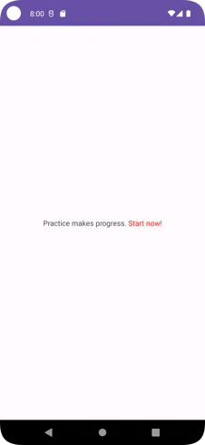
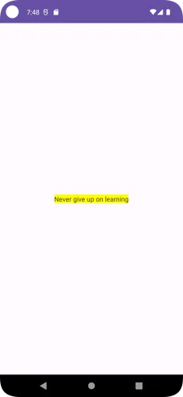
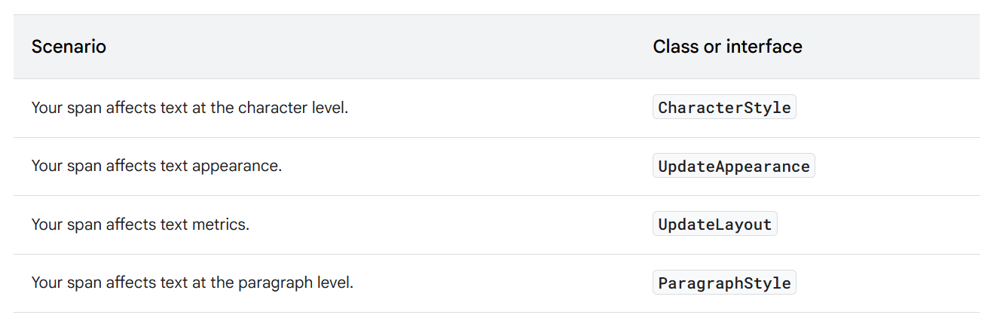

# nhịp

Span cung cấp một cách dễ dàng để tinh chỉnh trải nghiệm người dùng ứng dụng của bạn bằng cách sửa đổi màu văn bản, kiểu và thậm chí làm cho văn bản có thể nhấp vào được.

## Các loại nhịp

Hơn 20 loại nhịp có sẵn; chúng tôi sẽ mô tả những cái thường được sử dụng. Nếu bạn muốn có danh sách tất cả các loại, hãy truy cập [tài liệu chính thức của Android.](https://developer.android.com/reference/android/text/style/package-summary)

Một số loại nhịp có thể được thêm vào các ký tự riêng lẻ và một số loại khác phải được thêm vào toàn bộ đoạn văn.

Vì vậy, chúng tôi chia các nhịp thành hai loại:

- Khoảng cách ảnh hưởng đến ký tự (Có thể áp dụng cho từng ký tự)

    - Các khoảng ảnh hưởng đến ngoại hình (màu sắc, nền, kiểu dáng, kích thước),

    - Khoảng cách ảnh hưởng đến số liệu (phông chữ, căn chỉnh, chiều cao dòng)

- Đoạn ảnh hưởng đến các nhịp (Phải áp dụng cho toàn bộ phần)

## Triển khai Span

Span có thể được tạo bằng bất kỳ lớp nào trong thư viện Android:

- **SpannedString** là loại văn bản không thể thay đổi sau khi đã tạo (immutable). Nó có chiều dài và kiểu dáng cố định. Bạn có thể sử dụng nó để hiển thị một số văn bản đã được định dạng và không cần sửa đổi.
- **SpannableString** là loại văn bản không thể thay đổi sau khi đã tạo (immutable). Nó có độ dài cố định nhưng kiểu dáng có thể thay đổi. Bạn có thể áp dụng các kiểu và định dạng khác nhau cho các phần khác nhau của văn bản.
- **SpannableStringBuilder** là loại văn bản có thể thay đổi về nội dung và kiểu dáng. Nó có chiều dài và kiểu dáng thay đổi. Bạn có thể sử dụng nó để thực hiện các thao tác trên văn bản và kiểu của nó, chẳng hạn như thêm, xóa, thay thế, v.v.

Chọn lớp thích hợp dựa trên yêu cầu của bạn.

Để áp dụng một khoảng, hãy gọi


```kotlin
SpanObject.setSpan(Object span, int start, int end, int flags)
```

- `Object span` để áp dụng văn bản cho
- `int start` biểu thị vị trí bắt đầu của văn bản nơi áp dụng khoảng.
- `int end` thể hiện vị trí ngay sau ký tự cuối cùng mà span sẽ được áp dụng. Nói cách khác, khoảng sẽ áp dụng tối đa **nhưng không bao gồm ký tự ở vị trí được chỉ định ở cuối.**
- `int flags` giá trị "cờ" xác định cách một khoảng văn bản phản ứng với văn bản được chèn trong phạm vi của nó. Chúng ta có thể sử dụng `Spannable.SPAN_EXCLUSIVE_INCLUSIVE` hoặc `Spannable.SPAN_EXCLUSIVE_EXCLUSIVE`.
    - Spannable.`SPAN_EXCLUSIVE_INCLUSIVE` có thể giúp bạn khi bạn áp dụng một khoảng văn bản có cờ này cho một phạm vi văn bản cụ thể, chẳng hạn như một chuỗi con, sau đó chèn văn bản mới trong phạm vi đó, phạm vi sẽ tự động mở rộng để bao gồm văn bản mới được chèn. Nói cách khác, mọi định dạng hoặc thuộc tính liên quan đến khoảng sẽ áp dụng cho cả văn bản gốc và văn bản được chèn. Điều này có thể hữu ích khi bạn muốn định dạng của một khoảng bao gồm mọi sửa đổi được thực hiện trong ranh giới của nó.
    - Spannable.`SPAN_EXCLUSIVE_EXCLUSIVE`: Khi bạn áp dụng một khoảng văn bản có cờ này cho một dải văn bản và chèn văn bản mới trong phạm vi đó, khoảng đó sẽ vẫn cố định với ranh giới ban đầu của nó và không bao gồm văn bản được chèn. Nói cách khác, văn bản được chèn sẽ không kế thừa định dạng hoặc thuộc tính của span. Điều này hữu ích khi bạn muốn duy trì một định dạng cụ thể chỉ trên văn bản gốc và ngăn mọi văn bản được chèn kế thừa định dạng đó.

## Khoảng cách đối tượng

### ForegroundColorSpan

Nếu bạn cần thêm màu khác vào một phần cụ thể của văn bản thì `ForegroundColorSpan` là loại nhịp để sử dụng.
Nó thuộc về **Khoảng ảnh hưởng đến ký tự**, vì vậy điều đó có nghĩa là chúng ta có thể áp dụng nó cho bất kỳ phần nào của phần mong muốn của văn bản.

```kotlin
    val text = "Practice makes progress. Start now!"
    val spannableString = SpannableString(text)

    val start = 25 // Start index of the text portion
    val end = 35  // End index of the text portion
    val color = Color.RED // Color for the text portion

    val colorSpan = ForegroundColorSpan(color)
    spannableString.setSpan(colorSpan, start, end, Spanned.SPAN_EXCLUSIVE_EXCLUSIVE)

    sampleSpanColorTextView.text = spannableString //sets text to TextView
```



### BackgroundColorSpan

```kotlin
    val text = "Never give up on learning"
    val spannableString = SpannableString(text)

    val start = 0 // Start index of the text portion
    val end = text.length   // End index of the text portion
    val bgColor = Color.YELLOW // Background color for the text portion

    val bgColorSpan = BackgroundColorSpan(bgColor)
    spannableString.setSpan(bgColorSpan, start, end, Spanned.SPAN_EXCLUSIVE_EXCLUSIVE)

    binding.sampleSpanBackgroundTV.text = spannableString
```



### StyleSpan

Với lớp `StyleSpan`, bạn có thể áp dụng các kiểu văn bản như in đậm, in nghiêng, gạch chân hoặc gạch ngang cho bất kỳ phần nào của văn bản. Nó cũng là một phần của Khoảng thời gian ảnh hưởng đến tính cách.

```kotlin
    val text = "This is a bold italic text style"
    val spannableString = SpannableString(text)

    val start = 10 // Start index of the text portion
    val end = 32  // End index of the text portion

    // Apply bold and italic styles
    val styleSpan = StyleSpan(Typeface.BOLD_ITALIC)
    spannableString.setSpan(styleSpan, start, end, Spanned.SPAN_EXCLUSIVE_EXCLUSIVE)

    binding.sampleSpanStyleTV.text = spannableString
```


### ClickableSpan

`ClickableSpan` là một lớp trong Android cho phép bạn làm cho một phần của chế độ xem văn bản có thể nhấp được và thực hiện một số hành động khi được nhấp vào. Nó là một lớp con của `CharacterStyle`.
```kotlin
    val text = "Click me for an action"
    val spannableString = SpannableString(text)

    val start = 0 // Start index of the text portion
    val end = text.length // End index of the text portion

    // Define the action to be performed when the text is clicked
    val clickableSpan = object : ClickableSpan() {
        override fun onClick(widget: View) {
            // Action to perform when the text is clicked
            Toast.makeText(requireContext(), "Text Clicked!", Toast.LENGTH_SHORT).show()
        }
    }

    spannableString.setSpan(clickableSpan, start, end, Spanned.SPAN_EXCLUSIVE_EXCLUSIVE)

    // Enable clickable behavior on the TextView
    binding.sampleSpanClickableTV.movementMethod =
        android.text.method.LinkMovementMethod.getInstance()
    binding.sampleSpanClickableTV.text = spannableString
```

### Khoảng tùy chỉnh

Nếu bạn cần chức năng của một span chưa được cung cấp trong các lớp span Android hiện có,
bạn có thể tạo triển khai nhịp tùy chỉnh của mình.

Trước tiên, bạn phải quyết định khoảng này sẽ thay đổi những gì để biết lớp cơ sở nào cần mở rộng và giao diện nào cần triển khai.
Để tham khảo, bạn có thể kiểm tra bảng dưới đây:



Ví dụ: Trong lớp tùy chỉnh này, chúng tôi sẽ thay đổi màu văn bản thành màu đỏ và tạo văn bản lớn hơn với kiểu in đậm.

Thông qua inheritance, `RelativeSizeSpan` mở rộng `CharacterStyle` và triển khai hai giao diện `Update`.

Chúng tôi đã tạo một lớp mới với `CustomSpan` mở rộng `RelativeSizeSpan`(tỷ lệ float) với ba tham số:
- `size`: giá trị Float biểu thị kích thước tương đối của khoảng văn bản.
- `color`: chú thích @ColorInt cho biết màu của khoảng văn bản.
- `isBoldText`: cờ Boolean cho biết văn bản có được hiển thị in đậm hay không.

Lớp này ghi đè phương thức `updateDrawState`, chịu trách nhiệm cập nhật hình thức trực quan của văn bản. Phương thức này được gọi khi văn bản được vẽ trên màn hình. Bên trong phương thức `updateDrawState`:

- Lệnh gọi `super.updateDrawState(textPaint)` gọi việc triển khai phương thức updateDrawState của lớp cha, thiết lập kích thước văn bản tương đối.
- `textPaint?.color = color` đặt màu văn bản của nhịp bằng màu được cung cấp.
- `textPaint.isFakeBoldText = isBoldText` thiết lập độ đậm của khoảng văn bản dựa trên cờ `isBoldText`.

```kotlin
class CustomSpan(
    size: Float,
    @ColorInt private val color: Int,
    val isBoldText: Boolean
) : RelativeSizeSpan(size) {
    override fun updateDrawState(textPaint: TextPaint) {
        super.updateDrawState(textPaint)
        textPaint?.color = color
        textPaint.isFakeBoldText = isBoldText
    }
}
```
Sau đó, chúng tôi thêm lớp tùy chỉnh này làm tham số cho phương thức `setSpan`.

```kotlin
 val customSpan = CustomSpan(3.5f, Color.RED, true)
        val text = SpannableString("Custom span text")
        text.setSpan(customSpan, 0, 6, Spanned.SPAN_EXCLUSIVE_EXCLUSIVE)
        binding.sampleSpanCustom.text = text
```

Kết quả:


