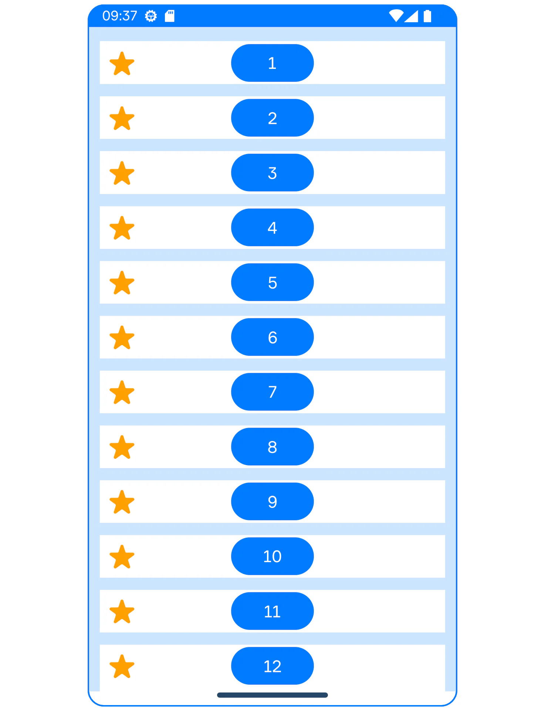

#ItemDecoration

`ItemDecoration` là một lớp trừu tượng có ba phương thức:

1. `getItemOffsets(outRect: Rect, view: View, parent: RecyclerView, state: RecyclerView.State)`
Phương pháp này cho phép bạn đặt độ lệch xung quanh từng mục trong `RecyclerView`.
Những khoảng lệch này giúp kiểm soát vị trí và khoảng cách của mục.
`outRect` biểu thị không gian xung quanh vật phẩm. Bạn có thể sửa đổi các thuộc tính của nó, chẳng hạn như `left`, `top`, `right` và `bottom`, để chỉ định khoảng cách giữa các mục. Khoảng cách sẽ thêm vào phần đệm gốc và lề mục hiện có. Tham số `view` biểu thị View của mục hiện tại trong `RecyclerView`.

2. `onDraw(c: Canvas, parent: RecyclerView, state: RecyclerView.State)`: Phương pháp này cho phép bạn vẽ các đồ trang trí tùy chỉnh trên khung vẽ của RecyclerView. Mọi thứ mà phương pháp này vẽ ra sẽ được vẽ trước khi xem mục và sẽ được hiển thị bên dưới.

3. `onDrawOver(c: Canvas, parent: RecyclerView, state: RecyclerView.State)`: Tương tự như `onDraw`, phương pháp này cho phép bạn thiết kế các đồ trang trí tùy chỉnh trên khung vẽ của RecyclerView. Tuy nhiên, các đồ trang trí được vẽ bằng `onDrawOver` sẽ xuất hiện ở đầu chế độ xem vật phẩm, không giống như `onDraw`.

Trong cả ba phương pháp, `parent` chính là `RecyclerView` và `state` là trạng thái của RecyclerView.

## Ví dụ

Kế thừa RecyclerView.ItemDecoration

```kotlin
class OffsetItemDecoration(private val spacingInPx: Int) :
    RecyclerView.ItemDecoration() {
    override fun getItemOffsets(
        outRect: Rect,
        view: View,
        parent: RecyclerView,
        state: RecyclerView.State
    ) {
        outRect.left = spacingInPx
        outRect.top = spacingInPx
        outRect.right = spacingInPx
        outRect.bottom = spacingInPx
    }
}
```

Để thêm trang trí này vào `RecyclerView`, chúng tôi sẽ sử dụng phương pháp `addItemDecoration`:

```kotlin
 recycler.addItemDecoration(
        OffsetItemDecoration(resources.getDimensionPixelSize(R.dimen.offsets))
    )
```

Thêm trang trí biểu tượng:

```kotlin
class IconItemDecoration(
    private val iconDrawable: Drawable, private val iconSizeInPx: Int
) : RecyclerView.ItemDecoration() {

    override fun onDrawOver(c: Canvas, parent: RecyclerView, state: RecyclerView.State) {

        // parent.childCount returns the number of items displayed on the screen
        for (i in 0 until parent.childCount) { 
            
            // parent.getChildAt(index: Int) returns the view of a specific item 
            val view = parent.getChildAt(i)

            val left = view.left
            val top = view.top
            val right = left + iconSizeInPx
            val bottom = top + iconSizeInPx
            /* try to replace bottom for the following code and 
            you'll get an interesting result*/
            // val bottom = (child.bottom - top) / 2 + iconSizeInPx / 2

            iconDrawable.setBounds(left, top, right, bottom)
            iconDrawable.draw(c)
        }
    }
}
```

> [!CAUTION]
> phương thức onDraw() vẽ nội dung của nó trước khi các mục được vẽ và vì các biểu tượng của chúng tôi nằm chính xác ở góc của các mục nên chúng tôi không thể nhìn thấy chúng. Giải pháp là sử dụng onDrawOver() thay vì onDraw():



Nhưng hãy xem thêm một ví dụ nữa:

```kotlin
class FrameItemDecoration(private val frameWidthInPx: Int): RecyclerView.ItemDecoration() {

    private val framePaint = Paint().apply {
        this.isAntiAlias = true
        this.style = Paint.Style.STROKE
        this.strokeWidth = frameWidthInPx.toFloat()
        this.color = Color.parseColor("#CCE5FF")
    }

    override fun onDrawOver(c: Canvas, parent: RecyclerView, state: RecyclerView.State) {

        for (i in 0 until parent.childCount) {
            val view = parent.getChildAt(i)

            /* rect top,left,right,bottom coordinates are in the middle 
            of the frame border, so it should start to draw from 
            view.left + half of the desired width */

            val left = (view.left + frameWidthInPx / 2).toFloat()
            val top = (view.top + frameWidthInPx / 2).toFloat()
            val bottom = (view.bottom - frameWidthInPx / 2).toFloat()
            val right = (view.right - frameWidthInPx / 2).toFloat()

            // the fifth (rx) parameter is the outer radius of the corner
            // the sixth (ry) parameter is the inner radius of the corner
            c.drawRoundRect(left, top, right, bottom, 32f, 32f, framePaint)
        }
    }
}
```


Như bạn có thể nhận thấy, khi định vị đồ trang trí, chúng tôi phụ thuộc vào vị trí của vật phẩm, tính toán nó bằng cách sử dụng `view.left/top/right/bottom`.
Nhưng nếu các vật phẩm của chúng ta có một số hình ảnh động thì sao? Liệu phương pháp được đề cập có cung cấp vị trí chính xác trong những trường hợp này không? Thật không may là không.
Tuy nhiên, có một cách để có được dữ liệu cần thiết.
Hãy xem làm thế nào chúng ta có thể làm điều đó.

Hãy xem xét một số thuộc tính chịu trách nhiệm về vị trí của khung nhìn:

- `view.left` là tọa độ x trực quan của cạnh trái của chế độ xem so với chế độ xem gốc tính bằng pixel. **Nó không bao gồm bất kỳ bản dịch nào được áp dụng cho chế độ xem.**

- `view.x` là tọa độ x trực quan của góc trên bên trái của chế độ xem so với chế độ xem gốc của nó.
Nó bao gồm bất kỳ bản dịch nào được áp dụng cho chế độ xem. Nếu chế độ xem đã được dịch theo chiều ngang, `view.x` sẽ phản ánh vị trí được cập nhật.

- `view.translationX` là bản dịch ngang của góc nhìn từ vị trí ban đầu. Nó cho biết chế độ xem đã di chuyển theo chiều ngang bao xa so với vị trí bố cục ban đầu của nó.

Tương tự, `view.top` cung cấp vị trí dọc ban đầu, `view.y` phản ánh vị trí trực quan hiện tại và `view.translationY` hiển thị bản dịch dọc của chế độ xem.

Việc lựa chọn sử dụng tùy thuộc vào việc bạn muốn bản vẽ của mình dựa trên vị trí bố cục ban đầu hay vị trí trực quan hiện tại của các mục trong `RecyclerView`.

> [!CAUTION]
> Đối với hầu hết các phần, chúng tôi khuyên bạn nên sử dụng .x và .y vì RecyclerView hầu như luôn có một số hoạt ảnh có thể ảnh hưởng đến vị trí trang trí của bạn và dẫn đến kết quả không mong muốn.

## Ưu điểm của ItemDecoration

Công cụ `RecyclerView.ItemDecoration` giúp bạn tùy chỉnh giao diện của `RecyclerView` mà không thay đổi dữ liệu cơ bản. **Nó cung cấp một số lợi thế chính so với việc thêm đồ trang trí thông qua bố cục XML**:

- **Tách trang trí khỏi logic**. Việc tuân thủ nguyên tắc separation of concerns là điều cần thiết để thiết kế phần mềm hiệu quả, mã của bạn trở nên mô-đun hơn, dễ hiểu và kiểm tra hơn.

- **Quản lý trang trí tập trung và đơn giản hóa**. Bằng cách có một điểm quản lý duy nhất trong mã của bạn, việc duy trì và cập nhật trở nên dễ dàng hơn đáng kể.

- **Khả năng tái sử dụng giữa các loại vật phẩm và RecyclerViews**. Sau khi tạo `ItemDecoration`, bạn có thể áp dụng nó cho các loại vật phẩm khác nhau trong cùng một `RecyclerView` hoặc thậm chí trên các `RecyclerViews` khác nhau

- **Tùy chỉnh động**. Với một vài dòng mã, bạn có thể thay đổi giao diện của các mục dựa trên nhiều yếu tố khác nhau, như vị trí của chúng trong `RecyclerView` hoặc dữ liệu chúng lưu giữ


Tuy nhiên, hãy lưu ý rằng `ItemDecoration` không tương tác và không bao gồm các tính năng trợ năng. 
Không thể nhấp vào các trang trí, không phản hồi với thông tin đầu vào của người dùng và hạn chế hình ảnh vẽ mà không có khả năng kết hợp văn bản hữu ích.
**Đây là điểm quan trọng vì đồ trang trí nhằm mục đích nâng cao hình ảnh mà không ảnh hưởng đến chức năng cốt lõi của vật phẩm.**

Hiểu được những lợi ích cơ bản của việc sử dụng ItemDecoration sẽ giúp bạn chuẩn bị tốt hơn để tận dụng các khả năng của nó tùy theo trường hợp sử dụng.

## ItemDecoration nâng cao


> [!CAUTION]
> Vì ItemDecorations được liên kết với các lượt xem nên chúng không tồn tại khi các lượt xem được tái sử dụng. Khi một khung nhìn được sử dụng lại cho một mục khác, phần trang trí sẽ bị mất.
> Điều này có nghĩa là bạn không thể dựa vào cách trang trí để truyền dữ liệu hoặc trạng thái từ chế độ xem này sang chế độ xem khác hoặc thậm chí để lưu trữ hay thao tác dữ liệu liên quan đến các mục trong RecyclerView.

Bây giờ chúng ta hãy luyện tập thêm một chút.
Để thực hiện việc này, chúng tôi sẽ sửa đổi FrameItemDecoration của mình để tạo khung chung cho mỗi ba mục.
Để đạt được điều này, hãy tạo một khung lớn với đường viền trên cùng thẳng hàng với mục đầu tiên và đường viền dưới cùng với mục thứ ba:

```kotlin
class FrameItemDecoration(private val frameWidthInPx: Int) :
    RecyclerView.ItemDecoration() {

    private val framePaint = Paint().apply {
        this.isAntiAlias = true
        this.style = Paint.Style.STROKE
        this.strokeWidth = frameWidthInPx.toFloat()
        this.color = Color.parseColor("#CCE5FF")
    }

    override fun onDrawOver(c: Canvas, parent: RecyclerView, state: RecyclerView.State) {
        if (parent.childCount >= 1) { // check is there any item in recyclerView
            val frameHeight = parent.getChildAt(0).height * 3 - frameWidthInPx
            val diff = (frameWidthInPx / 2).toFloat()

            for (i in 0 until parent.childCount) {
                val view = parent.getChildAt(i)
                val position = parent.getChildViewHolder(view).layoutPosition
                val left = (view.left + diff)
                val right = (view.right - diff)
                
                if ((position + 1) % 3 == 1) {
                    val top = (view.top + diff)
                    val bottom = (top + frameHeight)
                    c.drawRoundRect(left, top, right, bottom, 32f, 32f, framePaint)
                } else if ((position + 1) % 3 == 0) {
                    val bottom = (view.bottom - diff)
                    val top = (bottom - frameHeight)
                    c.drawRoundRect(left, top, right, bottom, 32f, 32f, framePaint)
                }
            }
        }
    }
}
```


Sử dụng khung này làm tham chiếu, rõ ràng việc vẽ bằng `Canvas` không hề phức tạp.
Nó cho phép chúng tôi đạt được những kết quả thú vị nhưng đòi hỏi sự chú ý và chính xác, đặc biệt là khi làm việc trên `RecyclerView` động.

Mặc dù `Canvas` phù hợp với các bản vẽ động, nhưng việc tạo các phần tử trang trí phức tạp trong bố cục XML có thể hiệu quả hơn về mặt thời gian phát triển.
XML cung cấp một cách khai báo để thể hiện UI, cách này có thể mang lại lợi ích cho một số phần tử tĩnh hoặc ít động hơn, tiết kiệm thời gian so với vẽ thủ công bằng Canvas.


**Khi quyết định giữa bố cục XML và Canvas, hãy xem xét mức độ phức tạp và tính năng động trong trang trí của bạn.**


## Thẩm quyền giải quyết

[ItemDecoration](https://hyperskill.org/learn/step/39548)


