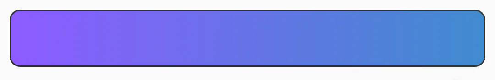
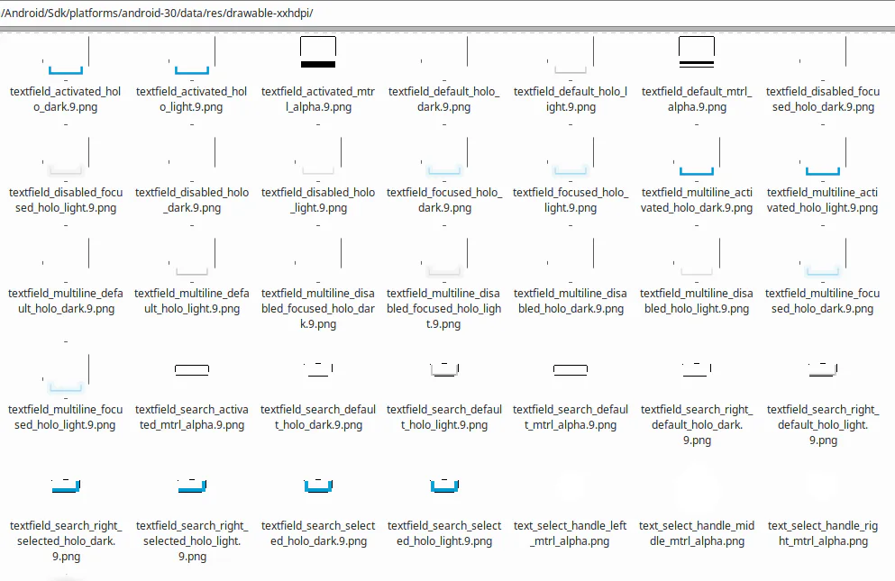
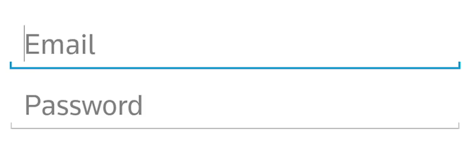
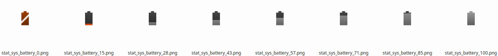

## vectơ

`VectorDrawables` là hình ảnh trong Android được xác định bằng vector graphics, nghĩa là chúng được tạo bằng các đường, đường cong và hình dạng thay vì pixel như hình ảnh truyền thống.
Chúng tương tự như hình ảnh `SVG` (Vector Graphics có thể mở rộng) được sử dụng trên web.

Đây là một ví dụ:

Trong Android Studio, bạn có thể dễ dàng nhập các tệp SVG hiện có và chuyển đổi chúng thành VectorDrawables (Tệp → Mới → Tài sản vectơ).
process này đơn giản hóa việc tạo vector graphics cho ứng dụng của bạn mà không cần phải viết mã XML theo cách thủ công.

Lớp `VectorDrawable` được sử dụng để xử lý vector graphics. Không giống như màu sắc hoặc hình ảnh, không có lớp cụ thể nào cho vectơ.

> [!CAUTION]
> Ngoài ra, bạn không thể tạo bản vẽ vector theo chương trình bằng mã;
> bạn phải sử dụng tệp XML để xác định chúng. Điều này có nghĩa là bạn không thể tạo động vector graphics tại runtime, chúng cần được xác định trước trong tài nguyên ứng dụng của bạn.

## Hình dạng và độ dốc

Chúng ta có thể tạo hình chữ nhật có các góc được bo tròn, tô màu gradient ngang theo cách sau:

```xml
<?xml version="1.0" encoding="utf-8"?>
<shape xmlns:android="http://schemas.android.com/apk/res/android">
    <corners
        android:radius="8dp" />
    <gradient
        android:angle="0"
        android:startColor="#8C5AFF"
        android:endColor="#408BCF" />
    <stroke
        android:width="1dp"
        android:color="#333333" />
</shape>
```



Trớ trêu thay, lớp `ShapeDrawable` không thực sự được sử dụng khi bạn xác định `<shape>` trong XML.
Thay vào đó, khi bạn tạo `<shape>`, Android sẽ chuyển đổi nó thành `GradientDrawable`, ngay cả khi nó chỉ chứa một màu đồng nhất.

Đây là Kotlin tương đương với định nghĩa `<shape>` ở trên:

```kotlin
GradientDrawable().apply {
    cornerRadius = dp(8f)
    orientation = GradientDrawable.Orientation.LEFT_RIGHT
    colors = intArrayOf(0xFF8C5AFF.toInt(), 0xFF408BCF.toInt())
    setStroke(dp(1), 0xFF333333.toInt())
}
```

ví dụ này sử dụng hai chức năng bổ sung:

```kotlin
/** Converts Device Independent Pixels to pixels. Returns an `Int` or a `Float` based on [value]'s type. */
inline fun Context.dip(value: Int): Int = (value * resources.displayMetrics.density).toInt()

/** Converts Device Independent Pixels to pixels. Returns an `Int` or a `Float` based on [value]'s type. */
inline fun Context.dip(value: Float): Float = (value * resources.displayMetrics.density)
```

## 9 bản vá

**9-patch** là hình ảnh raster (PNG) với các vùng có thể kéo dài.
Nó chủ yếu được sử dụng làm nền vì nó tự động điều chỉnh theo kích thước của chế độ xem.

Để minh họa điều này, chúng ta hãy xem qua một số bản vá từ Android SDK:



Vì vậy, các tệp này có phần mở rộng `.9.png`, chúng là các tệp PNG hợp lệ, nhưng có một số dấu gạch ngang màu đen xung quanh hình ảnh.
Các bản vá có đường viền một pixel đặc biệt: các pixel màu đen ở bên trái và ở trên cùng biểu thị các vùng có thể kéo dài và các pixel không phải màu đen ở bên phải và ở dưới cùng biểu thị phần đệm.

Kết xuất ví dụ của EditTexts sử dụng hình ảnh `textfield_` được kéo dài từ ảnh chụp màn hình ở trên:



Để biết thêm chi tiết, hãy xem [tài liệu chính thức về 9 bản vá](https://developer.android.com/guide/topics/graphics/drawables#nine-patch) và [cách tạo bản vá trong Android Studio](https://developer.android.com/studio/write/draw9patch). Đối với API, vui lòng tham khảo [NinePatch](https://developer.android.com/reference/android/graphics/NinePatch) và [NinePatchDrawable](https://developer.android.com/reference/android/graphics/drawable/NinePatchDrawable).

Trong ảnh chụp màn hình ở trên, có một số bản vá 9 được gọi là "mặc định", "đã kích hoạt", "bị vô hiệu hóa", "tập trung" và "đã chọn".

## Bộ chọn Drawable

`<selector>` cũng có thể tham chiếu `Drawables`, do đó `StateListDrawable` là `Drawable` tổng hợp cũng phụ thuộc vào trạng thái hiện tại.

```xml
<?xml version="1.0" encoding="utf-8"?>
<!-- Apache 2.0 License header skipped… -->

<selector xmlns:android="http://schemas.android.com/apk/res/android">
    
    <item android:state_window_focused="false" android:state_enabled="true"
        android:drawable="@drawable/textfield_search_default" />
        
    <item android:state_pressed="true"
        android:drawable="@drawable/textfield_search_pressed" />
        
    <item android:state_enabled="true" android:state_focused="true"
        android:drawable="@drawable/textfield_search_selected" />
    
    <item android:drawable="@drawable/textfield_search_default" />
    
</selector>
```

Khi tạo bộ chọn theo chương trình:

```kotlin
StateListDrawable().apply {
    addState(
        intArrayOf(-android.R.attr.state_window_focused, android.R.attr.state_enabled),
        textfieldSearchDefault
    )
    addState(
        intArrayOf(android.R.attr.state_pressed),
        textfieldSearchPressed
    )
    addState(
        intArrayOf(android.R.attr.state_enabled, android.R.attr.state_focused),
        textfieldSearchSelected
    )
    addState(
        intArrayOf(),
        textfieldSearchDefault
    )
}
```

## Các đối tượng có thể vẽ khác

- Kể từ khi phát hành Lollipop, các phần tử có thể nhấp vào như mục danh sách sẽ phản hồi các nhấp chuột bằng [RippleDrawable](https://developer.android.com/reference/android/graphics/drawable/RippleDrawable).

- A [LayerDrawable](https://developer.android.com/reference/android/graphics/drawable/LayerDrawable) là một tổ hợp thu hút các thành phần con của nó chồng lên nhau.

- [InsetDrawable](https://developer.android.com/reference/android/graphics/drawable/InsetDrawable) là một công cụ trang trí thêm một số phần đệm vào một Drawable khác.

- `Drawables` cũng có thể có cấp độ: một số nguyên trong phạm vi `0..10_000`. Ví dụ: mức pin, Wi-Fi và tín hiệu di động là [LevelListDrawables](https://developer.android.com/reference/android/graphics/drawable/LevelListDrawable):



- Ngoài ra còn có `RotateDrawable`, `ScaleDrawable` và `ClipDrawable`. Giao diện của các Đối tượng có thể vẽ này cũng phụ thuộc vào giá trị cấp độ.

- Cuối cùng, đối với thứ gì đó có thể chuyển động, bạn có thể kiểm tra `TransitionDrawable`, `AnimationDrawable` hoặc `AnimatedVectorDrawable`, cùng nhiều thứ khác.


## thẩm quyền giải quyết

- [Vector Graphics và bản vẽ nâng cao](https://hyperskill.org/learn/step/45974)