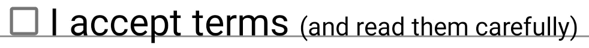
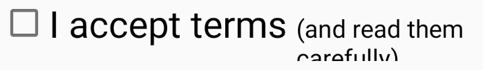
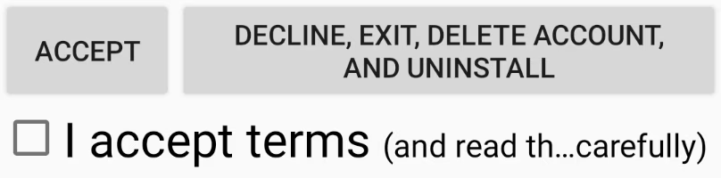
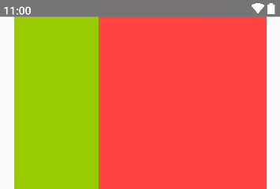
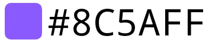

#LinearLayout

Kiểu bố trí này rất đơn giản. Tất cả các phần tử trong LinearLayout được xếp theo chiều dọc hoặc chiều ngang dọc theo một dòng

Có hai đối số chính cho bố cục này: `android:orientation`, là thuộc tính chính cho chính bố cục và thuộc tính `android:layout_weight` cho Chế độ xem.

## Căn chỉnh đường cơ sở LinearLayout

Mỗi dòng văn bản đều có một đường cơ sở - một đường ngang tưởng tượng mà trên đó các chữ cái của nó "đứng".

LinearLayout theo chiều ngang là baselineAligned theo mặc định. 
Điều này có nghĩa là tất cả trẻ em TextView đều có chung đường cơ sở.

Hãy xem xét ví dụ về bố cục sau (lưu ý rằng CheckBox kế thừa TextView và cũng có đường cơ sở):

```xml
<?xml version="1.0" encoding="utf-8"?>
<LinearLayout
    xmlns:android="http://schemas.android.com/apk/res/android"
    android:orientation="horizontal"
    android:layout_width="match_parent"
    android:layout_height="wrap_content">

    <CheckBox
        android:layout_width="wrap_content"
        android:layout_height="wrap_content"
        android:textSize="24sp"
        android:text="I accept terms " />

    <TextView
        android:layout_width="wrap_content"
        android:layout_height="wrap_content"
        android:textSize="16sp"
        android:text="(and read them carefully)" />

</LinearLayout>
```


Mỗi TextViews này có textSize khác nhau và chiều cao khác nhau. Không có trọng lực nào được chỉ định và bạn có thể xem bố cục trông như thế nào bên dưới (một đường màu xám đã được thêm vào để biểu thị đường cơ sở):



Phần trên được hiển thị đẹp mắt, nhưng bạn cần lưu ý rằng việc căn chỉnh đường cơ sở có thể gây khó chịu cho bạn khi xử lý văn bản nhiều dòng. Ảnh chụp màn hình sau đây được chụp trên màn hình có chiều rộng nhỏ hơn:



Một trường hợp khác có thể xảy ra sự cố là với các thành phần có viền như nút:


Bài học ở đây là căn chỉnh đường cơ sở hoạt động tốt với các đoạn văn bản một dòng nhưng lại mang lại kết quả không mong muốn với các đoạn văn bản nhiều dòng. Do đó, nó phải bị vô hiệu hóa một cách rõ ràng đối với mọi `LinearLayout` theo chiều ngang nơi loại căn chỉnh này không được dự định.


Vô hiệu hóa căn chỉnh đường cơ sở không phải là cách chữa trị duy nhất. Các nút trông đẹp hơn khi chúng có chiều cao bằng nhau và văn bản thuần túy có thể bị buộc phải giữ nguyên trên một dòng, như minh họa bên dưới:

```xml
<?xml version="1.0" encoding="utf-8"?>
<LinearLayout
    xmlns:android="http://schemas.android.com/apk/res/android"
    android:orientation="vertical"
    android:layout_width="match_parent"
    android:layout_height="wrap_content">

    <LinearLayout
        android:layout_width="match_parent"
        android:layout_height="wrap_content"
        android:baselineAligned="false">
        <!--
        baselineAligned won't break this layout
        because buttons have match_parent height.
        However, it is disabled both for explicitness
        and performance reasons.
        -->

        <Button
            android:layout_width="wrap_content"
            android:layout_height="match_parent"
            android:text="Accept" />

        <Button
            android:layout_width="wrap_content"
            android:layout_height="match_parent"
            android:text="Decline, exit, delete\u00A0account, and\u00A0uninstall" />

    </LinearLayout>

    <LinearLayout
        android:layout_width="match_parent"
        android:layout_height="wrap_content">

        <CheckBox
            android:layout_width="wrap_content"
            android:layout_height="wrap_content"
            android:textSize="24sp"
            android:text="I accept terms " />

        <TextView
            android:layout_width="wrap_content"
            android:layout_height="wrap_content"
            android:textSize="16sp"
            android:ellipsize="middle"
            android:singleLine="true"
            android:text="(and read them carefully)" />

    </LinearLayout>

</LinearLayout>
```



## Bộ chia LinearLayout

LinearLayout còn có thể vẽ dải phân cách giữa các con. Để tận dụng tính năng này, bạn chỉ cần tạo một đường vẽ thích hợp (trong trường hợp của chúng tôi là một đường ngang), đặt nó làm dải phân cách và chỉ định nơi bạn muốn đặt nó:

```xml
<!-- drawable/divider.xml -->
<?xml version="1.0" encoding="utf-8"?>
<shape xmlns:android="http://schemas.android.com/apk/res/android">
    <solid android:color="#20000000" />
    <size android:height="1dp" />
</shape>
```


```xml
<!-- layout/linear_with_dividers.xml -->
<?xml version="1.0" encoding="utf-8"?>
<LinearLayout
    xmlns:android="http://schemas.android.com/apk/res/android"
    android:layout_width="match_parent"
    android:layout_height="wrap_content"
    android:orientation="vertical"
    android:divider="@drawable/divider"
    android:showDividers="middle|end">

    <TextView
        android:layout_width="match_parent"
        android:layout_height="wrap_content"
        android:padding="8dp"
        android:textAppearance="?android:textAppearanceLarge"
        android:text="Thing #1" />

    <TextView
        android:layout_width="match_parent"
        android:layout_height="wrap_content"
        android:padding="8dp"
        android:textAppearance="?android:textAppearanceLarge"
        android:text="Thing #2" />

</LinearLayout>
```

Tùy chọn khác là `beginning`, vẽ một dải phân cách trước chế độ xem đầu tiên. Bạn có thể chỉ định bất kỳ sự kết hợp nào của ba tùy chọn này, bao gồm cả ba tùy chọn nếu bạn muốn: `beginning|middle|end`.

## Trọng lượng LinearLayout

Ví dụ: chúng ta có thể chỉ định rằng một đứa trẻ sử dụng 30% và đứa trẻ khác sử dụng 60% dung lượng có sẵn:
```xml
<?xml version="1.0" encoding="utf-8"?>
<LinearLayout
    xmlns:android="http://schemas.android.com/apk/res/android"
    android:layout_width="match_parent"
    android:layout_height="match_parent"
    android:orientation="horizontal"
    android:weightSum="1"
    android:gravity="center_horizontal">

    <View
        android:layout_width="0dp"
        android:layout_height="match_parent"
        android:layout_weight=".3"
        android:background="@android:color/holo_green_light" />

    <View
        android:layout_width="0dp"
        android:layout_height="match_parent"
        android:layout_weight=".6"
        android:background="@android:color/holo_red_light" />

</LinearLayout>
```


## Các thiết bị có thể kéo hỗn hợp TextView

Chúng ta thường cần đặt hình ảnh và văn bản cạnh nhau: ảnh sản phẩm gần tên của nó, ảnh hồ sơ phía trên tên người dùng hoặc thậm chí là một nút có biểu tượng.

Một cách rõ ràng để thực hiện điều này là đặt `TextView` và `ImageView` trong `LinearLayout`.
Điều này có thể chấp nhận được nhưng có một lựa chọn khác đơn giản hơn và hiệu quả hơn.

`TextView` có sáu thuộc tính XML cho phép bạn đính kèm các hình ảnh được gọi là hình ảnh có thể vẽ ghép bên cạnh nội dung của nó:
`drawable(Left|Start|Top|Right|End|Bottom)`. Điều này có nghĩa là `TextView` có khả năng tự hiển thị tối đa bốn đối tượng có thể vẽ.
Cũng có thể tạo khoảng cách cho các đối tượng có thể vẽ khỏi văn bản bằng thuộc tính `drawablePadding`.

```xml
<Button
    xmlns:android="http://schemas.android.com/apk/res/android"
    android:layout_width="wrap_content"
    android:layout_height="wrap_content"
    android:text="Play"
    android:drawablePadding="4dp"
    android:drawableTop="@android:drawable/ic_media_play" />
```


Tất nhiên, có một số hạn chế được liệt kê dưới đây. 
Nhưng bạn có thể sử dụng `LinearLayout` nếu bạn gặp phải bất kỳ vấn đề nào trong số đó:

- `gravity` không bao giờ ảnh hưởng đến các đối tượng có thể kéo được; nó chỉ tác động đến vị trí văn bản.

- Chỉ có một thuộc tính `drawablePadding` cho cả bốn đối tượng có thể vẽ
(bạn có thể giải quyết vấn đề này bằng cách tạo tệp có thể vẽ XML với thẻ gốc `<inset>` và chỉ định các độ lệch khác nhau).

- Không có `scaleType` và nhiều thuộc tính cụ thể khác của `ImageView`- cũng bị thiếu.

- Ngoài ra, không có listener nhấp chuột riêng biệt để cho biết khi nào đối tượng có thể vẽ cụ thể được nhấp vào
`OnClickListener` chỉ có thể được áp dụng cho toàn bộ `TextView`.


Java/Kotlin API liên quan đến các đối tượng có thể kéo kết hợp hơi khác so với các thuộc tính XML.
Có một cặp phương thức `(get|set)CompoundDrawablePadding` cho thuộc tính `drawablePadding`,
và một loạt các phương pháp để tự lấy và thiết lập các đối tượng có thể vẽ.

Những điều này có thể được thể hiện một cách tổng quát như
`setCompoundDrawables[Relative][WithIntrinsicBounds](4×(Drawable? or @DrawableRes Int))` và `getCompoundDrawables[Relative](): Array<Drawable>`.

Cách đơn giản nhất là `setCompoundDrawablesWithIntrinsicBounds(left: Int, top: Int, right: Int, bottom: Int)`: bạn chỉ cần chuyển ID tài nguyên có thể vẽ và nó sẽ hoạt động. 

Ví dụ: `setCompoundDrawablesWithIntrinsicBounds(0, android.R.drawable.ic_media_play, 0, 0)` tương tự như phiên bản XML ở trên.
Các phiên bản tương đối sử dụng bắt đầu và kết thúc thay vì trái và phải. Ngoài ra, cả hai phương pháp đều bị quá tải để chấp nhận Drawable? gõ vào những thời điểm chúng đã được khởi tạo hoặc tạo theo chương trình.

Vậy "có giới hạn nội tại" nghĩa là gì? Một số đối tượng có thể vẽ có kích thước riêng (tất cả các đối tượng vectơ đều có),
và một số trong số chúng thì không (như các màu có thể vẽ được).
Hình dạng thậm chí còn có nhiều biến đổi hơn: chúng có thể chỉ có chiều rộng, chỉ chiều cao, cả hai hoặc không có. 
Phiên bản phương thức `WithIntrinsicBounds` sử dụng kích thước được cung cấp bởi các đối tượng có thể vẽ.

Nếu bạn cần chỉ định rõ ràng kích thước của đối tượng có thể vẽ, bạn chỉ có thể thực hiện việc này theo chương trình. 
Bắt đầu bằng cách đặt giới hạn của đối tượng có thể vẽ, sau đó gọi `setCompoundDrawables[Relative](Drawable?, Drawable?, Drawable?, Drawable?)`,
không bao giờ sử dụng giới hạn nội tại. Đoạn mã sau minh họa cách tiếp cận này bằng cách tạo toàn bộ TextView và một hình dạng theo chương trình:

```kotlin
val sp = resources.displayMetrics.scaledDensity

TextView(context).apply {
    text = "#8C5AFF"
    setTextColor(Color.BLACK)
    textSize = 24f
    typeface = Typeface.MONOSPACE
    setCompoundDrawables(
        GradientDrawable().apply {
            cornerRadius = 4 * sp
            setColor(0xFF8C5AFF.toInt())
            setBounds(0, 0, (24 * sp).toInt(), (24 * sp).toInt())
        },
        null,
        null,
        null,
    )
    compoundDrawablePadding = (4 * sp).toInt()
}
```
Điều quan trọng là phải chú ý đến lệnh gọi phương thức `setBounds`: 
nó chấp nhận các số nguyên `left`, `top`, `right` và `bottom`.
Trong ví dụ trên, chúng tôi đã chuyển chiều rộng mong muốn cho tham số `right` và chiều cao cho tham số `bottom`. Bạn có thể xem kết quả trông như thế nào bên dưới:




