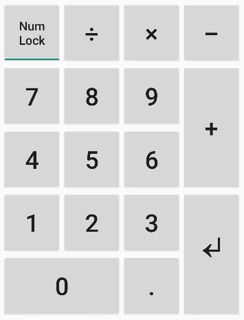

# Lưới và bảng

`GridLayout` là vùng chứa đặt các phần tử con của nó vào lưới hai chiều.
Bạn có thể sử dụng nó để tạo các giao diện người dùng phức tạp và trình bày một số dữ liệu dạng bảng.


Tương tự như `LinearLayout`, có thuộc tính định hướng xác định hướng hàng:
`horizontal` GridLayout sẽ xếp các ô từ trái sang phải và các hàng từ trên xuống dưới.
Số lượng hàng và cột có thể được chỉ định bằng thuộc tính rowCount và columnCount.

Ngoài ra, giống như trong `LinearLayout`, trẻ em có thể có trọng số, nhưng ở cả hai trục:
`layout_columnWeight` và `layout_rowWeight`.
Tương tự như các bảng HTML, một khung nhìn có thể chiếm nhiều ô theo bất kỳ hướng nào,
nhờ các thuộc tính `layout_columnSpan` và `layout_rowSpan`.

Không giống như các bảng HTML hoặc `LinearLayouts` lồng nhau, các chế độ xem ô được thêm trực tiếp vào `GridLayout` mà không có vùng chứa hàng hoặc ô trung gian.


```xml
<?xml version="1.0" encoding="utf-8"?>
<GridLayout
    xmlns:android="http://schemas.android.com/apk/res/android"
    android:layout_width="match_parent"
    android:layout_height="match_parent"
    android:orientation="horizontal"
    android:columnCount="4">

    <ToggleButton
        android:layout_width="0dp" android:layout_height="0dp"
        android:layout_columnWeight="1" android:layout_rowWeight="1"
        android:textOn="Num\nLock" android:textOff="Num\nLock"
        android:textAllCaps="false" android:textSize="18sp"
        android:checked="true" />

    <Button
        android:layout_width="0dp" android:layout_height="0dp"
        android:layout_columnWeight="1" android:layout_rowWeight="1"
        android:text="÷" android:textSize="36sp" />

    <Button
        android:layout_width="0dp" android:layout_height="0dp"
        android:layout_columnWeight="1" android:layout_rowWeight="1"
        android:text="×" android:textSize="36sp" />

    <Button
        android:layout_width="0dp" android:layout_height="0dp"
        android:layout_columnWeight="1" android:layout_rowWeight="1"
        android:text="–" android:textSize="36sp" />

    <Button
        android:layout_width="0dp" android:layout_height="0dp"
        android:layout_columnWeight="1" android:layout_rowWeight="1"
        android:text="7" android:textSize="36sp" />

    <Button
        android:layout_width="0dp" android:layout_height="0dp"
        android:layout_columnWeight="1" android:layout_rowWeight="1"
        android:text="8" android:textSize="36sp" />

    <Button
        android:layout_width="0dp" android:layout_height="0dp"
        android:layout_columnWeight="1" android:layout_rowWeight="1"
        android:text="9" android:textSize="36sp" />

    <Button
        android:layout_width="0dp" android:layout_height="0dp"
        android:layout_columnWeight="1" android:layout_rowWeight="1"
        android:layout_rowSpan="2"
        android:text="+" android:textSize="36sp" />

    <Button
        android:layout_width="0dp" android:layout_height="0dp"
        android:layout_columnWeight="1" android:layout_rowWeight="1"
        android:text="4" android:textSize="36sp" />

    <Button
        android:layout_width="0dp" android:layout_height="0dp"
        android:layout_columnWeight="1" android:layout_rowWeight="1"
        android:text="5" android:textSize="36sp" />

    <Button
        android:layout_width="0dp" android:layout_height="0dp"
        android:layout_columnWeight="1" android:layout_rowWeight="1"
        android:text="6" android:textSize="36sp" />

    <Button
        android:layout_width="0dp" android:layout_height="0dp"
        android:layout_columnWeight="1" android:layout_rowWeight="1"
        android:text="1" android:textSize="36sp" />

    <Button
        android:layout_width="0dp" android:layout_height="0dp"
        android:layout_columnWeight="1" android:layout_rowWeight="1"
        android:text="2" android:textSize="36sp" />

    <Button
        android:layout_width="0dp" android:layout_height="0dp"
        android:layout_columnWeight="1" android:layout_rowWeight="1"
        android:text="3" android:textSize="36sp" />

    <Button
        android:layout_width="0dp" android:layout_height="0dp"
        android:layout_columnWeight="1" android:layout_rowWeight="1"
        android:layout_rowSpan="2"
        android:text="↵" android:textSize="80sp" />

    <Button
        android:layout_width="0dp" android:layout_height="0dp"
        android:layout_columnWeight="1" android:layout_rowWeight="1"
        android:layout_columnSpan="2"
        android:text="0" android:textSize="36sp" />

    <Button
        android:layout_width="0dp" android:layout_height="0dp"
        android:layout_columnWeight="1" android:layout_rowWeight="1"
        android:text="." android:textSize="36sp" />

</GridLayout>
```


Bạn cũng có thể muốn tìm hiểu về `TableLayout`, đây là một bố cục khá khác biệt được sử dụng cho các mục đích tương tự.


