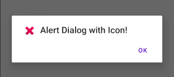

#AlertDialog

AlertDialog, một công cụ do hệ thống Android cung cấp để cung cấp cho người dùng lựa chọn trong các tình huống cụ thể.

## Các loại AlertDialogs


`AlertDialog` là một lớp đặc biệt cho phép bạn tạo và hiển thị cửa sổ bật lên hộp thoại.
Các tính năng tiêu chuẩn của lớp này cho phép bạn triển khai một số loại `AlertDialog`.

Ví dụ: nó có thể là một cửa sổ bật lên đơn giản có tiêu đề và một số văn bản hoặc cửa sổ bật lên có các nút chọn. Chúng ta cũng có thể tạo một cửa sổ với danh sách các mục và sử dụng một hoặc nhiều lựa chọn cho chúng.

Các hành động được thực hiện trong cửa sổ bật lên có thể ảnh hưởng đến hoạt động của ứng dụng: chúng ta có thể rời khỏi ứng dụng, xóa một số dữ liệu, chuyển các mục đã chọn sang hoạt động của mình, v.v.

## Đơn giản AlertDialog


Để hiển thị `AlertDialog`, hãy sử dụng lớp `AlertDialog.Builder` bằng cách chuyển ngữ cảnh tới hàm tạo của nó.

Trong tệp đánh dấu `activity_main.xml`, chúng tôi đã xác định một nút có id `alertDialogButton`. Lớp `AlertDialog.Builder` sẽ cho phép chúng ta xây dựng từng phần cửa sổ bật lên của mình. Đầu tiên, chúng ta sẽ đặt tiêu đề, sau đó là thông báo và sau đó là hai nút có chức năng xử lý tương ứng:


```kotlin
alertDialogButton.setOnClickListener {
    AlertDialog.Builder(this)
        .setTitle("Simple Alert Dialog!")
        .setMessage("Now you know how to use a new component!")
        .setPositiveButton(android.R.string.ok) { _, _ ->
            Toast.makeText(this, "Ok", Toast.LENGTH_SHORT).show()
        }
        .setNegativeButton(android.R.string.cancel, null)
        .show()
}
```


Các hàm `set**Button` chấp nhận văn bản nút và phiên bản `DialogInterface.OnClickListener` với một phương thức onClick trừu tượng duy nhất. Nó nhận các tham số sau: **dialog** (hộp thoại đã nhận được lượt nhấp chuột) và ** which (nút được nhấp vào hoặc vị trí của mục được nhấp vào)**. Điều này giúp tìm ra nút nào trong hộp thoại nào được nhấp vào nếu cùng một callback được sử dụng nhiều lần.

Khi người dùng nhấp vào bất kỳ nút nào, hộp thoại sẽ tự động bị loại bỏ. Do đó, nếu không cần thực hiện thêm hành động nào, listener có thể là `null`.

Chúng ta có thể tạo một hộp thoại bằng phương thức `create()` của Builder, lưu nó vào một biến và chỉ sau đó hiển thị nó:

```kotlin
val dialog = AlertDialog.Builder(this)
    .setTitle("Simple Alert Dialog!")
    .setMessage("Now you know how to use a new component!")
    .create()

alertDialogButton.setOnClickListener {
    dialog.show()
}
```
## AlertDialog với danh sách các mục

### 1. Lựa chọn một lần từ nhiều lựa chọn khác nhau mà không cần nút xác nhận

Chúng tôi có thể tạo `AlertDialog` cho phép người dùng thực hiện một lựa chọn duy nhất từ ​​nhiều lựa chọn khác nhau. Trong trường hợp này, các tùy chọn được lưu trữ trong một mảng. Hộp thoại loại này sẽ đóng khi bạn nhấp vào một mục trong danh sách, **vì vậy các nút sẽ vô dụng trong trường hợp này.**

Đừng quên xóa `.setMessage()`: nếu không, thông báo này sẽ được hiển thị thay vì danh sách.

```kotlin
val items = arrayOf("First Item", "Second Item", "Third Item")

alertDialogButton.setOnClickListener {
    AlertDialog.Builder(this)
        .setTitle("Alert Dialog with a List!")
        .setItems(items) { _, i ->
            Toast.makeText(this, items[i] + " is selected", Toast.LENGTH_SHORT).show()
        }
        .show()
}
```
### 2. Danh sách mục một lựa chọn có nút xác nhận
Bây giờ, hãy tạo một `AlertDialog` với danh sách mục một lựa chọn: để làm điều này, chúng ta sẽ sử dụng phương pháp `setSingleChoiceItems`.

Tham số thứ hai chịu trách nhiệm về mục mặc định. Trong trường hợp này, `-1` có nghĩa là không có giá trị mặc định:

```kotlin
val items = arrayOf("First Item", "Second Item", "Third Item")
var selectedItem = ""

alertDialogButton.setOnClickListener {
    AlertDialog.Builder(this)
        .setTitle("Alert Dialog with SingleChoiceItems List!")
        .setSingleChoiceItems(items, -1) { _, i ->
            selectedItem = items[i]
        }
        .setPositiveButton(android.R.string.ok) { _, _: Int ->
            Toast.makeText(this, selectedItem, Toast.LENGTH_SHORT).show()
        }
        .show()
}
```
### 3. AlertDialog với danh sách trắc nghiệm
Nếu bạn cần một danh sách trắc nghiệm, bạn có thể tạo nó bằng phương pháp `setMultiChoiceItems`. Một lần nữa, tham số thứ hai chịu trách nhiệm về các mục mặc định. Bạn có thể chuyển một mảng boolean ở đó, nhưng ở đây, chúng tôi sẽ chuyển `null`. Tiếp theo, chúng ta chuyển phương thức lambda `onClick` của giao diện `OnMultiChoiceClickListener`. Chữ ký phương thức `onClick`:

```kotlin
onClick(dialog: DialogInterface, which: Int, isChecked: Boolean)
```

- hộp thoại: hộp thoại nơi lựa chọn được thực hiện
- which: vị trí của mục được chọn
- isChecked: true nếu nhấp chuột đã chọn mục, sai nếu không chọn.

```kotlin
val items = arrayOf("First Item", "Second Item", "Third Item")
val selectedItems = ArrayList<String>()

alertDialogButton.setOnClickListener {
    AlertDialog.Builder(this)
        .setTitle("Alert Dialog with MultiChoiceItems List!")
        .setMultiChoiceItems(items, null) { _, i, isChecked ->
            if (isChecked)
                selectedItems.add(items[i])
            else
                selectedItems.remove(items[i])
            Toast.makeText(this, selectedItems.toString(), Toast.LENGTH_SHORT).show()
        }
        .setPositiveButton(android.R.string.ok) { _, _ ->
            Toast.makeText(this, selectedItems.toString(), Toast.LENGTH_SHORT).show()
            selectedItems.clear()
        }
        .show()
}
```

## AlertDialog với chế độ xem nội dung tùy chỉnh

Bạn có thể sử dụng phương pháp `setView()` để chỉ định nội dung phức tạp hơn. Để thực hiện việc này, bạn cần xác định chế độ xem nội dung hộp thoại của riêng mình:

```xml
<?xml version="1.0" encoding="utf-8"?>
<FrameLayout xmlns:android="http://schemas.android.com/apk/res/android"
    android:layout_width="match_parent"
    android:layout_height="wrap_content"
    android:padding="20dp">

    <EditText
        android:id="@+id/editText"
        android:layout_width="match_parent"
        android:layout_height="wrap_content" />

</FrameLayout>
```

Sau đó, bạn cần tạo (tăng cường) chế độ xem và chuyển nó sang phương thức `setView()`:

```kotlin
alertDialogButton.setOnClickListener {
    val contentView = LayoutInflater.from(this).inflate(R.layout.dialog_main, null, false)
    AlertDialog.Builder(this)
        .setTitle("Alert Dialog with Custom View!")
        .setView(contentView)
        .setPositiveButton(android.R.string.ok) { _, _ ->
            val editText = contentView.findViewById<EditText>(R.id.editText)
            Toast.makeText(this, editText.text, Toast.LENGTH_SHORT).show()
        }
        .show()
}
```

> [!CAUTION]
> Khi gọi inflate(resId, null …) như thế này, chuyển null cho tham số gốc, mọi thuộc tính layout_ XML sẽ bị bỏ qua. Đó là lý do tại sao chúng tôi có thêm FrameLayout có phần đệm thay vì chỉ định trực tiếp bố cục_margin cho EditText.

## Tính năng bổ sung

Cùng với setTitle() và setMessage(), chúng ta có thể sử dụng phương thức setIcon() để đặt biểu tượng cho AlertDialog của mình:

```kotlin
.setIcon(android.R.drawable.ic_delete)
```



Chúng ta cũng có thể đặt handler cho tình huống khi cửa sổ bị đóng do nhấn nút bên trong cửa sổ hoặc nút quay lại:

```kotlin
.setOnDismissListener {
    Toast.makeText(this, "AlertDialog dismissed", Toast.LENGTH_SHORT).show()
}
```

Một phương pháp tương tự `setOnShowListener()` đặt callback vào thời điểm cửa sổ xuất hiện.

Chúng ta có thể ghi đè khả năng đóng `AlertDialog` bằng nút quay lại bằng cách gọi `.setCancelable(false)`.

Cuối cùng, phương thức `.dismiss()` sẽ buộc `AlertDialog` của chúng tôi đóng.

##DialogFragment

Cũng có thể tạo `AlertDialog` trong một đoạn. Trước khi khám phá cách thực hiện việc này, trước tiên chúng ta hãy tự nhắc nhở mình phân đoạn là gì bằng cách xem định nghĩa được đưa ra trong tài liệu chính thức của Android:

"Một đoạn đại diện cho một phần mô-đun của user interface trong một hoạt động. Một đoạn có lifecycle riêng, nhận các sự kiện đầu vào của riêng nó và bạn có thể thêm hoặc xóa các đoạn trong khi hoạt động chứa đang chạy."

`AlertDialog` có thể được hiển thị bên trong một đoạn nếu nó được chứa trong `DialogFragment`. Đây là cách DialogFragment được mô tả trong tài liệu:

"Một đoạn hiển thị một cửa sổ hộp thoại, nổi phía trên cửa sổ hoạt động của nó. Đoạn này chứa một đối tượng Dialog, đối tượng này sẽ hiển thị khi thích hợp dựa trên trạng thái của đoạn."

> [!NOTE]
> Tạo một hộp thoại theo cách này thường phức tạp và dài dòng hơn, nhưng nó mang lại cho chúng tôi tính linh hoạt cao hơn, bao gồm các phương pháp API của đoạn lifecycle callback.

Để tạo `DialogFragment` của riêng mình, chúng tôi **phải** tạo một lớp kế thừa từ `DialogFragment`:

```kotlin
class ReactionDialogFragment : DialogFragment() {
    override fun onCreateDialog(savedInstanceState: Bundle?): Dialog {
        return AlertDialog.Builder(requireActivity())
            .setTitle("Alert Dialog with Fragment Lifecycle!")
            .setMessage("FragmentDialog!")
            .setPositiveButton(android.R.string.ok) { _, _ ->
                Toast.makeText(requireActivity(), "Ok", Toast.LENGTH_SHORT).show()
            }
            .show()
    }
}
```

Chúng tôi chỉ cần chuyển hộp thoại tương tự sang phương thức `onCreateDialog` như chúng tôi đã làm trước đây.

Tiếp theo, trong `MainActivity`, bắt đầu hộp thoại này bằng cách nhấp vào nút:

```kotlin
alertDialogButton.setOnClickListener {
    ReactionDialogFragment().show(supportFragmentManager, null)
}
```

Chúng tôi nhận được kết quả tương tự như với `AlertDialog` đơn giản, nhưng bây giờ hộp thoại của chúng tôi có một đoạn lifecycle và các tính năng tương ứng.


## thẩm quyền giải quyết

- [AlertDialog](https://hyperskill.org/learn/step/12330)