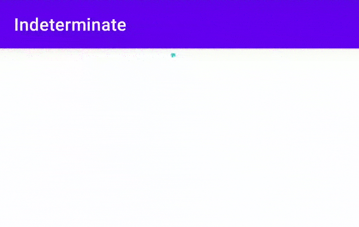
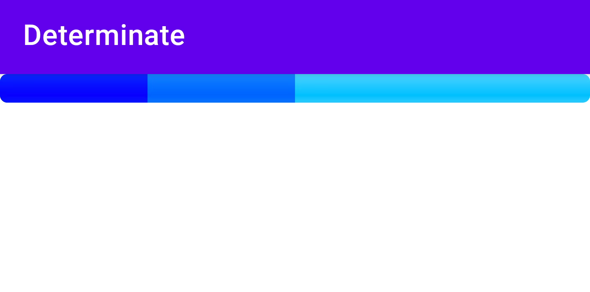
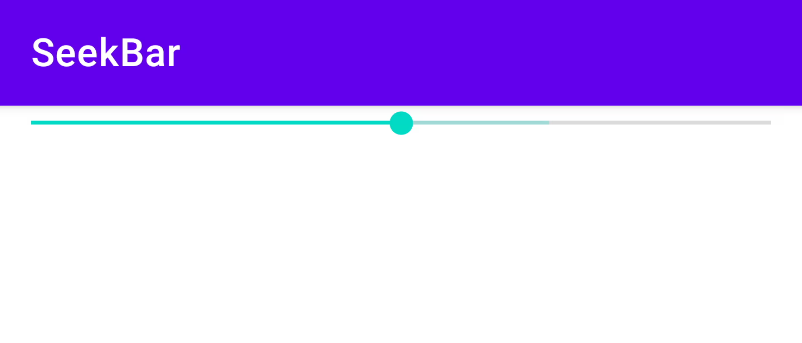
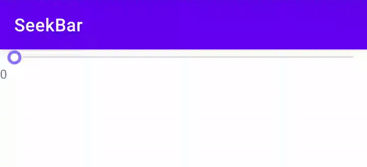

# ProgressBar, SeekBar và RatingBar

Chúng tôi sẽ đề cập đến một số tiện ích do Android framework cung cấp để giúp ứng dụng của bạn sử dụng trực quan và thuận tiện hơn: ProgressBar, SeekBar và RatingBar.

##ProgressBar

`ProgressBar` là phần tử user interface cho biết tiến trình của một hoạt động.

ProgressBar có hai chế độ: 
- `indeterminate`
- `determinate`

###Chế độ không xác định
Chế độ không xác định không hiển thị thời gian thực hiện thao tác. Đó là chế độ mặc định cho `ProgressBar`. 
Bạn có thể hiển thị nó khi bạn bắt đầu một thao tác và ẩn nó sau khi hoàn thành bằng phương thức `setVisibility()` hoặc thuộc tính `android:visibility`. Giá trị mặc định cho `visibility` là `'visible'`. Đây là cách bạn có thể tạo nó:

```xml
<ProgressBar
    android:layout_width="match_parent"
    android:layout_height="wrap_content"/>
```



### Chế độ xác định
Để biểu thị tiến trình xác định, bạn có thể đặt kiểu thành `android.R.style.Widget_ProgressBar_Horizontal`, như trong đoạn mã sau:

```xml
<ProgressBar
    style="@android:style/Widget.ProgressBar.Horizontal"
    android:layout_width="match_parent"
    android:layout_height="wrap_content"
    android:secondaryProgress="50"
    android:progress="25"/>
```

Bạn cũng có thể sử dụng phong cách này để có cái nhìn hiện đại hơn:

```xml
style="@style/Widget.AppCompat.ProgressBar.Horizontal"
```

Làm cách nào bạn có thể tùy chỉnh `ProgressBar`?

Bạn nên đặt `android:progressDrawable`. Nhưng trước tiên hãy tạo một cái:

```xml
<?xml version="1.0" encoding="utf-8"?>
<!--our_progress_drawable.xml-->

<layer-list xmlns:android="http://schemas.android.com/apk/res/android">

    <item android:id="@android:id/background">
        <shape>
            <corners android:radius="5dp" />
            <gradient
                android:startColor="#B300BFFF"
                android:centerColor="#00BFFF"
                android:centerY="0.75"
                android:endColor="#CE00BFFF"
                android:angle="270"
                />
        </shape>

    </item>

    <item android:id="@android:id/secondaryProgress">
        <clip>
            <shape>
                <corners android:radius="5dp" />
                <gradient
                    android:startColor="#B30062FF"
                    android:centerColor="#0062FF"
                    android:centerY="0.75"
                    android:endColor="#CE0062FF"
                    android:angle="270"
                    />
            </shape>
        </clip>
    </item>

    <item android:id="@android:id/progress">
        <clip>
            <shape>
                <corners android:radius="5dp" />
                <gradient
                    android:startColor="#B30800FF"
                    android:centerColor="#0800FF"
                    android:centerY="0.75"
                    android:endColor="#CE0800FF"
                    android:angle="270"
                    />
            </shape>
        </clip>
    </item>

</layer-list>
```

Ở đây chúng tôi đã xác định `<layer-list>` với ba mục:

- `@android:id/background`

- `@android:id/secondaryProgress`

- `@android:id/progress`,

xác định `background`, `secondaryProgress` và `progress`, `respectively`. Trong ví dụ này, chúng tôi đã sử dụng các hình dạng nhưng các mục cũng có thể là `Color` hoặc `9-patch`. Tuy nhiên, vector có thể vẽ được sẽ không hoạt động ở đây.

Bây giờ, hãy áp dụng `progressDrawable` của chúng tôi cho `ProgressBar`:

```xml
<ProgressBar
    android:layout_width="match_parent"
    android:layout_height="wrap_content"
    android:indeterminateOnly="false"
    android:maxHeight="20dp"
    android:minHeight="20dp"
    android:progress="25"
    android:progressDrawable="@drawable/our_progress_drawable"
    android:secondaryProgress="50" />
```



nhưng nếu chúng ta muốn tùy chỉnh `ProgressBar` không xác định thì sao? Trong trường hợp như vậy, chúng ta nên tạo một đối tượng có thể vẽ sẽ xoay:

```xml
<?xml version="1.0" encoding="utf-8"?>
<!--rotate_drawable.xml-->

<rotate xmlns:android="http://schemas.android.com/apk/res/android"
    android:fromDegrees="0"
    android:pivotX="50%"
    android:pivotY="50%"
    android:toDegrees="360">
    <shape
        android:innerRadiusRatio="4"
        android:shape="ring"
        android:thicknessRatio="5.333"
        android:useLevel="false">
        <size
            android:width="18dp"
            android:height="18dp" />

        <gradient
            android:centerColor="#880800FF"
            android:centerY="50%"
            android:endColor="#ff0800FF"
            android:startColor="#000800FF"
            android:type="sweep"
            />
    </shape>
</rotate>
```


##SeekBar
`SeekBar` là phần mở rộng của `ProgressBar`. Sự khác biệt là bây giờ chúng ta có ngón tay cái có thể kéo được.
Việc SeekBar là phần mở rộng của `ProgressBar` có nghĩa là chúng có hầu hết các thuộc tính giống nhau.
Ví dụ: chúng ta vẫn có `android:max`, `android:progress`, `android:secondaryProgress`.

Vì vậy, hãy tạo `SeekBar` đầu tiên của chúng tôi:

```xml
<SeekBar
    android:id="@+id/seekBar"
    android:progress="50"
    android:secondaryProgress="70"
    android:layout_width="match_parent"
    android:layout_height="wrap_content"/>
```
Và nó sẽ trông như thế này:



Tính năng quan trọng nhất của `SeekBar` là chúng ta có thể đính kèm `SeekBar.OnSeekBarChangeListener` để được thông báo về hành động của người dùng. Hãy minh họa nó bằng một ứng dụng nhỏ cho chúng ta thấy tiến trình của `SeekBar` thành `TextView`!

Trước hết, hãy xác định bố cục của chúng tôi với `SeekBar` và `TextView`:

```xml
<?xml version="1.0" encoding="utf-8"?>
<LinearLayout xmlns:android="http://schemas.android.com/apk/res/android"
    xmlns:tools="http://schemas.android.com/tools"
    android:layout_width="match_parent"
    android:layout_height="match_parent"
    android:orientation="vertical"
    tools:context=".MainActivity">

    <SeekBar
        android:id="@+id/seekBar"
        android:layout_width="match_parent"
        android:layout_height="wrap_content" />

    <TextView
        android:id="@+id/progressTv"
        android:layout_width="wrap_content"
        android:layout_height="wrap_content"
        android:text="0" />
</LinearLayout>
```
Sau khi xác định bố cục của mình, chúng tôi sẽ chuyển sang hoạt động của mình, nhận lượt xem và đặt trình xử lý thay đổi:

```kotlin
val progressTv = findViewById<TextView>(R.id.progressTv)
val seekBar = findViewById<SeekBar>(R.id.seekBar)


seekBar.setOnSeekBarChangeListener(object : SeekBar.OnSeekBarChangeListener {
    override fun onProgressChanged(sb: SeekBar, progress: Int, fromUser: Boolean) {
        // we get in parameters SeekBar in case we add this listener to more that one SeekBar
        // fromUser give us information if change was initiated by user or programmatically
        
        // we set text in our TextView to the progress value we got
        progressTv.text = progress.toString()
    }
    
    override fun onStartTrackingTouch(seekBar: SeekBar) {
        println("Tracking started!")
    }
        
    override fun onStopTrackingTouch(seekBar: SeekBar) {
        println("Tracking stopped!")
    }
        
})
```
Các phương thức `onStartTrackingTouch()` và `onStopTrackingTouch()` có thể hữu ích nếu bạn muốn thực hiện một số hành động khi người dùng bắt đầu hoặc dừng kéo ngón tay cái.
Ngay cả khi bạn không sử dụng chúng, chúng vẫn nên bị ghi đè. Nếu không, lỗi biên dịch sẽ xảy ra.

Và đây là kết quả:



##RatingBar

`RatingBar` là phần mở rộng của `SeekBar` hiển thị xếp hạng theo sao. Nó có một số thuộc tính XML chính:

- `android:isIndicator` có thể được đặt thành đúng hoặc sai và xác định xem người dùng có thể tự thay đổi xếp hạng hay chỉ được sử dụng làm chỉ báo.

- đặt chiều rộng bố cục thành `wrap_content`, nếu không, kết quả sẽ không thể đoán trước được!

- `android:rating` đặt xếp hạng ban đầu theo sao cho tiện ích.

- `android:stepSize` đặt kích thước bước tối thiểu theo sao.

Trong trường hợp bạn đang sử dụng nó ở chế độ tương tác, có thể bạn sẽ muốn được thông báo khi người dùng thay đổi xếp hạng. Với mục đích này, bạn có thể đính kèm RatingBar.onRatingBarChangeListener. Giao diện này chỉ có một phương thức, vì vậy bạn có thể triển khai nó trong lambda bên trong `RatingBar.setOnRatingBarChangeListener()` như thế này:

```kotlin
yourRatingBar.setOnRatingBarChangeListener { ratingBar: RatingBar, rating: Float, fromUser: Boolean ->
    // perform your actions here!
}
```

Ý nghĩa của ratingBar, xếp hạng và fromUser tương tự như ý nghĩa trong `SeekBar.onSeekBarChangeListener`.

Bây giờ để minh họa những gì chúng ta vừa học, hãy sửa đổi các đoạn mã mà chúng ta đã thấy trong phần `SeekBar` bằng `RatingBar` và làm cho `TextView` hiển thị xếp hạng từ `RatingBar` theo số sao!

Trước hết, chúng tôi xác định bố cục của mình bằng `RatingBar` và `TextView`:


```xml
<?xml version="1.0" encoding="utf-8"?>
<LinearLayout xmlns:android="http://schemas.android.com/apk/res/android"
    xmlns:tools="http://schemas.android.com/tools"
    android:layout_width="match_parent"
    android:layout_height="match_parent"
    android:orientation="vertical"
    tools:context=".MainActivity">

    <RatingBar
        android:layout_width="wrap_content"
        android:id="@+id/ratingBar"
        android:layout_height="wrap_content"
        android:numStars="5"
        android:stepSize="0.5" />

    <TextView
        android:id="@+id/ratingBarTv"
        android:layout_width="wrap_content"
        android:layout_height="wrap_content"
        android:text="0" />
</LinearLayout>
```

Chúng tôi đặt năm sao làm xếp hạng tối đa và một nửa sao làm bước cho `RatingBar` của chúng tôi.

Bây giờ chúng ta cần đính kèm `RatingBar.onRatingBarChangeListener` vào bên trong hoạt động của mình:

```kotlin
val tv = findViewById<TextView>(R.id.ratingBarTv)
val rb = findViewById<RatingBar>(R.id.ratingBar)
        
// We do not use first and third parameters so we should omit them and replace them with _
rb.setOnRatingBarChangeListener { _, rating, _ ->
    // We set text in out TextView to the number of stars that was set on RatingBar
    tv.text = rating.toString()
}
```


## tài liệu tham khảo
- [Tổng quan về ProgressBar, SeekBar và RatingBar](https://hyperskill.org/learn/step/28515)