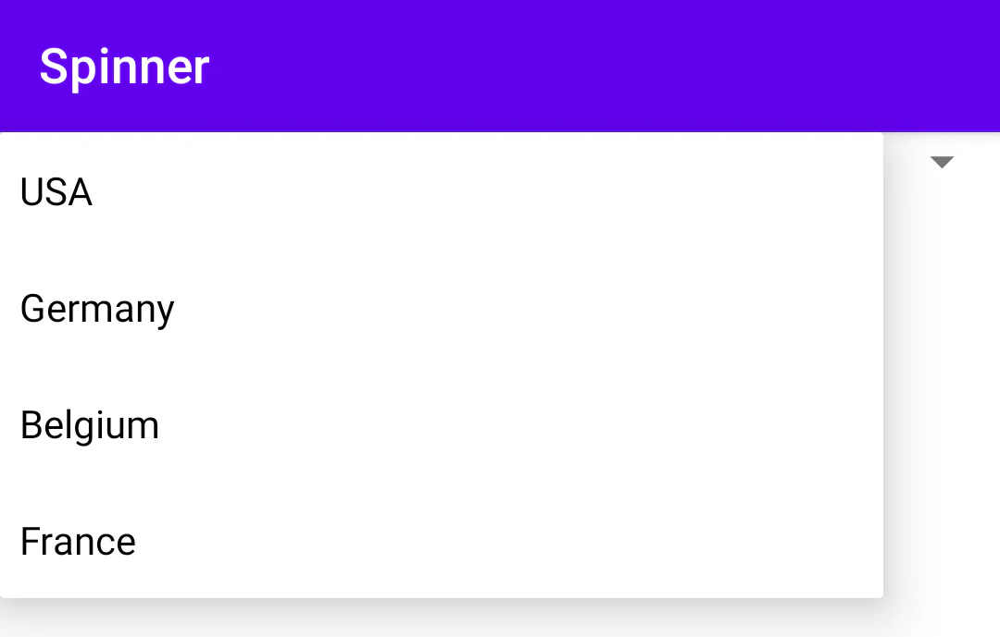
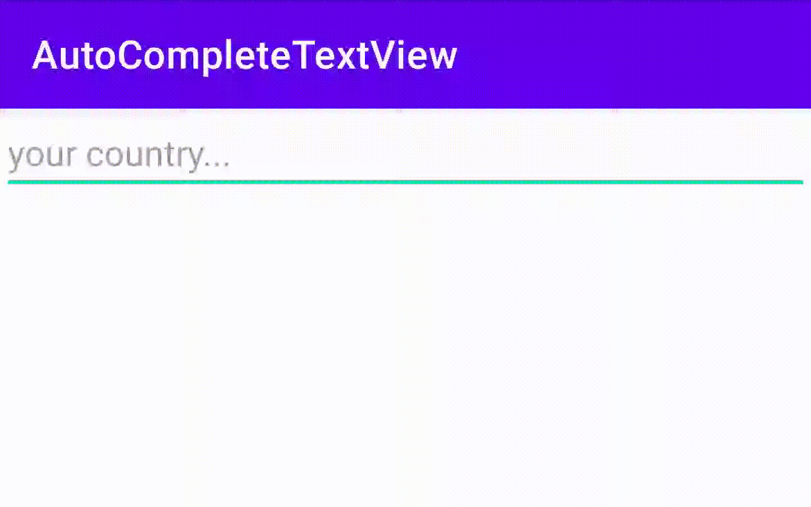

# Máy quay

`Spinner` cung cấp một cách nhanh chóng để chọn một giá trị từ một tập hợp với **danh sách tùy chọn thả xuống**. Đây là cách nó trông:



Vì vậy, làm thế nào chúng ta có thể tạo ra một cái? Trước hết, chúng ta nên thêm `Spinner` vào bố cục của mình.

```xml
<Spinner
    android:id="@+id/countries_spinner"
    android:layout_width="match_parent"
    android:layout_height="wrap_content" />
```

Nếu trong trường hợp này danh sách tùy chọn được xác định trước, chúng tôi có thể sử dụng tài nguyên XML để điền vào bộ điều hợp, vì vậy hãy tạo danh sách quốc gia của chúng tôi trong tệp `strings.xml`.

Sau đó tạo và áp dụng `ArrayAdapter` của chúng tôi với danh sách này.

```kotlin
val spinner = findViewById<Spinner>(R.id.countries_spinner)

// Create an ArrayAdapter using the string array and a default spinner layout
ArrayAdapter.createFromResource(
    this,
    R.array.countries_array,
    // Specify the layout to use when the list of choices appears
    android.R.layout.simple_spinner_item
).also { adapter ->
    // Set the layout for the drop down list
    adapter.setDropDownViewResource(android.R.layout.simple_spinner_dropdown_item)

    // Apply the adapter to the spinner
    spinner.adapter = adapter
}
```

Hoặc chúng ta có thể sử dụng danh sách các đối tượng để xác định lựa chọn của người dùng.

```kotlin
ArrayAdapter(
    this,
    android.R.layout.simple_spinner_item,
    listOf("USA", "Germany", "Belgium", "France")
)
```

## Nhận lựa chọn của người dùng

Để giải quyết vấn đề này, chúng ta chỉ cần triển khai `AdapterView.OnItemSelectedListener` và áp dụng nó cho Spinner của chúng ta như thế này:

```kotlin
val listener = object : AdapterView.OnItemSelectedListener {
    override fun onItemSelected(parent: AdapterView<*>, view: View?, pos: Int, id: Long) {
        // We retrieve the selected item from the Spinner via its position in list
        val selectedItem = parent.getItemAtPosition(pos)

        // Show toast with selected item
        Toast.makeText(
            this@MainActivity,
            "Selected item: $selectedItem",
            Toast.LENGTH_SHORT
        ).show()
    }

    override fun onNothingSelected(parent: AdapterView<*>) {
        //This method will be invoked when the selection disappears from the view
        Toast.makeText(
            this@MainActivity,
            "Nothing selected",
            Toast.LENGTH_SHORT
        ).show()
    }
}


spinner.onItemSelectedListener = listener
```

Bạn cũng có thể nhận được các lựa chọn của người dùng theo yêu cầu với các thuộc tính `selectedItem` và `selectedItemPosition`.

##AutoCompleteTextView

Đây là chế độ xem văn bản có thể chỉnh sửa sẽ cung cấp các đề xuất thả xuống từ danh sách được cung cấp



Trước hết chúng ta cần thêm `AutoCompleteTextView` vào bố cục của mình:

```xml
<AutoCompleteTextView
    android:hint="your country..."
    android:id="@+id/countries_autocomplete"
    android:layout_width="match_parent"
    android:layout_height="wrap_content" />
```

Sau đó, chúng tôi tạo và áp dụng `ArrayAdapter` giống như cách chúng tôi đã làm với `Spinner`, ngoại trừ việc chúng tôi sử dụng bố cục mục thả xuống mặc định khác.


```kotlin
// Create an ArrayAdapter using the string list and a default drop down layout
ArrayAdapter(
    this,
    android.R.layout.simple_dropdown_item_1line,
    listOf("USA", "Germany", "Belgium", "France")
).also { adapter ->
    autoCompleteTextView.setAdapter(adapter)
}
```

Chúng ta cũng có thể sử dụng phương thức `setThreshold()` hoặc thuộc tính android `android:completionThreshold` XML để đặt giá trị ngưỡng, số lượng ký tự mà `AutoCompleteTextView` bắt đầu đưa ra đề xuất.

Bạn có thể đặt `AdapterView.OnItemSelectedListener` bằng phương pháp `setOnItemSelectedListener()` nhưng không có gì đảm bảo rằng người dùng sẽ chọn một mục từ danh sách gợi ý—họ có thể chỉ cần nhập văn bản của riêng họ và để nó trong trường.


