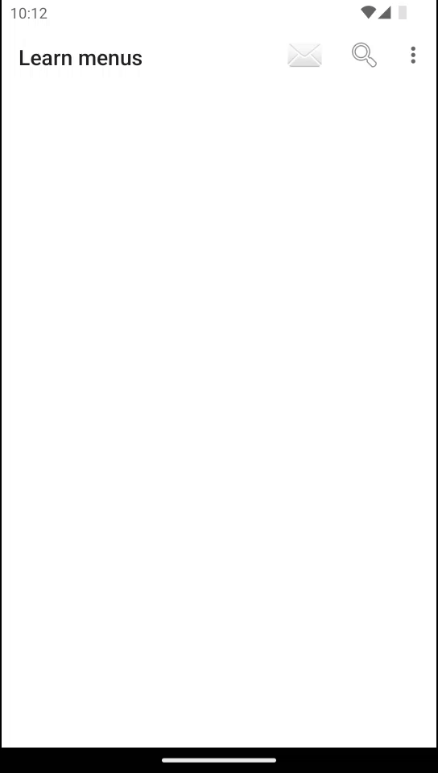

# Menu: Tùy chọn, Popup

Một ứng dụng đôi khi cung cấp danh sách các hành động có sẵn. Những danh sách như vậy được gọi là **menu** và chúng có thể trông khác nhau trong các ngữ cảnh khác nhau.

## Tài nguyên thực đơn


Có một loại tài nguyên XML đặc biệt dành cho menu. Để khám phá nó, hãy tạo Tệp tài nguyên menu `app/src/main/res/menu/example.xml` và thử các tính năng khác nhau.


```xml
<?xml version="1.0" encoding="utf-8"?>
<menu
    xmlns:android="http://schemas.android.com/apk/res/android"
    xmlns:app="http://schemas.android.com/apk/res-auto">

    <item
        android:id="@+id/basic"
        android:title="Basic item" />

    <item
        android:id="@+id/checkbox"
        android:title="Checkable"
        android:checkable="true" />

    <item
        android:id="@+id/with_icon"
        android:icon="@android:drawable/ic_dialog_email"
        android:title="With icon"
        app:showAsAction="ifRoom" />

    <item
        android:id="@+id/search_icon"
        android:icon="@android:drawable/ic_menu_search"
        app:showAsAction="always|collapseActionView"
        app:actionViewClass="androidx.appcompat.widget.SearchView"
        android:title="Search" />

</menu>
```

Chúng ta có gì ở đây?

- Một món đồ **cơ bản**. Nó có một tiêu đề và có thể được nhấp vào.
- Một mục **có thể kiểm tra**. Nó có một hộp kiểm, nhưng việc đặt trạng thái đã chọn khi được nhấp vào là trách nhiệm của bạn.
- Một mục có biểu tượng. `showAsAction="ifRoom"` có nghĩa là chúng tôi muốn xem nó như một biểu tượng. Tuy nhiên, nếu vượt quá dung lượng có sẵn, nó sẽ được hiển thị trong menu mục bổ sung dưới dạng mục văn bản.
- Một mặt hàng tùy chỉnh. Trường nhập tìm kiếm xuất hiện khi được nhấp vào. Luôn được hiển thị dưới dạng hành động vì việc có mục tìm kiếm trong menu mục bổ sung có vẻ không thực tế. Cờ `collapseActionView` giúp user interface thân thiện hơn khi tìm kiếm được mở rộng.

> [!NOTE]
> Các mục menu cũng có thể chứa các menu con. Mặc dù tương đối dễ nhưng kỹ thuật này nằm ngoài phạm vi của chủ đề này nhưng có thể học được từ [tài liệu chính thức](https://developer.android.com/develop/ui/views/components/menus#xml).

Bây giờ là lúc hiển thị menu này trên màn hình. Chúng ta sẽ cần một khung nhìn phục vụ như một máy chủ menu.

##Thanh công cụ

**Thanh công cụ** là chế độ xem ngang, thường ở phía trên màn hình, cung cấp các thao tác nhanh, biểu tượng ứng dụng hoặc nút quay lại và tiêu đề màn hình. Nó thường được thêm vào bố cục theo cách thủ công.

```xml
<androidx.appcompat.widget.Toolbar
    android:id="@+id/toolbar"
    android:layout_width="match_parent"
    android:layout_height="?actionBarSize"
    app:title="Learn menus" />
```
> [!WARNING]
> Đảm bảo rằng chủ đề hoạt động được đặt thành gì đó có .NoActionBar. Nếu không, Thanh công cụ sẽ được tạo tự động và chúng ta sẽ có ít quyền kiểm soát hơn đối với nó.

Bây giờ chúng ta cần hướng dẫn `Activity` rằng chúng ta có `Toolbar` và tăng cường một menu. Cách cập nhật để thêm menu là triển khai `MenuProvider`.


```kotlin
override fun onCreate(savedInstanceState: Bundle?) {
    super.onCreate(savedInstanceState)
    setContentView(R.layout.activity_with_toolbar)

    val toolbar = findViewById<Toolbar>(R.id.toolbar)
    setSupportActionBar(toolbar)
    addMenuProvider(object : MenuProvider {
        override fun onCreateMenu(menu: Menu, menuInflater: MenuInflater) {
            menuInflater.inflate(R.menu.example, menu)
        }
        
        override fun onMenuItemSelected(menuItem: MenuItem): Boolean {
            TODO()
        }
        
    })
}
```

Với Fragments, hãy thực hiện `requireActivity().addMenuProvider(..., viewLifecycleOwner)` trong `onCreateView()` để thêm menu sẽ tự động bị loại bỏ khi Fragment biến mất.

Hàm `onMenuItemSelected` được gọi khi nhấp vào một mục menu. Tại đây chúng ta có thể kiểm tra xem đó là mục nào và thực hiện bất kỳ hành động cần thiết nào. Trả về `true` có nghĩa là chúng tôi đã xử lý hành động đó.

```kotlin
override fun onMenuItemSelected(menuItem: MenuItem): Boolean = when (menuItem.itemId) {
    R.id.basic -> {
        Toast.makeText(this@MainActivity, menuItem.title, Toast.LENGTH_SHORT).show()
        true
    }
    R.id.checkbox -> {
        menuItem.isChecked = !menuItem.isChecked
        true
    }
    R.id.with_icon -> {
        Toast.makeText(this@MainActivity, menuItem.title, Toast.LENGTH_SHORT).show()
        true
    }
    R.id.search_icon -> {
        true // nothing to do here
    }
    else -> {
        false // none of my business
    }
}
```

`SearchView` yêu cầu xử lý đặc biệt. Để làm cho việc tìm kiếm trở nên hữu ích, chúng ta cần xử lý một số sự kiện bổ sung.

```kotlin
override fun onCreateMenu(menu: Menu, menuInflater: MenuInflater) {
    menuInflater.inflate(R.menu.example, menu)

    val search = menu.findItem(R.id.search_icon)
    val searchView = search.actionView as SearchView
    searchView.setOnQueryTextListener(object : OnQueryTextListener {

        override fun onQueryTextSubmit(query: String): Boolean {
            // The search was submitted by the user. Do something:
            Toast.makeText(this@MainActivity, query, Toast.LENGTH_SHORT).show()
            // …and collapse SearchView.
            search.collapseActionView()
            return true
        }

        override fun onQueryTextChange(newText: String): Boolean {
            return true
        }
    })
}
```
Và đây là kết quả:



## Cửa sổ bật lên

**Cửa sổ bật lên** hoặc **thả xuống** tương tự có thể được tạo mà không cần `Toolbar` và được neo vào chế độ xem tùy ý. Chỉ cần tạo `PopupMenu`, mở rộng menu, đặt trình nghe để xử lý các nhấp chuột và hiển thị nó.

```kotlin
anyView.setOnClickListener { anyView ->
    PopupMenu(this@MainActivity, anyView).apply {
        inflate(R.menu.example)
        setForceShowIcon(true)
        setOnMenuItemClickListener { item ->
            Toast.makeText(it.context, item.title, Toast.LENGTH_SHORT).show()
            true
        }
        show()
    }
}
```
Chức năng `setForceShowIcon` có thể được sử dụng để hiển thị các biểu tượng trong danh sách cùng với tiêu đề.

Xem thêm

- Các mục menu có thể được [tập hợp thành nhóm](https://developer.android.com/develop/ui/views/components/menus#groups), điều này đặc biệt hữu ích cho các mục có thể kiểm tra.

- Một menu có thể được hiển thị bằng cách nhấp chuột dài vào chế độ xem. Đây được gọi là [menu ngữ cảnh](https://developer.android.com/develop/ui/views/components/menus#context-menu).
- Nếu ứng dụng của bạn cho phép người dùng thực hiện các hành động hàng loạt trên các mục đã chọn—chẳng hạn như xóa hoặc di chuyển nhiều tệp trong trình quản lý tệp hoặc thư viện—thì tốt nhất bạn nên sử dụng [chế độ hành động theo ngữ cảnh](https://developer.android.com/develop/ui/views/components/menus#CAB) để có trải nghiệm người dùng tốt hơn.


