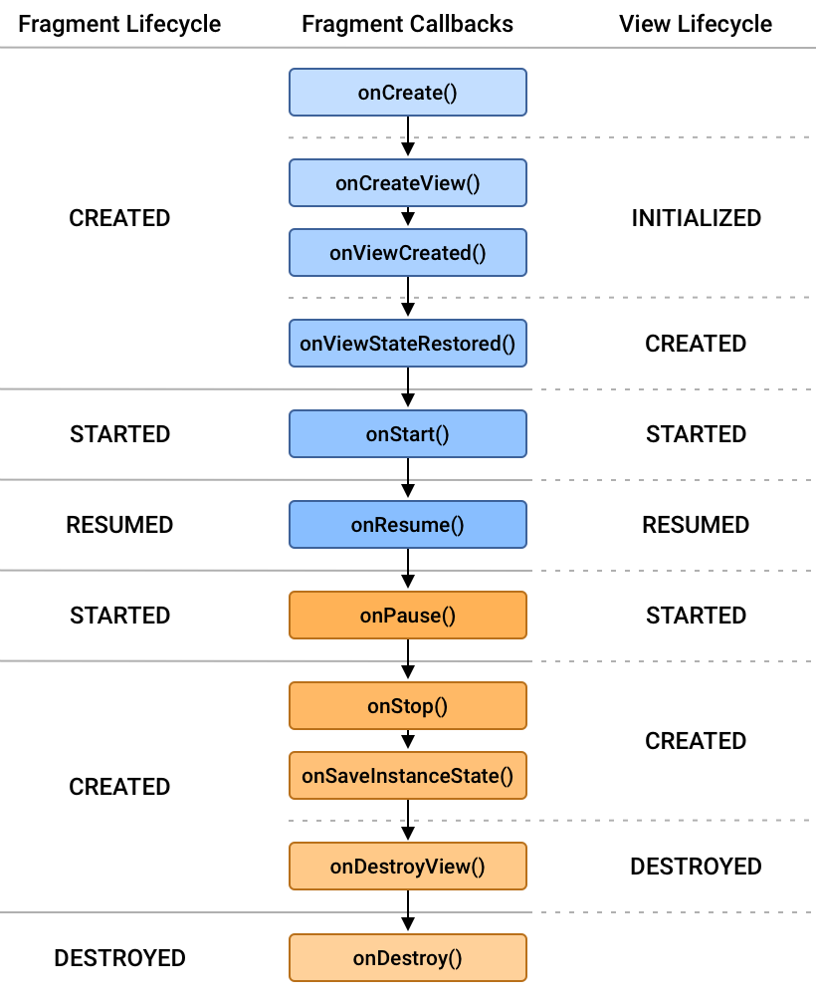
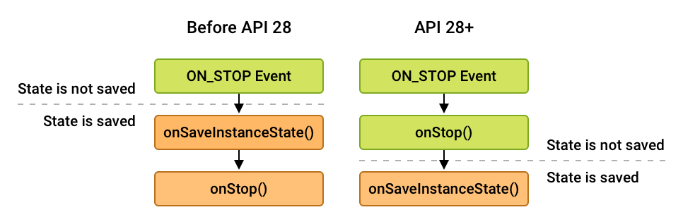
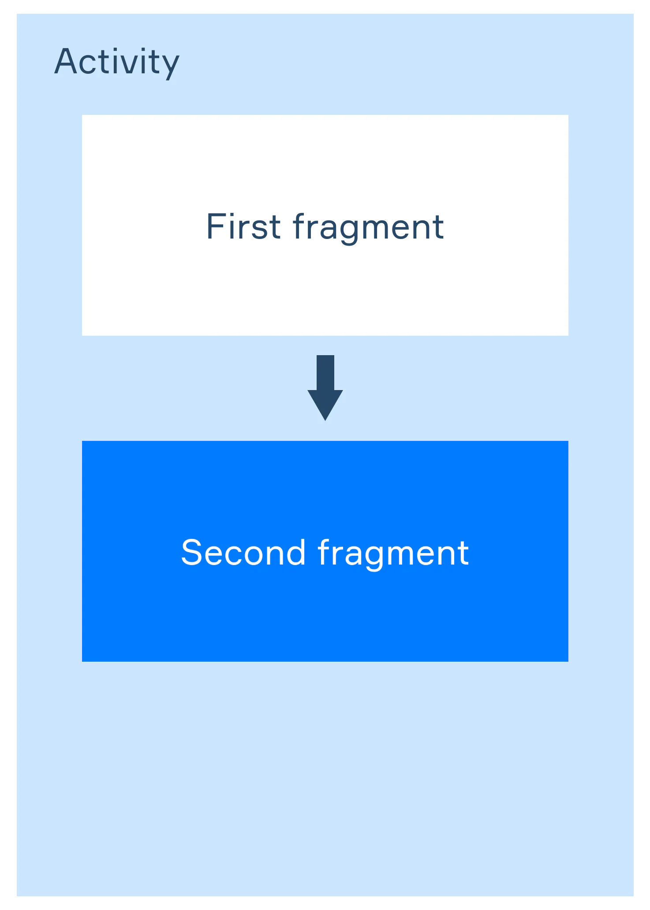
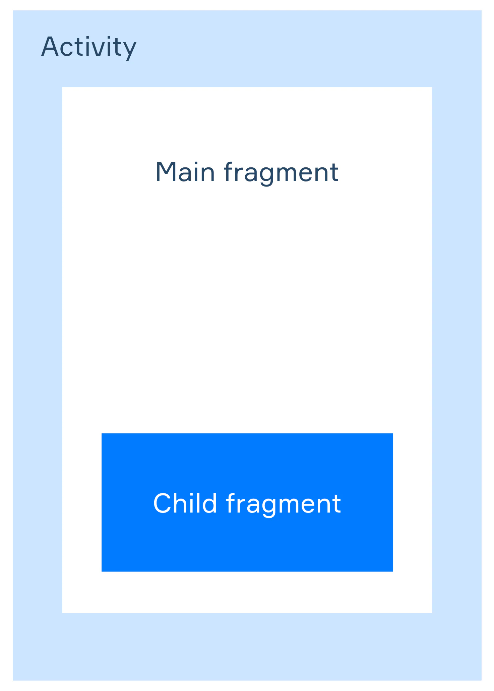

#Fragments

Fragment giống như Activity có thể được kết nối với các phần khác nhau của ứng dụng.
Tuy nhiên, điều quan trọng là phải hiểu rằng chúng không giống nhau.
Điều này có nghĩa là Fragment không thể tồn tại trừ khi nó được nhúng trong Activity.

Fragments được sử dụng trong **Kiến trúc Activity đơn** để tạo Navigation và lưu trạng thái.

## Fragment lifecycle

Để quản lý lifecycle, `Fragment` triển khai `LifecycleOwner`, hiển thị một đối tượng `Lifecycle` mà bạn có thể truy cập thông qua phương thức `getLifecycle()`.

Mỗi trạng thái `Lifecycle` có thể có được thể hiện trong `Lifecycle.State`

- `INITIALIZED`
- `CREATED`
- `STARTED`
- `RESUMED`
- `DESTROYED`

   Chế độ xem của một mảnh có một `Lifecycle` riêng biệt được quản lý độc lập với chế độ xem của `Lifecycle` của mảnh.


## Trạng thái và lệnh gọi lại Fragment lifecycle

     Khi một mảnh tiến triển qua lifecycle, nó sẽ di chuyển lên và xuống qua các trạng thái của nó. Ví dụ: một mảnh được thêm vào đầu back stack sẽ di chuyển lên từ `CREATED` đến `STARTED` đến `RESUMED`. Ngược lại, khi một mảnh được tách ra khỏi back stack, mảnh đó sẽ di chuyển xuống dưới qua các trạng thái đó, từ `RESUMED` đến `STARTED` đến `CREATED` và cuối cùng là `DESTROYED`.



## Chuyển đổi trạng thái đi lên

    Khi di chuyển lên trên qua các trạng thái lifecycle, trước tiên, một đoạn sẽ gọi lifecycle callback được liên kết cho trạng thái mới của nó. Sau khi callback này hoàn tất, `Lifecycle.Event` có liên quan sẽ được phát ra tới người quan sát bởi `Lifecycle` của mảnh


#### Fragment CREATED

        Khi mảnh của bạn đạt đến trạng thái `CREATED` , mảnh đó đã được thêm vào `FragmentManager` và phương thức `onAttach()` đã được gọi.

        Lưu ý rằng chế độ xem của phân đoạn chưa được tạo tại thời điểm này và mọi trạng thái liên quan đến chế độ xem của phân đoạn chỉ được khôi phục sau khi chế độ xem được tạo.

#### Fragment CREATED và View INITIALIZED

    Chế độ xem của mảnh `Lifecycle` chỉ được tạo khi `Fragment` của bạn cung cấp một phiên bản `View` hợp lệ. Trong hầu hết các trường hợp, bạn có thể sử dụng các hàm tạo phân đoạn lấy một `@LayoutId` để tự động tăng cường chế độ xem vào thời điểm thích hợp. Bạn cũng có thể ghi đè `onCreateView()` để tăng cường theo chương trình hoặc tạo chế độ xem cho mảnh của mình.

    Nếu và chỉ khi chế độ xem phân mảnh của bạn được khởi tạo bằng `View` không rỗng, thì `View` đó được đặt trên phân mảnh và có thể truy xuất bằng cách sử dụng `getView()`. Sau đó, `getViewLifecycleOwnerLiveData()` được cập nhật với `INITIALIZED` `LifecycleOwner` mới tương ứng với chế độ xem của mảnh. `onViewCreated()` lifecycle callback cũng được gọi vào thời điểm này.

    Đây là nơi thích hợp để thiết lập trạng thái ban đầu cho chế độ xem của bạn, để bắt đầu quan sát các phiên bản `LiveData` có lệnh gọi lại cập nhật chế độ xem của phân đoạn và để thiết lập bộ chuyển đổi trên mọi phiên bản `RecyclerView` hoặc `ViewPager2` trong chế độ xem phân đoạn của bạn.

VN : ý nghĩa là sau khi onCreate chạy xong thì Lifecycle của chế độ xem mới được khởi tạo có nghĩa là lúc này LifecycleOwner mới được khởi tạo tương ứng với View

### Fragment và View CREATED

Sau khi chế độ xem của mảnh được tạo, trạng thái chế độ xem trước đó, nếu có, sẽ được khôi phục và `Lifecycle` của chế độ xem sau đó được chuyển sang trạng thái `CREATED`.  tình trạng. Chế độ xem lifecycle owner cũng phát ra sự kiện `ON_CREATE` cho người quan sát. Tại đây, bạn nên khôi phục mọi trạng thái bổ sung liên quan đến chế độ xem của phân đoạn.

### Fragment và View STARTED

Bạn nên liên kết các thành phần nhận biết Lifecycle với trạng thái `STARTED` của một mảnh, vì trạng thái này đảm bảo rằng chế độ xem của mảnh sẽ có sẵn nếu một mảnh được tạo và rằng việc thực hiện `FragmentTransaction` trên phần con `FragmentManager` của mảnh là an toàn. Nếu chế độ xem của mảnh không có giá trị rỗng thì chế độ xem của mảnh `Lifecycle` sẽ được chuyển sang `STARTED` ngay sau khi `Lifecycle` của mảnh được chuyển sang `STARTED`.

Khi mảnh trở thành `STARTED`, `onStart()` callback sẽ được gọi.

### Fragment và View RESUMED

    Khi mảnh hiển thị, tất cả các hiệu ứng `Animator` và `Transition` đã hoàn tất và mảnh đã sẵn sàng để người dùng tương tác. `Lifecycle` của mảnh chuyển sang trạng thái `RESUMED` và `onResume()` callback được gọi.

    Việc chuyển đổi sang `RESUMED` là tín hiệu thích hợp để cho biết rằng người dùng hiện có thể tương tác với mảnh của bạn.

    Fragments không phải là `RESUMED` không nên đặt tiêu điểm vào chế độ xem của chúng theo cách thủ công hoặc cố gắng xử lý khả năng hiển thị của phương thức nhập.

## Chuyển đổi trạng thái đi xuống

        Khi một mảnh di chuyển xuống trạng thái lifecycle thấp hơn, `Lifecycle.Event` có liên quan sẽ được phát ra cho người quan sát bởi chế độ xem của mảnh `Lifecycle`, nếu được khởi tạo, theo sau là `Lifecycle` của mảnh. Sau khi sự kiện lifecycle của một mảnh được phát ra, mảnh đó sẽ gọi lifecycle callback được liên kết.

### Fragment và View STARTED

        Khi người dùng bắt đầu rời khỏi mảnh và trong khi mảnh vẫn hiển thị, `Lifecycle` cho mảnh và cho chế độ xem của nó sẽ được chuyển trở lại trạng thái `STARTED` và phát ra sự kiện `ON_PAUSE` cho người quan sát của họ. Sau đó, mảnh sẽ gọi `onPause()` callback của nó.

### Fragment và View CREATED

        Sau khi mảnh không còn hiển thị nữa, `Lifecycle` cho mảnh và cho chế độ xem của nó sẽ được chuyển sang trạng thái `CREATED` và phát ra sự kiện `ON_STOP` đến trình quan sát của chúng. Quá trình chuyển đổi trạng thái này được kích hoạt không chỉ bởi hoạt động hoặc phân đoạn gốc bị dừng mà còn do hoạt động hoặc phân đoạn gốc lưu trạng thái

    Hành vi này đảm bảo rằng sự kiện `ON_STOP` được gọi trước khi lưu trạng thái của mảnh. Điều này khiến sự kiện `ON_STOP` trở thành điểm cuối cùng để đảm bảo an toàn khi thực hiện `FragmentTransaction` trên trẻ `FragmentManager`.

     thứ tự của `onStop()` callback và việc lưu trạng thái với `onSaveInstanceState()` khác nhau dựa trên cấp độ API. Đối với tất cả các cấp độ API trước API 28, `onSaveInstanceState()` được gọi trước `onStop()`. Đối với API cấp 28 trở lên, thứ tự gọi sẽ bị đảo ngược.



## Fragment CREATED và View DESTROYED

    Sau khi tất cả các hoạt ảnh và chuyển tiếp thoát đã hoàn tất và chế độ xem của mảnh đã được tách khỏi cửa sổ, chế độ xem của mảnh `Lifecycle` được chuyển sang trạng thái `DESTROYED` và phát ra sự kiện `ON_DESTROY` cho trình quan sát của nó. Sau đó, mảnh sẽ gọi `onDestroyView()` callback của nó. Tại thời điểm này, chế độ xem của mảnh đã đạt đến cuối lifecycle và `getViewLifecycleOwnerLiveData()` trả về giá trị `null`.

    Tại thời điểm này, tất cả các tham chiếu đến chế độ xem của phân đoạn phải bị xóa, cho phép chế độ xem của phân đoạn được thu thập rác

#### Fragment DESTROYED

    Nếu mảnh bị xóa hoặc nếu `FragmentManager` bị hủy, thì `Lifecycle` của mảnh đó sẽ được chuyển sang trạng thái `DESTROYED` và gửi sự kiện `ON_DESTROY` đến trình quan sát của nó. Sau đó, mảnh sẽ gọi `onDestroy()` callback của nó. Tại thời điểm này, đoạn đã đạt đến điểm cuối lifecycle.


## Fragment Lifecycle callback chi tiết


**lifecycle của một mảnh hơi khác so với lifecycle của một hoạt động vì bản thân mảnh đó hoàn toàn phụ thuộc vào hoạt động đó và không tồn tại riêng.** Vì vậy, nhiều phương thức được đặt tên giống như phương thức hoạt động hoặc có tên rất giống nhau:

- `onAttach()` phương thức được gọi khi đoạn được gắn vào hoạt động.

- `onCreate()` phương thức được gọi khi một đoạn được tạo.

- `onCreateView()` phương thức tạo và trả về hệ thống phân cấp chế độ xem được liên kết với đoạn. Bạn có thể sử dụng nó để tăng cường bố cục của bạn.

- `onViewCreated()` phương thức được gọi khi các chế độ xem đã được tạo và đính kèm. Tất cả các chế độ xem phải được khởi tạo ở đây.

- `onActivityCreated()` — phương thức được gọi theo phương thức `Activity.onCreate()`.

- `onStart()` — phương thức được gọi khi người dùng nhìn thấy đoạn này (xem phương thức `Activity.onStart()`).

- `onResume()` — phương thức được gọi trước khi phân đoạn có sẵn để người dùng tương tác (xem phương thức `Activity.onResume()`).

- `onPause()` — người dùng không tương tác với đoạn nhưng người dùng sẽ nhìn thấy một phần của đoạn.

- `onStop()` — phương pháp làm cho đoạn này không hiển thị với người dùng.

- `onSaveInstanceState()` — phương pháp lưu trạng thái phân đoạn.

- `onDestroyView()` – đoạn xóa các tài nguyên được liên kết với hệ thống phân cấp chế độ xem. Tại đây, bạn phải vô hiệu hóa tất cả các chế độ xem của mình vì việc giữ các chế độ xem bị hủy có thể gây ra memory leak.

- `onDestroy()` – phương thức được gọi trước khi mảnh bị phá hủy.

- `onDetach()` – phương thức được gọi trước khi mảnh được tách khỏi hoạt động.


## Người quản lý Fragment

Fragments kế thừa từ lớp `androidx.fragment.app.Fragment`, lớp này xuất phát từ thư viện AndroidX.
Nhưng cũng có một số lớp con Fragment: `ListFragment`, `DialogFragment`, `PreferenceFragment`, `WebViewFragment` và các lớp khác.

### Truy cập FragmentManager

1. **Truy cập bằng Activity**

        Mọi `FragmentActivity` và các lớp con của chúng, chẳng hạn như `AppCompatActivity`, đều có quyền truy cập vào `FragmentManager` thông qua phương thức `getSupportFragmentManager()`.

2. **Truy cập bằng Fragment**

Fragments cũng có khả năng lưu trữ một hoặc nhiều đoạn con. Bên trong một mảnh, bạn có thể nhận được tham chiếu đến `FragmentManager` quản lý các phần tử con của mảnh đó thông qua `getChildFragmentManager()`. Nếu cần truy cập vào máy chủ `FragmentManager`, bạn có thể sử dụng `getParentFragmentManager()`.

### Cách sử dụng FragmentManager

Có hai phương pháp trong `FragmentManager` có thể được sử dụng để tìm Fragments được liên kết với Activity.
Đó là `findFragmentById(int id)` và `findFragmentByTag(String tag)`.
Phương thức `findFragmentById()` tìm Fragment theo mã định danh và `findFragmentByTag()` tìm kiếm theo thẻ nhất định.
Nếu bạn muốn thực hiện bất kỳ thao tác nào trên Fragments, có thể thay thế, xóa hoặc ẩn chúng, bạn cần sử dụng lớp `androidx.app.FragmentTransaction` đặc biệt.

Dưới đây là các phương thức chính của lớp `FragmentTransaction`:

- `add()` thêm Fragment vào Activity.
- `remove()` được sử dụng để loại bỏ Fragment khỏi Activity.
- `replace()` thay thế một Fragment bằng một Fragment khác.
- `hide()` dùng để ẩn Fragment trên màn hình.
- `show()` hiển thị Fragment trên màn hình.

Cuối cùng, điều quan trọng cần nhớ là bạn phải gọi phương thức `commit()` vào cuối mỗi giao dịch!

## Giao tiếp với hoạt động

### 1. Sử dụng Giao diện
   
Để chuyển nội dung nào đó đến một hoạt động, trước tiên, bạn cần tạo giao diện trong đoạn mong muốn.

```kotlin
class YourFragment : Fragment() {

    override fun onCreateView(...) { ... }

    interface YourFragmentListener {
        fun doSomething()
    }
}
```
Tiếp theo, bạn cần triển khai giao diện của mình trong hoạt động mong muốn.

```kotlin
class MainAсtivity : AppCompatActivity(), YourFragment.YourFragmentListener {

    ...

    override fun doSomething() {
        Log.d("Log", "Doing something!")
    }
}
```

Bước áp chót là lấy một phiên bản Activity triển khai giao diện của bạn trong Fragment.

```kotlin
    private var callback: YourFragmentListener? = null
    override fun onAttach(context: Context) {
        super.onAttach(context)
        callback = context as YourFragmentListener
    }
    override fun onDetach() {
        super.onDetach()
        callback = null
    }
```

Cuối cùng, bạn chỉ cần gọi phiên bản giao diện tại vị trí bạn muốn,

### 2. Trình nghe kết quả

Android có API rất hữu ích để truyền dữ liệu giữa các phân đoạn, **Fragment Kết quả API**. Đây là một công cụ cho phép truyền dữ liệu giữa các đoạn bằng khóa do người dùng chỉ định. 

Tất cả điều này xảy ra với `FragmentManager` — `parentFragmentManager` và `childFragmentManager`.

Nếu các mảnh của bạn độc lập với nhau, bạn nên sử dụng `parentFragmentManager`.



Trong trường hợp một mảnh là mảnh con, mảnh cha phải sử dụng `childFragmentManager` và mảnh con phải sử dụng `parentFragmentManager`.



Sau khi chọn `FragmentManager` mong muốn trong đoạn sẽ gửi dữ liệu, hãy gọi phương thức `setFragmentResult()`.

Trong phương pháp này, đặt kết quả trong `FragmentManager` giống hệt với kết quả đầu tiên và sử dụng cùng một khóa.
Các tham số của phương thức này là chính khóa và đối tượng `Bundle` cần được chuyển sang một đoạn khác.

```kotlin
button.setOnClickListener {
    parentFragmentManager.setFragmentResult("key", bundleOf("bundleKey" to yourObject))
}
```

Tiếp theo, trong phương thức `onCreate()` của đoạn mà bạn muốn nhận dữ liệu của mình, bạn cần gọi phương thức `setFragmentResultListener()`.

Tham số đầu tiên của phương thức này là tham số khóa: nó phải giống với khóa bạn đã chỉ định trong đoạn khác.

```kotlin
YourFragmentManager.setFragmentResultListener("key", this) { key, bundle ->
    val result = bundle.get("bundleKey")
}
```

### 3. ViewModel

Để chia sẻ dữ liệu giữa các mảnh và hoạt động trên máy chủ của chúng, hãy sử dụng `ViewModel` có phạm vi hoạt động.

Ví dụ:

```kotlin
class ItemViewModel : ViewModel() {
    private val mutableSelectedItem = MutableLiveData<Item>()
    val selectedItem: LiveData<Item> get() = mutableSelectedItem

    fun selectItem(item: Item) {
        mutableSelectedItem.value = item
    }
}
```
Việc sử dụng `LiveData` đảm bảo dữ liệu vẫn nhận biết được lifecycle.

Sử dụng ViewModel trong Activity

```kotlin
class MainActivity : AppCompatActivity() {
    private val viewModel: ItemViewModel by viewModels()

    override fun onCreate(savedInstanceState: Bundle?) {
        super.onCreate(savedInstanceState)
        viewModel.selectedItem.observe(this, Observer { item ->
            // Handle item update
        })
    }
}
```
Sử dụng ViewModel trong Fragment

```kotlin
class ListFragment : Fragment() {
    private val viewModel: ItemViewModel by activityViewModels()

    fun onItemClicked(item: Item) {
        viewModel.selectItem(item)
    }
}
```
> [!CAUTION]
> Đảm bảo sử dụng cùng một phạm vi (MainActivity) trong cả MainActivity và ListFragment để chia sẻ cùng một ViewModel. Việc sử dụng đoạn này làm phạm vi riêng của nó sẽ tạo ra một phiên bản riêng biệt.


## Giao tiếp với Fragment khác

### Sử dụng sharedViewModel

Fragments trong cùng một hoạt động thường cần giao tiếp mà không bị ràng buộc chặt chẽ. Việc sử dụng `ViewModel` được chia sẻ với phạm vi hoạt động cho phép họ trao đổi dữ liệu trong khi vẫn độc lập.

Ví dụ:

```kotlin
class ListViewModel : ViewModel() {
    val filters = MutableLiveData<Set<Filter>>()

    private val originalList: LiveData<List<Item>>() = ...
    val filteredList: LiveData<List<Item>> = ...

    fun addFilter(filter: Filter) { ... }
    fun removeFilter(filter: Filter) { ... }
}
```
Sử dụng `ViewModel` trong `ListFragment`
```kotlin
class ListFragment : Fragment() {
    private val viewModel: ListViewModel by activityViewModels()

    override fun onViewCreated(view: View, savedInstanceState: Bundle?) {
        viewModel.filteredList.observe(viewLifecycleOwner, Observer { list ->
            // Update the list UI
        })
    }
}
```
Sử dụng `ViewModel` trong `FilterFragment`

```kotlin
class FilterFragment : Fragment() {
    private val viewModel: ListViewModel by activityViewModels()

    override fun onViewCreated(view: View, savedInstanceState: Bundle?) {
        viewModel.filters.observe(viewLifecycleOwner, Observer { set ->
            // Update the selected filters UI
        })
    }

    fun onFilterSelected(filter: Filter) = viewModel.addFilter(filter)
    fun onFilterDeselected(filter: Filter) = viewModel.removeFilter(filter)
}
```

> [!CAUTION]
> ViewModel vẫn còn trong bộ nhớ cho đến khi ViewModelStoreOwner nằm trong phạm vi của nó biến mất vĩnh viễn. 
> Trong kiến ​​trúc hoạt động đơn lẻ, nếu ViewModel nằm trong phạm vi hoạt động thì về cơ bản nó là một hoạt động đơn lẻ. Sau khi ViewModel được khởi tạo lần đầu tiên, các lệnh gọi tiếp theo để truy xuất ViewModel sử dụng phạm vi hoạt động luôn trả về cùng một ViewModel hiện có, cùng với dữ liệu hiện có cho đến khi lifecycle của hoạt động kết thúc vĩnh viễn.

### Chia sẻ dữ liệu giữa mảnh cha và mảnh con qua ViewModel

Khi làm việc với các mảnh con, mảnh gốc và các mảnh con của nó có thể cần chia sẻ dữ liệu với nhau.
Để chia sẻ dữ liệu giữa các phân đoạn này, hãy sử dụng phân đoạn gốc làm phạm vi `ViewModel`, như trong ví dụ sau:

```kotlin
class ListFragment: Fragment() {
    // Using the viewModels() Kotlin property delegate from the fragment-ktx
    // artifact to retrieve the ViewModel.
    private val viewModel: ListViewModel by viewModels()
    override fun onViewCreated(view: View, savedInstanceState: Bundle?) {
        viewModel.filteredList.observe(viewLifecycleOwner, Observer { list ->
            // Update the list UI.
        })
    }
}

class ChildFragment: Fragment() {
    // Using the viewModels() Kotlin property delegate from the fragment-ktx
    // artifact to retrieve the ViewModel using the parent fragment's scope
    private val viewModel: ListViewModel by viewModels({requireParentFragment()})
    
}
```

### Phạm vi ViewModel đến Navigation Graph (Điều hướng Jetpack)

Nếu bạn đang sử dụng thư viện Navigation, bạn cũng có thể xác định phạm vi `ViewModel` đến lifecycle của `NavBackStackEntry` của đích. Ví dụ: `ViewModel` có thể được đặt trong phạm vi `NavBackStackEntry` cho `ListFragment`:

```kotlin
class ListFragment: Fragment() {
    // Using the navGraphViewModels() Kotlin property delegate from the fragment-ktx
    // artifact to retrieve the ViewModel using the NavBackStackEntry scope.
    // R.id.list_fragment == the destination id of the ListFragment destination
    private val viewModel: ListViewModel by navGraphViewModels(R.id.list_fragment)

    override fun onViewCreated(view: View, savedInstanceState: Bundle?) {
        viewModel.filteredList.observe(viewLifecycleOwner, Observer { item ->
            // Update the list UI.
        })
    }
}
```

### Sử dụng gói với điều hướng Jetpack

Để truyền bất kỳ dữ liệu nào giữa các phân đoạn, hãy sử dụng gói đối số. Để thực hiện việc này, trong đoạn mà bạn muốn truyền dữ liệu, hãy tạo Bundle và đặt tất cả các đối tượng cần thiết vào đó, cung cấp cho chúng một khóa để tham chiếu sau này trong đoạn đích.

```kotlin
val bundle = Bundle()
bundle.putString("Key", thing)
```
Lưu ý rằng bạn cũng có thể tạo Bundle như thế này:

```kotlin
val bundle = bundleOf("Key" to thing)
```

Tiếp theo, thêm gói của bạn làm đối số cho hàm `navigate()` để chuyển sang đoạn tiếp theo.

```kotlin
findNavController().navigate(R.id.firstFragment, bundle)
```
Trong đoạn nhận, bạn có thể lấy gói đối số để sử dụng nội dung của nó.

```kotlin
val thing = arguments?.getString("Key")
```


tài liệu tham khảo:

https://hyperskill.org/learn/step/12981

https://hyperskill.org/learn/step/21929

https://developer.android.com/guide/fragments/communicate
