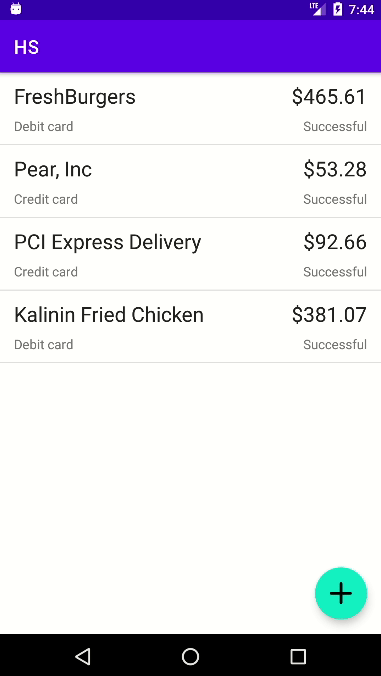
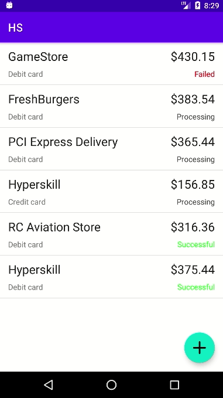
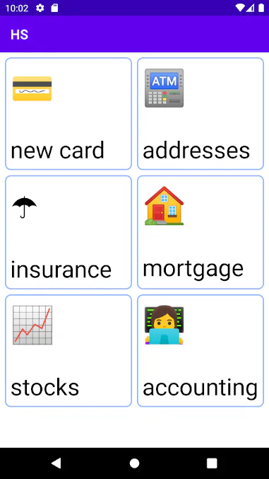
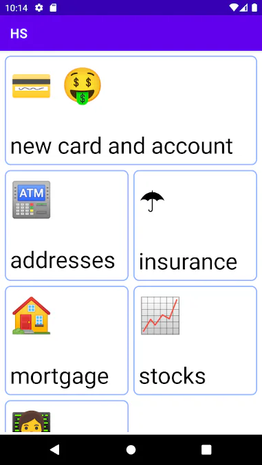
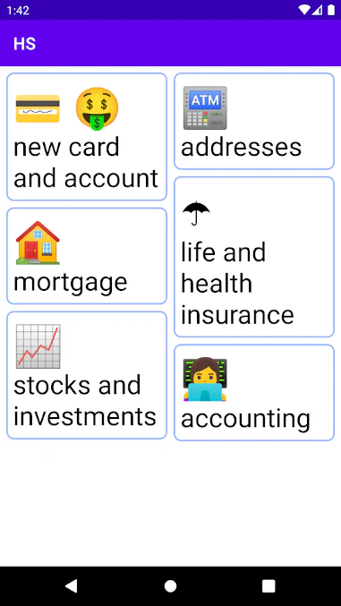
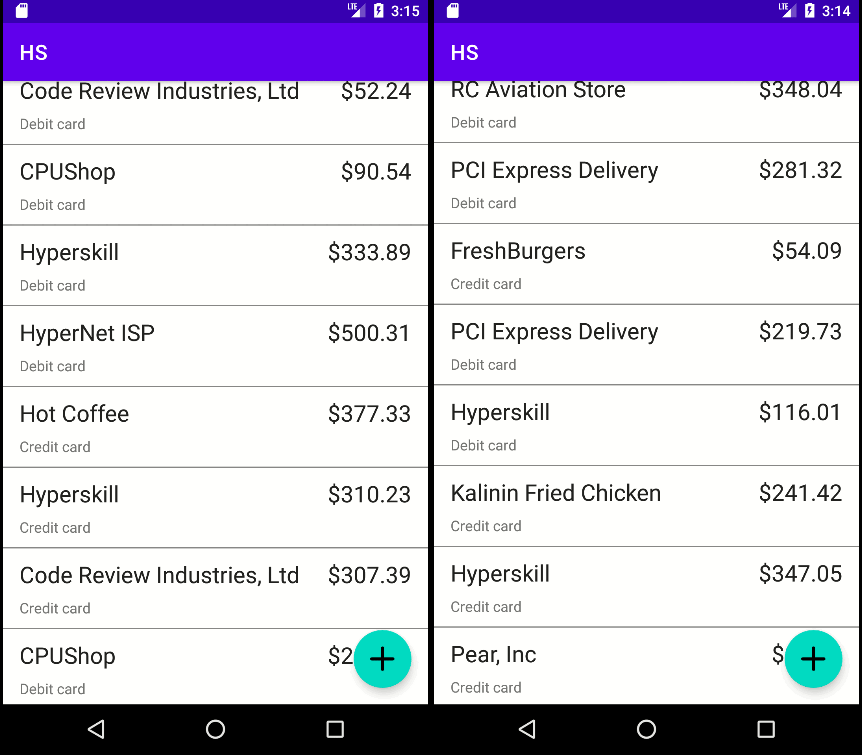

# Tùy chỉnh RecyclerView

## Thay đổi nội dung bộ chuyển đổi

Một bộ chuyển đổi thông thường được hỗ trợ bởi một danh sách. Nhưng nếu chúng ta thay thế danh sách hoặc thay đổi nội dung của nó, bộ điều hợp sẽ không nhận biết được, dẫn đến hành vi không nhất quán và thậm chí bị treo. Vì vậy, khi có thay đổi xảy ra, chúng ta phải thông báo cho adapter về điều đó thông qua phương thức thích hợp:

- `notifyDataSetChanged`: quên mọi thứ và điền RecyclerView từ đầu.

- `notifyItemChanged` / `notifyItemRangeChanged`: liên kết lại (các) mục được chỉ định.

- `notifyItemInserted` / `notifyItemRangeInserted`: chèn item vào vị trí xác định.

- `notifyItemRemoved` / `notifyItemRangeRemoved`: làm cho (các) vật phẩm được chỉ định biến mất.

- `notifyItemMoved`: thay đổi vị trí của một vật phẩm.


`notifyDataSetChanged()` là một cách phổ biến để thực hiện cập nhật nhưng nó cực kỳ kém hiệu quả và các hoạt ảnh đã được thay đổi sẽ không chạy. Vì vậy, phương pháp này chỉ nên được sử dụng như là phương sách cuối cùng.

Các phương pháp khác được liệt kê ở trên được sử dụng khi xảy ra các tình huống liên quan. Để làm ví dụ về cách thực hiện việc này, hãy triển khai một phương thức thêm gọi `notifyItemInserted()`:

```kotlin
class TransactionAdapter(
    transactions: List<Transaction>,
) : RecyclerView.Adapter<TransactionAdapter.TransactionViewHolder>() {

    private val transactions = transactions.toMutableList()

    fun add(transaction: Transaction) {
        transactions.add(transaction)
        notifyItemInserted(transactions.size - 1)
    }

}
```

Bạn có thể thấy nó được sử dụng dưới đây:



Cho đến nay, rất tốt. Nhưng điều gì sẽ xảy ra nếu chúng ta cần thay thế các mục nội dung khi không biết chính xác những gì đã thay đổi? Điều này thường xảy ra khi bạn yêu cầu dữ liệu từ mạng và máy chủ cung cấp dữ liệu mới mà không có bất kỳ thông tin chi tiết nào về sự khác biệt của dữ liệu đó với tập dữ liệu cũ. Trong những trường hợp này, chúng tôi cần DiffUtil — một công cụ để tìm ra những khác biệt này. Cách dễ nhất để sử dụng nó là kế thừa từ androidx.recyclerview.widget.ListAdapter, tính năng này tính toán sự khác biệt không đồng bộ cho chúng ta. Để xem nó hoạt động như thế nào, hãy di chuyển siêu lớp bộ chuyển đổi bằng cách:

- Xóa thuộc tính danh sách giao dịch của chúng tôi (ListAdapter quản lý danh sách riêng của mình)

- Cung cấp dữ liệu vào phương thức submitList()

- Lấy tập dữ liệu hiện tại bằng cách đọc thuộc tính currentList

- Loại bỏ việc triển khai phương thức getItemCount (ListAdapter cũng có khả năng thực hiện việc này cho chúng tôi)

```kotlin
class TransactionsAdapter(transactions: List<Transaction>) :
    ListAdapter<Transaction, TransactionsAdapter.TransactionViewHolder>(
        object : DiffUtil.ItemCallback<Transaction>() {
            override fun areItemsTheSame(
                oldItem: Transaction, newItem: Transaction,
            ): Boolean =
                TODO("Not yet implemented")

            override fun areContentsTheSame(
                oldItem: Transaction, newItem: Transaction,
            ): Boolean =
                TODO("Not yet implemented")

        }) {
    
    init {
        submitList(transactions)
    }

    override fun onCreateViewHolder(
        parent: ViewGroup, viewType: Int,
    ): TransactionViewHolder =
        TransactionViewHolder(
            LayoutInflater.from(parent.context)
                .inflate(R.layout.item_transaction, parent, false)
        )

    override fun onBindViewHolder(holder: TransactionViewHolder, position: Int) {
        val t = getItem(position)
        // holder… stays the same
    }

    fun add(transaction: Transaction) {
        submitList(currentList + transaction)
    }

    // ViewHolder stays the same

}
```

Bây giờ chúng ta cần triển khai hai hàm của lớp trừu tượng DiffUtil.ItemCallback. Hàm areItemsTheSame xác định xem các mục có đến từ cùng một thực thể hay không: nếu có thì chúng có thể đã được cập nhật hoặc di chuyển. areContentsTheSame sau đó kiểm tra xem nội dung của các mục này có bằng nhau hay không: nếu không, chúng phải được cập nhật.


Trong ví dụ của chúng tôi, giả sử rằng các mục giao dịch của chúng tôi giống nhau nếu khoản thanh toán receiver, tài khoản và số tiền đều bằng nhau. Nhưng nếu trạng thái thay đổi từ "Đang xử lý" thành "Thành công" hoặc "Không thành công" thì nội dung sẽ khác:


```kotlin
override fun areItemsTheSame(oldItem: Transaction, newItem: Transaction): Boolean =
    oldItem.account == newItem.account &&
        oldItem.receiver == newItem.receiver &&
        oldItem.amount == newItem.amount
```

Để hoàn tất việc kiểm tra tính bằng nhau của nội dung, chúng ta có thể thêm công cụ sửa đổi dữ liệu vào lớp Giao dịch của mình. Điều này cho phép chúng ta tận dụng phương thức bằng() được tạo tự động bằng cách sử dụng toán tử ==:

```kotlin
data class Transaction(
    // the rest of the class remains the same
)

//…

override fun areContentsTheSame(oldItem: Transaction, newItem: Transaction): Boolean =
    oldItem == newItem
```

Bạn có thể thấy phương pháp thay thế nội dung này được sử dụng bên dưới:



## Xử lý sự kiện vật phẩm

RecyclerView không có phương pháp setOnItemClickListener riêng hoặc cơ sở tương tự. Trách nhiệm của bộ chuyển đổi là thiết lập các trình xử lý sự kiện cần thiết và bật các sự kiện này. Hãy thử xem:

```kotlin
class TransactionAdapter(
    private val transactions: List<Transaction>,
    private val onTransactionClick: (Transaction) -> Unit,
) : RecyclerView.Adapter<TransactionAdapter.TransactionViewHolder>() {

    override fun onCreateViewHolder(
        parent: ViewGroup, viewType: Int,
    ): TransactionViewHolder {
        val holder = TransactionViewHolder(
            LayoutInflater.from(parent.context)
                .inflate(R.layout.transaction_item, parent, false))

        holder.itemView.setOnClickListener {
            onTransactionClick(TODO("figure out transaction"))
        }

        return holder
    }

    ...

}
```

Vậy làm thế nào để chúng ta biết Giao dịch nào mà chủ sở hữu hiện tại bị ràng buộc? Để tìm ra điều này, chúng ta có thể hỏi vị trí của nó. Tuy nhiên, một giá đỡ có thể đồng thời thuộc các vị trí khác nhau nếu nó được sử dụng trong các thành phần RecyclerView khác nhau. ViewHolder.layoutPosition xác định vị trí theo LayoutManager. Và khi RecyclerView áp dụng các thay đổi dữ liệu, điều này có thể tạm thời khác với vị trí của bộ điều hợp.

Vị trí bộ chuyển đổi được cung cấp bởi ViewHolder.adapterPosition hoặc ViewHolder.bindingAdapterPosition trong các phiên bản thư viện RecyclerView mới hơn. Tuy nhiên, chủ sở hữu có thể thuộc vị trí không hợp lệ -1, nghĩa là nó nằm trong process không bị ràng buộc và sẽ biến mất. Do đó, chúng tôi cần tiến hành kiểm tra độ tỉnh táo trên giá trị này:

```kotlin
holder.itemView.setOnClickListener {
    val pos = holder.bindingAdapterPosition
    if (pos >= 0) {
        onTransactionClick(transactions[pos])
    }
}
```

Bạn có thể xử lý các nhấp chuột vào bất kỳ chế độ xem nào bên trong chủ sở hữu, các nhấp chuột dài hoặc bất kỳ sự kiện nào khác theo cách tương tự.

## Dải phân cách và khoảng trắng

Chúng ta có thể thêm hiệu ứng mà chúng ta đang tìm kiếm bằng một công cụ thích hợp hơn. Sử dụng ItemDecoration là giải pháp tốt nhất. Nhưng trước khi tạo nó, hãy khôi phục thụt lề đã được đưa vào dạng xem. Chúng ta có thể thực hiện việc này bằng cách thêm paddingBottom vào vùng chứa để thay thế cho bố cục_marginTop của dải phân cách. Sự khác biệt được hiển thị dưới đây:

```xml
<?xml version="1.0" encoding="utf-8"?>
<RelativeLayout
    xmlns:android="http://schemas.android.com/apk/res/android"
    xmlns:tools="http://schemas.android.com/tools"
    android:layout_width="match_parent"
    android:layout_height="wrap_content"
    android:paddingBottom="10dp"> <!-- added -->

    <!-- TextViews remain the same -->

    <!-- View android:id="@+id/divider"... was removed -->

</RelativeLayout>
```

Để đạt được kết quả mong muốn, chúng tôi sẽ sử dụng DividerItemDecoration, có sẵn ngay lập tức. Điều này yêu cầu một đối tượng có thể vẽ được để đóng vai trò là bộ chia mà chúng ta có thể định nghĩa theo cách sau:

```xml
<!-- res/drawable/divider.xml -->
<?xml version="1.0" encoding="utf-8"?>
<shape xmlns:android="http://schemas.android.com/apk/res/android">
    <solid android:color="#888888" />
    <size android:height="1dp" />
</shape>
```

Bây giờ, hãy tạo trang trí, chuyển đối tượng có thể vẽ và đính kèm trang trí vào RecyclerView của chúng tôi:

```kotlin
recyclerView.addItemDecoration(
    DividerItemDecoration(this, DividerItemDecoration.VERTICAL).apply {
        setDrawable(getDrawable(R.drawable.divider)!!)
    }
)
```

Xong! DividerItemDecoration thêm các đường ngang có chiều cao 1dp, như được chỉ định bởi thuộc tính android:height của dải phân cách.

Bạn sẽ học cách tùy chỉnh các dải phân cách và thêm độ lệch trong chủ đề sau.

## Ảnh động

Theo mặc định, mọi RecyclerView đều sử dụng lớp DefaultItemAnimator. Vì vậy, khi nội dung của bộ điều hợp bị thay đổi, hình ảnh động sẽ được áp dụng cho các mục bị ảnh hưởng. Điều này làm cho các mục được thêm và xóa mờ dần. Cũng như làm mờ các mục đã được thay đổi và thay đổi vị trí của các mục đã được di chuyển.

Hoạt hình có thể được điều chỉnh để chạy ở tốc độ nhanh hơn hoặc chậm hơn. Ví dụ: recyclerView.itemAnimator!!.addDuration = 1000 sẽ khiến các mục xuất hiện cực kỳ chậm so với 120 mili giây mặc định.

Các trình tạo hoạt ảnh kế thừa từ SimpleItemAnimator (bao gồm DefaultItemAnimator) chỉ cho phép bạn tắt thay đổi hoạt ảnh. Có nghĩa là các hoạt ảnh liên quan đến sự xuất hiện, biến mất và chuyển động của các vật phẩm sẽ tiếp tục hoạt động:

```kotlin
(recyclerView.itemAnimator as SimpleItemAnimator).supportsChangeAnimations = false
```

Để tắt tất cả hoạt ảnh, chỉ cần thả mục hoạt ảnh hiện có: recyclerView.itemAnimator = null.

Không có bất kỳ hoạt hình nào khác được cung cấp sẵn. Nhưng có rất nhiều tùy chỉnh trên GitHub! Ví dụ: kiểm tra thư viện của Daichi Furiya hoặc Gabriele Mariotti.

## Khám phá trình quản lý bố cục

Thư viện RecyclerView có ba trình quản lý bố cục cơ bản: Tuyến tính, Lưới và StaggeredGrid. Bạn đã quen thuộc với tùy chọn Linear, vì vậy bây giờ chúng ta hãy xem xét hai tùy chọn còn lại.

GridLayoutManager yêu cầu phải chuyển số nhịp (số cột) cùng với ngữ cảnh: layoutManager = GridLayoutManager(this, 2). Kết quả (với một bộ chuyển đổi hoàn toàn khác) được hiển thị bên dưới:



Nhưng số lượng nhịp không cố định! Bạn có thể làm cho bất kỳ mục nào có số lượng nhịp bất kỳ. Để chứng minh điều này, hãy đặt mục đầu tiên có khoảng 2, để nó chiếm cả hai cột:

```kotlin
layoutManager = GridLayoutManager(this, 2).apply {
    spanSizeLookup = object : SpanSizeLookup() {
        override fun getSpanSize(position: Int): Int =
            if (position == 0) 2 else 1
    }
}
```



Cấu hình lưới so le cũng rất thú vị: các ô của nó được phép có chiều cao khác nhau. Hàm tạo yêu cầu số lượng và hướng cột:

```kotlin
layoutManager = StaggeredGridLayoutManager(2, StaggeredGridLayoutManager.VERTICAL)
```
Bạn có thể thấy nó trông như thế nào bên dưới:




> [!NOTE]
> Nếu bạn muốn có sự linh hoạt tối đa, hãy xem FlexboxLayoutManager của Google.


## Cuộn theo lập trình

Đôi khi bạn cần một cách để cuộn RecyclerView theo chương trình. Điều này thường được yêu cầu nhất khi nội dung của RecyclerView đã được cập nhật và cần hiển thị lại từ đầu. Nhưng có nhiều tình huống khác khi cuộn theo chương trình cũng có thể hữu ích. Bản thân RecyclerView có các phương thức sau:

- scrollToPosition(Int)

- smoothScrollToPosition(Int)




Sự khác biệt giữa các phương pháp này có vẻ rõ ràng ngay từ tên gọi của chúng, nhưng trên thực tế, scrollToPosition (trái) hoạt động khá bất ngờ và gây ra một số hoạt ảnh ngoài ý muốn.

Nhưng vấn đề thực sự là họ không có khả năng kiểm soát tốt việc định vị cuộn. Họ sẽ cuộn cho đến khi mục đó hiển thị. Nhưng không có cách nào để xác định rằng nó nên được đặt ở đầu, giữa, cuối hoặc ở một vị trí tùy ý trong RecyclerView.

Tin vui là LinearLayoutManager có một phương thức có tên scrollToPositionWithOffset(position: Int, offset: Int). Tin xấu là độ lệch được chỉ định bằng pixel, vì vậy độ lệch 0 có nghĩa là "đưa phần đầu của mục vào phần đầu của RecyclerView". Nhưng việc chụp từ trung tâm đến trung tâm hoặc từ đầu đến cuối sẽ trở thành vấn đề. Ngoài ra, phương pháp này thực hiện bước nhảy tức thời thay vì cuộn trơn tru. May mắn thay, có một phương pháp LayoutManager khác cho phép chúng tôi tùy chỉnh bất cứ thứ gì chúng tôi thích: startSmoothScroll(SmoothScroller).

Dưới mui xe, RecyclerView.smoothScrollToPosition() đã đề cập trước đó thực hiện như sau:

```kotlin
val linearSmoothScroller = LinearSmoothScroller(context)
linearSmoothScroller.targetPosition = position
layoutManager.startSmoothScroll(linearSmoothScroller)
```

Và chúng tôi có thể tự do mở rộng lớp LinearSmoothScroller và ghi đè một số phương thức để khiến nó thực hiện những gì chúng tôi muốn. Ví dụ: hãy bắt đầu và giảm một nửa tốc độ cuộn:

```kotlin
recyclerView.layoutManager!!.startSmoothScroll(object : LinearSmoothScroller(this) {

    override fun calculateSpeedPerPixel(displayMetrics: DisplayMetrics): Float =
        super.calculateSpeedPerPixel(displayMetrics) / 2

    override fun getVerticalSnapPreference(): Int =
        SNAP_TO_START

}.also { it.targetPosition = 0 })
```

Tất nhiên, có nhiều thứ khác có thể điều chỉnh được. Ví dụ: [câu trả lời về Tràn ngăn xếp này](https://stackoverflow.com/a/53756296/3050249) hiển thị cách cuộn đến giữa một mục.


## thẩm quyền giải quyết:

- [Tùy chỉnh RecyclerView](https://hyperskill.org/learn/step/19037)


