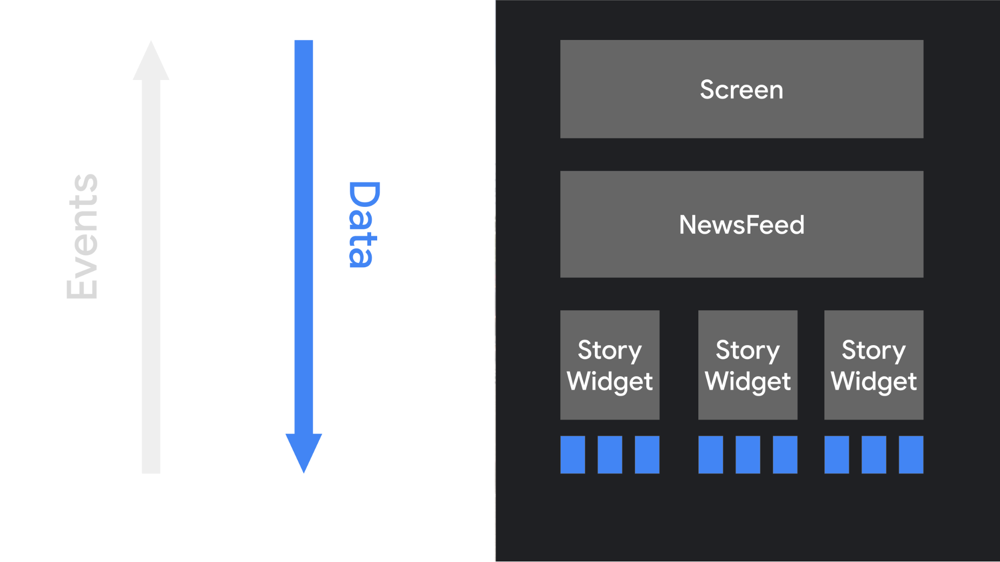
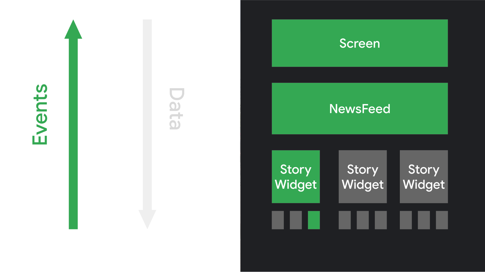

# Suy nghĩ trong Compose


#Mô hình lập trình khai báo

Trong lịch sử, hệ thống phân cấp chế độ xem Android được biểu thị dưới dạng cây gồm các tiện ích UI. 
Khi trạng thái của ứng dụng thay đổi do những thứ như tương tác của người dùng, 
hệ thống phân cấp UI cần được cập nhật để hiển thị dữ liệu hiện tại. 
Cách phổ biến nhất để cập nhật UI là duyệt cây bằng các hàm như `findViewById()`, 
và thay đổi các nút bằng cách gọi các phương thức như `button.setText(String)`, `container.addChild(View)`, 
hoặc `img.setImageBitmap(Bitmap)`. Các phương thức này thay đổi trạng thái bên trong của widget.


**Việc thao tác các chế độ xem theo cách thủ công sẽ làm tăng khả năng xảy ra lỗi. 
Nếu một phần dữ liệu được hiển thị ở nhiều nơi, bạn rất dễ quên cập nhật một trong các chế độ xem hiển thị phần đó.
Cũng dễ dàng tạo ra các trạng thái bất hợp pháp khi hai bản cập nhật xung đột theo cách không mong muốn.**


Ví dụ: một bản cập nhật có thể cố gắng đặt giá trị của nút vừa bị xóa khỏi UI. 
Nói chung, độ phức tạp của việc bảo trì phần mềm tăng lên cùng với số lượt xem yêu cầu cập nhật.


Trong vài năm qua, **toàn bộ ngành đã bắt đầu chuyển sang mô hình UI khai báo, giúp đơn giản hóa đáng kể kỹ thuật liên quan đến xây dựng và cập nhật giao diện người dùng. Kỹ thuật này hoạt động bằng cách tái tạo lại toàn bộ màn hình từ đầu, sau đó chỉ áp dụng những thay đổi cần thiết. Cách tiếp cận này tránh được sự phức tạp của việc cập nhật thủ công hệ thống phân cấp chế độ xem có trạng thái**. Compose là UI framework khai báo.


## Chức năng Compose

một vài điều đáng chú ý về chức năng này

- Chức năng được chú thích bằng chú thích `@Composable`. Tất cả các hàm Composable phải có chú thích này; **Chú thích này thông báo cho Compose compiler rằng chức năng này nhằm chuyển đổi dữ liệu thành UI.**

- Hàm không trả về bất cứ thứ gì. Các hàm Compose phát ra UI không cần trả về bất kỳ thứ gì vì chúng mô tả trạng thái màn hình mong muốn thay vì xây dựng các tiện ích UI.

> [!NOTE]
> Không giống như quy ước đặt tên cho các hàm Kotlin thông thường, sử dụng kiểu camelCase, các hàm Composable phải được đặt tên bắt đầu bằng chữ in hoa theo kiểu PascalCase.

## Sự thay đổi mô hình khai báo

Với nhiều bộ công cụ UI hướng đối tượng bắt buộc, bạn khởi tạo UI bằng cách khởi tạo một cây tiện ích. Bạn thường làm điều này bằng cách tăng cường tệp bố cục XML. Mỗi tiện ích duy trì trạng thái bên trong của riêng mình và hiển thị các phương thức getter và setter cho phép logic ứng dụng tương tác với tiện ích.

**Trong cách tiếp cận khai báo của Compose, các widget tương đối không có trạng thái và không hiển thị các hàm setter hoặc getter.** Trên thực tế, các widget không được hiển thị dưới dạng đối tượng. **Bạn cập nhật UI bằng cách gọi cùng một composable function với các đối số khác nhau.** Điều này giúp dễ dàng cung cấp trạng thái cho các mẫu kiến ​​trúc như `ViewModel`, như được mô tả trong [Hướng dẫn về cấu trúc ứng dụng](https://developer.android.com/topic/architecture). Sau đó, các thành phần kết hợp của bạn chịu trách nhiệm chuyển đổi trạng thái ứng dụng hiện tại thành UI mỗi khi cập nhật dữ liệu có thể quan sát được.


- Logic ứng dụng cung cấp dữ liệu cho composable function cấp cao nhất. Hàm đó sử dụng dữ liệu để mô tả UI bằng cách gọi các thành phần kết hợp khác và chuyển dữ liệu thích hợp đến các thành phần kết hợp đó và phân cấp theo cấp bậc.




- Khi trạng thái thay đổi, các hàm tổng hợp sẽ được gọi lại cùng với dữ liệu mới. Điều này khiến các phần tử UI được vẽ lại--process này được gọi là recomposition.



## Nội dung động

Vì các hàm có thể kết hợp được viết bằng Kotlin thay vì XML nên chúng có thể động như bất kỳ mã Kotlin nào khác. Ví dụ: giả sử bạn muốn xây dựng UI chào đón danh sách người dùng:


```kotlin
@Composable
fun Greeting(names: List<String>) {
    for (name in names) {
        Text("Hello $name")
    }
}
```

Hàm này lấy danh sách tên và tạo lời chào cho mỗi người dùng. Các chức năng Composable có thể khá phức tạp. Bạn có thể sử dụng câu lệnh if để quyết định xem bạn có muốn hiển thị một phần tử UI cụ thể hay không. Bạn có thể sử dụng các vòng lặp. Bạn có thể gọi các hàm trợ giúp. Bạn có toàn bộ tính linh hoạt của ngôn ngữ cơ bản. Sức mạnh và tính linh hoạt này là một trong những ưu điểm chính của Jetpack Compose.

##Recomposition

Trong mô hình UI bắt buộc, để thay đổi một tiện ích, bạn gọi một trình thiết lập trên tiện ích để thay đổi trạng thái bên trong của nó. Trong Compose, bạn gọi lại composable function với dữ liệu mới. Làm như vậy sẽ khiến hàm được kết hợp lại--các tiện ích do hàm phát ra sẽ được vẽ lại, nếu cần, với dữ liệu mới. Compose framework chỉ có thể kết hợp lại các thành phần đã thay đổi một cách thông minh.

<details>
  <summary style="color: orange;">
  <b>
  Ví dụ: hãy xem xét composable function này hiển thị một nút
  </b>
  </summary>
  
  <p>
  
```kotlin
@Composable
fun ClickCounter(clicks: Int, onClick: () -> Unit) {
    Button(onClick = onClick) {
        Text("I've been clicked $clicks times")
    }
}
```

Mỗi lần nhấp vào nút, người gọi sẽ cập nhật giá trị của các lần nhấp. Compose gọi lại lambda bằng hàm Văn bản để hiển thị giá trị mới; process này được gọi là recomposition. Các hàm khác không phụ thuộc vào giá trị sẽ không được kết hợp lại.

Như chúng ta đã thảo luận, việc sắp xếp lại toàn bộ cây UI có thể tốn kém về mặt tính toán, sử dụng sức mạnh tính toán và thời lượng pin. Compose giải quyết vấn đề này với recomposition thông minh này.


Recomposition là process dùng để gọi lại các hàm có khả năng kết hợp khi đầu vào thay đổi. Điều này xảy ra khi đầu vào của hàm thay đổi. Khi Compose kết hợp lại dựa trên đầu vào mới, nó chỉ gọi các hàm hoặc lambda có thể đã thay đổi và bỏ qua phần còn lại. Bằng cách bỏ qua tất cả các hàm hoặc lambda không có tham số thay đổi, Compose có thể kết hợp lại một cách hiệu quả.

Không bao giờ phụ thuộc vào tác dụng phụ của việc thực thi các hàm có khả năng kết hợp vì recomposition của hàm có thể bị bỏ qua. Nếu bạn làm vậy, người dùng có thể gặp phải hành vi kỳ lạ và khó đoán trong ứng dụng của bạn. Tác dụng phụ là bất kỳ thay đổi nào được hiển thị với phần còn lại của ứng dụng của bạn. Ví dụ: những hành động này đều là tác dụng phụ nguy hiểm:

- Ghi vào một thuộc tính của một đối tượng được chia sẻ
- Cập nhật một thứ có thể quan sát được trong ViewModel
- Cập nhật sở thích chia sẻ

Các chức năng Composable có thể được thực thi lại thường xuyên ở mọi khung hình, chẳng hạn như khi hoạt ảnh được hiển thị. Các chức năng của Composable phải nhanh để tránh bị giật trong khi hoạt ảnh. Nếu bạn cần thực hiện các thao tác tốn kém, chẳng hạn như đọc từ các tùy chọn được chia sẻ, hãy thực hiện việc đó trong coroutine nền và chuyển kết quả giá trị cho composable function làm tham số.

  </p>
</details>

>[!NOTE]
>**Tài liệu này thảo luận về một số điều cần lưu ý khi bạn sử dụng Compose:**
>- Các chức năng Composable có thể thực hiện theo bất kỳ thứ tự nào.
>- Các chức năng Composable có thể thực thi song song.
>- Recomposition bỏ qua nhiều hàm có thể kết hợp và lambda nhất có thể.
>- Recomposition lạc quan và có thể bị hủy.
>- composable function có thể được chạy khá thường xuyên, thường xuyên như mọi khung hình của hoạt ảnh.

Các phần sau đây sẽ đề cập đến cách xây dựng các hàm có khả năng kết hợp để hỗ trợ recomposition. Trong mọi trường hợp, best practice nhằm giữ cho các hàm tổng hợp của bạn hoạt động nhanh, ổn định và không có tác dụng phụ.

## Các hàm Composable có thể thực thi theo bất kỳ thứ tự nào

Nếu bạn xem mã của composable function, **bạn có thể cho rằng mã được chạy theo thứ tự xuất hiện**. Nhưng điều này không hẳn là đúng. Nếu composable function chứa các lệnh gọi đến các hàm có khả năng kết hợp khác thì các hàm đó có thể chạy theo bất kỳ thứ tự nào. Compose có tùy chọn nhận dạng rằng một số phần tử UI có mức độ ưu tiên cao hơn các phần tử khác và vẽ chúng trước.


<details>
  <summary style="color: orange;">
  <b>
  Ví dụ: giả sử bạn có mã như thế này để vẽ ba màn hình trong bố cục tab
  </b>
  </summary>
  
  <p>
  
```kotlin
@Composable
fun ButtonRow() {
    MyFancyNavigation {
        StartScreen()
        MiddleScreen()
        EndScreen()
    }
}
```

Các lệnh gọi tới StartScreen, MiddleScreen và EndScreen có thể diễn ra theo bất kỳ thứ tự nào. Điều này có nghĩa là bạn không thể, chẳng hạn, yêu cầu StartScreen() đặt một số biến toàn cục (tác dụng phụ) và yêu cầu MiddleScreen() tận dụng thay đổi đó. Thay vào đó, mỗi chức năng đó cần phải được khép kín.

  </p>
</details>


## Các hàm Composable có thể chạy song song

Compose có thể tối ưu hóa recomposition bằng cách chạy song song các hàm có thể kết hợp. Điều này cho phép Compose tận dụng nhiều lõi và chạy các chức năng có thể kết hợp không có trên màn hình ở mức độ ưu tiên thấp hơn.

Sự tối ưu hóa này có nghĩa là composable function có thể thực thi trong một nhóm các background thread.**Nếu composable function gọi một hàm trên ViewModel thì Compose có thể gọi hàm đó từ nhiều thread cùng một lúc.**

Để đảm bảo ứng dụng của bạn hoạt động chính xác, tất cả các hàm có khả năng kết hợp sẽ không có tác dụng phụ. Thay vào đó, hãy kích hoạt các tác dụng phụ từ các callback, chẳng hạn như onClick luôn thực thi trên UI thread.

Khi composable function được gọi, lệnh gọi có thể xảy ra trên thread khác với người gọi. Điều đó có nghĩa là bạn nên tránh sử dụng mã sửa đổi các biến trong lambda có thể kết hợp – vì mã đó không an toàn cho thread và vì đó là một tác dụng phụ không được chấp nhận của lambda có thể kết hợp.

<details>
  <summary style="color: orange;">
  <b>
  Ví dụ: Để hiển thị một thành phần kết hợp hiển thị danh sách và số lượng của danh sách đó
  </b>
  </summary>
  
  <p>
  
```kotlin
@Composable
fun ListComposable(myList: List<String>) {
    Row(horizontalArrangement = Arrangement.SpaceBetween) {
        Column {
            for (item in myList) {
                Text("Item: $item")
            }
        }
        Text("Count: ${myList.size}")
    }
}
```

Mã này không có tác dụng phụ và chuyển đổi danh sách đầu vào thành UI. Đây là mã tuyệt vời để hiển thị một danh sách nhỏ. Tuy nhiên, nếu hàm ghi vào local variable, mã này sẽ không an toàn hoặc không chính xác với thread:

```kotlin
@Composable
@Deprecated("Example with bug")
fun ListWithBug(myList: List<String>) {
    var items = 0

    Row(horizontalArrangement = Arrangement.SpaceBetween) {
        Column {
            for (item in myList) {
                Text("Item: $item")
                items++ // Avoid! Side-effect of the column recomposing.
            }
        }
        Text("Count: $items")
    }
}
```

Trong ví dụ này, các mục được sửa đổi với mọi recomposition. Đó có thể là mọi khung hình của hoạt ảnh hoặc khi danh sách cập nhật. Dù bằng cách nào, UI sẽ hiển thị số lượng sai. Do đó, việc viết như thế này không được hỗ trợ trong Compose; bằng cách cấm những thao tác ghi đó, chúng tôi cho phép framework thay đổi các thread để thực thi các lambda có thể tổng hợp.

  </p>
</details>

## Recomposition bỏ qua càng nhiều càng tốt

Khi các phần trong UI của bạn không hợp lệ, Compose sẽ cố gắng hết sức để chỉ soạn lại những phần cần được cập nhật. Điều này có nghĩa là nó có thể bỏ qua để chạy lại thành phần kết hợp của một Nút mà không thực thi bất kỳ thành phần kết hợp nào ở trên hoặc dưới nút đó trong cây UI.

<details>
  <summary style="color: orange;">
  <b>
Dưới đây là ví dụ minh họa cách recomposition có thể bỏ qua một số thành phần khi hiển thị danh sách
  </b>
  </summary>

  <p>
Mọi composable function và lambda đều có thể tự kết hợp lại.

```kotlin
/**
 * Display a list of names the user can click with a header
 */
@Composable
fun NamePicker(
    header: String,
    names: List<String>,
    onNameClicked: (String) -> Unit
) {
    Column {
        // this will recompose when [header] changes, but not when [names] changes
        Text(header, style = MaterialTheme.typography.bodyLarge)
        Divider()

        // LazyColumn is the Compose version of a RecyclerView.
        // The lambda passed to items() is similar to a RecyclerView.ViewHolder.
        LazyColumn {
            items(names) { name ->
                // When an item's [name] updates, the adapter for that item
                // will recompose. This will not recompose when [header] changes
                NamePickerItem(name, onNameClicked)
            }
        }
    }
}

/**
 * Display a single name the user can click.
 */
@Composable
private fun NamePickerItem(name: String, onClicked: (String) -> Unit) {
    Text(name, Modifier.clickable(onClick = { onClicked(name) }))
}

```

  </p>
</details>

## Recomposition lạc quan

Recomposition bắt đầu bất cứ khi nào Compose cho rằng các tham số của một thành phần kết hợp có thể đã thay đổi. Recomposition lạc quan,**có nghĩa là Compose dự kiến ​​sẽ hoàn thành recomposition trước khi các tham số lại thay đổi. Nếu một tham số thay đổi trước khi recomposition kết thúc, Compose có thể hủy recomposition và khởi động lại nó bằng tham số mới.**

Khi recomposition bị hủy, Compose sẽ loại bỏ cây UI khỏi recomposition. Nếu bạn có bất kỳ tác dụng phụ nào phụ thuộc vào UI được hiển thị, thì tác dụng phụ sẽ được áp dụng ngay cả khi composition bị hủy. Điều này có thể dẫn đến trạng thái ứng dụng không nhất quán.

Đảm bảo rằng tất cả các hàm có khả năng kết hợp và lambda đều bình thường và không có tác dụng phụ để xử lý recomposition lạc quan.


## Các hàm Composable có thể chạy khá thường xuyên

Trong một số trường hợp, composable function có thể chạy cho mọi khung hình của hoạt ảnh UI. Nếu chức năng này thực hiện các thao tác tốn kém, chẳng hạn như đọc từ bộ nhớ thiết bị, thì chức năng này có thể gây ra hiện tượng giật UI.

Ví dụ: nếu tiện ích của bạn cố đọc cài đặt thiết bị, nó có thể đọc các cài đặt đó hàng trăm lần một giây, gây ra những ảnh hưởng tai hại đến hiệu suất ứng dụng của bạn.

Nếu composable function của bạn cần dữ liệu, nó sẽ xác định các tham số cho dữ liệu. Sau đó, bạn có thể di chuyển tác phẩm đắt tiền sang thread khác, bên ngoài composition và chuyển dữ liệu tới Compose bằng mutableStateOf hoặc LiveData.

## Thẩm quyền giải quyết


- https://developer.android.com/develop/ui/compose/mental-model

