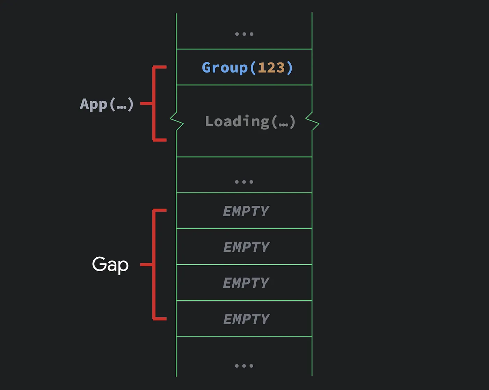
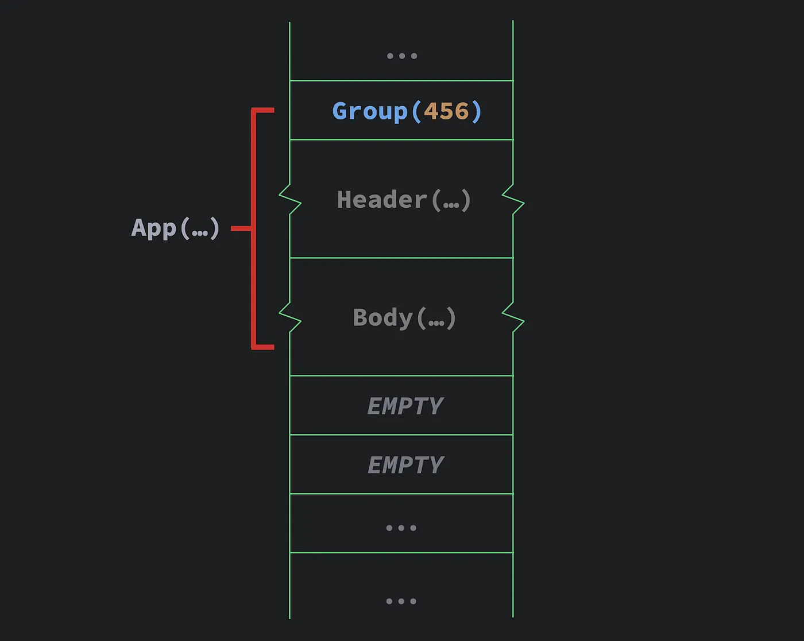

# Dưới mui xe của Jetpack Compose


## `@Composable` nghĩa là gì?

- `@Composable` không phải là bộ xử lý chú thích mà đóng vai trò như một từ khóa ngôn ngữ, tương tự như `suspend` trong Kotlin.
- Khi một hàm được đánh dấu bằng `@Composable`, nó sẽ thay đổi loại của hàm và nó chỉ có thể được gọi bên trong một hàm `@Composable` khác.
- Điều này là do `@Composable` yêu cầu ngữ cảnh gọi, được gọi là Composer, để quản lý lifecycle và trạng thái của user interface.

##Mô hình thực thi

- `Composer` sử dụng data structure tương tự như `Gap Buffer`, thường được sử dụng trong các trình soạn thảo văn bản, để lưu trữ và quản lý các thành phần UI.
- Cấu trúc này cho phép thêm, xóa và di chuyển các phần tử UI với độ phức tạp thời gian không đổi **(O(1))**, ngoại trừ thao tác dịch chuyển khoảng cách có độ phức tạp **O(n)**.
- Việc lựa chọn cấu trúc này dựa trên giả định cấu trúc UI không thay đổi thường xuyên; những thay đổi chính nằm ở các giá trị được hiển thị.

**Ví dụ**:

  
```kotlin
@Composable fun App() {
 val result = getData()
 if (result == null) {
   Loading(...)
 } else {
   Header(result)
   Body(result)
 }
}
```

Hàm getData trả về một số kết quả và hiển thị thành phần tải có thể kết hợp trong một trường hợp cũng như tiêu đề và nội dung trong một trường hợp khác. compiler chèn các khóa riêng biệt cho từng nhánh của câu lệnh if.

```kotlin
fun App($composer: Composer) {
 val result = getData()
 if (result == null) {
   $composer.start(123)
   Loading(...)
   $composer.end()
 } else {
   $composer.start(456)
   Header(result)
   Body(result)
   $composer.end()
 }
}
```

Giả sử rằng khi mã này thực thi lần đầu tiên, kết quả là null. Thao tác này sẽ chèn một nhóm vào mảng khoảng trống và màn hình tải sẽ chạy.



Lần thứ hai hàm chạy, hãy giả sử rằng kết quả không còn rỗng để nhánh thứ hai của câu lệnh if thực thi.

Lệnh gọi tới Composer.start có một nhóm có khóa `456`. compiler thấy nhóm trong bảng slot của `123` không khớp nên bây giờ nó biết rằng UI đã thay đổi về cấu trúc.

Sau đó, compiler di chuyển khoảng cách đến vị trí con trỏ hiện tại và mở rộng khoảng cách trên UI đã có ở đó, loại bỏ nó một cách hiệu quả.

Tại thời điểm này, mã được thực thi như bình thường và UI mới — tiêu đề và nội dung — được chèn vào.



Chúng tôi gọi khái niệm này là *Ghi nhớ vị trí* và đây là khái niệm mà Compose được xây dựng dựa trên

## Ghi nhớ vị trí

Thông thường, chúng ta có tính năng ghi nhớ toàn cục, nghĩa là compiler lưu trữ kết quả của một hàm dựa trên đầu vào của hàm đó

**Ví dụ**

```kotlin
@Composable
fun App(items: List<String>, query: String) {
 val results = items.filter { it.matches(query) }
 // ...
}
```

Hàm này lấy danh sách các mục chuỗi và truy vấn, sau đó thực hiện tính toán bộ lọc trên danh sách. 
Chúng ta có thể gói tính toán này trong một lệnh gọi tới `remember`: `remember` là thứ biết cách thu hút bảng đánh bạc. 
`remember` xem xét các mục và lưu trữ danh sách cũng như truy vấn trong bảng vị trí. 
Sau đó, tính toán bộ lọc sẽ chạy và `remember` lưu trữ kết quả trước khi gửi lại.

Lần thứ hai hàm thực thi, `remember` xem xét các giá trị mới được truyền vào và so sánh chúng với các giá trị cũ. 
Nếu cả hai đều không thay đổi thì thao tác lọc sẽ bị bỏ qua và kết quả trước đó sẽ được trả về. 
Đó là ghi nhớ vị trí.

## Lưu trữ thông số
Để minh họa cách lưu trữ các tham số của Composable function, hãy xem ví dụ:

```kotlin
@Composable fun Google(number: Int) {
 Address(
   number=number,
   street="Amphitheatre Pkwy",
   city="Mountain View",
   state="CA"
   zip="94043"
 )
}
 
@Composable fun Address(
 number: Int,
 street: String,
 city: String,
 state: String,
 zip: String
) {
 Text("$number $street")
 Text(city)
 Text(", ")
 Text(state)
 Text(" ")
 Text(zip)
}
```

Compose lưu trữ các tham số của composable function trong bảng vị trí. Nhìn vào ví dụ trên, chúng ta thấy một số phần dư thừa: “Mountain View” và “CA”, được thêm vào trong lệnh gọi địa chỉ, lại được lưu trữ trong các lệnh gọi văn bản cơ bản, vì vậy các chuỗi này sẽ được lưu trữ hai lần.

Chúng ta có thể loại bỏ sự dư thừa này bằng cách thêm tham số tĩnh vào các hàm Composable ở cấp compiler.

```kotlin
fun Google(
 $composer: Composer,
 $static: Int,
 number: Int
) {
 Address(
   $composer,
   0b11110 or ($static and 0b1),
   number=number,
   street="Amphitheatre Pkwy",
   city="Mountain View",
   state="CA"
   zip="94043"
 )
}
```


Tham số tĩnh trong trường hợp này là trường bit cho biết runtime có biết tham số không thay đổi hay không. Nếu một tham số được biết là không thay đổi thì không cần phải lưu trữ nó. **Vì vậy, trong ví dụ này của Google, compiler chuyển một trường bit cho biết không có tham số nào sẽ thay đổi.**

Sau đó, trong Địa chỉ, compiler có thể thực hiện điều tương tự và chuyển nó thành văn bản.

```kotlin
fun Address(
  $composer: Composer,
  $static: Int,
  number: Int, street: String, 
  city: String, state: String, zip: String
) {
  Text($composer, ($static and 0b11) and (($static and 0b10) shr 1), "$number $street")
  Text($composer, ($static and 0b100) shr 2, city)
  Text($composer, 0b1, ", ")
  Text($composer, ($static and 0b1000) shr 3, state)
  Text($composer, 0b1, " ")
  Text($composer, ($static and 0b10000) shr 4, zip)
}
```

Logic bitwise này khó đọc và khó hiểu, nhưng chúng ta không cần phải hiểu điều này: compiler giỏi việc này, còn con người thì không.

Vì điều này, chúng ta có thể tiến xa hơn và tạo mã hiểu rằng con số đó là thứ duy nhất sẽ thay đổi. Sau đó, mã này có thể hoạt động sao cho nếu một số không thay đổi thì phần nội dung của hàm sẽ bị bỏ qua hoàn toàn và chúng ta chỉ cần hướng dẫn trình soạn thảo di chuyển chỉ mục hiện tại của nó đến vị trí như thể hàm đã được thực thi.


```kotlin
fun Google(
 $composer: Composer,
 number: Int
) {
 if (number == $composer.next()) {
   Address(
     $composer,
     number=number,
     street="Amphitheatre Pkwy",
     city="Mountain View",
     state="CA"
     zip="94043"
   )
 } else {
   $composer.skip()
 }
}
```


> [!NOTE]
> Jetpack Compose tự động thêm các tham số tĩnh để tối ưu hóa, loại bỏ nhu cầu xử lý thủ công các giá trị không thay đổi.
##Recomposition

Để giải thích cách recomposition hoạt động, hãy quay lại ví dụ ngược lại.


```kotlin
fun Counter($composer: Composer) {
 $composer.start(123)
 var count = remember($composer) { mutableStateOf(0) }
 Button(
   $composer,
   text="Count: ${count.value}",
   onPress={ count.value += 1 },
 )
 $composer.end()
}
```

Recomposition là process trong Jetpack Compose trong đó Composable function được chạy lại khi dữ liệu phụ thuộc vào thay đổi. Trong ví dụ ngược lại, mỗi lần giá trị của số đếm thay đổi, Jetpack Compose sẽ chạy lại hàm `Counter`.

- `composer.start(123)` đánh dấu sự bắt đầu của một nhóm trong cây tổng hợp. Mỗi nhóm đại diện cho một phần tử UI.
- ghi nhớ và `mutableStateOf` lưu trữ giá trị đếm. Khi số lượng thay đổi, Compose biết rằng nó cần - sắp xếp lại UI để phản ánh giá trị mới.
- `Button` hiển thị giá trị đếm và cập nhật nó khi được nhấp vào.
- `composer.end()` đánh dấu sự kết thúc của nhóm.

Khi hàm `Counter` được thực thi, count.value được đọc từ đối tượng `mutableStateOf`. Mỗi lần số lượng thay đổi, Jetpack Compose sẽ kích hoạt recomposition để cập nhật UI.

Sau khi gọi `composer.end()`, nếu có bất kỳ giá trị nào thay đổi, Jetpack Compose sẽ kiểm tra xem recomposition có cần thiết hay không bằng cách sử dụng `updateScope`.


```kotlin
$composer.end()?.updateScope { nextComposer ->
 Counter(nextComposer)
}
```

`?` (kiểm tra null) ở đây cho biết rằng nếu không có đối tượng mô hình nào (như `count`) được đọc trong khi thực thi `Counter` thì hệ thống không cần theo dõi cách cập nhật thành phần kết hợp này vì nó biết UI sẽ không thay đổi. Nếu không có thay đổi nào, `updateScope` là không cần thiết.
Nếu thay đổi xảy ra, Jetpack Compose biết cách khởi động lại `Composable` bằng cách gọi `Counter`(nextComposer).


## Thẩm quyền giải quyết

- https://medium.com/androiddevelopers/understanding-jetpack-compose-part-1-of-2-ca316fe39050
- https://medium.com/androiddevelopers/under-the-hood-of-jetpack-compose-part-2-of-2-37b2c20c6cdd


