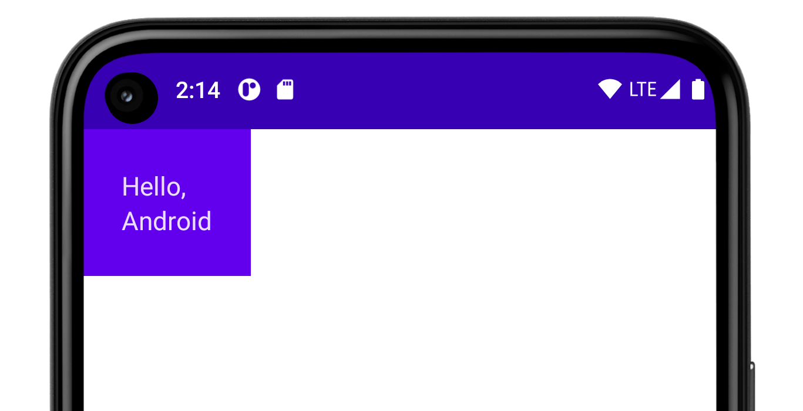
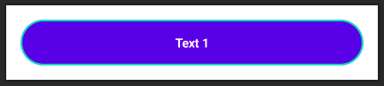

#Modifier
## Định nghĩa

Công cụ sửa đổi cho phép bạn trang trí hoặc tăng cường thành phần kết hợp. Công cụ sửa đổi cho phép bạn thực hiện những việc sau:
- Thay đổi kích thước, bố cục, hành vi và giao diện của thành phần kết hợp
- Thêm thông tin, như nhãn trợ năng
- Đầu vào của người dùng Process
- Thêm các tương tác cấp cao, như làm cho một phần tử có thể nhấp, có thể cuộn, có thể kéo hoặc có thể thu phóng

Công cụ sửa đổi là các đối tượng Kotlin tiêu chuẩn. **Tạo một công cụ sửa đổi bằng cách gọi một trong các hàm lớp Modifier**:

```kotlin
@Composable
private fun Greeting(name: String) {
    Column(modifier = Modifier.padding(24.dp)) {
        Text(text = "Hello,")
        Text(text = name)
    }
}
```


Đó là best practice để tất cả các thành phần kết hợp của bạn chấp nhận tham số công cụ sửa đổi và chuyển công cụ sửa đổi đó cho thành phần con đầu tiên phát ra UI. Làm như vậy sẽ giúp mã của bạn có thể tái sử dụng nhiều hơn và làm cho hành vi của mã dễ dự đoán và trực quan hơn.


### Thứ tự của các từ bổ nghĩa quan trọng


Thứ tự của các hàm sửa đổi là **đáng kể**. Vì mỗi hàm thực hiện các thay đổi đối với Công cụ sửa đổi được hàm trước đó trả về nên trình tự sẽ ảnh hưởng đến kết quả cuối cùng. 

<details>
  <summary style="color: orange;">
  <b>
  Hãy xem một ví dụ về điều này:
  </b>
  </summary>
  
  <p>
  
```kotlin
@Composable
fun ArtistCard(/*...*/) {
    val padding = 16.dp
    Column(
        Modifier
            .clickable(onClick = onClick)
            .padding(padding)
            .fillMaxWidth()
    ) {
        // rest of the implementation
    }
}

```


Trong mã phía trên, toàn bộ khu vực có thể nhấp vào được, bao gồm cả `padding` xung quanh, vì công cụ sửa đổi `padding` đã được áp dụng sau công cụ sửa đổi `clickable`. Nếu thứ tự sửa đổi bị đảo ngược, khoảng trắng được thêm bởi `padding` sẽ không phản ứng với dữ liệu đầu vào của người dùng:

```kotlin
@Composable
fun ArtistCard(/*...*/) {
    val padding = 16.dp
    Column(
        Modifier
            .padding(padding)
            .clickable(onClick = onClick)
            .fillMaxWidth()
    ) {
        // rest of the implementation
    }
}
```


  </p>
</details>

### Làm cách nào để thêm ký quỹ trong Compose?

Bạn có thể coi phần đệm và lề giống nhau (hãy tưởng tượng nó là "khoảng cách"). Bạn có thể áp dụng khoảng đệm hai lần (hoặc nhiều hơn) trong cùng một thành phần kết hợp và đạt được hoạt động tương tự như khi sử dụng lề+khoảng đệm. Ví dụ:

```kotlin
val shape = CircleShape
Text(
    text = "Text 1",
    style = TextStyle(
        color = Color.White,
        fontWeight = FontWeight.Bold,
        textAlign = TextAlign.Center),
    modifier = Modifier.fillMaxWidth()
        .padding(16.dp)
        .border(2.dp, MaterialTheme.colors.secondary, shape)
        .background(MaterialTheme.colors.primary, shape)
        .padding(16.dp)
)
```
Sẽ dẫn đến điều này:



Như bạn có thể thấy, phần đệm đầu tiên sẽ thêm khoảng trắng giữa thành phần và đường viền của nó. Sau đó, nền và đường viền được xác định. Cuối cùng, một phần đệm mới được đặt để thêm khoảng trống giữa đường viền và văn bản.


> [!NOTE]
> Thứ tự rõ ràng giúp bạn suy luận về cách các từ bổ nghĩa khác nhau sẽ tương tác. So sánh điều này với hệ thống dựa trên chế độ xem trong đó bạn phải tìm hiểu mô hình hộp, lề được áp dụng "bên ngoài" phần tử nhưng đệm "bên trong" nó và phần tử nền sẽ có kích thước tương ứng. Thiết kế công cụ sửa đổi làm cho loại hành vi này trở nên rõ ràng và có thể dự đoán được, đồng thời cung cấp cho bạn nhiều quyền kiểm soát hơn để đạt được hành vi chính xác mà bạn muốn. **Nó cũng giải thích tại sao không có công cụ sửa đổi lề mà chỉ có công cụ sửa đổi lề.**

### Công cụ sửa đổi tích hợp

#### phần đệm và kích thước

- Theo mặc định, các bố cục được cung cấp trong Compose bao bọc các phần tử con của chúng. Tuy nhiên, bạn có thể đặt kích thước bằng cách sử dụng công cụ sửa đổi kích thước:

```kotlin
@Composable
fun ArtistCard(/*...*/) {
    Row(
        modifier = Modifier.size(width = 400.dp, height = 100.dp)
    ) {
        Image(/*...*/)
        Column { /*...*/ }
    }
}
```

- Lưu ý rằng kích thước bạn chỉ định có thể không được tôn trọng nếu kích thước đó không đáp ứng các ràng buộc đến từ bố cục gốc. **Nếu bạn yêu cầu cố định kích thước của thành phần kết hợp bất kể các ràng buộc sắp tới, hãy sử dụng công cụ sửa đổi requiredSize:**

```kotlin
@Composable
fun ArtistCard(/*...*/) {
    Row(
        modifier = Modifier.size(width = 400.dp, height = 100.dp)
    ) {
        Image(
            /*...*/
            modifier = Modifier.requiredSize(150.dp)
        )
        Column { /*...*/ }
    }
}
```

> [!NOTE]
> Bố cục dựa trên các ràng buộc và thông thường, cha mẹ chuyển những ràng buộc đó cho con. Đứa trẻ nên tôn trọng những hạn chế. Tuy nhiên, đó có thể không phải lúc nào cũng là những gì UI yêu cầu. Có nhiều cách để bỏ qua hành vi này của trẻ. Ví dụ: bạn có thể chuyển trực tiếp các công cụ sửa đổi như `requiredSize` cho trẻ, ghi đè các ràng buộc mà trẻ nhận được từ cha mẹ hoặc bạn có thể sử dụng bố cục tùy chỉnh với hành vi khác. Khi một đứa trẻ không tôn trọng các ràng buộc của nó, hệ thống bố trí sẽ ẩn điều này khỏi cha mẹ. Cha mẹ sẽ thấy các giá trị `width` và `height` của con như thể chúng bị ép buộc trong các ràng buộc do cha mẹ cung cấp. Sau đó, hệ thống bố trí sẽ tập trung trẻ vào không gian do cha mẹ phân bổ với giả định rằng trẻ tôn trọng các ràng buộc. Các nhà phát triển có thể ghi đè hành vi tập trung này bằng cách áp dụng công cụ sửa đổi `wrapContentSize` cho trẻ.


- Nếu bạn muốn bố cục con lấp đầy tất cả chiều cao có sẵn được cha mẹ cho phép, hãy thêm công cụ sửa đổi `fillMaxHeight`, trong khi `fillMaxWidth` sử dụng tất cả không gian ngang có sẵn. `fillMaxSize` chiếm toàn bộ không gian có sẵn trong một thành phần kết hợp.

```kotlin
@Composable
fun ArtistCard(/*...*/) {
    Row(
        modifier = Modifier.size(width = 400.dp, height = 100.dp)
    ) {
        Image(
            /*...*/
            modifier = Modifier.fillMaxHeight()
        )
        Column { /*...*/ }
    }
}
```

> [!CAUTION]
> Tuy nhiên, điều quan trọng là phải thận trọng.
> Ví dụ: khi tạo ứng dụng dành cho máy tính bảng; một nút có thể lấp đầy toàn bộ chiều rộng màn hình, dẫn đến trải nghiệm người dùng không tốt.
> Điều này trở nên tồi tệ hơn ở chế độ nằm ngang. Mặc dù vậy, bạn có thể khắc phục nó một cách nhanh chóng; các công cụ sửa đổi này lấy phân số làm tham số, lấy các số dấu phẩy động.
> Bạn có thể chỉ định nó từ 0 đến 1 tương ứng.
> Tham số phân số không chỉ áp dụng cho fillMaxWidth mà còn cho fillMaxHeight và fillMaxSize.

- Để thêm phần đệm xung quanh một phần tử, hãy đặt công cụ sửa đổi `padding`. Nếu bạn muốn thêm khoảng đệm phía trên đường cơ sở văn bản để đạt được khoảng cách cụ thể từ đầu bố cục đến đường cơ sở, hãy sử dụng công cụ sửa đổi `paddingFromBaseline`

#### Bù lại

Để định vị bố cục so với vị trí ban đầu của nó, hãy thêm công cụ sửa đổi độ lệch và đặt độ lệch theo trục x và y. Sự bù đắp có thể tích cực cũng như không tích cực. **Sự khác biệt giữa phần đệm và phần bù là việc thêm phần bù vào thành phần kết hợp không làm thay đổi số đo của nó**:

```kotlin
@Composable
fun ArtistCard(artist: Artist) {
    Row(/*...*/) {
        Column {
            Text(artist.name)
            Text(
                text = artist.lastSeenOnline,
                modifier = Modifier.offset(x = 4.dp)
            )
        }
    }
}
```

> [!CAUTION]
> Công cụ sửa đổi `offset` được áp dụng theo chiều ngang theo hướng bố cục. Trong ngữ cảnh **từ trái sang phải**, `offset` dương sẽ dịch chuyển phần tử sang phải, trong khi ở ngữ cảnh **từ phải sang trái**, nó dịch chuyển phần tử sang trái. Nếu bạn cần đặt độ lệch mà không xem xét hướng bố cục, hãy xem công cụ sửa đổi `absoluteOffset`, trong đó giá trị bù dương luôn dịch chuyển phần tử sang bên phải.

## An toàn phạm vi trong Compose

Trong Compose, có các công cụ sửa đổi chỉ có thể được sử dụng khi áp dụng cho con của một số thành phần kết hợp nhất định. Compose thực thi điều này bằng phạm vi tùy chỉnh.

**Ví dụ**, nếu bạn muốn tạo thành phần con lớn bằng `Box` gốc mà không ảnh hưởng đến kích thước `Box`, hãy sử dụng công cụ sửa đổi `matchParentSize`. `matchParentSize` chỉ có ở `BoxScope`. Do đó, nó chỉ có thể được sử dụng cho trẻ em trong cha mẹ `Box`.

**Sự an toàn của phạm vi ngăn bạn thêm các công cụ sửa đổi không hoạt động trong các thành phần kết hợp và phạm vi khác, đồng thời tiết kiệm thời gian từ việc dùng thử và sai sót.**

> [!NOTE]
> Trong hệ thống Android View, không có phạm vi an toàn. Các nhà phát triển thường phải thử các thông số bố cục khác nhau để khám phá những thông số nào được xem xét và ý nghĩa của chúng trong bối cảnh của một cấp độ gốc cụ thể.

### `matchParentSize` trong `Box`

Trong ví dụ bên dưới, `Spacer` con lấy kích thước từ `Box` cha, `ArtistCard` cha mẹ của nó, lần lượt lấy kích thước từ con lớn nhất, `ArtistCard` trong trường hợp này.

```kotlin
@Composable
fun MatchParentSizeComposable() {
    Box {
        Spacer(
            Modifier
                .matchParentSize()
                .background(Color.LightGray)
        )
        ArtistCard()
    }
}
```


Nếu `fillMaxSize` được sử dụng thay vì `matchParentSize`, Spacer sẽ lấy tất cả không gian có sẵn được phép cho cấp độ gốc, từ đó khiến cấp độ gốc mở rộng và lấp đầy tất cả không gian có sẵn.


### `weight` trong `Row` và `Column`

Bạn có thể đặt kích thước có thể kết hợp thành linh hoạt trong cấp độ gốc bằng cách sử dụng `weight` Modifier chỉ có trong `RowScope` và `ColumnScope`. 

> [!NOTE]
> Trọng lượng không áp dụng cho BoxScope, mặc dù nó cũng có thể có nhiều thành phần kết hợp. Bởi vì không rõ trọng lượng sẽ được phân bổ như thế nào – theo chiều dọc, chiều ngang hoặc cả hai. 

Hãy lấy một `Row` có chứa hai thành phần kết hợp `Box`. Hộp đầu tiên có gấp đôi `weight` của hộp thứ hai, do đó, nó có chiều rộng gấp đôi. Vì `Row` có chiều rộng `210.dp` nên `Box` đầu tiên có chiều rộng `140.dp` và `70.dp`:

```kotlin
@Composable
fun ArtistCard(/*...*/) {
    Row(
        modifier = Modifier.fillMaxWidth()
    ) {
        Image(
            /*...*/
            modifier = Modifier.weight(2f)
        )
        Column(
            modifier = Modifier.weight(1f)
        ) {
            /*...*/
        }
    }
}
```

> [!NOTE]
> Sự khác biệt chính giữa fillMaxSize và trọng lượng là bố cục gốc sử dụng trọng lượng để phân bổ không gian có sẵn giữa các thành phần kết hợp khác nhau.

> [!CAUTION]
> Tuy nhiên, hãy nhớ rằng trọng lượng có thể làm tăng độ phức tạp của bố cục. Ngoài ra, trên các thiết bị nhỏ hơn, nếu nội dung quá đông đúc, nội dung có thể bị chồng chéo.
## Trích xuất và sử dụng lại các sửa đổi

Đôi khi, việc sử dụng lại các phiên bản chuỗi sửa đổi giống nhau trong nhiều thành phần kết hợp có thể có ích, bằng cách trích xuất chúng thành các biến và hoisting chúng vào phạm vi cao hơn. Nó có thể cải thiện khả năng đọc mã hoặc giúp cải thiện hiệu suất ứng dụng của bạn vì một số lý do:

- Việc phân bổ lại các bộ sửa đổi sẽ không được lặp lại khi recomposition xảy ra đối với các thành phần kết hợp sử dụng chúng
- Chuỗi Modifier có thể rất dài và phức tạp, do đó, việc sử dụng lại cùng một phiên bản của chuỗi có thể giảm bớt khối lượng công việc mà Compose runtime cần thực hiện khi so sánh chúng
- Việc trích xuất này thúc đẩy độ sạch của mã, tính nhất quán và khả năng bảo trì trên toàn bộ cơ sở mã

### Trích xuất và sử dụng lại các sửa đổi khi quan sát trạng thái thay đổi thường xuyên

<details>
  <summary style="color: orange;">
  <b>
  Ví dụ
  </b>
  </summary>
  
  <p>

Khi quan sát các trạng thái thay đổi thường xuyên bên trong các thành phần kết hợp, như trạng thái hoạt ảnh hoặc scrollState, có thể có một số lượng đáng kể quá trình kết hợp lại được thực hiện. Trong trường hợp này, công cụ sửa đổi của bạn sẽ được phân bổ trên mọi recomposition và có thể cho mọi khung hình:

```kotlin
@Composable
fun LoadingWheelAnimation() {
    val animatedState = animateFloatAsState(/*...*/)

    LoadingWheel(
        // Creation and allocation of this modifier will happen on every frame of the animation!
        modifier = Modifier
            .padding(12.dp)
            .background(Color.Gray),
        animatedState = animatedState
    )
}
```
Thay vào đó, bạn có thể tạo, trích xuất và sử dụng lại cùng một phiên bản của công cụ sửa đổi và chuyển nó vào thành phần kết hợp như sau:

```kotlin
// Now, the allocation of the modifier happens here:
val reusableModifier = Modifier
    .padding(12.dp)
    .background(Color.Gray)

@Composable
fun LoadingWheelAnimation() {
    val animatedState = animateFloatAsState(/*...*/)

    LoadingWheel(
        // No allocation, as we're just reusing the same instance
        modifier = reusableModifier,
        animatedState = animatedState
    )
}
```


  </p>
</details>

### Trích xuất và sử dụng lại các công cụ sửa đổi không có phạm vi

<details>
  <summary style="color: orange;">
  <b>
  Ví dụ
  </b>
  </summary>
  
  <p>
  
Công cụ sửa đổi có thể không có phạm vi hoặc nằm trong phạm vi của một thành phần kết hợp cụ thể. Trong trường hợp các công cụ sửa đổi không có phạm vi, bạn có thể dễ dàng trích xuất chúng bên ngoài bất kỳ thành phần kết hợp nào dưới dạng các biến đơn giản:

```kotlin
val reusableModifier = Modifier
    .fillMaxWidth()
    .background(Color.Red)
    .padding(12.dp)

@Composable
fun AuthorField() {
    HeaderText(
        // ...
        modifier = reusableModifier
    )
    SubtitleText(
        // ...
        modifier = reusableModifier
    )
}
```

Điều này có thể đặc biệt có lợi khi kết hợp với bố cục Lazy. Trong hầu hết các trường hợp, bạn muốn tất cả số lượng mặt hàng, có khả năng đáng kể, của mình có cùng các sửa đổi chính xác:

```kotlin
val reusableItemModifier = Modifier
    .padding(bottom = 12.dp)
    .size(216.dp)
    .clip(CircleShape)

@Composable
private fun AuthorList(authors: List<Author>) {
    LazyColumn {
        items(authors) {
            AsyncImage(
                // ...
                modifier = reusableItemModifier,
            )
        }
    }
}
```


  </p>
</details>

### Trích xuất và sử dụng lại các công cụ sửa đổi có phạm vi

<details>
  <summary style="color: orange;">
  <b>
  Ví dụ
  </b>
  </summary>
  
  <p>
  
Khi xử lý các công cụ sửa đổi nằm trong phạm vi các thành phần kết hợp nhất định, bạn có thể trích xuất chúng ở mức cao nhất có thể và tái sử dụng khi thích hợp:

```kotlin
Column(/*...*/) {
    val reusableItemModifier = Modifier
        .padding(bottom = 12.dp)
        // Align Modifier.Element requires a ColumnScope
        .align(Alignment.CenterHorizontally)
        .weight(1f)
    Text1(
        modifier = reusableItemModifier,
        // ...
    )
    Text2(
        modifier = reusableItemModifier
        // ...
    )
    // ...
}
``` 

Bạn chỉ nên chuyển các công cụ sửa đổi có phạm vi, được trích xuất cho các phần tử con trực tiếp có cùng phạm vi

```kotlin
Column(modifier = Modifier.fillMaxWidth()) {
    // Weight modifier is scoped to the Column composable
    val reusableItemModifier = Modifier.weight(1f)

    // Weight will be properly assigned here since this Text is a direct child of Column
    Text1(
        modifier = reusableItemModifier
        // ...
    )

    Box {
        Text2(
            // Weight won't do anything here since the Text composable is not a direct child of Column
            modifier = reusableItemModifier
            // ...
        )
    }
}
```

  </p>
</details>

### Xâu chuỗi thêm các công cụ sửa đổi được trích xuất


<details>
  <summary style="color: orange;">
  <b>
  Ví dụ
  </b>
  </summary>
  
  <p>
  
Bạn có thể xâu chuỗi hoặc nối thêm chuỗi sửa đổi đã trích xuất của mình bằng cách gọi hàm .then():

```kotlin
val reusableModifier = Modifier
    .fillMaxWidth()
    .background(Color.Red)
    .padding(12.dp)

// Append to your reusableModifier
reusableModifier.clickable { /*...*/ }

// Append your reusableModifier
otherModifier.then(reusableModifier)
```


  </p>
</details>

## Tạo công cụ sửa đổi tùy chỉnh

Công cụ sửa đổi tùy chỉnh trong Jetpack Compose là một công cụ mạnh mẽ cho phép chúng tôi trích xuất logic UI phức tạp và tạo các thành phần sửa đổi mô-đun, có thể tái sử dụng.

process này khuyến khích **nguyên tắc single responsibility**, nâng cao khả năng bảo trì mã và cho phép trừu tượng hóa logic UI.

Jetpack Compose tận dụng các chức năng mở rộng của Kotlin, một cách nhanh chóng và hiệu quả để thêm chức năng mới vào các lớp hiện có.

Ví dụ :

```kotlin
fun Modifier.roundedCorners(radius: Dp): Modifier =
    clip(RoundedCornerShape(radius))

@Composable
fun CustomModifiers() {
    Box(
        modifier = Modifier.size(300.dp)
            .roundedCorners(16.dp)
            .background(Color.Blue)
    )
}
```

Công cụ sửa đổi tùy chỉnh trong ví dụ này là **không trạng thái**; điều quan trọng cần lưu ý là bạn cũng có thể tạo các công cụ sửa đổi **trạng thái**.

Để đạt được điều này, bạn có thể tận dụng chức năng `composed` để ghi nhớ trạng thái của chính nó và phản ứng với các thay đổi.
Hàm này có hai tham số:
- `inspectorInfo`, rất hữu ích nếu bạn muốn gỡ lỗi công cụ sửa đổi của mình.
- `factory`, trong đó chúng tôi xác định logic cho cả thành phần kết hợp và trạng thái liên kết của nó.

Ví dụ:
```kotlin
fun Modifier.changeColorWhenClicked() = composed {
    var isClicked by remember { mutableStateOf(false) }
    val color = if (isClicked) Color.Red else Color.Blue

    then(
        Modifier
            .background(color = color)
            .clickable { isClicked = !isClicked }
    )
}
```

Hàm `then` chấp nhận `Modifier` làm đối số và trả về nó, cho phép trích xuất thêm chuỗi sửa đổi.


## Các phương pháp hay nhất khi xây dựng UI với Modifier

- Có rất nhiều cách để đạt được kết quả tương tự trên UI. Ví dụ: bạn có thể sử dụng `Spacer` để tách hình ảnh khỏi văn bản. Hoặc thay vì áp dụng khoảng đệm trong `Row`, bạn có thể sử dụng khoảng đệm trong mọi thành phần kết hợp. 
Tuy nhiên, làm điều gì đó ít hơn sẽ tốt hơn nếu nó không làm phức tạp mã. Hãy tưởng tượng rằng số lượng thành phần trong `Row` có thể nhiều hơn nữa.
- Kết hợp `modifier` với `remember` khi làm việc với `Modifier.clickable` vì **một công cụ sửa đổi có thể nhấp mới được tạo mỗi lần**.
Hãy cân nhắc việc ghi nhớ toàn bộ công cụ sửa đổi, chẳng hạn như:

```kotlin
val modifier = remember(viewModel) {
        val event = object: UiEvent {
            override fun onClick() {
                viewModel.action()
            }
        }
        Modifier.clickable { event.onClick() }
    }
```

> [!NOTE]
> Việc bổ sung viewModel làm tham số cho phần ghi nhớ để đảm bảo phiên bản mới của clickable() được tạo nếu/khi viewModel thay đổi.


## Thẩm quyền giải quyết

- https://developer.android.com/develop/ui/compose/modifiers
- https://hyperskill.org/learn/step/38658

