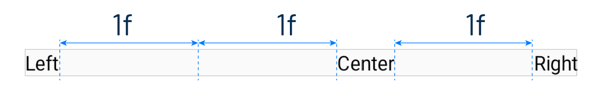
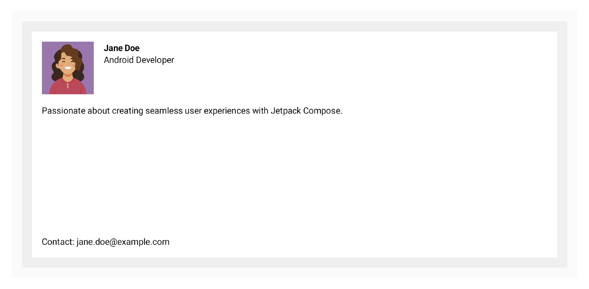

# Miếng đệm và phần đệm

## Miếng đệm


Bạn có thể quen thuộc với "mô hình hộp" từ hệ thống Android View, trong đó mỗi chế độ xem là một hộp có thể có một khoảng không gian bên ngoài gọi là "lề" và một không gian bên trong gọi là "khoảng đệm".

Jetpack Compose đơn giản hóa nhiều thứ, bao gồm cả mẫu hộp.

Jetpack Compose cung cấp một cách linh hoạt hơn để sắp xếp các phần tử không gian bằng Spacer và phần đệm.
Lựa chọn này phù hợp với mục tiêu của Compose là có UI mang tính khai báo hơn, cho phép các nhà phát triển tạo khoảng cách tùy chỉnh cho bố cục của họ.

Thành phần kết hợp `Spacer` là một thành phần vô hình tạo ra khoảng cách giữa các phần tử UI. Bạn có thể đặt một kích thước cụ thể cho nó, hoạt động giống như kích thước mà bạn thường gọi là lề.

### Tính linh hoạt của miếng đệm

Trong Jetpack Compose, `Spacer` không chỉ là một trình chèn không gian tĩnh; đó là một công cụ linh hoạt có thể thích ứng với không gian có sẵn trong bố cục.

- Công cụ sửa đổi `weight` có thể được sử dụng với `Spacer` để phân chia không gian có sẵn trong `Row` hoặc `Column`.
Khi bạn sử dụng `weight`, bạn đang yêu cầu Compose cung cấp một phần không gian có sẵn cho `Spacer`, tùy thuộc vào trọng lượng của nó so với các phần tử khác có trọng số.

- Bạn có thể đặt nhiều thành phần kết hợp `Spacer` với các `weights` khác nhau để kiểm soát cách phân chia không gian.

Ví dụ:
```kotlin
@Composable
fun FlexibleSpaceDistributionExample() {
    Row(modifier = Modifier.fillMaxWidth()) {
        Text("Left")
        Spacer(modifier = Modifier.weight(2f)) // Takes twice as much space as the right spacer
        Text("Center")
        Spacer(modifier = Modifier.weight(1f)) // Uses available space
        Text("Right")
    }
}
```



- Đôi khi bạn có thể muốn `Spacer` có kích thước thay đổi dựa trên nội dung hoặc giới hạn. Bạn có thể thực hiện việc này bằng cách kết hợp công cụ sửa đổi `weight` với giới hạn kích thước tối thiểu.


```kotlin
@Composable
fun DynamicSpacerSizeExample() {
    Column(modifier = Modifier.fillMaxHeight()) {
        Text("Top")
        Spacer(modifier = Modifier.weight(1f).heightIn(min = 50.dp)) // At least 50.dp tall
        Text("Bottom")
    }
}
```

## Đệm

Trong khi `Spacer` thêm không gian giữa các phần tử, thì phần đệm được dùng để thêm không gian bên trong ranh giới của một thành phần kết hợp. Bạn có thể áp dụng khoảng đệm cho bất kỳ thành phần kết hợp nào bằng cách sử dụng công cụ sửa đổi `padding`.

Bạn có thể áp dụng phần đệm theo nhiều cách khác nhau
- Một cách là thêm cùng một khoảng đệm vào tất cả các cạnh của thành phần kết hợp bằng cách cung cấp một giá trị duy nhất cho công cụ sửa đổi `padding`.

```kotlin
@Composable
fun ProfileCard() {
    Column(
        modifier = Modifier
            .fillMaxWidth()
            .padding(all = 16.dp)
            .background(Color(0xFFEEEEEE)) // Color of the shadow effect
            .padding(all = 16.dp) // Additional padding for the shadow effect
            .background(Color.White)
            .padding(all = 16.dp)
    ) {
        /*...*/
    }        
}
```

Thao tác này sẽ thêm ba lớp đệm—mỗi lớp `16.dp`—vào tất cả các cạnh của `Column`, căn giữa nội dung với không gian bằng nhau xung quanh nó.



- Thay vì có cùng một khoảng đệm trên tất cả các mặt, bạn có thể chỉ định khoảng đệm cho từng mặt: `top`, `bottom`, `start` hoặc `end`.


- Công cụ sửa đổi `absolutePadding` cho phép bạn chỉ định phần đệm là `left` và `right` thay vì `start` và `end`. 
Trong bố cục từ trái sang phải (LTR), `start` có nghĩa là `left` và `end` có nghĩa là `right`. Nhưng trong ngôn ngữ từ phải sang trái (RTL) như tiếng Ả Rập hoặc tiếng Do Thái, `start` là `right` và `end` là `left`.


`absolutePadding` bỏ qua điều này và áp dụng phần đệm cho các cạnh thực của màn hình.

Hãy sử dụng `absolutePadding` một cách cẩn thận vì nó có thể tạo cảm giác khác lạ cho người dùng RTL. Hãy suy nghĩ về ứng dụng tổng thể và liệu việc giữ nguyên hướng của khoảng đệm có mang lại trải nghiệm tốt hơn hay không.

### Đệm ngang và dọc

Trong trường hợp này, bạn có tham số `horizontal` để áp dụng cùng một khoảng đệm cho các mặt `start` và `end`, và tham số `vertical` để áp dụng cùng một khoảng đệm cho các mặt `top` và `bottom`.

### Đệm từ đường cơ sở

Công cụ sửa đổi `paddingFromBaseline` là một dạng phần đệm chuyên dụng rất hữu ích khi xử lý các thành phần văn bản.

`paddingFromBaseline` nhận các giá trị theo đơn vị `dp` hoặc `sp` (pixel tỷ lệ).
`sp` là đơn vị tốt hơn cho các thành phần Văn bản vì nó tôn trọng tùy chọn kích thước phông chữ và cài đặt trợ năng của người dùng.

Đây là cách bạn có thể sử dụng `paddingFromBaseline`:


```kotlin
@Composable
fun TextWithPaddingFromBaseline() {
    Column {
        Text(
            text = "Headline",
            style = MaterialTheme.typography.headlineLarge,
            modifier = Modifier.paddingFromBaseline(top = 40.sp)
        )
        Text(
            text = "Subhead",
            style = MaterialTheme.typography.headlineSmall,
            modifier = Modifier.paddingFromBaseline(top = 32.sp, bottom = 24.sp)
        )
    }
}
```

Trong ví dụ này, công cụ sửa đổi `paddingFromBaseline` đảm bảo có khoảng trắng `40.sp` từ đường cơ sở "Tiêu đề" `Text` và một khoảng trống `32.sp` từ đường cơ sở `Text` "Tiêu đề phụ". Nó cũng thêm một khoảng trắng `24.sp` từ đường cơ sở đến cuối "Tiêu đề phụ" `Text`, nhường chỗ cho phần tử tiếp theo.


> [!WARNING]
> Hãy nhớ rằng paddingFromBaseline sẽ trông khác nhau tùy theo phông chữ và kích thước, vì những điều này ảnh hưởng đến vị trí đường cơ sở. Vì vậy, khi bạn sử dụng công cụ sửa đổi này, hãy nghĩ đến nhu cầu văn bản cụ thể trong thiết kế của bạn và kiểm tra nó bằng các cài đặt văn bản khác nhau để đảm bảo nó hoạt động tốt.

## Công cụ sửa đổi "bù đắp"

Đôi khi bạn có thể cần phần đệm âm để đặt một thành phần chính xác ở nơi bạn muốn,
nhưng nếu bạn thử thứ gì đó như thế này: `Modifier.padding(start = (-4).dp)`,
bạn sẽ gặp lỗi khi nói: "Phần đệm phải không âm".

Để giải quyết vấn đề này, Jetpack Compose cung cấp công cụ sửa đổi `offset`.
Công cụ sửa đổi này cho phép bạn di chuyển một thành phần kết hợp bằng cách dịch chuyển thành phần đó khỏi vị trí ban đầu theo một khoảng cách cụ thể là `x` (ngang) và `y` (dọc).

> [!IMPORTANT]
> Việc sử dụng offset sẽ thay đổi vị trí trực quan của một thành phần kết hợp nhưng không thay đổi không gian bố cục mà nó chiếm (Đó là lý do tại sao một khoảng trắng được để lại ở cuối trong bản xem trước của ví dụ trước của chúng tôi).
> Không gian dành riêng cho thành phần kết hợp trước phần bù vẫn giữ nguyên và thành phần kết hợp có thể bao gồm các phần tử khác do phần bù.

## Các phương pháp hay nhất

- **Hãy nhất quán**: Giữ khoảng cách nhất quán trong toàn bộ ứng dụng của bạn.
Chọn một tập hợp các giá trị khoảng cách nhất quán, chẳng hạn như bội số của `4.dp` hoặc `8.dp`, để tạo giao diện cân bằng.
Khoảng cách nhất quán giúp giữ nhịp điệu trong thiết kế của bạn.

- **Tránh sử dụng quá nhiều Spacer**: Mặc dù `Spacer` rất hữu ích nhưng việc sử dụng quá nhiều có thể lấp đầy các hàm tổng hợp của bạn bằng những phần không cần thiết. Nếu bạn đang sử dụng nhiều `Spacers`, hãy nghĩ đến việc sử dụng `padding` hoặc thay đổi cách tiếp cận bố cục của bạn.

- **Sử dụng chuỗi bổ trợ một cách thông minh**: Bạn có thể xâu chuỗi các bổ trợ lại với nhau trong Jetpack Compose. Khi bạn kết hợp `padding` với các công cụ sửa đổi khác, thứ tự có thể thay đổi bố cục.

- **Responsive design**: Đảm bảo bố cục có khoảng đệm và Khoảng cách hoạt động tốt trên các kích thước và vị trí màn hình khác nhau.

- **Tránh các số được mã hóa cứng**: Thay vì viết thẳng các giá trị `padding` và `Spacer` vào mã của bạn, **đặt chúng dưới dạng hằng số hoặc trong một chủ đề**. Điều này làm cho việc điều chỉnh toàn cục trở nên dễ dàng hơn và mã của bạn gọn gàng hơn.


## Thẩm quyền giải quyết

- https://hyperskill.org/learn/step/42034


