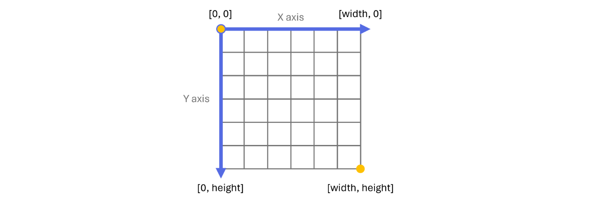
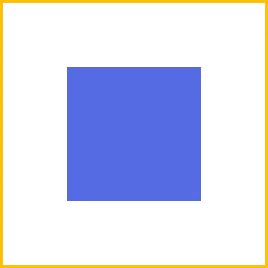

# Hình dạng trong Compose

## Hình dạng tích hợp

Compose cung cấp nhiều hình dạng được xác định trước để bạn có thể dễ dàng sử dụng trong thiết kế ứng dụng của mình. Hãy cùng khám phá những hình dạng này:

### `CircleShape`

Sử dụng nó cho các tình huống mà bạn cần một phần tử hình tròn, chẳng hạn như ảnh hồ sơ hoặc một số phần tử trang trí:

```kotlin
Image(
    painter = painterResource(R.drawable.profile_picture),
    contentDescription = "Profile Picture",
    contentScale = ContentScale.Crop,
    modifier = Modifier
        .clip(CircleShape) // Apply the CircleShape
        .size(100.dp)
)
```
> [!WARNING]
> Nếu thành phần kết hợp có kích thước không bằng nhau, CircleShape sẽ tạo thành hình bầu dục hoặc hình elip.

### `RoundedCornerShape`

Điều này cho phép bạn tạo hình chữ nhật với các góc tròn. 

```kotlin
Button(
    onClick = { /* Do something */ },
    shape = RoundedCornerShape(8.dp) // Round corners by 8.dp
) {
    Text("Click me")
}
```

`RoundedCornerShape` cung cấp nhiều cách khác nhau để kiểm soát bán kính góc:

- **Bán kính góc đồng nhất**: Vượt qua một `size: Dp`, `corner: CornerSize`, `size: Float` hoặc **phần trăm: Int** (các giá trị nằm trong khoảng từ 0 đến 100)

- **Bán kính góc riêng**: Sử dụng các tham số `topStart`, `topEnd`, `bottomEnd` và `bottomStart` chuyển các giá trị `Dp`, `Float` hoặc `CornerSize` tới chỉ định bán kính khác nhau cho mỗi góc.
Bạn cũng có thể chuyển các giá trị phần trăm dưới dạng số nguyên bằng cách sử dụng `topStartPercent`, `topEndPercent`, v.v.

### `RectangleShape`

Điều này thể hiện một hình chữ nhật đơn giản với các góc nhọn.

### `CutCornerShape`

Điều này cho phép bạn tạo hình chữ nhật với các góc cắt

## Hình dạng tùy chỉnh

Đôi khi bạn cần một hình dạng độc đáo hoàn toàn phù hợp với yêu cầu thiết kế của bạn.
Để tạo hình dạng tùy chỉnh, bạn cần mở rộng giao diện `Shape` và triển khai chức năng `createOutline`.

Hàm này chịu trách nhiệm xác định đường viền của hình dạng, về cơ bản là vẽ các ranh giới của nó:

```kotlin
// Import `Shape` from here
import androidx.compose.ui.graphics.Shape

class MyCustomShape : Shape {
    override fun createOutline(
        size: Size,
        layoutDirection: LayoutDirection,
        density: Density
    ): Outline {
        // Define your custom shape here
    }
}
```
Hãy chia nhỏ các tham số của hàm `createOutline`:

- **size**: Đối tượng `Size` cung cấp chiều rộng và chiều cao của vùng nơi hình sẽ được vẽ.
- **layoutDirection**: Giá trị này cho biết hướng bố cục (từ trái sang phải hoặc từ phải sang trái) của thành phần kết hợp bằng cách sử dụng hình dạng. Bạn có thể sử dụng thông tin này để tạo các hình dạng thích ứng với các hướng ngôn ngữ khác nhau.

- **mật độ**: Đối tượng `Density` này cung cấp thông tin về mật độ màn hình, có thể hữu ích để chia tỷ lệ hình dạng của bạn một cách thích hợp trên các thiết bị khác nhau.


Trong hàm `createOutline`, bạn sẽ sử dụng lớp `Outline` và các hàm khác nhau của nó để mô tả đường viền của hình dạng. Lớp `Outline` hoạt động như một thùng chứa dữ liệu đường dẫn của hình dạng của bạn.

Compose sử dụng hệ tọa độ Descartes, trong đó vị trí của bất kỳ điểm nào trên màn hình được xác định bởi hai giá trị: X và Y (dưới dạng Phao).

Gốc (0, 0) của hệ tọa độ này nằm ở góc trên cùng bên trái của thành phần kết hợp mà bạn đang làm việc:



Ví dụ: chúng ta có thể tạo một hình chữ nhật có kích thước bằng một nửa thành phần kết hợp được áp dụng cho:

```kotlin
class HalfSizeRectangleShape : Shape {
    override fun createOutline(
        size: Size,
        layoutDirection: LayoutDirection,
        density: Density
    ): Outline {
        val halfWidth = size.width / 2 // size.width is a Float
        val halfHeight = size.height / 2 // size.height is also a Float
        val rect = Rect(
            left = halfWidth / 2,
            top = halfHeight / 2,
            right = halfWidth + halfWidth / 2,
            bottom = halfHeight + halfHeight / 2
        )
        return Outline.Rectangle(rect)
    }
}
```



Đường viền vàng chỉ nhằm mục đích minh họa và hiển thị kích thước thực tế của thành phần kết hợp.


> [!NOTE]
> Hàm Rect có nhiều biến thể. bạn có thể áp dụng phương pháp này để khám phá tình trạng quá tải cho các chức năng khác được đề cập.

Lớp `Outline` có ba lớp lồng nhau:

- `Outline.Rectangle`. Lớp này cho phép bạn tạo các đường viền hình chữ nhật với các góc nhọn.
- `Outline.Rounded`. cho phép chúng ta tạo các hình chữ nhật tròn.
- `Outline.Generic`.Với lớp Path, Bạn di chuyển bút từ điểm này sang điểm khác, tạo đường thẳng hoặc đường cong và cuối cùng là đóng hình.

Ví dụ: để tạo một hình tam giác:

```kotlin
class TriangleShape : Shape {
    override fun createOutline(
        size: Size,
        layoutDirection: LayoutDirection,
        density: Density
    ): Outline {
        val path = Path().apply {
            moveTo(size.width / 2f, 0f) // Move to top center
            lineTo(size.width, size.height) // Draw line to bottom right
            lineTo(0f, size.height) // Draw line to bottom left
            close() // Close the path
        }
        return Outline.Generic(path)
    }
}
```

> [!TIP]
> Việc tạo các hình dạng phức tạp thường liên quan đến một số phép toán, đặc biệt là đối với các đường cong. 
> Ví dụ: đường cong Bézier sử dụng các điểm kiểm soát để xác định độ cong của đường dẫn.
> Hiểu các nguyên tắc hình học cơ bản và các hàm toán học có thể mở rộng đáng kể khả năng tạo hình tùy chỉnh của bạn.


Compose cung cấp một lớp tiện dụng có tên `GenericShape` giúp đơn giản hóa việc tạo các hình dạng tùy chỉnh bằng các đường dẫn.
Điều này có thể đặc biệt hữu ích khi bạn muốn tạo hình dạng tùy chỉnh một lần mà không cần xác định một lớp hoàn toàn mới

```kotlin
Box(
    modifier = Modifier
        .size(100.dp)
        .clip(GenericShape {size, layoutDirection ->
            // Bottom right quadrant shape
            moveTo(size.width, 0f)
            quadraticBezierTo(size.width, size.height, 0f, size.height)
            lineTo(0f, 0f)
        })
        .background(Color.Blue)
)
```


