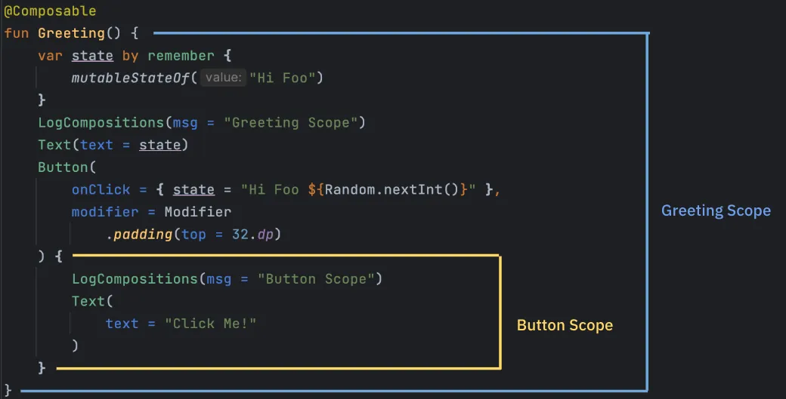

# Recomposition Phạm vi trong Jetpack Compose


> [!NOTE]
> Theo tài liệu chính thức Chúng tôi có:
> Recomposition là process dùng để gọi lại các hàm có thể kết hợp của bạn khi đầu vào thay đổi
> Điều này xảy ra khi đầu vào của hàm thay đổi. Khi Compose kết hợp lại dựa trên đầu vào mới, nó chỉ gọi các hàm hoặc lambda có thể đã thay đổi và bỏ qua phần còn lại. Bằng cách bỏ qua tất cả các hàm hoặc lambda không có tham số thay đổi, Compose có thể kết hợp lại một cách hiệu quả.

Recomposition là điều không thể tránh khỏi khi chúng ta build UI với Compose vì recomposition là Compose có cơ chế cập nhật trạng thái dữ liệu hiện tại lên UI, **nhưng những thứ chúng ta có thể loại bỏ là recomposition không cần thiết tối ưu hóa mã Compose của chúng tôi**. Bằng cách hiểu cách recomposition hoạt động, chúng tôi có thể đảm bảo rằng mã chúng tôi viết không dẫn đến việc soạn thảo liên tục recomposition không cần thiết.

## Phạm vi Recomposition

Phạm vi Recomposition là khối mã nhỏ nhất có thể được kết hợp lại một cách độc lập.


Điều đó có nghĩa là soạn thảo có thể tìm thấy nơi trạng thái hoặc đầu vào đọc và chỉ soạn lại phạm vi nhỏ nhất của thành phần mà không cần soạn lại tất cả chúng.


Chúng ta hãy xem mẫu phạm vi recomposition bên dưới:



**Phạm vi Recomposition thường được đánh dấu bằng khung chức năng mở và đóng**, Về mặt phân cấp, chúng ta thấy rằng `Button Scope` cũng nằm trong `Greeting Scope`, nhưng về mặt recomposition `Greeting Scope` và `Button Scope ` có thể kết hợp lại một cách độc lập, Compose có thể soạn lại `Greeting Scope ` mà không soạn lại `Button Scope` hoặc soạn lại `Button Scope` mà không soạn lại `Greeting Scope` hoặc soạn lại cả hai trong một recomposition process.

## Để hiểu cách hoạt động của phạm vi recomposition, hãy thực hiện một số thử nghiệm.

### 1. Tìm hiểu phạm vi Recomposition
Đối với chức năng sau:

```kotlin
class Ref(var value: Int)

@Composable
inline fun LogCompositions(msg: String) {
    val ref = remember { Ref(0) }
    SideEffect { ref.value++ }
    Log.d("RecompositionLog", "Compositions: $msg ${ref.value}")
}
```


hàm này sẽ gọi mỗi khi recomposition xảy ra và đếm xem có bao nhiêu recomposition đã được gọi.
Chúng tôi cần hàm này nội tuyến để đảm bảo composable function này không có phạm vi recomposition riêng. 

Hãy xem ví dụ bên dưới, chúng tôi sửa đổi màn hình Lời chào mặc định khi tạo hoạt động soạn thư trên Android Studio để hiển thị cách hoạt động của phạm vi recomposition

```kotlin
@Composable
fun Greeting() {
    var state by remember {
        mutableStateOf("Hi Foo")
    }
    LogCompositions(msg = "Greeting Scope")
    Text(text = state)
    Button(
        onClick = { state = "Hi Foo ${Random.nextInt()}" },
        modifier = Modifier
            .padding(top = 32.dp)
    ) {
        LogCompositions(msg = "Button Scope")
        Text(
            text = "Click Me!"
        )
    }
}
```

Trong mẫu này, chúng tôi tạo một văn bản và một nút, bất cứ khi nào nhấn nút, nó sẽ cập nhật trạng thái đọc của văn bản. Chúng tôi có hai phạm vi composition ở đây, `Greeting Scope` và `Button Scope` . Và kết quả là:

`Greeting Scope` được gọi, nhưng `Button Scope` không được gọi. Tại sao? bởi vì trạng thái được đọc trên dòng 7 trong đó `LogCompositions` này là một phần của `Greeting Scope` . Tại sao `Button Scope` không được gọi? vì không có trạng thái có thể quan sát nào được đọc bởi bất kỳ thành phần soạn thảo nào trên `Button Scope`.

Bước tiếp theo, chúng tôi cố gắng chuyển thành phần đọc trạng thái sang phạm vi khác:

```kotlin
@Composable
fun Greeting() {
    var state by remember {
        mutableStateOf("Hi Foo")
    }
    LogCompositions(msg = "Greeting Scope")
    Text(text = "Hi Foo")
    Button(
        onClick = { state = "Hi Foo ${Random.nextInt()}" },
        modifier = Modifier
            .padding(top = 32.dp)
    ) {
        LogCompositions(msg = "Button Scope")
        Text(
            text = state
        )
    }
}
```

`Button Scope` được gọi vì chúng tôi di chuyển thành phần đọc trạng thái vào `Button Scope` . Mặc dù dựa trên hệ thống phân cấp `Button Scope` cũng là một phần của `Greeting Scope` nhưng Compose có thể gọi nó mà không cần gọi thành phần phạm vi gốc của nó. Để hiểu rõ hơn về việc bỏ qua process này bạn có thể đọc thêm bài viết này về “Bỏ qua lỗ Donute”

### 2. Chú ý đến Inline Composable Function

Dựa trên ví dụ ở Phần 1, mã này sẽ chỉ gọi `Column` Scope , phải không? bởi vì thành phần đọc trạng thái trên dòng số 9 nằm ở `Column` Scope . Hãy cùng tìm hiểu.

```kotlin
@Composable
fun Greeting() {
    var state by remember {
        mutableStateOf("Hi Foo")
    }
    LogCompositions(msg = "Greeting Scope")
    Column { // We add new component here
        LogCompositions(msg = "Column Scope")
        Text(text = state)
        Button(
            onClick = { state = "Hi Foo ${Random.nextInt()}" },
        ) {
            LogCompositions(msg = "Button Scope")
            Text(
                text = "Click Me"
            )
        }
    }
}
```

Kết quả :

logCat trông giống như:

```
Composition: Greenting Scope 1
Composition: Column Scope 1
```

Được rồi, điều này lẽ ra không được xảy ra. `Column Scope` được gọi, nhưng tại sao `Greeting Scope` cũng được gọi? Để trả lời câu hỏi này, hãy mở Định nghĩa cột


`Column` (và hầu hết vùng chứa trong Compose như `Box`, `Row`, `Constraint Layout`) **là chức năng nội tuyến**. Chúng tôi biết rằng khi chúng tôi biên dịch hàm nội tuyến thành mã java, hàm đó không thực sự tồn tại, nó sẽ hướng dẫn compiler mang hàm nội dung hoàn chỉnh đến người gọi mà không cần tạo hàm mới. Nó tạo ra composable function nội tuyến như `Column` không có phạm vi recomposition, nó tuân theo phạm vi gốc của nó. Đó là lý do tại sao trên mẫu của chúng tôi ở trên `Column Scope` được gọi cùng với `Greeting Scope` vì `Column Scope` không thực sự tồn tại.

Bạn có thể đọc thêm về hàm nội tuyến trên tài liệu chính thức của Kotlin hoặc từ bài viết này: [Hàm nội tuyến trong kotlin](https://amitshekhar.me/blog/inline-function-in-kotlin)

TL;DR từ bài viết: 

```kotlin
fun simpleFun(){
    print("abc")
    reader()
}


inline fun reader(){
    print("reader")
}
```

khi được biên dịch sang java:

```java
public void simpleFun(){
    System.out.print("abc")
    System.out.print("reader")
}
```

### 3. Phạm vi Recomposition và Thành phần có thể bỏ qua

Chúng ta hãy xem mã dưới đây:

```kotlin
@Composable
fun Greeting() {
    var state by remember {
        mutableStateOf("Hi Foo")
    }
    var staticState by remember {
        mutableStateOf("This state never changes")
    }
    LogCompositions(msg = "Greeting Scope")
    Column {
        LogCompositions(msg = "Column Scope")
        Text(text = state)
        Text(text = staticState)
        Button(
            onClick = { state = "Hi Foo ${Random.nextInt()}" },
        ) {
            LogCompositions(msg = "Button Scope")
            Text(
                text = "Click Me"
            )
        }
    }
}
```

Kết quả:

Chúng tôi thấy rằng văn bản đầu tiên và văn bản thứ hai nằm trong cùng một phạm vi, đó là `Greeting Scope` . **Phạm vi lời chào này được gọi mỗi khi chúng ta nhấn vào nút, nhưng nó chỉ cập nhật biến trạng thái và không có bản cập nhật forstatisState**. mặc dù toàn bộ mã trên `Greeting Scope` được gọi, Compose biết rằng trạng thái đọc bằng văn bản thứ hai không được cập nhật, vì vậy Compose chỉ cần bỏ qua để soạn lại thành phần này. Bằng cách bỏ qua thành phần soạn lại không cần thiết, Compose sẽ hoạt động hiệu quả.


⮕ Giờ đây, chúng tôi biết rằng không cần thiết phải chia phạm vi recomposition hoặc gói mọi thành phần vào phạm vi recomposition nhỏ hơn, **điều quan trọng hơn đối với chúng tôi là đảm bảo mọi thành phần trên phạm vi recomposition đều có thể bỏ qua**, vì vậy, ngay cả khi có nhiều thành phần trên một phạm vi composition thì điều đó cũng không ảnh hưởng đến hiệu suất vì Compose chỉ soạn lại thành phần cần thiết và không soạn lại phần còn lại.


## Kết luận

- Compose thực hiện recomposition thông minh bằng cách gọi phạm vi recomposition nhỏ nhất nơi trạng thái đọc
- Thay vì lo lắng về dòng mã trong một phạm vi, sẽ tốt hơn nếu chúng ta đảm bảo thành phần bên trong phạm vi recomposition có thể bỏ qua, nó sẽ giúp việc soạn thảo hoạt động hiệu quả hơn
- Nói chung khó xác định được phạm vi nào sẽ được recomposite nếu không biết hàm đó có nội tuyến hay không, hãy sử dụng các công cụ hỗ trợ như Layout Inspector để theo dõi recomposition
- Quy tắc recomposition có thể thay đổi trong quá trình phát triển trong tương lai do mục đích tối ưu hóa

Để nhận báo cáo đầy đủ về thành phần soạn thư có thể bỏ qua và không thể bỏ qua, chúng tôi có thể sử dụng [chỉ số Composable](https://chrisbanes.me/posts/composable-metrics/) hoặc thư viện của bên thứ ba như [Mendable](https://github.com/jayasuryat/mendable)

### Tài liệu tham khảo

- https://medium.com/@riz_maulana/how-does-compose-determine-which-block-of-code-to-recompose-3bf6bd4dad1e