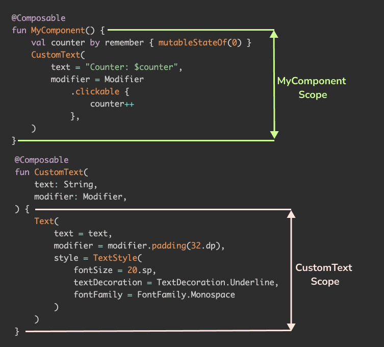
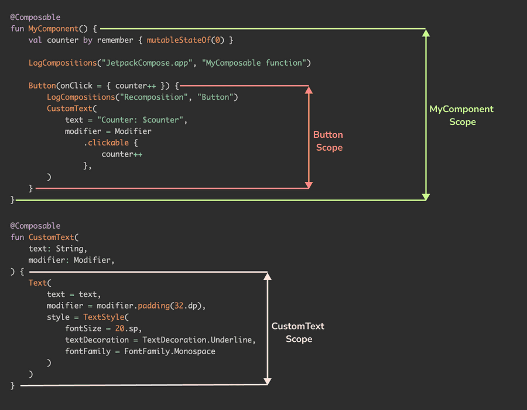
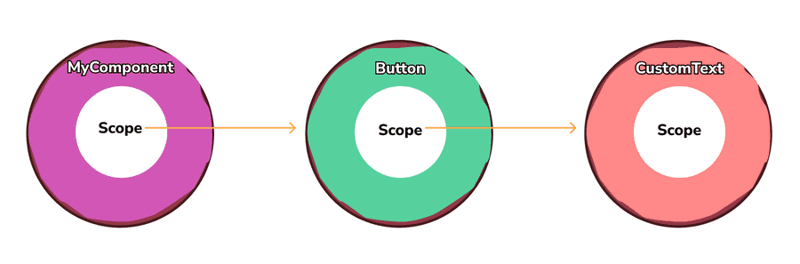
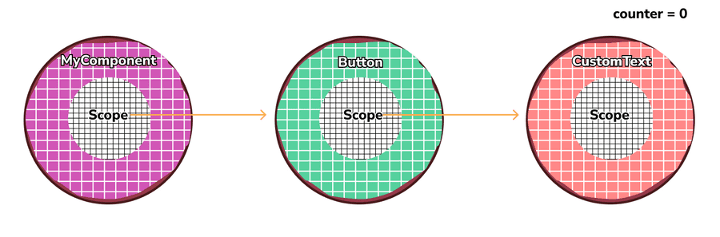
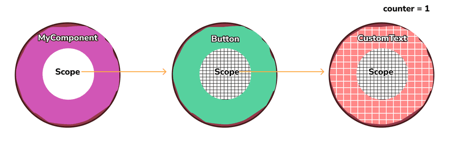
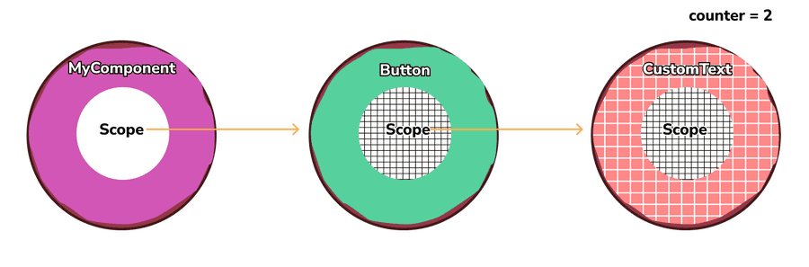
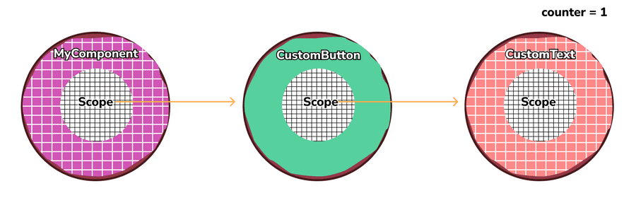
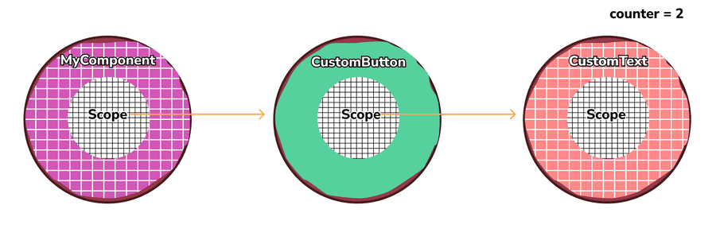

# Bỏ qua lỗ bánh rán trong Jetpack Compose

## Phạm vi phân hủy lại
Ví dụ:

```kotlin
class Ref(var value: Int)

// Note the inline function below which ensures that this function is essentially
// copied at the call site to ensure that its logging only recompositions from the
// original call site.
@Composable
inline fun LogCompositions(tag: String, msg: String) {
    if (BuildConfig.DEBUG) {
        val ref = remember { Ref(0) }
        SideEffect { ref.value++ }
        Log.d(tag, "Compositions: $msg ${ref.value}")
    }
}
```


```kotlin
@Composable
fun MyComponent() {
    val counter by remember { mutableStateOf(0) }

   LogCompositions("JetpackCompose.app", "MyComposable function")

    CustomText(
        text = "Counter: $counter",
        modifier = Modifier
            .clickable {
                counter++
            },
    )
}

@Composable
fun CustomText(
    text: String,
    modifier: Modifier = Modifier,
) {
   LogCompositions("JetpackCompose.app", "CustomText function")

    Text(
        text = text,
        modifier = modifier.padding(32.dp),
        style = TextStyle(
            fontSize = 20.sp,
            textDecoration = TextDecoration.Underline,
            fontFamily = FontFamily.Monospace
        )
    )
}
```


kết quả sẽ là:

```
MyComposeable function 0
CustomText function 0
MyComposeable function 1
CustomText function 1
MyComposeable function 2
CustomText function 2
```




Khi giá trị của bộ đếm thay đổi, trước đây chúng tôi đã nhận thấy rằng cả hai phạm vi này đều đang được gọi lại và đây là lý do:

- `CustomText` được kết hợp lại vì tham số văn bản của nó đã thay đổi khi bao gồm giá trị bộ đếm. Điều này có ý nghĩa và có lẽ là những gì bạn muốn.
- `MyComponent` được kết hợp lại vì phạm vi lambda của nó nắm bắt đối tượng trạng thái truy cập và phạm vi lambda nhỏ hơn không có sẵn để thực hiện bất kỳ hoạt động tối ưu hóa recomposition nào.

Ví dụ 2:

```kotlin
@Composable
fun MyComponent() {
    val counter by remember { mutableStateOf(0) }

    LogCompositions("JetpackCompose.app", "MyComposable function")

    Button(onClick = { counter++ }) {
        LogCompositions("JetpackCompose.app", "Button")
        CustomText(
            text = "Counter: $counter",
        )
    }
}
```
Kết quả:

```
MyComposeable function 0
Button 0
CustomText function 0
Button 1
CustomText function 1
Button 2
CustomText function 2
```



Chúng tôi thấy rằng nội dung của `MyComponent` đã được thực thi trong composition đầu tiên cùng với nội dung của thành phần kết hợp `Button` và thành phần kết hợp theCustomText. Tuy nhiên, mọi recomposition tiếp theo chỉ khiến thành phần kết hợp `Button` và `CustomText` được gọi lại trong khi nội dung của `MyComponent` bị bỏ qua hoàn toàn.

- Mặc dù việc khởi tạo bộ đếm nằm trong phạm vi MyComponent, nhưng nó không đọc giá trị của nó, ít nhất là không trực tiếp trong phạm vi chính.
- Phạm vi Nút là nơi giá trị của bộ đếm được đọc và chuyển đến thành phần kết hợp CustomText làm đầu vào

**Vì việc soạn thảo runtime có thể tìm thấy một phạm vi nhỏ hơn (Phạm vi nút) trong đó giá trị của bộ đếm đang được đọc** nên nó đã bỏ qua việc gọi phạm vi `MyComponent` và chỉ gọi phạm vi `Button` (nơi giá trị đang được đọc) & phạm vi `CustomText` (khi đầu vào của nó thay đổi). Trên thực tế, nó cũng đã bỏ qua việc gọi thành phần kết hợp `Button` (nó gọi phạm vi của nó chứ không phải chính thành phần kết hợp `Button`).


Hãy hình dung các thành phần kết hợp trong ví dụ 2 bằng ống kính này và xem chúng được kết hợp lại như thế nào. Bất cứ thứ gì có họa tiết ca-rô đều thể hiện rằng nó đã được bố cục lại.


Trạng thái trước khi bất kỳ chức năng nào trong số này được sáng tác


Bộ đếm = 0 composition đầu tiên, tất cả các hàm có khả năng kết hợp và phạm vi của chúng đều được thực thi và tổng hợp



Bộ đếm = Chỉ có 1 Phạm vi nút và Phạm vi CustomText, & CustomText được kết hợp lại. MyComponent, MyComponent Phạm vi & Nút được bỏ qua khỏi recomposition.


Bộ đếm = Chỉ có 2 Phạm vi nút và Phạm vi CustomText, & CustomText được kết hợp lại. MyComponent, MyComponent Phạm vi & Nút được bỏ qua khỏi recomposition.

### Compose vẫn đang làm recomposition thông minh

Ví dụ 3 :

```kotlin
@Composable
fun MyComponent() {
    val counter by remember { mutableStateOf(0) }

    LogCompositions("JetpackCompose.app", "MyComposable function")

    val readingCounter = counter
    CustomButton(onClick = { counter++ }) {
        LogCompositions("JetpackCompose.app", "CustomButton scope")
        CustomText(
            text = "Counter: $counter",
            modifier = Modifier
                .clickable {
                    counter++
                },
        )
    }
}
```

với:


```kotlin
@Composable
fun CustomButton(
    onClick: () -> Unit,
    content: @Composable () -> Unit
) {
    LogCompositions("JetpackCompose.app", "CustomButton function")
    Button(onClick = onClick, modifier = Modifier.padding(16.dp)) {
        LogCompositions("JetpackCompose.app", "Button function")
        content()
    }
}

@Composable
fun CustomText(
    text: String,
    modifier: Modifier = Modifier,
) {
   LogCompositions("JetpackCompose.app", "CustomText function")

    Text(
        text = text,
        modifier = modifier.padding(32.dp),
        style = TextStyle(
            fontSize = 20.sp,
            textDecoration = TextDecoration.Underline,
            fontFamily = FontFamily.Monospace
        )
    )
}
```

Kết quả: 

```
MyComposable function 0
CustomButton function 0
Button function 0
CustomButton Scope 0
CustomText function 0

MyComposable function 1
CustomButton Scope 1
CustomText function 1

MyComposable function 2
CustomButton Scope 2
CustomText function 2
```

Mỗi khi giá trị của `counter` thay đổi, hàm `CustomButton` và hàm `Button` sẽ bị bỏ qua hoàn toàn.

**Chúng ta đã học được từ các ví dụ trước rằng Compose sẽ rất thông minh khi bỏ qua các hàm Composable không đọc đối tượng trạng thái mutable hoặc nếu đầu vào của chúng không thay đổi.**

Tuy nhiên, có điều gì đó độc đáo về hành vi của Jetpack Compose đáng được nêu bật và bạn có thể đã bỏ lỡ nó khi xem nhật ký của ví dụ này. Để hình dung điều này, chúng ta hãy nhìn vào sơ đồ bánh rán cho Ví dụ 3


Trạng thái trước khi bất kỳ chức năng nào trong số này được sáng tác


Bộ đếm = 0 composition đầu tiên, tất cả các hàm có khả năng kết hợp và phạm vi của chúng đều được thực thi và tổng hợp


Bộ đếm = 1 Mọi thứ ngoại trừ CustomButton được kết hợp lại


Bộ đếm = 2 Mọi thứ ngoại trừ CustomButton được kết hợp lại

Điều làm cho Compose trở nên đặc biệt là nó có thể bỏ qua recomposition của CustomButton trong khi sắp xếp lại cha mẹ (MyComponent) và con của nó (CustomText) 🤯

Và đây, mọi người, là lý do tại sao việc tối ưu hóa này của Compose được gọi là “bỏ qua lỗ bánh rán” vì nó có thể bỏ qua các nút trong cây con không cần phải kết hợp lại.

### Thẩm quyền giải quyết 

https://www.jetpackcompose.app/articles/donut-hole-skipping-in-jetpack-compose