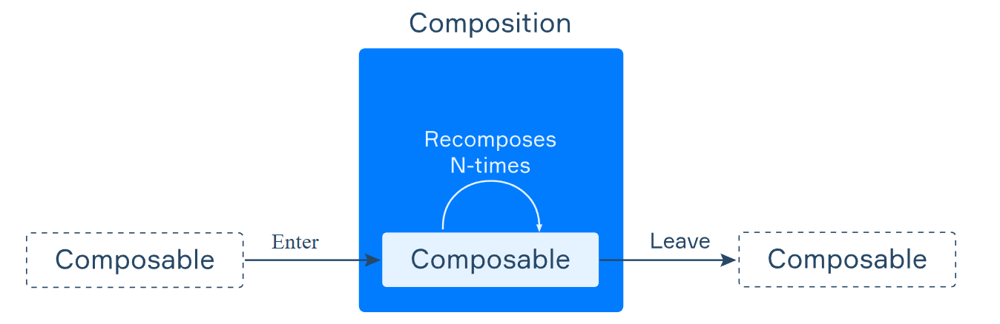
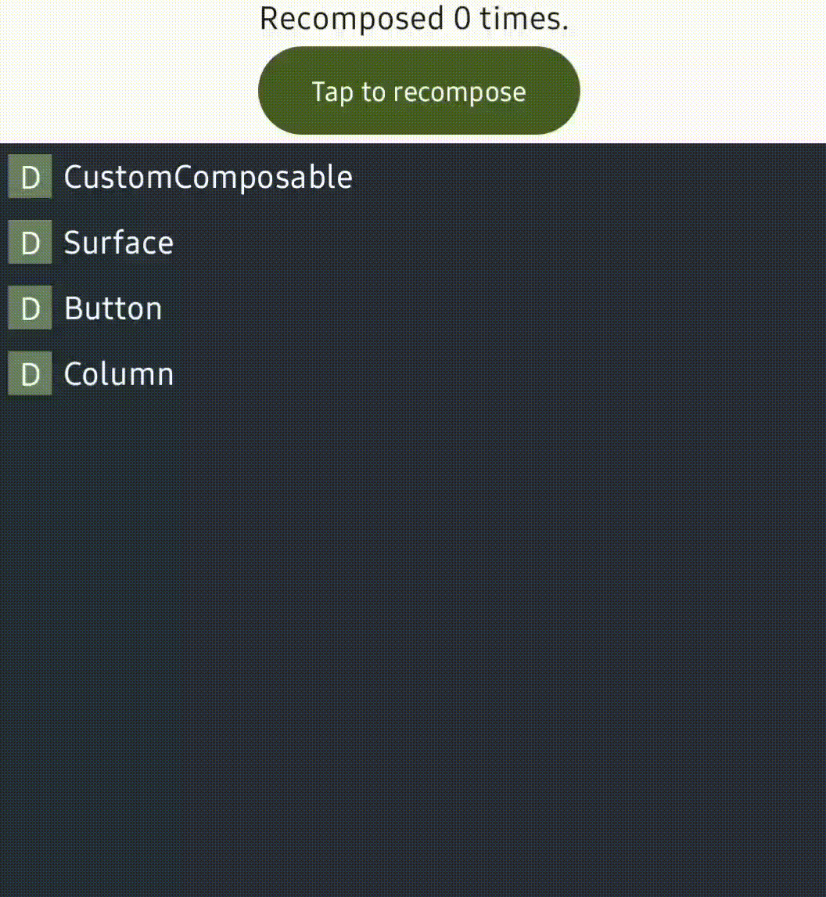
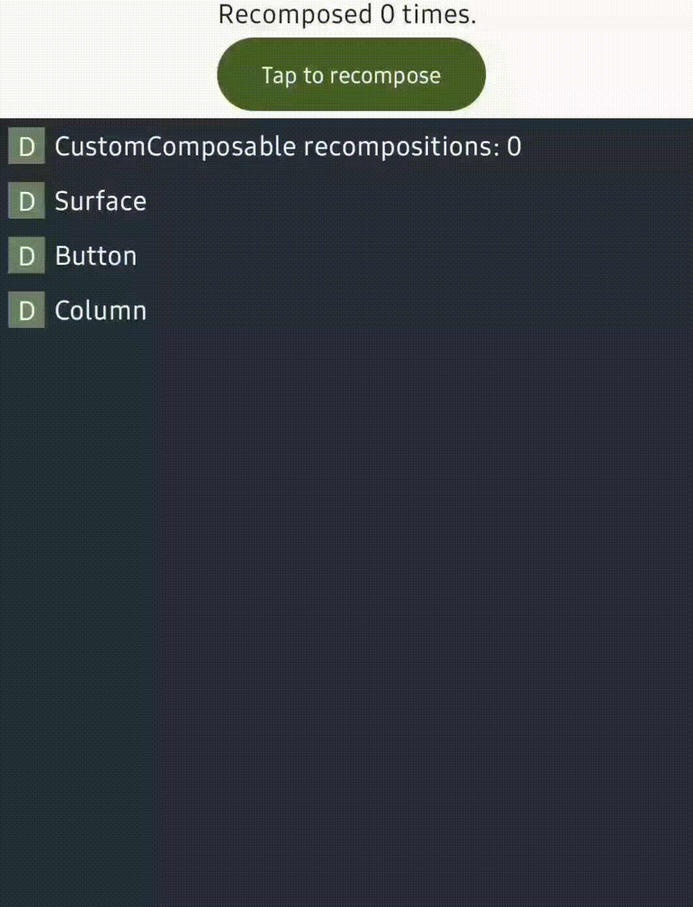
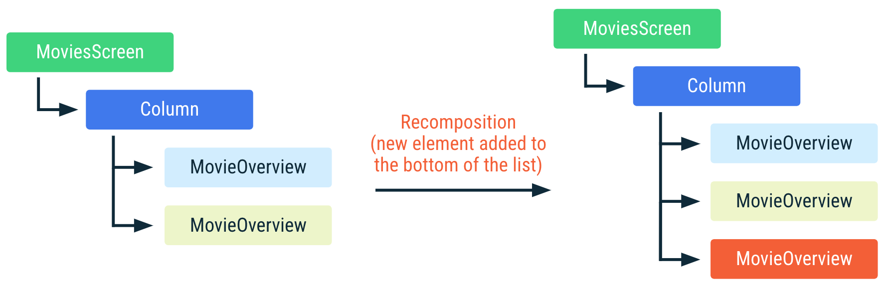
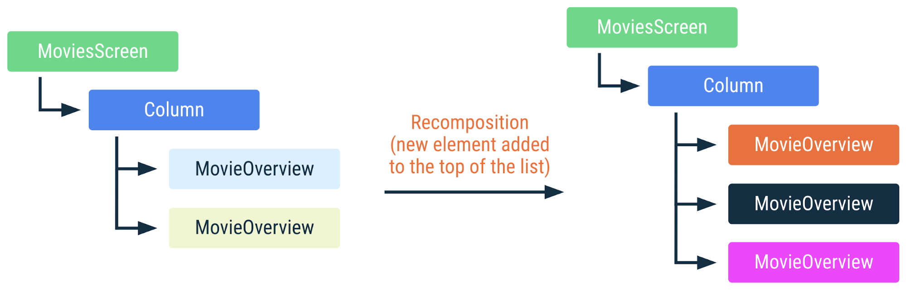
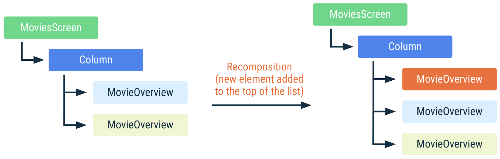

# Lifecycle của các thành phần kết hợp

**Composition** mô tả UI của ứng dụng của bạn và được tạo bằng cách chạy các thành phần kết hợp. Composition là cấu trúc dạng cây của các thành phần kết hợp mô tả UI của bạn.

Trong lần chạy đầu tiên của các thành phần kết hợp, Jetpack Compose sẽ theo dõi chúng trong Composition để mô tả UI của bạn. **state** là bất kỳ giá trị nào có thể được thay đổi tại bất kỳ thời điểm nào trong quá trình thực thi ứng dụng. Khi trạng thái ứng dụng của bạn thay đổi, Jetpack Compose sẽ lên lịch **recomposition**. Điều này liên quan đến việc thực thi lại các thành phần kết hợp có thể đã thay đổi do thay đổi trạng thái và cập nhật Composition tương ứng.

Composition chỉ có thể được tạo bởi composition ban đầu và được cập nhật bởi recomposition. Cách duy nhất để sửa đổi Composition là thông qua recomposition.




Recomposition thường được kích hoạt khi có sự thay đổi đối với đối tượng `State<T>`. Compose theo dõi những điều này và chạy tất cả các thành phần kết hợp trong Composition đọc `State<T>` cụ thể đó và mọi thành phần kết hợp mà chúng gọi là không thể bỏ qua.


> [!NOTE]
> lifecycle của thành phần kết hợp đơn giản hơn lifecycle về lượt xem, hoạt động và phân đoạn. Khi một thành phần kết hợp cần quản lý hoặc tương tác với các tài nguyên bên ngoài có lifecycle phức tạp hơn, bạn nên sử dụng hiệu ứng. (Hiệu ứng là composable function không phát ra UI và khiến các hiệu ứng phụ chạy khi composition hoàn thành.)


## Cấu trúc của một thành phần kết hợp trong Composition

Nếu trong recomposition, một thành phần kết hợp gọi các thành phần kết hợp khác với composition trước đó,
**Compose sẽ xác định các thành phần kết hợp nào được gọi** hoặc không được gọi và đối với các thành phần kết hợp được gọi trong cả hai thành phần sáng tác, Compose sẽ **tránh kết hợp lại chúng nếu dữ liệu đầu vào của chúng không thay đổi và chưa được xác định trực tiếp trong nội dung của Composable**

Ví dụ:

```kotlin
val recompositionCount = mutableStateOf(0)

@Composable
fun CustomComposable() {
    Log.d("Recomposition", "CustomComposable")

    Column {
        Log.d("Recomposition", "Column")

        Surface {
            Log.d("Recomposition", "Surface")

            Text(text = "Recomposed ${recompositionCount.value} times.")
        }

        Button(onClick = { recompositionCount.value++ }) {
            Log.d("Recomposition", "Button")

            Text(text = "Tap to recompose")
        } 

    }
}
```
Đầu ra:



Bây giờ hãy thay thế một dòng `Log.d("Recomposition", "CustomComposable")` bằng
`Log.d("Recomposition", "CustomComposable recompositions: ${recompositionCount.value}")` và cùng xem kết quả:




Do đó, **bằng cách truy cập trực tiếp vào biến trạng thái trong phần thân của CustomComposable, chức năng này trở nên phụ thuộc vào trạng thái**, mặc dù nó không ảnh hưởng đến hình ảnh màn hình theo bất kỳ cách nào. Tuy nhiên, việc thay đổi trạng thái này bây giờ sẽ gây ra recomposition của `CustomComposable`, `Column` và `Surface`.

**Vấn đề là một số thành phần kết hợp có thể kích hoạt recomposition của thành phần kết hợp gốc khi trạng thái của các thành phần kết hợp con thay đổi**.
Tương tự, với tư cách là các thành phần kết hợp con, chúng cũng sẽ được thực thi lại bất cứ khi nào thành phần kết hợp gốc được kết hợp lại, ngay cả khi trạng thái của chính chúng không thay đổi.
Đây là các chức năng như `Column`, `Row`, `Box` và các chức năng khác. 

## Thêm thông tin bổ sung để hỗ trợ việc kết hợp lại thông minh

Ví dụ:

```kotlin
@Composable
fun MoviesScreen(movies: List<Movie>) {
    Column {
        for (movie in movies) {
            // MovieOverview composables are placed in Composition given its
            // index position in the for loop
            MovieOverview(movie)
        }
    }
}
```

Trong ví dụ trên, Compose sử dụng thứ tự thực thi ngoài trang cuộc gọi để giữ cho phiên bản khác biệt trong Composition. Nếu một phim mới được thêm vào cuối danh sách, Compose có thể sử dụng lại các phiên bản đã có trong Composition do vị trí của chúng trong danh sách không thay đổi và do đó, đầu vào `movie` giống nhau cho các phiên bản đó.



**Hình 2.** Biểu diễn của MoviesScreen trong Composition khi một phần tử mới được thêm vào cuối danh sách.
Các thành phần kết hợp `MovieOverview` trong Composition có thể được tái sử dụng. Cùng màu trong `MovieOverview` có nghĩa là thành phần kết hợp chưa được kết hợp lại.


Tuy nhiên, nếu danh sách `movies` thay đổi bằng cách thêm vào đầu hoặc giữa danh sách, xóa hoặc sắp xếp lại các mục, điều đó sẽ gây ra recomposition trong tất cả các lệnh gọi `MovieOverview` có tham số đầu vào đã thay đổi vị trí trong danh sách.
Điều đó cực kỳ quan trọng, chẳng hạn như nếu `MovieOverview` tìm nạp hình ảnh phim bằng hiệu ứng phụ. Nếu recomposition xảy ra trong khi hiệu ứng đang diễn ra, nó sẽ bị hủy và sẽ bắt đầu lại.


```kotlin
@Composable
fun MovieOverview(movie: Movie) {
    Column {
        // Side effect explained later in the docs. If MovieOverview
        // recomposes, while fetching the image is in progress,
        // it is cancelled and restarted.
        val image = loadNetworkImage(movie.url)
        MovieHeader(image)

        /* ... */
    }
}
```



**Hình 3.** Biểu diễn của MoviesScreen trong Composition khi một phần tử mới được thêm vào danh sách. Không thể sử dụng lại các thành phần kết hợp MovieOverview và tất cả các tác dụng phụ sẽ khởi động lại.
Màu khác trong MovieOverview có nghĩa là thành phần kết hợp đã được kết hợp lại.

Bằng cách gói một khối mã bằng lệnh gọi đến thành phần kết hợp `key` với một hoặc nhiều giá trị được truyền vào, các giá trị đó sẽ được kết hợp để dùng để xác định phiên bản đó trong composition.
Giá trị của `key` không cần phải là duy nhất trên toàn cầu, nó chỉ cần là duy nhất trong số các lệnh gọi của các thành phần kết hợp tại trang web cuộc gọi.
Vì vậy, trong ví dụ này, mỗi `movie` cần có một `key` duy nhất trong số `movies`; Sẽ không sao nếu nó chia sẻ khóa đó với một số thành phần kết hợp khác ở nơi khác trong ứng dụng.

```kotlin
@Composable
fun MoviesScreenWithKey(movies: List<Movie>) {
    Column {
        for (movie in movies) {
            key(movie.id) { // Unique ID for this movie
                MovieOverview(movie)
            }
        }
    }
}
```

**Với cách trên, ngay cả khi các thành phần trong danh sách thay đổi, Compose vẫn nhận dạng các cuộc gọi riêng lẻ tới MovieOverview và có thể sử dụng lại chúng.**



Một số thành phần kết hợp có hỗ trợ tích hợp cho thành phần kết hợp `key`. Ví dụ: `LazyColumn` chấp nhận chỉ định `key` tùy chỉnh trong `items`.

```kotlin
@Composable
fun MoviesScreenLazy(movies: List<Movie>) {
    LazyColumn {
        items(movies, key = { movie -> movie.id }) { movie ->
            MovieOverview(movie)
        }
    }
}
```

## Nền tảng của Recomposition

Có một số điểm chính quan trọng về hoạt động của các hàm có khả năng kết hợp trong composition ban đầu và recomposition tiếp theo mà bạn nên luôn ghi nhớ.

1. **Các hàm Composable có thể được thực thi theo bất kỳ thứ tự nào.**
Jetpack Compose có thể ưu tiên một số thành phần kết hợp quan trọng hơn những thành phần khác và hiển thị chúng trước.
2. **Các thành phần kết hợp có thể chạy song song.**
Compose có thể chạy các thành phần kết hợp có mức độ ưu tiên thấp hơn trên background thread để tối ưu hóa và cải thiện hiệu suất.
3. **Recomposition có thể bị hủy.**
Đây là một khía cạnh quan trọng khác do dữ liệu có thể thay đổi quá nhanh.
Khi dữ liệu thay đổi trước khi recomposition hoàn thành, nó có thể bị hủy vì đã lỗi thời. Nhờ đó, bạn có thể bắt đầu recomposition tiếp theo với dữ liệu mới nhất ngay bây giờ mà không cần đợi hoàn thành.
4. **Recomposition bỏ qua càng nhiều thành phần kết hợp càng tốt.**
Nhiệm vụ của chúng tôi với tư cách là nhà phát triển là hỗ trợ recomposition, mang lại hiệu suất tốt nhất cho ứng dụng của chúng tôi cũng như trải nghiệm người dùng.
5. **Recomposition có thể được thực thi thường xuyên như mọi khung hình động.** 
Tất cả các hoạt động không liên quan trực tiếp đến UI phải được thực hiện trong một thread riêng biệt để tránh rác UI.
Đổi lại, kết quả của các thao tác này phải được chuyển đến các hàm có khả năng kết hợp bằng cách sử dụng `mutableStateOf()` hoặc `mutableStateListOf()`.

## Tài liệu tham khảo:

- https://developer.android.com/develop/ui/compose/lifecycle
- https://hyperskill.org/learn/step/28325#comment


