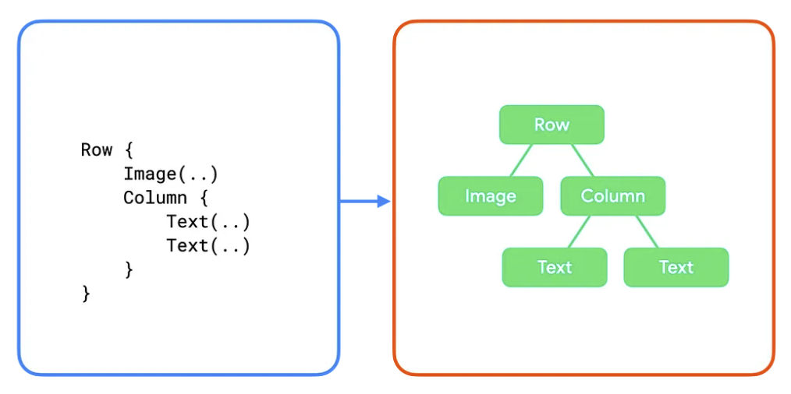
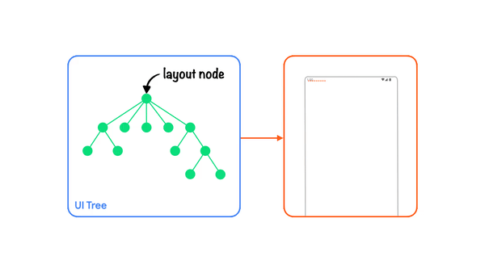
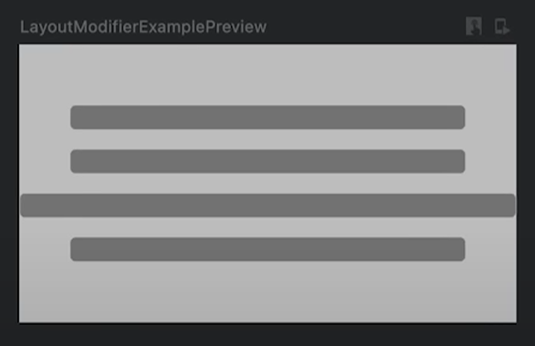
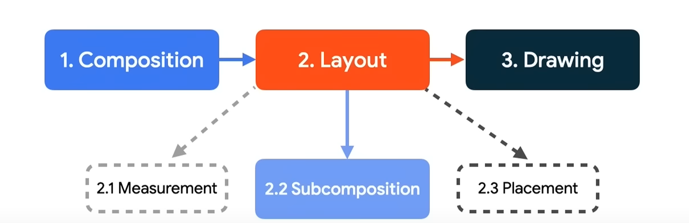
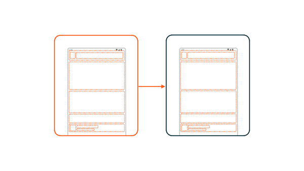
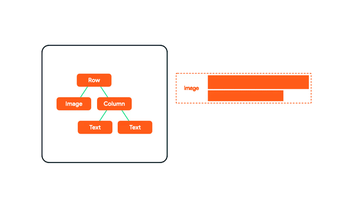
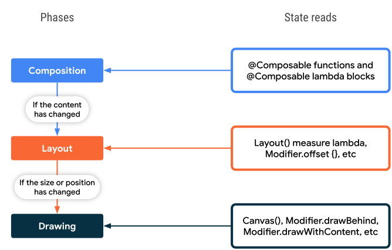

#Giai đoạn Jetpack Compose 

Giống như hầu hết các bộ công cụ UI khác, Compose render frame qua nhiều giai đoạn đặc biệt

Nếu chúng ta nhìn vào hệ thống Android View, nó có ba giai đoạn chính: đo lường, bố trí và vẽ. Compose rất giống nhưng có một giai đoạn bổ sung quan trọng được gọi là composition khi bắt đầu.

Composition được mô tả trong các tài liệu Compose của chúng tôi, bao gồm [Suy nghĩ bằng Compose](../Introduction/ThikingInCompose.md) và [Trạng thái và Jetpack Compose.](./ManagingState.md)

## Ba giai đoạn của một khung hình

Compose có ba giai đoạn chính:

1. **Composition**: UI cần hiển thị những gì. Compose chạy các hàm có khả năng kết hợp và tạo mô tả về UI của bạn.
2. **Bố cục**: Nơi đặt UI. Giai đoạn này bao gồm hai bước: đo lường và bố trí. Các phần tử bố cục đo lường và đặt chính chúng cũng như bất kỳ phần tử con nào trong tọa độ 2D cho mỗi nút trong cây bố cục.
3. **Bản vẽ**: Cách hiển thị. Các phần tử UI vẽ vào Canvas, thường là màn hình thiết bị.


Thứ tự các giai đoạn này thường giống nhau, cho phép dữ liệu chuyển động theo một hướng từ bố cục, composition đến bố cục để vẽ tạo ra một khung hình (còn được gọi là [unidirectional data flow](/General/DesignPattern/UnidirectionalDataFlow.md)). `BoxWithConstraints` và `LazyColumn` và `LazyRow` là những ngoại lệ đáng chú ý, trong đó các thành phần của nó phụ thuộc vào giai đoạn bố cục của cha mẹ.

Bạn có thể giả định một cách toàn diện rằng ba giai đoạn này hầu như diễn ra cho mọi khung hình, nhưng vì mục tiêu thực hiện:
- Compose tránh lặp lại công việc sẽ tính toán cùng một kết quả từ cùng một dữ liệu đầu vào trong tất cả các giai đoạn này. 
- Compose bỏ chạy một hàm có thể kết hợp nếu hàm đó có thể sử dụng lại kết quả cũ và người dùng giao diện Compose không bố trí lại hoặc vẽ lại toàn bộ cây nếu không cần thiết.
- Compose chỉ thực hiện công việc khối lượng tối thiểu cần thiết để cập nhật giao diện người dùng.
- Công việc tối ưu hóa này có thể được thực hiện vì Compose trạng thái theo dõi đọc trong các giai đoạn khác nhau.

## Hiểu rõ các giai đoạn

Phần này mô tả cách thực hiện ba giai đoạn Compose cho các composables một cách chi tiết hơn.

### Composition

Trong giai đoạn composition. Compose runtime thực thi các hàm có thể kết hợp và **xuất cấu trúc cây** đại diện cho UI của bạn. 


Cây đại diện cho UI của bạn được tạo trong giai đoạn composition.

Một phần con của mã và cây UI trông như sau:


Trong các ví dụ này, mỗi hàm đều có khả năng kết hợp trong mã lập trình để hướng tới một nút duy nhất được bố trí trong giao diện người dùng cây. Trong các ví dụ phức tạp hơn, các thành phần kết hợp có thể chứa logic và điều khiển luồng, đồng thời tạo ra một cây khác với các Bang khác nhau.

### Cách trình bày

Trong giai đoạn Bố cục, Compose sử dụng cây UI được tạo trong giai đoạn composition làm đầu vào. Tập hợp các nút bố trí chứa tất cả thông tin cần thiết để quyết định kích thước và vị trí của từng nút trong không gian 2D.



Trong giai đoạn bố trí, cây được duyệt bằng cách sử dụng **thuật toán ba bước** sau:

1. **Đo con**: Một nút đo các con nút của nó nếu có.
2. **Quyết định kích thước của riêng nó**: Dựa trên các phép đo này, một nút sẽ quyết định kích thước của chính nó.
3. **Đặt con**: Mỗi nút được đặt tương ứng với vị trí của nút đó.

**Khi kết thúc giai đoạn này, mỗi nút bố cục có:**
- Chiều rộng và chiều cao được chỉ định cụ thể
- speed x, y seek to draw


Ghi nhớ người dùng giao diện cây từ phần trước:


Đối với cây này, hoạt động thuật toán như sau:

1. `Row` đo lường các thành phần con của nó, `Image` và `Column`.
2. `Image` được đo. Nó không có con nào nên nó tự quyết định kích thước của mình và báo cáo kích thước đó trở lại `Row`.
3. Tiếp theo là đo `Column`. Trước tiên, nó đo lường các thành phần con của chính nó (hai thành phần kết hợp Văn bản).
4. Văn bản đầu tiên được đo. Nó không có con nào nên nó tự quyết định kích thước của mình và báo cáo lại kích thước của nó cho `Column`.
    - Văn bản thứ hai được đo. Nó không có con nào nên nó tự quyết định kích thước của mình và báo cáo lại cho `Column`.
5. `Column` sử dụng **các phép đo con** để quyết định kích thước của chính nó. Nó sử dụng chiều rộng tối đa của con và tổng chiều cao của con nó.
6. `Column` đặt các phần tử con của nó so với chính nó, đặt chúng bên dưới nhau theo chiều dọc.
7. `Row` sử dụng các phép đo con để quyết định kích thước của chính nó. Nó sử dụng chiều cao tối đa của con và tổng chiều rộng của con nó. Sau đó nó đặt con của nó.


> [!NOTE]
>Lưu ý rằng mỗi nút chỉ được truy cập một lần. Compose runntime chỉ yêu cầu một lần duyệt qua giao diện người dùng cây để đo và thiết lập tất cả các nút, giúp cải thiện hiệu suất. Khi tăng số lượng nút trong cây, thời gian duyệt qua nó sẽ tăng theo tính chất tuyến tính. Ngược lại, nếu mỗi nút được truy cập nhiều lần thì thời gian duyệt qua các nút sẽ tăng cấp số nhân.

#### Xây dựng bố cục tùy chỉnh trong Compose

Gọi bố cục có thể kết hợp là điểm bắt đầu của cả giai đoạn bố cục và xây dựng bố cục tùy chỉnh. Nó chấp nhận nội dung có thể kết hợp dưới dạng nội dung con và đo lường chính sách để đo lường và định vị các phần tử của nó. Tất cả bố cục cấp cao hơn, như `Column` và `Row`, đều sử dụng thành phần kết hợp này. Thành phần kết hợp bố cục hiện có 3 tình trạng quá tải. 

**1.** Bố cục đo lường và đặt không hoặc nhiều thành phần con, chấp nhận một thành phần kết hợp làm nội dung. 

```kotlin
//Layout.kt
inline fun Layout(
    content: @Composable @UiComposable () -> Unit,
    modifier: Modifier = Modifier,
    measurePolicy: MeasurePolicy
) {
    ..
}
```


**2.** Bố cục cho các nút lá của cây UI, không có con nào chính xác nên không có tham số nội dung.

```kotlin
//Layout.kt
@Suppress("NOTHING_TO_INLINE")
@Composable
@UiComposable
inline fun Layout(
    modifier: Modifier = Modifier,
    measurePolicy: MeasurePolicy
) {..}
```

**3.** Bố cục chấp nhận danh sách nội dung để chuyển nhiều thành phần kết hợp khác nhau..

```kotlin
//Layout.kt
@Suppress("ComposableLambdaParameterPosition", "NOTHING_TO_INLINE")
@UiComposable
@Composable
inline fun Layout(
    contents: List<@Composable @UiComposable () -> Unit>,
    modifier: Modifier = Modifier,
    measurePolicy: MultiContentMeasurePolicy
) {...}
```


Sau khi bước vào giai đoạn bố cục, chúng tôi thấy rằng nó bao gồm hai bước, **đo lường và đánh dấu**, theo thứ tự cụ thể đó. Kích thước của các phần tử con được tính toán trong quá trình vượt qua thước đo và vị trí của chúng trong quá trình vượt qua vị trí. Thứ tự của các bước này được thực thi với phạm vi Kotlin DSL, nội dung của bố cục có thể được truy cập dưới dạng các thành phần có thể đo lường được, hiện đã sẵn sàng để đo lường. Bố cục bên trong, các giá trị có thể đo lường được hiển thị dưới dạng danh sách theo mặc định. Tùy thuộc vào yêu cầu về bố cục của bạn, bạn có thể lấy danh sách này và đo từng mục có cùng các ràng buộc sắp tới để giữ kích thước được xác định trước ban đầu hoặc điều chỉnh các phép đo của nó nếu cần bằng cách sao chép các ràng buộc bạn muốn giữ và ghi đè những ràng buộc bạn muốn thay đổi.


```kotlin
@Composable
fun CustomLayout(
    content: @Composable () -> Unit,
    modifier: Modifier = Modifier
) {
    Layout(content  = { //TODO },measurePolicy = { measurables, constraints ->
        // MEASUREMENT SCOPE
        // 1. Measurement step
        // Determine sizes of components

        measurables // Ready to measured!

        /**
        **Very important feature of the layout phase is single pass measurement.** 
        This mean the layout element may not measure at any of its children more than once. 
        Single pass element is good for performance, allow Compose to efficiently handle deep UI trees. 
        Measuring a list of measurables would, in return, give a list of placeables
        **/

        val placeables = measurables.map{ 
            it.measure(
                constraints.copy(
                    minWidth = constraints.minWidth + 10
                    maxWidth = constraints.maxWidth + 10
                )
            )
        }


        layout(placeables.sumOf { it.width }, placeables.sumOf{ it.height }){
            //PLACEMENT SCOPE
            /**
            The placement step starts by calling the layout function and entering placement scope. 
            At this point, the parent layout will be able to decide on its own size, 
            for example , by summing up the widths and the heights of all its child placeables.
            **/
            //2. Placement step
            /**
             Placement scope now allows us use all placeables that came as result of measurement. 
            To start placing children, we need their starting x and y coordinates.
            Once we define where we want the children to be positioned
            **/
            val xPosition = 0
            val yPosition = 0

            placeables // Ready to placed

            /**
                 we call `place()` to conclude with the placement pass.
                 And with that, we end the placement step, as well as the layout phase.
                 Your custom layout is now ready to be used and reused.
            **/
            placeables.map { it.place(xPosition, yPosition)}

        }

    })
}

```

Việc sử dụng bố cục có thể kết hợp để tạo bố cục tùy chỉnh cho phép bạn quản lý tất cả các phần tử con và kiểm soát kích thước cũng như vị trí của chúng theo cách thủ công.

**Tuy nhiên, có những trường hợp khi việc tạo bố cục tùy chỉnh chỉ từ việc kiểm soát một phần tử cụ thể là quá mức cần thiết và không cần thiết.** Trong trường hợp này, thay vì sử dụng bố cục tùy chỉnh, hãy sử dụng bố cục Modifier, cho phép bạn đo lường và bố trí chỉ một phần tử được bao bọc duy nhất

Ví dụ:
<div style="display: flex; align-items: center;">
  
  <p>

```kotlin
@Composable
fun LayoutModifierExample(){
    Coulmn(
        modifier = Modifier
        .fillMaxWidth
        .background(Color.LightGray)
        .padding(40.dp)
    ){
        Element()
        Element()
        //Item below should rebel against the enforced padding and go edge to edge
        Element(modifier = Modifier.layout{ measurables, constraints ->
            val placeable = measureable.measure(
                constraints.copy(
                    maxWidth = constraints.maxWidth + 80.dp.roundToPx()
                )
            )

            layout(placeabe.width, placeable.height){
                placeable.place(x = 0,y = 0)
            }
        })
        Element()
    }
}
```

  </p>
</div>

#### Bố cục soạn thảo phụ

<details>
  <summary style="color: orange;">
  <b>
  Hãy suy nghĩ về các trường hợp sử dụng
  </b>
  </summary>
  
  <p>
  
bạn đang xây dựng danh sách 1000 mục không thể vừa với màn hình cùng một lúc. Trong trường hợp đó, việc soạn tất cả các mục con này sẽ gây lãng phí tài nguyên không cần thiết.
Thay vào đó, cách tiếp cận tốt hơn là đo lường tất cả các mục trong danh sách để có được kích thước của chúng, sau đó dựa vào đó tính toán số lượng mục có thể vừa với khung nhìn có sẵn.
Và cuối cùng


  </p>
</details>

**Compose chỉ những mục có thể nhìn thấy được. Đây là ý tưởng chính đằng sau `Subcompose Layout`. Trước tiên, nó cần thực hiện phép đo đối với một số thành phần kết hợp con, sau đó sử dụng thông tin kích thước đó để xác định xem có nên soạn các thành phần con khác** hay không. Có nghĩa là bước đo lường trong giai đoạn bố cục cần phải diễn ra trước giai đoạn composition của một số trẻ em. composition bị trì hoãn này được gọi là thành phần phụ và đó chính xác là lý do tại sao các thành phần lười biếng được xây dựng dựa trên bố cục thành phần phụ, cho phép chúng thêm nội dung theo yêu cầu trong khi cuộn.



####BoxWithConstraints

BoxWithConstraints cũng sử dụng bố cục soạn thảo phụ một cách cơ bản. Nó cấp cho bạn quyền truy cập vào các giới hạn sắp đến như chiều cao tối đa, từ bố cục gốc, những điều không có sẵn trong bố cục thông thường. Điều này là do bố cục bước đo của một số phần tử con được thực hiện trước composition của các phần tử con khác. Bạn có thể sử dụng các ràng buộc thu được để quyết định có nên soạn một phần tử con hay không.


> [!CAUTION]
> Bố cục soạn thảo phụ có thể tác động đến hiệu suất vì bố cục soạn thảo phụ thay đổi quy trình thông thường của giai đoạn soạn thảo. Có một số chi phí và hạn chế nhất định khi nói đến hiệu suất. vì vậy bạn cần phải quyết định có nên sáng tác một đứa trẻ hay không.
>|       ✅ |       ❌ |
>| -------------- | -------------- |
>| composition của ít nhất một trẻ phụ thuộc vào kết quả đo của một trẻ khác | Yêu cầu số đo của trẻ này phải đo trẻ khác |

#### Đo lường nội tại

Có những trường hợp sử dụng khi bố cục gốc cần biết một số thông tin về các con của nó trước khi đo lường chúng để có thể sử dụng thông tin này nhằm xác định và truyền lại các ràng buộc. Và đây chính xác là những gì các phép đo nội tại thực hiện. Chúng cho phép bạn truy vấn trẻ em trước khi chúng được đo lường.

<details>
  <summary style="color: orange;">
  <b>
Ví dụ
  </b>
  </summary>
  
  <p>

Chúng tôi muốn các mục cột này có cùng chiều rộng hoặc chính xác hơn là có chiều rộng của mỗi mục như thế
của đứa trẻ rộng nhất. Trong trường hợp của chúng tôi, mục và công cụ sửa đổi. Nhưng chúng tôi cũng muốn đứa trẻ đó có chiều rộng bao nhiêu tùy ý.

```kotlin

@Composeable
fun IntrinsicExample(){
    Column(modifier = Modifier.background(Color.LightGray).width(InstrinsicSize.Max)){
        ...
    }
}

```


  </p>
</details>

### Vẽ

Trong giai đoạn Vẽ, cây lại được duyệt từ trên xuống dưới và từng nút sẽ tự động vẽ trên màn hình.



**Hình 1**. Giai đoạn vẽ vẽ các pixel trên màn hình.

Sử dụng ví dụ trước, nội dung cây được vẽ theo cách sau:

- `Row` vẽ bất kỳ nội dung nào có thể có, chẳng hạn như màu nền.

- `Image` tự vẽ.

- `Column` tự vẽ.

- `Text` thứ nhất và thứ hai lần lượt tự rút ra.



**Hình 1**. Cây UI và hình vẽ của nó.

## Trạng thái đọc

Khi bạn đọc giá trị của trạng thái ảnh chụp nhanh trong một trong các giai đoạn được liệt kê ở trên, Compose sẽ tự động theo dõi những gì nó đang thực hiện khi giá trị được đọc. Việc theo dõi này cho phép Compose thực thi lại trình đọc khi giá trị trạng thái thay đổi và là cơ sở của khả năng quan sát trạng thái trong Compose.

Trạng thái thường được tạo bằng cách sử dụng mutableStateOf() rồi truy cập thông tin qua một trong hai cách: bằng cách truy cập trực tiếp vào giá trị thuộc tính hoặc bằng cách sử dụng quyền thuộc tính Kotlin. Bạn có thể đọc thêm về chúng trong State trong các kết hợp thành phần. Vì mục đích của hướng dẫn này, "state reads" đề cập đến một trong các phương thức truy cập tương thích.

```kotlin
// State read without property delegate.
val paddingState: MutableState<Dp> = remember { mutableStateOf(8.dp) }
Text(
    text = "Hello",
    modifier = Modifier.padding(paddingState.value)
)
```

```kotlin
// State read with property delegate.
var padding: Dp by remember { mutableStateOf(8.dp) }
Text(
    text = "Hello",
    modifier = Modifier.padding(padding)
)
```

Bên dưới vỏ bọc của delegate tài sản, các hàm "getter" và "setter" được sử dụng để truy cập và cập nhật giá trị của State. Hàm getter và setter này chỉ được gọi khi bạn tham chiếu thuộc tính dưới dạng giá trị chứ không phải khi nó được tạo, đó là lý do tại sao hai cách trên tương đương nhau.

> [!NOTE]
> Mỗi khối mã có thể được thực thi lại khi trạng thái đọc thay đổi là phạm vi khởi động lại. Compose theo dõi các thay đổi giá trị trạng thái và khởi động lại phạm vi trong các giai đoạn khác nhau.

## Đọc trạng thái theo từng giai đoạn

Như đã đề cập ở trên, có ba giai đoạn chính trong Compose và Compose theo dõi trạng thái được đọc trong mỗi giai đoạn đó. **Điều này cho phép Compose chỉ thông báo các giai đoạn cụ thể cần thực hiện công việc cho từng thành phần bị ảnh hưởng trong UI của bạn.**

> [!NOTE]
> Việc tạo và lưu trữ một trạng thái hiện tại (thể hiện trạng thái) ít ảnh hưởng đến các giai đoạn (giai đoạn), điều quan trọng chỉ là khi và nơi mà một trạng thái giá trị được đọc.

### Giai đoạn 1: Composition

Việc đọc trạng thái trong khối @Composable function hoặc lambda ảnh hưởng đến composition và có thể là các giai đoạn tiếp theo. Khi giá trị trạng thái thay đổi, trình soạn thảo lại sẽ lên lịch chạy lại tất cả các hàm có khả năng kết hợp đọc giá trị trạng thái đó. Lưu ý rằng runtime có thể quyết định bỏ qua một số hoặc tất cả các hàm có thể kết hợp nếu đầu vào không thay đổi. Xem [Bỏ qua nếu đầu vào không thay đổi](../UIArchitecture/LifecycleOfComposables.md) để biết thêm thông tin.


```kotlin
var padding by remember { mutableStateOf(8.dp) }
Text(
    text = "Hello",
    // The `padding` state is read in the composition phase
    // when the modifier is constructed.
    // Changes in `padding` will invoke recomposition.
    modifier = Modifier.padding(padding)
)

```


### Giai đoạn 2: Bố cục

Giai đoạn bố trí bao gồm hai bước: **đo lường** và **vị trí**. Bước đo chạy hàm lambda đo được chuyển đến thành phần kết hợp `Layout`, phương thức `MeasureScope.measure` của giao diện `LayoutModifier`, v.v. Bước vị trí chạy khối vị trí của hàm bố cục, khối lambda của `Modifier.offset { … }`, v.v.

Việc đọc trạng thái trong mỗi bước này sẽ ảnh hưởng đến bố cục và có thể cả giai đoạn vẽ. Khi giá trị trạng thái thay đổi, Compose UI lên lịch giai đoạn bố trí. Nó cũng chạy giai đoạn vẽ nếu kích thước hoặc vị trí đã thay đổi.

Nói chính xác hơn, **bước đo và bước sắp xếp có phạm vi khởi động lại riêng biệt, nghĩa là trạng thái đọc trong bước sắp xếp không gọi lại bước đo trước đó**. Tuy nhiên, hai bước này thường đan xen nhau nên trạng thái đọc trong bước sắp xếp có thể ảnh hưởng đến phạm vi khởi động lại khác thuộc bước đo.

```kotlin
var offsetX by remember { mutableStateOf(8.dp) }
Text(
    text = "Hello",
    modifier = Modifier.offset {
        // The `offsetX` state is read in the placement step
        // of the layout phase when the offset is calculated.
        // Changes in `offsetX` restart the layout.
        IntOffset(offsetX.roundToPx(), 0)
    }
)
```

### Giai đoạn 3: Vẽ

Trạng thái đọc trong quá trình vẽ mã ảnh hưởng đến giai đoạn vẽ. Các ví dụ phổ biến bao gồm `Canvas()`, Modifier.drawBehind và `Modifier.drawWithContent`. Khi giá trị trạng thái thay đổi, Compose UI chỉ chạy giai đoạn vẽ.

```kotlin
var color by remember { mutableStateOf(Color.Red) }
Canvas(modifier = modifier) {
    // The `color` state is read in the drawing phase
    // when the canvas is rendered.
    // Changes in `color` restart the drawing.
    drawRect(color)
}
```



## Tối ưu hóa trạng thái đọc

Vì Compose thực hiện theo dõi đọc trạng thái cục bộ, **chúng tôi có thể giảm thiểu khối lượng công việc được thực hiện bằng cách đọc từng trạng thái trong một giai đoạn thích hợp.**

Chúng ta hãy xem một ví dụ. Ở đây chúng ta có Image() sử dụng công cụ sửa đổi offset để bù vị trí bố cục cuối cùng của nó, dẫn đến hiệu ứng thị sai khi người dùng cuộn.


Ví dụ:

```kotlin
Box {
    val listState = rememberLazyListState()

    Image(
        // ...
        // Non-optimal implementation!
        Modifier.offset(
            with(LocalDensity.current) {
                // State read of firstVisibleItemScrollOffset in composition
                (listState.firstVisibleItemScrollOffset / 2).toDp()
            }
        )
    )

    LazyColumn(state = listState) {
        // ...
    }
}
```

Mã này hoạt động nhưng mang lại hiệu suất không tối ưu.
 Như đã viết, mã đọc giá trị của trạng thái `firstVisibleItemScrollOffset` và chuyển nó đến hàm `Modifier.offset(offset: Dp)`. Khi người dùng cuộn, giá trị `firstVisibleItemScrollOffset` sẽ thay đổi. Như chúng ta đã biết, Compose theo dõi mọi trạng thái đọc để nó có thể khởi động lại (gọi lại) mã đọc, trong ví dụ của chúng ta là nội dung của `Box`.

Đây là ví dụ về trạng thái được đọc trong pha composition. Đây không hẳn là một điều xấu chút nào, và trên thực tế nó là cơ sở của recomposition, cho phép thay đổi dữ liệu để phát ra UI mới.

Tuy nhiên, ví dụ này không tối ưu vì mỗi sự kiện cuộn sẽ dẫn đến việc đánh giá lại toàn bộ nội dung có thể kết hợp, sau đó đo lường, bố trí và cuối cùng là vẽ. 

**Chúng tôi đang kích hoạt giai đoạn Compose trên mỗi cuộn mặc dù những gì chúng tôi đang hiển thị không thay đổi, chỉ ở nơi nó được hiển thị. Chúng tôi có thể tối ưu hóa việc đọc trạng thái để chỉ kích hoạt lại giai đoạn bố cục.**

```kotlin
Box {
    val listState = rememberLazyListState()

    Image(
        // ...
        Modifier.offset {
            // State read of firstVisibleItemScrollOffset in Layout
            IntOffset(x = 0, y = listState.firstVisibleItemScrollOffset / 2)
        }
    )

    LazyColumn(state = listState) {
        // ...
    }
}
```

Vậy tại sao điều này lại hiệu quả hơn? Khối lambda mà chúng tôi cung cấp cho công cụ sửa đổi được gọi trong giai đoạn bố cục (cụ thể là trong bước sắp xếp của giai đoạn bố cục), **có nghĩa là trạng thái `firstVisibleItemScrollOffset` của chúng tôi không còn được đọc trong composition.** Bởi vì Compose theo dõi khi trạng thái được đọc, nên thay đổi này có nghĩa là nếu giá trị firstVisibleItemScrollOffset thay đổi, **Compose chỉ phải khởi động lại giai đoạn bố cục và vẽ.**

> [!NOTE]
> Bạn có thể thắc mắc liệu việc lấy tham số lambda có làm tăng thêm chi phí so với việc lấy một giá trị đơn giản hay không. Nó có. **Tuy nhiên, lợi ích của việc giới hạn việc đọc trạng thái ở giai đoạn bố cục sẽ lớn hơn chi phí trong trường hợp này.** Giá trị của firstVisibleItemScrollOffset thay đổi mọi khung hình trong khi cuộn và bằng cách trì hoãn việc đọc trạng thái ở giai đoạn bố cục, chúng ta có thể tránh được việc kết hợp lại.

> [!IMPORTANT]
> Cố gắng bản địa hóa các lần đọc trạng thái về pha thấp nhất có thể, cho phép Compose thực hiện khối lượng công việc tối thiểu.

Vòng lặp ## Recomposition


Trước đó, chúng tôi đã đề cập rằng các giai đoạn của Compose luôn được gọi theo cùng một thứ tự và không có cách nào để quay lại trong cùng một khung hình. Tuy nhiên, điều đó không ngăn cản ứng dụng rơi vào composition các vòng lặp qua các khung hình khác nhau. Hãy xem xét ví dụ sau:

```kotlin
Box {
    var imageHeightPx by remember { mutableStateOf(0) }

    Image(
        painter = painterResource(R.drawable.rectangle),
        contentDescription = "I'm above the text",
        modifier = Modifier
            .fillMaxWidth()
            .onSizeChanged { size ->
                // Don't do this
                imageHeightPx = size.height
            }
    )

    Text(
        text = "I'm below the image",
        modifier = Modifier.padding(
            top = with(LocalDensity.current) { imageHeightPx.toDp() }
        )
    )
}
```
> **Lưu ý**
>Ở đây, chúng tôi đã triển khai (một cách tệ hại) một cột dọc, với hình ảnh ở trên cùng và sau đó là văn bản ở bên dưới. Chúng tôi đang sử dụng Modifier.onSizeChanged() để biết kích thước được phân giải của hình ảnh, sau đó sử dụng Modifier.padding() trên văn bản để dịch chuyển nó xuống. Việc chuyển đổi không tự nhiên từ Px trở lại Dp đã cho thấy rằng mã có một số vấn đề.

> **Lưu ý**
>**Vấn đề với ví dụ này là chúng ta không đạt được bố cục "cuối cùng" trong một khung hình duy nhất**. Mã dựa trên nhiều khung hình đang diễn ra, thực hiện công việc không cần thiết và dẫn đến việc UI nhảy lung tung trên màn hình đối với người dùng.

Đọc thêm lý do tại [tại đây](https://developer.android.com/develop/ui/compose/phases#phase1-comp)

> **Cách khắc phục cho mẫu ở trên là sử dụng bố cục gốc phù hợp**. Ví dụ trên có thể được triển khai bằng một Cột() đơn giản, nhưng bạn có thể có một ví dụ phức tạp hơn đòi hỏi một cái gì đó tùy chỉnh, sẽ yêu cầu viết bố cục tùy chỉnh. Xem hướng dẫn Bố cục tùy chỉnh để biết thêm thông tin.

**Nguyên tắc chung ở đây là có single source of truth cho nhiều phần tử UI cần được đo và đặt liên quan đến nhau**. Việc sử dụng bố cục gốc phù hợp hoặc tạo bố cục tùy chỉnh có nghĩa là bố cục gốc được chia sẻ tối thiểu đóng vai trò là nguồn thực tế có thể điều phối mối quan hệ giữa nhiều phần tử. Việc giới thiệu một trạng thái động sẽ phá vỡ nguyên tắc này.