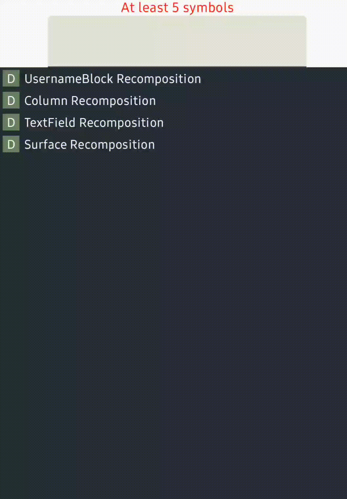
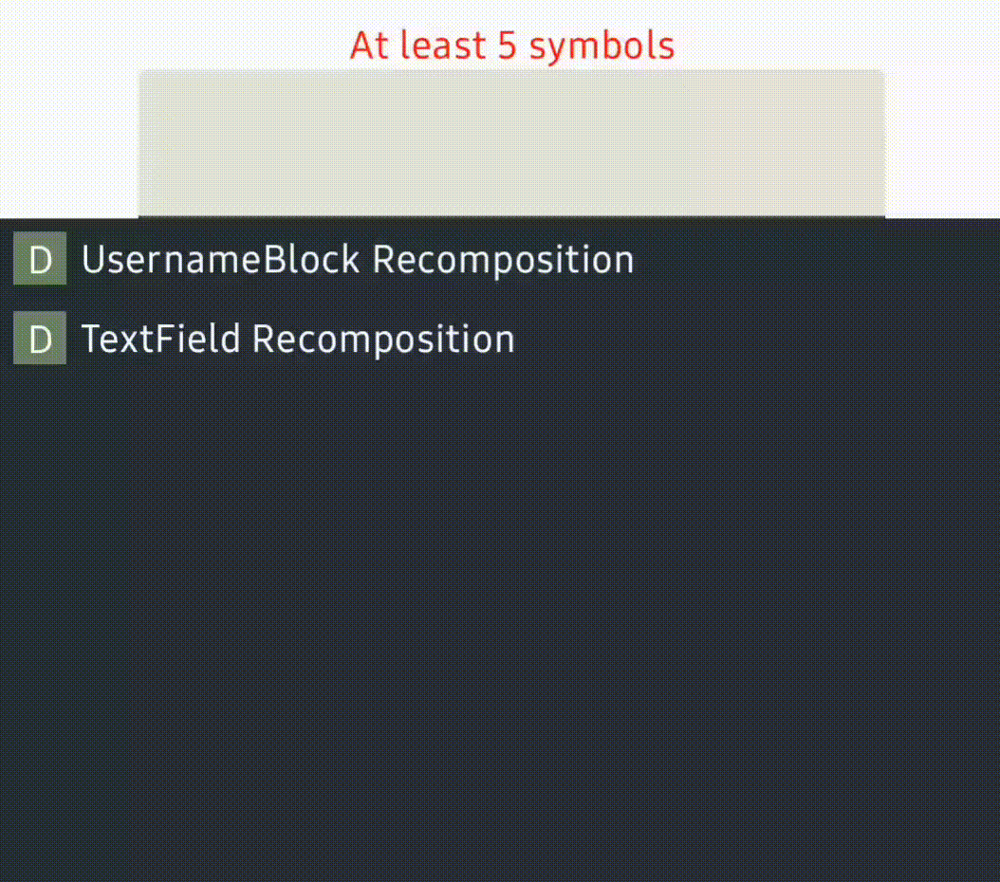

# Quản lý trạng thái trong Jetpack Compose

## Trạng thái và Jetpack Compose


**Trạng thái** là bất kỳ giá trị nào có thể được thay đổi tại bất kỳ thời điểm nào trong quá trình thực thi ứng dụng.

### Trạng thái và composition

**Compose mang tính khai báo và do đó, cách duy nhất để cập nhật nó là gọi cùng một thành phần kết hợp với các đối số mới, recomposition cần phải xuất hiện.** Các đối số này đại diện cho trạng thái UI.
Để theo dõi các thay đổi trạng thái, Jetpack Compose có hệ thống quan sát đặc biệt của riêng mình thuộc loại `State<T>` và `MutableState<T>`. Hệ thống này giám sát tham số giá trị và kích hoạt recomposition bất cứ khi nào nó thay đổi.

> [!NOTE]
> Thuật ngữ chính:
> composition ban đầu: tạo Composition bằng cách chạy các thành phần kết hợp lần đầu tiên.
> Recomposition: chạy lại các thành phần kết hợp để cập nhật Composition khi dữ liệu thay đổi.

### Trạng thái quan sát

`mutableStateOf` tạo ra `MutableState<T>` có thể quan sát được, đây là loại có thể quan sát được tích hợp với runtime.


```kotlin
interface MutableState<T> : State<T> {
    override var value: T
}
```

Có ba cách để khai báo đối tượng MutableState trong một thành phần kết hợp:

- `val mutableState = remember { mutableStateOf(default) }`
- `var value by remember { mutableStateOf(default) }`
- `val (value, setValue) = remember { mutableStateOf(default) }`

Các phần khai báo này tương đương nhau và được cung cấp dưới dạng cú pháp cho các mục đích sử dụng trạng thái khác nhau. Bạn nên chọn câu khai báo tạo mã dễ đọc nhất trong thành phần kết hợp mà bạn đang viết.

Bạn có thể sử dụng giá trị được ghi nhớ làm tham số cho các thành phần kết hợp khác hoặc thậm chí làm logic trong các câu lệnh để thay đổi thành phần kết hợp nào được hiển thị. 

[Đọc thêm về ghi nhớ](/General/ComputerScience/3_Mobile/0_Android/1_UserInterface/2_UIComponents/1_Compose/1_UIArchitecture/5_Remember.md)

### Quan sát trạng thái với Collection

Giả sử chúng ta không chỉ có một giá trị mà còn có cả danh sách
Ví dụ: danh sách mua sắm các mặt hàng cần mua tại cửa hàng. Chúng ta có thể chuyển nó làm đối số cho `mutableStateOf(value = mutableListOf(“candy”, “chocolate”, “cookies”))`,
nhưng khi chúng tôi thêm hoặc xóa các thành phần khỏi danh sách, sẽ không có gì thay đổi vì `mutableStateOf()` theo dõi toàn bộ đối tượng chứ không phải nội dung bên trong của nó.
Trong trường hợp này, chức năng `mutableStateListOf("candy", "chocolate", "cookies")` sẽ hoạt động.

Chúng ta cũng có thể sử dụng chức năng mở rộng `Collection<T>.toMutableStateListOf()` để chuyển đổi danh sách hiện có.
Giờ đây, Compose sẽ được thông báo mỗi khi danh sách thay đổi và danh sách hiển thị trên màn hình sẽ được cập nhật.

Tương tự, chúng ta có thể sử dụng `mutableStateMapOf()` để tạo `Map<T>` có thể quan sát được.

Hoặc Bạn có thể sử dụng cách tiếp cận khác. Sử dụng bộ giữ dữ liệu có thể quan sát được như `State<List<T>>` và immutable `listOf()`.

### Trạng thái dẫn xuất

Hãy tưởng tượng một tình huống khác.
Giả sử chúng ta có TextField và chúng ta cần kiểm tra xem độ dài của tên người dùng có khớp với kích thước được đặt tối thiểu với mỗi ký tự được nhập hay không.

```kotlin
const val MIN_LENGTH = 5
val username = mutableStateOf("")

@Composable
fun UsernameBlock() {
    Log.d("Recomposition", "UsernameBlock Recomposition")

    Column {
        Log.d("Recomposition", "Column Recomposition")

        val isMinLength = username.value.length >= MIN_LENGTH

        if (!isMinLength) {
            Text("At least 5 symbols", color = Color.Red)
        }

        Surface {
            Log.d("Recomposition", "TextField Recomposition")

            TextField(value = username.value, onValueChange = { username.value = it })
        }
    }
}
```

Kết quả:



Như bạn có thể thấy, mỗi khi giá trị của `TextField` thay đổi, toàn bộ thành phần kết hợp `UsernameBlock` sẽ được kết hợp lại.
Điều này là do thành phần kết hợp `Column` phụ thuộc vào trạng thái của `username`.
Do đó, chúng tôi kích hoạt các hoạt động kết hợp lại không cần thiết, mặc dù thực tế là composition trên màn hình không thay đổi cho đến khi độ dài văn bản đạt đến mức tối thiểu đã đặt.

`derivedStateOf` cho phép bạn tạo trạng thái phụ thuộc vào một hoặc nhiều trạng thái khác.
Hàm này có một tham số tính toán duy nhất lấy các hàm làm đối số để thực hiện các phép tính cụ thể và trả về kết quả tính toán của chúng.
Khi bất kỳ trạng thái nào phụ thuộc vào sự thay đổi, trạng thái do `derivedStateOf` tạo cũng sẽ thay đổi và tất cả các Thành phần kết hợp nghe trạng thái đó sẽ được kết hợp lại.

Hãy thử cải thiện mã của chúng tôi:

```kotlin
const val MIN_LENGTH = 5
val username = mutableStateOf("")
val derivedState = derivedStateOf { 
    username.value.length >= MIN_LENGTH 
}

@Composable
fun UsernameBlock() {
    Log.d("Column", "UsernameBlock Recomposition")

    Column {
        Log.d("Column", "Column Recomposition")

        if (!derivedState.value) {
            Text("At least 5 symbols", color = Color.Red)
        }

        Surface {
            Log.d("Column", "Surface Recomposition")

            TextField(value = username.value, onValueChange = { username.value = it })
        }
    }
}
```



### Các loại trạng thái được hỗ trợ khác

Compose không yêu cầu bạn sử dụng `MutableState<T>` để giữ trạng thái; nó hỗ trợ các loại có thể quan sát khác. Trước khi đọc một loại có thể quan sát khác trong Compose, **bạn phải chuyển đổi loại đó thành `State<T>` để các thành phần kết hợp có thể tự động kết hợp lại khi trạng thái thay đổi.**

Compose có chức năng tạo `State<T>` từ các loại có thể quan sát phổ biến được sử dụng trong ứng dụng Android. Trước khi sử dụng các tiện ích tích hợp này, hãy thêm (các) thành phần lạ thích hợp như được nêu bên dưới:

- Flow: `collectAsStateWithLifecycle()` và `collectAsState()`

Cả `collectAsStateWithLifecycle()` và `collectAsState()` đều thu thập các giá trị từ `Flow` và chuyển đổi chúng thành Trạng thái Compose, biểu thị giá trị được phát ra mới nhất. `collectAsStateWithLifecycle()` **lifecycle nhận biết**, giúp bảo tồn tài nguyên ứng dụng trên Android và là API được đề xuất cho các luồng thu thập. `collectAsState()` cung cấp chức năng tương tự nhưng thiếu nhận thức về lifecycle.

Sử dụng collectAsState cho mã không xác định nền tảng thay vì `collectAsStateWithLifecycle`, chỉ dành cho Android.

- Dữ liệu trực tiếp: `observeAsState()`

`observeAsState()` bắt đầu quan sát `LiveData` này và thể hiện các giá trị của nó thông qua `State`.
- RxJava2/RxJava3: `subscribeAsState()`

`subscribeAsState()` là các hàm mở rộng chuyển đổi các luồng phản ứng của (RxJava2/RxJava3) (ví dụ: `Single`, `Observable`, `Completable`) thành Compose `State`.


> [!IMPORTANT]
> Compose tự động soạn lại từ việc đọc các đối tượng `State`. Nếu bạn sử dụng một loại có thể quan sát khác, chẳng hạn như `LiveData` trong Compose, bạn nên chuyển đổi nó thành Trạng thái trước khi đọc. Đảm bảo rằng quá trình chuyển đổi loại diễn ra trong một thành phần kết hợp bằng cách sử dụng hàm mở rộng có thể kết hợp như `LiveData<T>.observeAsState()`.

### Trạng thái Compose tùy chỉnh

Bạn không bị giới hạn trong những tích hợp này. Bạn có thể xây dựng chức năng mở rộng cho Jetpack Compose để đọc các loại có thể quan sát khác.
Nếu ứng dụng của bạn sử dụng một lớp có thể quan sát tùy chỉnh, hãy chuyển đổi nó để tạo ra `State<T>` bằng cách sử dụng `produceState()` API. Chức năng này cho phép bạn sử dụng trực tiếp các trạng thái dựa trên đăng ký, chẳng hạn như `Flow`, `LiveData` hoặc `RxJava` trong các trạng thái có thể kết hợp

> [!NOTE]
> không giống như mutableStateOf() và derivedStateOf(), hàm produceState() là một thành phần kết hợp trả về một đối tượng thuộc loại `State<T>`. Do đó, hàm này chỉ có thể được gọi trong một thành phần kết hợp khác.

Bây giờ chúng ta hãy thử tạo một hàm mở rộng chung với chú thích `@Composable` để chuyển đổi trạng thái bằng cách sử dụng `LiveData` làm ví dụ:

```kotlin
@Composable
fun <T> LiveData<T>.observeAsState(): State<T?> { 
    val liveData = this 
    val owner = LocalLifecycleOwner.current
    // we need to call the produceState() function, which will return an object of the State<T> type.
    // This function has two required parameters: initialValue of generic type and a producer parameter,
    val state = produceState(initialValue = liveData.value) {
        /**
        Note that inside the lambda expression of the producer parameter you can execute
        both regular functions and suspended functions.
        This is because produceState launches a coroutine scoped to the composition. 
        This means that the producer function will be launched when produceState() 
        enters composition and will be canceled when it leaves composition.
        **/
        liveData.observe(owner) { recentData ->
            value = recentData
        }
    }
    return state
}
```

Bây giờ chúng ta chỉ cần gọi hàm mở rộng trên đối tượng LiveData và xử lý trạng thái này theo cách chúng ta cần, ví dụ như minh họa ở đây:

```kotlin
val liveData = MutableLiveData(0)

@Composable
fun LiveStateBlock() {
    val liveState = liveData.observeAsState()

    Button(onClick = { liveData.value = liveData.value!! + 1 }) {
        Text("Clicks: ${liveState.value}")
    }
}
```


## Có trạng thái và không có trạng thái

Một thành phần kết hợp sử dụng tính năng ghi nhớ để lưu trữ một đối tượng sẽ tạo ra trạng thái bên trong, làm cho thành phần kết hợp đó có trạng thái. HelloContent là một ví dụ về thành phần kết hợp có trạng thái vì nó giữ và sửa đổi trạng thái tên của nó trong nội bộ. Điều này có thể hữu ích trong trường hợp người gọi không cần kiểm soát trạng thái và có thể sử dụng nó mà không cần phải tự quản lý trạng thái. Tuy nhiên, các thành phần kết hợp có trạng thái nội bộ có xu hướng ít tái sử dụng hơn và khó kiểm tra hơn.

Thành phần kết hợp không có trạng thái là thành phần kết hợp không chứa bất kỳ trạng thái nào. Một cách dễ dàng để đạt được trạng thái không trạng thái là sử dụng state hoisting.

Khi phát triển các thành phần kết hợp có thể sử dụng lại, bạn thường muốn hiển thị cả phiên bản có trạng thái và không có trạng thái của cùng một thành phần kết hợp. Phiên bản có trạng thái thuận tiện cho những người gọi không quan tâm đến trạng thái và phiên bản không có trạng thái là cần thiết cho những người gọi cần kiểm soát hoặc nâng cấp trạng thái.


##State hoisting

State hoisting trong Compose là một dạng chuyển trạng thái sang phương thức gọi của thành phần kết hợp để biến thành thành phần kết hợp thành không có trạng thái. Mẫu chung cho state hoisting trong Jetpack Compose là thay thế biến trạng thái bằng hai tham số:

- `value T`: giá trị hiện tại cần hiển thị
- `onValueChange: (T) -> Unit`: sự kiện yêu cầu thay đổi giá trị, trong đó T là giá trị mới được đề xuất

Tuy nhiên, bạn không bị giới hạn ở `onValueChange`. Nếu các sự kiện cụ thể hơn phù hợp với thành phần kết hợp, bạn nên xác định chúng bằng lambda.

**Trạng thái được nâng lên theo cách này có một số thuộc tính quan trọng:**

- **Single source of truth**: Bằng cách di chuyển trạng thái thay vì sao chép nó, chúng tôi đảm bảo chỉ có một nguồn sự thật. Điều này giúp tránh lỗi.
- **Được đóng gói**: Chỉ các thành phần kết hợp có trạng thái mới có thể sửa đổi trạng thái của chúng. Nó hoàn toàn nội bộ.
Có thể chia sẻ: Trạng thái được nâng lên có thể được chia sẻ với nhiều thành phần kết hợp. Nếu bạn muốn đọc tên trong một thành phần kết hợp khác, hoisting sẽ cho phép bạn làm điều đó.
- **Có thể chặn**: người gọi các thành phần kết hợp không có trạng thái có thể quyết định bỏ qua hoặc sửa đổi các sự kiện trước khi thay đổi trạng thái.
- **Đã tách rời**: trạng thái của các thành phần kết hợp không có trạng thái có thể được lưu trữ ở bất kỳ đâu. Ví dụ: giờ đây bạn có thể chuyển tên sang ViewModel.

> [!IMPORTANT]
> Khi hoisting có trạng thái, có ba quy tắc giúp bạn tìm ra trạng thái nên chuyển sang đâu:
> 1. Trạng thái phải được nâng lên ít nhất **mốc gốc thấp nhất** trong tất cả các thành phần kết hợp sử dụng trạng thái (đọc).
> 2. Trạng thái phải được nâng lên ít nhất **mức cao nhất có thể thay đổi** (ghi).
> 3. Nếu **hai trạng thái thay đổi để phản ứng với cùng một sự kiện** thì chúng sẽ **được nâng lên cùng nhau**.

## Khôi phục trạng thái trong Compose

`rememberSaveable` API hoạt động tương tự như `remember` vì nó giữ lại trạng thái trong các lần kết hợp lại cũng như trong hoạt động hoặc giải trí process bằng cách sử dụng cơ chế trạng thái phiên bản đã lưu. Ví dụ, điều này xảy ra khi màn hình được xoay.

> [!NOTE]
> rememberSaveable sẽ không giữ lại trạng thái nếu hoạt động [bị người dùng loại bỏ hoàn toàn](https://developer.android.com/topic/libraries/architecture/saving-states#ui-dismissal-user). Ví dụ: nó không giữ lại trạng thái nếu người dùng vuốt hoạt động hiện tại lên từ [màn hình gần đây](https://developer.android.com/guide/components/activities/recents).

### Các cách lưu trữ State

Tất cả các loại dữ liệu được thêm vào `Bundle` đều được lưu tự động. Nếu bạn muốn lưu thứ gì đó không thể thêm vào `Bundle`, có một số tùy chọn.

#### Bưu kiện

Giải pháp đơn giản nhất là thêm chú thích `@Parcelize` vào đối tượng. Đối tượng trở nên có thể phân chia được và có thể được đóng gói. Ví dụ: mã này tạo kiểu dữ liệu `City` có thể phân chia và lưu nó vào trạng thái.

```kotlin
@Parcelize
data class City(val name: String, val country: String) : Parcelable

@Composable
fun CityScreen() {
    var selectedCity = rememberSaveable {
        mutableStateOf(City("Madrid", "Spain"))
    }
}
```

####MapSaver

Nếu vì lý do nào đó `@Parcelize` không phù hợp, bạn có thể sử dụng mapSaver để xác định quy tắc của riêng mình nhằm chuyển đổi một đối tượng thành một tập hợp các giá trị mà hệ thống có thể lưu vào `Bundle`.

```kotlin
data class City(val name: String, val country: String)

val CitySaver = run {
    val nameKey = "Name"
    val countryKey = "Country"
    mapSaver(
        save = { mapOf(nameKey to it.name, countryKey to it.country) },
        restore = { City(it[nameKey] as String, it[countryKey] as String) }
    )
}

@Composable
fun CityScreen() {
    var selectedCity = rememberSaveable(stateSaver = CitySaver) {
        mutableStateOf(City("Madrid", "Spain"))
    }
}
```

####ListSaver

Để tránh phải xác định các khóa cho bản đồ, bạn cũng có thể sử dụng `listSaver` và sử dụng các chỉ mục của nó làm khóa:

```kotlin
data class City(val name: String, val country: String)

val CitySaver = listSaver<City, Any>(
    save = { listOf(it.name, it.country) },
    restore = { City(it[0] as String, it[1] as String) }
)

@Composable
fun CityScreen() {
    var selectedCity = rememberSaveable(stateSaver = CitySaver) {
        mutableStateOf(City("Madrid", "Spain"))
    }
}
```

## Chủ sở hữu trạng thái trong Compose

state hoisting đơn giản có thể được quản lý trong chính các hàm có khả năng kết hợp. Tuy nhiên, nếu số lượng trạng thái cần theo dõi tăng lên hoặc logic thực hiện trong các hàm có khả năng kết hợp phát sinh thì bạn nên ủy quyền logic và trách nhiệm trạng thái cho các lớp khác: **chủ sở hữu trạng thái.** -> **Chủ sở hữu trạng thái quản lý logic và trạng thái của các thành phần kết hợp.**


## Retrigger ghi nhớ phép tính khi phím thay đổi

Nói chung, `remember` lấy tham số lambda tính toán. Khi `remember` được chạy lần đầu tiên, nó gọi phép tính lambda và lưu trữ kết quả của nó. Trong recomposition, `remember` trả về giá trị được lưu trữ lần cuối.

Ngoài trạng thái bộ nhớ đệm, bạn cũng có thể sử dụng `remember` để lưu trữ bất kỳ đối tượng hoặc kết quả của một thao tác nào trong Composition vốn tốn kém khi khởi tạo hoặc tính toán. Bạn có thể không muốn lặp lại phép tính này trong mọi recomposition. 

`remember` lưu trữ giá trị cho đến khi nó rời khỏi Composition. Tuy nhiên, **có một cách để vô hiệu hóa giá trị được lưu trong bộ nhớ đệm**. `remember` API cũng có tham số `key` hoặc `keys`. Nếu bất kỳ phím nào trong số này thay đổi, lần tiếp theo khi hàm kết hợp lại, **`remember` sẽ vô hiệu hóa bộ nhớ đệm và thực hiện lại khối lambda tính toán. Cơ chế này cho phép bạn kiểm soát vòng đời của một đối tượng trong Composition**. Phép tính vẫn có hiệu lực cho đến khi đầu vào thay đổi, thay vì cho đến khi giá trị được ghi nhớ rời khỏi Composition.

Ví dụ:

```kotlin
@Composable
private fun BackgroundBanner(
    @DrawableRes avatarRes: Int,
    modifier: Modifier = Modifier,
    res: Resources = LocalContext.current.resources
) {
    val brush = remember(key1 = avatarRes) {
        ShaderBrush(
            BitmapShader(
                ImageBitmap.imageResource(res, avatarRes).asAndroidBitmap(),
                Shader.TileMode.REPEAT,
                Shader.TileMode.REPEAT
            )
        )
    }

    Box(
        modifier = modifier.background(brush)
    ) {
        /* ... */
    }
}
```

## Tài liệu tham khảo

- https://developer.android.com/develop/ui/compose/state
- https://hyperskill.org/learn/step/28475