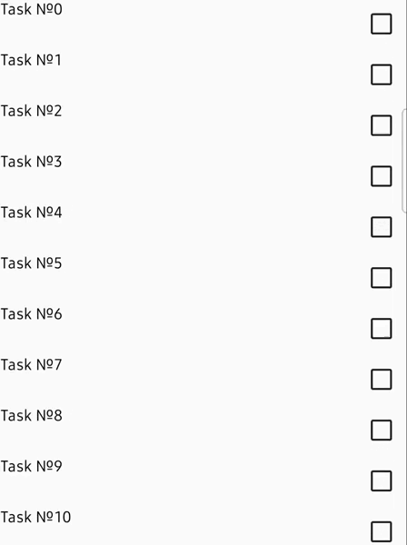
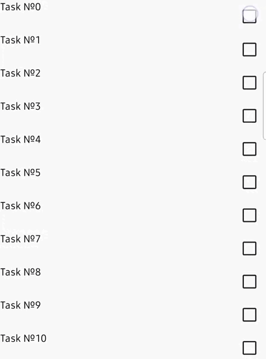

# Ghi nhớ vào Compose


Các hàm Composable có thể sử dụng `remember` API để lưu trữ một đối tượng trong bộ nhớ.
Giá trị được tính toán bởi `remember` được lưu trữ trong Composition trong composition ban đầu và giá trị được lưu trữ được trả về trong recomposition.
`remember` có thể được sử dụng để lưu trữ cả đối tượng mutable và immutable.

> [!NOTE]
> Các đối tượng được lưu trữ bởi Remember sẽ bị loại bỏ khi thành phần kết hợp tương ứng bị xóa hoặc không còn cần thiết.


## nhớ

### Vấn đề
Trước đó, để lưu trạng thái của thành phần kết hợp, chúng tôi đã khai báo nó bên ngoài chính composable function và nó đã hoạt động.

Tuy nhiên, nếu muốn sử dụng lại chức năng này, chúng ta sẽ gặp một số vấn đề.
Vấn đề là một thành phần kết hợp đã được sử dụng nhiều lần sẽ luôn dựa vào cùng một trạng thái

Khi trạng thái này thay đổi, tất cả các thành phần kết hợp sẽ được kết hợp lại và mỗi thành phần sẽ hiển thị giá trị mới giống như tất cả các thành phần khác.

Hãy xem ví dụ về danh sách việc cần làm có hộp kiểm hoàn thành:

```kotlin
val isChecked = mutableStateOf(false)

@Composable
fun Task() {
    Row(horizontalArrangement = Arrangement.SpaceBetween, modifier = Modifier.fillMaxWidth()) {
        Text(text = "Task №${Random.nextInt()}")
        Checkbox(checked = isChecked.value, onCheckedChange = { isChecked.value = !isChecked.value})
    }
}
```
Lớp MainActivity:
```kotlin
val taskList = List(100) { "Task №$it"}

class MainActivity : ComponentActivity() {
    override fun onCreate(savedInstanceState: Bundle?) {
        super.onCreate(savedInstanceState)
        setContent {
            HyperskillTheme {

                Column {
                    taskList.forEach { task ->
                        Task(description = task)
                    }
                }

            }
        }
    }
}
```
Khi bạn cố gắng đánh dấu một trong các nhiệm vụ là "đã hoàn thành", tất cả các nhiệm vụ khác cũng sẽ được kiểm tra:



Để khắc phục sự cố này, chúng ta cần di chuyển trạng thái bên trong thành phần kết hợp, tạo trạng thái mới mỗi lần sử dụng lại.

Vấn đề là ngay cả khi chúng ta di chuyển dòng `val isChecked = mutableStateOf(false)` bên trong thành phần kết hợp của mình, Compose sẽ theo dõi trạng thái của nó và kích hoạt recomposition khi nó thay đổi.
Nhưng vấn đề là khi thành phần kết hợp được gọi lại trong recomposition, **nó sẽ được gọi với các giá trị được chỉ định ban đầu.**

### Giải pháp

Tuy nhiên, có một giải pháp gọn gàng cho phép bạn tồn tại trong recomposition và giữ trạng thái trong thành phần kết hợp.
Để làm điều này, chúng ta sẽ sử dụng hàm ghi nhớ, hàm này sẽ bao bọc trạng thái của chúng ta bằng:

```kotlin
@Composable
fun Task() {
    val isChecked = remember { mutableStateOf(false) }

    Row(horizontalArrangement = Arrangement.SpaceBetween, modifier = Modifier.fillMaxWidth()) {
        Text(text = "Task №${Random.nextInt()}")

        Checkbox(checked = isChecked.value, onCheckedChange = { isChecked.value = !isChecked.value})
    }
}
```



##rememberSaveable

### Vấn đề

`remember` lưu trữ các đối tượng trong composition ban đầu và giá trị được lưu trữ được trả về trong recomposition.
Tuy nhiên, nó sẽ quên đối tượng khi thành phần kết hợp có tên `remember` bị xóa khỏi composition.

Bạn có thể thấy nó trong ví dụ dưới đây.
- Chúng ta sẽ sử dụng `LazyColumn` thay vì `Column`. Điểm khác biệt chính của nó là nó không tải tất cả các mục trong danh sách cùng một lúc.
Nó chỉ thực thi nhiều thành phần kết hợp nhất có thể hiển thị trên màn hình.
Đồng thời, các thành phần kết hợp rời khỏi vùng hiển thị của màn hình cũng rời khỏi composition. 
Vì vậy, khi thành phần kết hợp rời khỏi composition, `remember` sẽ quên đối tượng được lưu trữ và khi nó quay trở lại composition, **trạng thái của nó sẽ trở về trạng thái ban đầu.**
- trạng thái không được giữ lại khi thay đổi cấu hình, chẳng hạn như khi xoay màn hình.

### Giải pháp

Để giải quyết những vấn đề này, bạn cần `rememberSaveable`, `Bundle` tự động lưu giá trị trong `Bundle`.

`rememberSaveable` cho phép trạng thái tồn tại không chỉ recomposition mà còn cả hoạt động giải trí và cái chết process do hệ thống khởi tạo.

## Cải tiến hiệu suất
Chúng tôi đã chuyển tất cả các giá trị mà trước đây chúng tôi đã chuyển cho hàm `remember` sang tham số lambda `calculations` của hàm này.

Khi composable function được khởi tạo lần đầu tiên, `remember` thực hiện các phép tính trên các đối tượng được khai báo trong lambda expression và lưu trữ kết quả của các phép tính đó. Trong các lần kết hợp lại tiếp theo, `remember` không còn thực hiện các phép tính mới mà chỉ khôi phục kết quả của các phép tính ban đầu.

Chính tính năng này cho phép bạn cải thiện hiệu suất ứng dụng.

 
> [!NOTE]
> Có nhiều trường hợp các thành phần kết hợp khác nhau cần truy cập vào cùng một trạng thái để đọc hoặc sửa đổi trạng thái đó.
> Ngoài ra, dữ liệu có thể được lưu trữ trong view model và phải được chuyển đến composable function.
> Để làm được điều này, các giá trị trạng thái phải được chuyển đến các tham số của thành phần kết hợp làm đối số để tôn trọng nguyên tắc cơ bản của "hàm thuần túy".
> Bằng cách này, chúng tôi loại bỏ trạng thái bên trong thành phần kết hợp. process này được gọi là state hoisting.

```kotlin
@Composable
fun SortedTaskList(
    taskList: List<String>,
    sortComparator: Comparator<String>
) {
    val sortedTasks = taskList.sortedWith(sortComparator)
    
    LazyColumn {
        items(sortedTasks.size) {
            Task(description = sortedTasks[it])
        }
    }
}
```
Nhưng ngay sau khi danh sách tăng lên một chút, UI sẽ bị giật.

Trong trường hợp này, điều quan trọng là sử dụng `remember`.
Với nó, việc sắp xếp sẽ chỉ được thực hiện một lần.
Lưu ý rằng nếu trạng thái của `taskList` hoặc `sortComparator` bị thay đổi, **chúng tôi phải thông báo để ghi nhớ về điều đó**. 
Để thực hiện việc này, hãy thêm các giá trị `key` và nếu ít nhất một trong số chúng thay đổi, các phép tính sẽ được gọi lại.

```kotlin
@Composable
fun SortedTaskList(
    taskList: List<String>,
    sortComparator: Comparator<String>
) {
    val sortedTasks = remember(key1 = taskList, key2 = sortComparator) {
        taskList.sortedWith(sortComparator)
    }
    
    LazyColumn {
        items(sortedTasks.size) {
            Task(description = sortedTasks[it])
        }
    }
}
```


