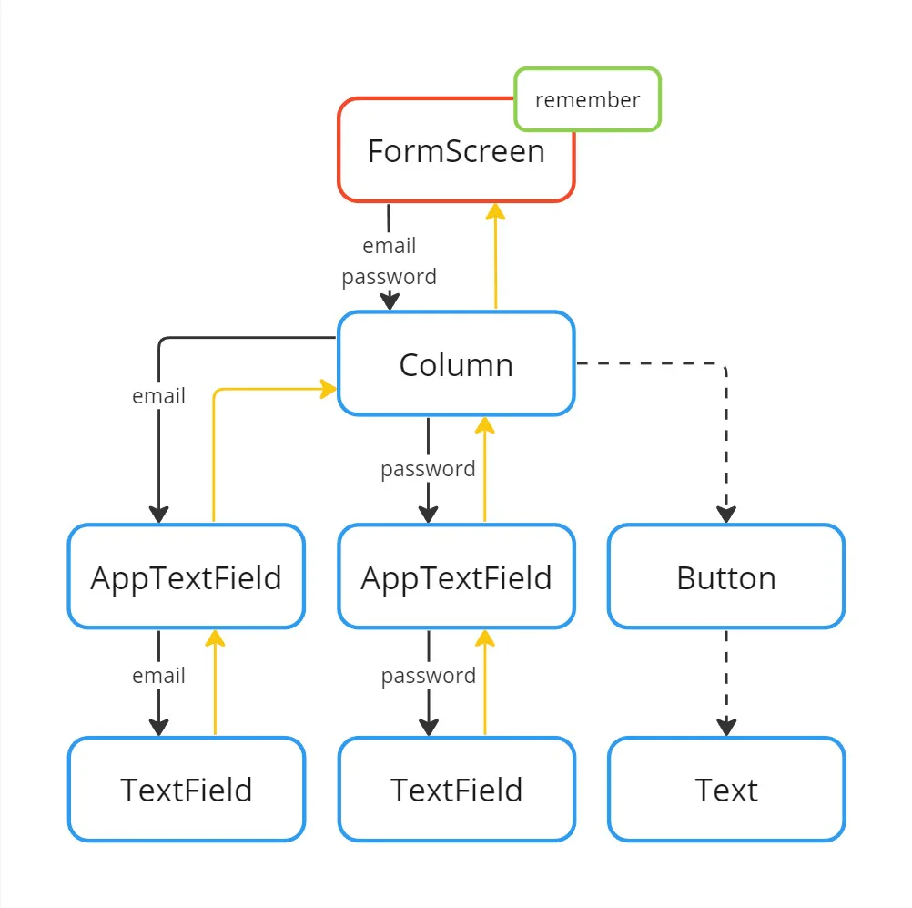

# Lưu trữ nhà nước

Nơi để nâng nhà nước?

## Trạng thái UI
Trạng thái UI là thuộc tính mô tả UI. Có hai loại trạng thái UI:
 - **Màn hình trạng thái UI**: là nội dung bạn cần hiển thị trên màn hình. (Ví dụ: lớp NewsUiState...)
 - **Trạng thái phần tử UI**: đề cập đến các thuộc tính nội tại của các phần tử UI ảnh hưởng đến cách chúng được hiển thị. Phần tử UI có thể được hiển thị hoặc ẩn và có thể có phông chữ, cỡ chữ hoặc màu phông chữ nhất định. (Một ví dụ về điều này là các phương thức get và set của lớp TextView cho văn bản của nó.)

 ##Luật lý

 Logic trong một ứng dụng có thể là logic nghiệp vụ hoặc logic UI:
 - **Logic nghiệp vụ** là việc triển khai các yêu cầu sản phẩm đối với dữ liệu ứng dụng.
 - **Logic UI** liên quan đến cách hiển thị trạng thái UI trên màn hình

 ### logic UI

 Khi logic UI cần trạng thái đọc hoặc ghi, **bạn nên đặt phạm vi trạng thái đó trong UI**, theo lifecycle của nó. Để đạt được điều này, **bạn nên nâng trạng thái ở mức chính xác trong composable function**. Ngoài ra, bạn có thể làm như vậy trong lớp state holder đơn giản, cũng nằm trong phạm vi UI lifecycle.

Dưới đây là mô tả về cả hai giải pháp và giải thích khi nào nên sử dụng giải pháp nào.

#### Thành phần kết hợp với tư cách là chủ sở hữu trạng thái
Việc có trạng thái logic UI và trạng thái phần tử UI trong các thành phần kết hợp **là một phương pháp hay nếu trạng thái và logic đơn giản**. Bạn có thể để trạng thái nội bộ của mình thành một thành phần kết hợp hoặc Palăng nếu cần.

#### Không cần state hoisting

**Trạng thái Hoisting không phải lúc nào cũng bắt buộc**. Trạng thái có thể được lưu giữ nội bộ trong một thành phần kết hợp khi không có thành phần kết hợp nào khác cần kiểm soát nó. Trong đoạn mã này, có một thành phần kết hợp có thể mở rộng và thu gọn khi nhấn:

```kotlin
@Composable
fun ChatBubble(
    message: Message
) {
    var showDetails by rememberSaveable { mutableStateOf(false) } // Define the UI element expanded state

    ClickableText(
        text = AnnotatedString(message.content),
        onClick = { showDetails = !showDetails } // Apply simple UI logic
    )

    if (showDetails) {
        Text(message.timestamp)
    }
}
```

#### Hoisting trong các thành phần kết hợp

Hoisting trạng thái ngụ ý việc di chuyển nó lên trong hệ thống phân cấp để nó được quản lý bởi thành phần kết hợp gốc hoặc màn hình, chứ không phải bởi các phần tử UI riêng lẻ.

Việc hiểu state hoisting đòi hỏi phải hiểu rõ về các hàm **trạng thái** và **không trạng thái**. 

- Hàm trạng thái là hàm bao gồm bất kỳ cơ chế lưu trữ trạng thái nào; ví dụ: hàm `remember` hoặc `rememberSaveable`. Nó có thể quản lý, lưu trữ và chia sẻ trạng thái với các thành phần kết hợp con hoặc cháu.
- Ngược lại, hàm phi trạng thái không quản lý hay lưu trữ trạng thái; nó chỉ hiển thị trạng thái do thành phần kết hợp gốc cung cấp hoặc gửi các sự kiện trở lại thành phần gốc. 

**Nếu bạn cần chia sẻ trạng thái phần tử UI của mình với các thành phần kết hợp khác và áp dụng logic UI cho nó ở những nơi khác**, bạn có thể nâng nó lên cao hơn trong hệ thống phân cấp UI. Điều này cũng làm cho các thành phần kết hợp của bạn có thể tái sử dụng nhiều hơn và dễ kiểm tra hơn.

Ví dụ: Hãy xem xét một biểu mẫu đơn giản có nhiều trường văn bản. Mỗi trường văn bản có thể có trạng thái riêng - văn bản hiện tại.
Tuy nhiên, Màn hình chứa biểu mẫu thường cần biết trạng thái tổng thể (dữ liệu được nhập trên tất cả các trường).
Bằng cách sử dụng state hoisting, chúng tôi có thể quản lý tất cả các trạng thái này ở cấp biểu mẫu.

```kotlin

import androidx.compose.runtime.getValue
import androidx.compose.runtime.mutableStateOf
import androidx.compose.runtime.remember
import androidx.compose.runtime.setValue

@Composable
fun FormScreen() {
    var email by remember { mutableStateOf("") }
    var password by remember { mutableStateOf("") }
    Column {
        AppTextField(
            label = "Email",
            value = email,
            onValueChange = { email = it }
        )
        AppTextField(
            label = "Password",
            value = password,
            onValueChange = { password = it }
        )
        Button(onClick = { /* Handle business logic */ }) {
            Text("Submit")
        }
    }
}

@Composable
fun AppTextField(label: String, value: String, onValueChange: (String) -> Unit) {
    TextField(
        value = value,
        onValueChange = onValueChange,
        label = { Text(label) }
    )
}
```

chúng tôi có một thành phần kết hợp `FormScreen` chứa hai phần trạng thái: `email` và `password`.
Mỗi trạng thái được quản lý ở cấp biểu mẫu bằng cách sử dụng ghi nhớ và `mutableStateOf`.
Sau đó, chúng tôi chuyển từng phần trạng thái xuống thành phần kết hợp `AppTextField`, cùng với `onValueChange` callback tương ứng, cập nhật trạng thái khi văn bản thay đổi.

`AppTextField` chấp nhận `label`, `value` hiện tại và `onValueChange` callback làm tham số. 
Thiết lập này làm cho mỗi trường văn bản trở thành một thành phần kết hợp thuần túy (không có trạng thái) ở trạng thái của nó mà không có sự quản lý trạng thái nội bộ. Chúng ta hãy xem thiết lập này dưới dạng sơ đồ.



Một khía cạnh quan trọng khác là dữ liệu truyền theo một hướng—từ `FormScreen` đến `TextField`—trong khi các sự kiện cập nhật trạng thái, chẳng hạn như thông tin đầu vào của người dùng, lại truyền theo hướng ngược lại.
Mẫu này được gọi là [unidirectional data flow](/General/ComputerScience/3_Mobile/0_Android/3_Architecture/2_StateManagement/UnidirectionalDataFlow.md).
Nó giúp việc theo dõi cách dữ liệu và sự kiện di chuyển trong ứng dụng trở nên dễ dàng hơn, từ đó đơn giản hóa việc gỡ lỗi và giải quyết vấn đề.

Nó cũng giúp ngăn chặn các lỗi xảy ra khi dữ liệu thay đổi bất ngờ hoặc di chuyển theo cách bạn không mong muốn—đây là sự cố thường gặp trong **luồng dữ liệu hai chiều**, nơi dữ liệu có thể quay đi quay lại.

#### Lớp state holder đơn giản với tư cách là chủ sở hữu trạng thái

Khi một thành phần kết hợp chứa logic UI phức tạp liên quan đến một hoặc nhiều trường trạng thái của phần tử UI, thì thành phần đó phải ủy quyền trách nhiệm đó cho `state holders`, giống như lớp state holder đơn giản. Điều này làm cho logic của thành phần kết hợp trở nên dễ kiểm tra hơn khi tách biệt và giảm độ phức tạp của nó. Cách tiếp cận này thiên về [nguyên tắc separation of concerns](/General/DesignPrinciple/SeparationOfConcernsPrinciple.md): **thành phần kết hợp chịu trách nhiệm phát ra các phần tử UI và state holder chứa logic UI và trạng thái phần tử UI.**

Các lớp state holder đơn giản cung cấp các chức năng thuận tiện cho người gọi composable function của bạn, do đó họ không phải tự viết logic này.

Các lớp đơn giản này được tạo và ghi nhớ trong Composition. Vì chúng tuân theo [lifecycle](/General/ComputerScience/3_Mobile/0_Android/1_UserInterface/2_UIComponents/1_Compose/1_UIArchitecture/LifecycleOfComposables.md của thành phần kết hợp), nên chúng có thể lấy các loại do thư viện Compose cung cấp, chẳng hạn như `rememberNavController()` hoặc `rememberLazyListState()`.

<details>
  <summary style="color: orange;">
  <b>
  Một ví dụ về điều này
  </b>
  </summary>
  
  <p>
   lớp state holder đơn giản LazyListState, được triển khai trong Compose để kiểm soát độ phức tạp UI của LazyColumn hoặc LazyRow.

```kotlin
// LazyListState.kt

@Stable
class LazyListState constructor(
    firstVisibleItemIndex: Int = 0,
    firstVisibleItemScrollOffset: Int = 0
) : ScrollableState {
    /**
     *   The holder class for the current scroll position.
     */
    private val scrollPosition = LazyListScrollPosition(
        firstVisibleItemIndex, firstVisibleItemScrollOffset
    )

    suspend fun scrollToItem(/*...*/) { /*...*/ }

    override suspend fun scroll() { /*...*/ }

    suspend fun animateScrollToItem() { /*...*/ }
}
```


>Trong Compose, @Stable là một Annotation được sử dụng để đánh dấu rằng một lớp hoặc một hàm không thể thay đổi về nội dung sau khi được tạo. Khi một đối tượng được đánh dấu là @Stable, nó sẽ không được thay đổi giá trị trong suốt vòng đời của ứng dụng.

>Trong trường hợp của lớp LazyListState, việc đánh dấu là @Stable là quan trọng để đảm bảo rằng trạng thái của LazyListState không thay đổi sau khi được tạo ra. Điều này cần thiết để LazyListState thường được sử dụng để theo dõi vị trí cuộn của danh sách hoặc RecyclerView trong người dùng giao diện. Nếu trạng thái của LazyListState thay đổi trong khi chạy ứng dụng, có thể gây ra lỗi hoặc không có mức tối thiểu trong danh sách hiển thị. Điều đặc biệt quan trọng trong việc xây dựng giao diện người dùng có hiệu suất cao, nơi mà việc giữ trạng thái không thay đổi là rất quan trọng.

LazyListState đóng gói trạng thái của LazyColumn lưu trữ scrollPosition cho phần tử UI này. Nó cũng hiển thị các phương pháp để sửa đổi vị trí cuộn bằng cách cuộn đến một mục nhất định.

  </p>
</details>

Như bạn có thể thấy, **việc tăng trách nhiệm của thành phần kết hợp sẽ làm tăng nhu cầu về state holder**. Các trách nhiệm có thể nằm ở logic UI hoặc chỉ ở mức độ trạng thái cần theo dõi.

> [!NOTE]
> Nếu các lớp state holder đơn giản chứa trạng thái bạn muốn duy trì sau khi Activity hoặc process được tạo lại, hãy sử dụng `rememberSaveable` và tạo `Saver` tùy chỉnh cho nó.


### Logic nghiệp vụ

Nếu trạng thái phần tử UI của bạn được chuyển lên `ViewModel` vì nó được yêu cầu bởi logic nghiệp vụ, bạn có thể sử dụng API của `ViewModel`.

<details>
  <summary style="color: orange;">
  <b>
    Những lợi ích chính của việc sử dụng ViewModel
  </b>
  </summary>
  
  <p>

Một trong những lợi ích chính của việc sử dụng ViewModel trong ứng dụng Android của bạn là nó xử lý các thay đổi cấu hình miễn phí. Khi có configuration change và hoạt động bị hủy và được tạo lại, trạng thái UI được chuyển lên ViewModel sẽ được lưu trong bộ nhớ. Sau khi giải trí, phiên bản ViewModel cũ được gắn vào phiên bản hoạt động mới.

  </p>
</details>


> [!NOTE]
> `ViewModel`, khi triển khai cấp độ màn hình state holder, xử lý logic nghiệp vụ được sử dụng để tạo trạng thái màn hình UI. **Bạn nên nâng trạng thái UI lên `ViewModel`, không phải vì nó sẽ xử lý các thay đổi cấu hình miễn phí mà vì nó có ý nghĩa đối với kiến ​​trúc của bạn**.

Tuy nhiên, phiên bản `ViewModel` không tồn tại sau khi process bị hệ thống khởi tạo. Để trạng thái UI tồn tại được sau này, hãy sử dụng mô-đun Trạng thái đã lưu cho `ViewModel`, chứa `SavedStateHandle` API.


## Thẩm quyền giải quyết

- https://developer.android.com/develop/ui/compose/state
- https://hyperskill.org/learn/step/40623