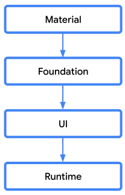

#kiến trúc Jetpack Compose

Trang này cung cấp thông tin tổng quan cấp cao về các lớp kiến ​​trúc tạo nên Jetpack Compose và các nguyên tắc cốt lõi thông báo cho thiết kế này.

Jetpack Compose không phải là một dự án nguyên khối duy nhất; nó được tạo ra từ một số mô-đun được lắp ráp lại với nhau để tạo thành một ngăn xếp hoàn chỉnh. Hiểu các mô-đun khác nhau tạo nên Jetpack Compose cho phép bạn:

- Sử dụng mức độ trừu tượng thích hợp để xây dựng ứng dụng hoặc thư viện của bạn
- Hiểu khi nào bạn có thể 'thả' xuống mức thấp hơn để có nhiều quyền kiểm soát hoặc tùy chỉnh hơn
- Giảm thiểu sự phụ thuộc của bạn

## Lớp

Các lớp chính của Jetpack Compose là:

Mỗi lớp được xây dựng dựa trên các cấp độ thấp hơn, kết hợp chức năng để tạo ra các thành phần cấp độ cao hơn. Mỗi lớp xây dựng trên các API công khai của các lớp thấp hơn để xác minh ranh giới mô-đun và cho phép bạn thay thế bất kỳ lớp nào nếu cần. Hãy kiểm tra các lớp này từ dưới lên.

1. **Runtime**
    Mô-đun này cung cấp các kiến thức cơ bản về Compose runtime chẳng hạn như `remember`, `mutableStateOf`, chú thích `@Composable` và SideEffect.**Bạn có thể cân nhắc xây dựng trực tiếp trên lớp này nếu chỉ cần Khả năng quản lý cây của Compose, không phải UI.**

2. **UI**
    Lớp UI được tạo thành từ nhiều mô-đun ( `ui-text`, `ui-graphics`, `ui-tooling`, v.v.). Các mô-đun này triển khai các nguyên tắc cơ bản của bộ công cụ UI, chẳng hạn như `LayoutNode`, `Modifier`, handler đầu vào, bố cục tùy chỉnh và bản vẽ. **Bạn có thể cân nhắc xây dựng trên lớp này nếu bạn chỉ cần các khái niệm cơ bản về bộ công cụ UI.**

3. **Nền**
    Mô-đun này cung cấp các khối xây dựng bất khả tri của hệ thống thiết kế cho Compose UI, như `Row` và `Column`, `LazyColumn`, nhận dạng các cử chỉ cụ thể, v.v. **Bạn có thể cân nhắc xây dựng dựa trên lớp nền tảng để tạo hệ thống thiết kế của riêng mình.**

4. **Chất liệu**
    Mô-đun này cung cấp cách triển khai hệ thống Material Design cho Compose UI, cung cấp hệ thống theo chủ đề, các thành phần được tạo kiểu, chỉ báo gợn sóng, biểu tượng. **Xây dựng dựa trên lớp này khi sử dụng Material Design trong ứng dụng của bạn.**