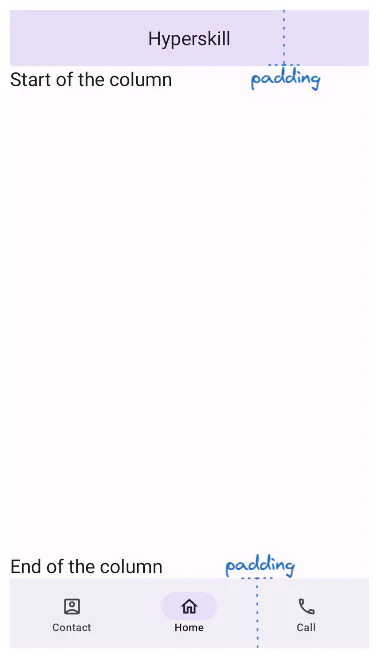

#Scaffold


Scaffold đóng gói các cấu trúc bố cục Material Design cơ bản, đảm bảo tính nhất quán trên các màn hình và ứng dụng. Điều đó giúp đơn giản hóa việc triển khai các thành phần và mẫu bố cục Material Design phổ biến

```kotlin
@Composable
fun Scaffold(
    modifier: Modifier = Modifier,
    topBar: @Composable () -> Unit = {},
    bottomBar: @Composable () -> Unit = {},
    snackbarHost: @Composable () -> Unit = {},
    floatingActionButton: @Composable () -> Unit = {},
    floatingActionButtonPosition: FabPosition = FabPosition.End,
    containerColor: Color = MaterialTheme.colorScheme.background,
    contentColor: Color = contentColorFor(containerColor),
    contentWindowInsets: WindowInsets = ScaffoldDefaults.contentWindowInsets,
    content: @Composable (PaddingValues) -> Unit
)
```

- Tham số `contentWindowInsets` rất quan trọng để cung cấp khoảng đệm chính xác cho nội dung của Scaffold, đảm bảo nội dung đó tôn trọng ranh giới UI của hệ thống. 
Việc cân nhắc này đặc biệt quan trọng trong giao diện người dùng Android hiện đại với nội dung tràn cạnh và điều hướng bằng cử chỉ


- Tham số `content` rất cần thiết để xác định các thành phần chính của màn hình của bạn,
Hàm lambda này nhận đối tượng `PaddingValues` làm đầu vào do thành phần kết hợp Scaffold cung cấp. 
Nó cho biết khoảng đệm cần thiết xung quanh nội dung của bạn để chiếm không gian được chiếm bởi các phần tử như Thanh trên cùng hoặc Thanh dưới cùng.

Ví dụ:

```kotlin
import androidx.compose.material3.Scaffold
import androidx.compose.material3.ExperimentalMaterial3Api
import androidx.compose.material3.BottomAppBar
import androidx.compose.material3.CenterAlignedTopAppBar

@OptIn(ExperimentalMaterial3Api::class)
@Composable
fun ScaffoldScreen() {
    Scaffold(
        topBar = {
            CenterAlignedTopAppBar(
                title = { Text("Hyperskill") },
                /*...*/
            )
        },
        bottomBar = {  
		    BottomAppBar { /*...*/ }  
		}
    ) { innerPadding ->  
	    ScaffoldContent(modifier = Modifier.padding(innerPadding).fillMaxSize())  
	}
}
```



## Các phương pháp hay nhất và cân nhắc về hiệu suất

Trạng thái của Scaffold hoặc các thành phần của nó đôi khi có thể khiến toàn bộ hệ thống phân cấp Scaffold được sắp xếp lại. Điều quan trọng là phải xem xét cập nhật trạng thái của bạn bắt nguồn từ đâu.

- Nếu những thay đổi về trạng thái chỉ ảnh hưởng đến một phần nhỏ trên màn hình của bạn, bạn nên đóng gói phần đó trong thành phần kết hợp của chính nó để giới hạn recomposition chỉ ở khu vực đó.
- Vùng `content` của Scaffold là trung tâm màn hình của bạn.
Hãy lưu ý đến tác động đến hiệu suất nếu khu vực này bao gồm danh sách dài, bố cục phức tạp hoặc có thể được cập nhật thường xuyên.
Việc sử dụng các kỹ thuật như `LazyColumn` cho danh sách và tách biệt các thành phần kết hợp có cường độ tính toán cao có thể giúp đảm bảo trải nghiệm tốt cho người dùng. 


## Thẩm quyền giải quyết

- https://hyperskill.org/learn/step/45216


