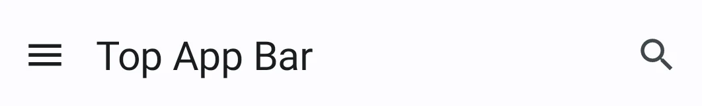
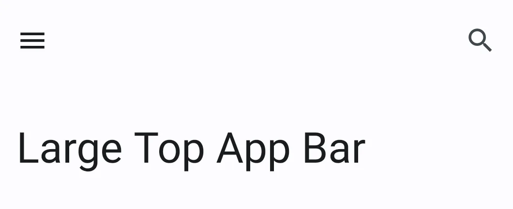
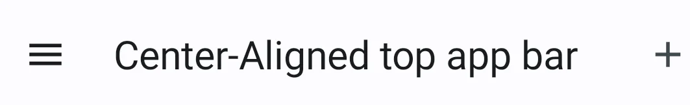
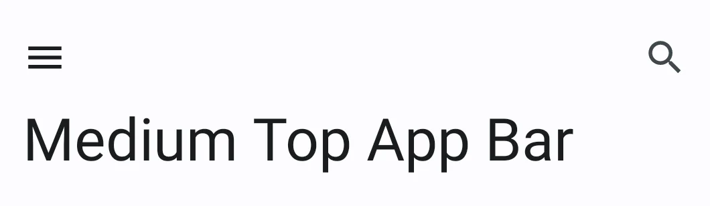
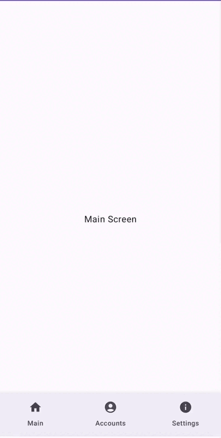

#thanh ứng dụng

Thanh ứng dụng là nơi cung cấp cho người dùng quyền truy cập vào các tính năng chính và mục điều hướng.
Trong Jetpack Compose dành cho Android, có hai loại thanh ứng dụng:

- **Thanh ứng dụng trên cùng**: Thanh này xuất hiện ở đầu màn hình và cung cấp quyền truy cập vào các tác vụ và thông tin chính.
Nó thường bao gồm tiêu đề, các mục hành động cốt lõi và các mục điều hướng nhất định.

- Thanh ứng dụng dưới cùng: Thanh này xuất hiện ở cuối màn hình và bao gồm các mục điều hướng cốt lõi.
Nó cũng có thể cung cấp quyền truy cập vào các hành động chính khác, chẳng hạn như thông qua nút hành động nổi.

## Các loại thanh ứng dụng hàng đầu

Jetpack Compose cung cấp một số loại thanh ứng dụng hàng đầu để đáp ứng các yêu cầu ứng dụng và mẫu thiết kế khác nhau.
Chúng bao gồm:

- `TopAppBar`: Thanh ứng dụng tiêu chuẩn thường chứa tiêu đề màn hình, biểu tượng điều hướng và biểu tượng hành động.
Nó phù hợp với hầu hết các kịch bản ứng dụng và cung cấp giao diện nhất quán.

```kotlin
@Composable
fun MyAppBar() {
    TopAppBar(
        title = { Text("Top App Bar") },
        navigationIcon = {
            IconButton(onClick = { /* Handle navigation */ }) {
                Icon(Icons.Default.Menu, contentDescription = "Menu")
            }
        },
        actions = {
            IconButton(onClick = { /* Handle search */ }) {
                Icon(Icons.Default.Search, contentDescription = "Search")
            }
        }
    )
}
```



- `LargeTopAppBar`: Thanh ứng dụng có chiều cao được mở rộng, cho phép các yếu tố thương hiệu nổi bật hơn hoặc nội dung bổ sung.
Nó thường được sử dụng kết hợp với thanh công cụ thu gọn hoặc khi bạn muốn tạo ấn tượng mạnh về mặt thị giác.


```kotlin
@Composable
fun MyLargeAppBar() {
    LargeTopAppBar(
        title = { Text("Large Top App Bar", style = MaterialTheme.typography.h4) },
        navigationIcon = {
            IconButton(onClick = { /* Handle navigation */ }) {
                Icon(Icons.Default.Menu, contentDescription = "Menu")
            }
        },
        actions = {
            IconButton(onClick = { /* do something */ }) {
                Icon(
                    imageVector = Icons.Filled.Search,
                    contentDescription = "Localized description"
                )
            }
        }
    )
}
```




- `CenterAlignedTopAppBar`: Một biến thể của thanh ứng dụng trong đó tiêu đề được căn giữa theo chiều ngang.
Phong cách này thường được sử dụng trong các ứng dụng tập trung vào phương tiện truyền thông hoặc khi bạn muốn nhấn mạnh tính đối xứng trong thiết kế ứng dụng của mình.

```kotlin
@Composable
fun MyCenteredAppBar() {
    CenterAlignedTopAppBar(
        title = { Text(text = "Center-Aligned top app bar") },
        navigationIcon = {
            IconButton(onClick = { /*TODO*/ }) {
                Icon(imageVector = Icons.Default.Menu, contentDescription = null)
            }
        },
        actions = {
            Icon(imageVector = Icons.Default.Add, contentDescription = null)
        }
    )
}
```



- `MediumTopAppBar`: Thanh ứng dụng ở trên cùng có kích thước trung bình tương tự như thanh ứng dụng lớn, mặc dù khoảng đệm giữa tiêu đề và biểu tượng nhỏ hơn và chiếm ít không gian hơn trên màn hình tổng thể.

```kotlin
@Composable
fun MyMediumTopAppBar() {
    MediumTopAppBar(
        title = { Text("Medium Top App Bar", style = MaterialTheme.typography.headlineLarge) },
        navigationIcon = {
            IconButton(onClick = { /* Handle navigation */ }) {
                Icon(Icons.Default.Menu, contentDescription = "Menu")
            }
        },
        actions = {
            IconButton(onClick = { /* do something */ }) {
                Icon(
                    imageVector = Icons.Filled.Search,
                    contentDescription = "Localized description"
                )
            }
        }
    )
}
```


> [!NOTE]
> Để tích hợp thanh ứng dụng trên cùng vào ứng dụng của bạn bằng Scaffold, bạn có thể sử dụng khe topBar và cung cấp composable function để xác định nội dung của thanh ứng dụng trên cùng.


## thanh ứng dụng phía dưới

Trong Jetpack Compose, bạn có thể tạo thành phần thanh ứng dụng ở dưới cùng để điều hướng ở dưới cùng bằng cách sử dụng các thành phần kết hợp `NavigationBar` và `NavigationBarItem`. 
Để thể hiện các đích đến điều hướng theo cách an toàn về loại, bạn có thể sử dụng các enum Kotlin hoặc các lớp kín. 

```kotlin
sealed class Screen(val route: String) {
    object MainScreen : Screen("main_screen")
    object AccountsScreen : Screen("accounts_screen")
    object SettingScreen : Screen("settings_screen")
}

@Composable
fun MyApp() {
    Scaffold(
        bottomBar = {
            val currentRoute =  navController.currentDestination?.route
            NavigationBar  {
                NavigationBarItem(
                    icon = { /*..*/ },
                    label = { Text(text = "Main") },
                    selected = Screen.MainScreen.route == currentRoute,
                    onClick = { /* Handle navigation icon click */ }
                )
                NavigationBarItem(
                    icon = { /*..*/ },
                    label = { Text(text = "Accounts") },
                    selected = Screen.AccountsScreen.route == currentRoute,
                    onClick = { /* Handle navigation icon click */ }
                )
                NavigationBarItem(
                    icon = { /*..*/ },
                    label = { Text(text = "Settings") },
                    selected = Screen.SettingScreen.route == currentRoute,
                    onClick = { /* Handle navigation icon click */ }
                )
            }
        }
    ) { padding ->
        // Screen content goes here
    }
}
```



> [!NOTE]
> Bạn cũng có thể tạo thanh điều hướng phía dưới bằng cách sử dụng BottomAppBar . Nó tương tự như việc tạo thanh ứng dụng hàng đầu bằng TopAppBar.
> BottomAppBar chấp nhận một loạt mục điều hướng thông qua thuộc tính hành động và cũng có thể chấp nhận nút hành động nổi thông qua thuộc tính floatingActionButton.


