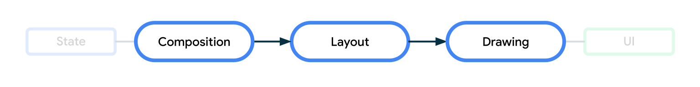
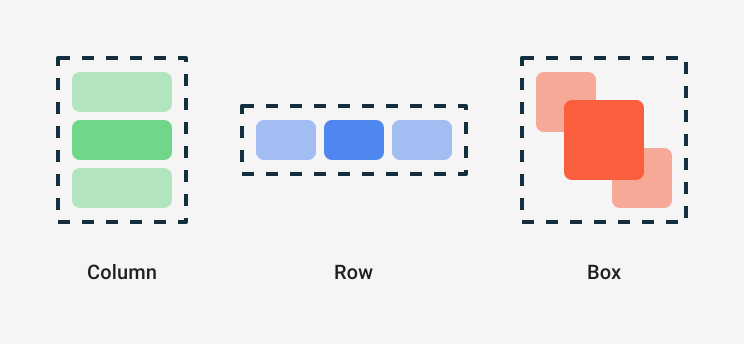
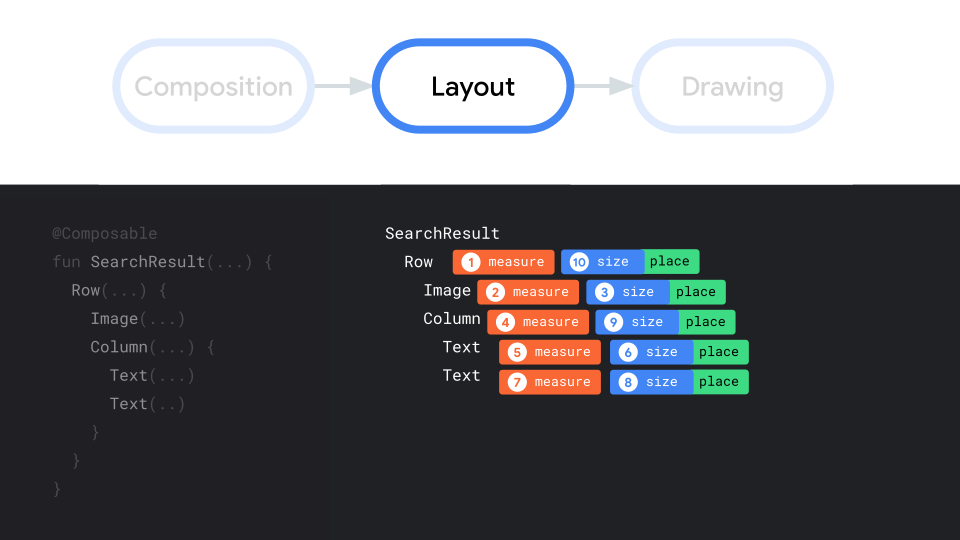
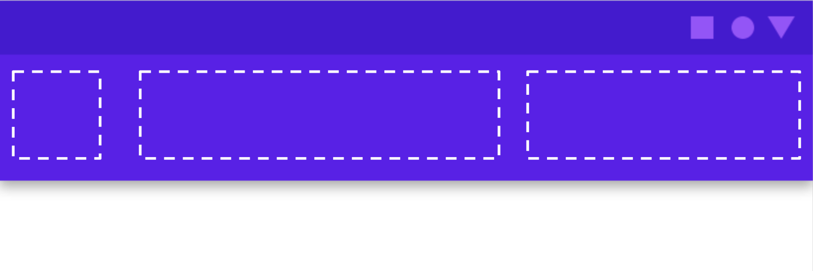

# Bố cục 
## Định nghĩa

Compose chuyển đổi trạng thái thành các phần tử UI, thông qua [các pha](../UIArchitecture/3_Phases.md):




**Tài liệu này tập trung vào bố cục của các phần tử**, giải thích một số khối xây dựng mà Compose cung cấp để giúp bạn bố cục các phần tử UI của mình.

## Mục tiêu của bố cục trong Compose

Việc triển khai hệ thống bố trí Jetpack Compose có hai mục tiêu chính:

- Hiệu suất cao
- Khả năng dễ dàng viết bố cục tùy chỉnh

> [!Lưu ý]
> Với hệ thống Android View, bạn có thể gặp phải một số vấn đề về hiệu suất khi lồng một số Chế độ xem nhất định, chẳng hạn như `RelativeLayout`. Vì Compose tránh thực hiện nhiều phép đo nên bạn có thể lồng sâu tùy thích mà không ảnh hưởng đến hiệu suất.

## Thông tin cơ bản về các hàm có khả năng kết hợp

Các chức năng Composable là khối xây dựng cơ bản của Compose. composable function là Đơn vị phát ra chức năng mô tả một phần UI của bạn. Hàm này lấy một số dữ liệu đầu vào và tạo ra những gì hiển thị trên màn hình. Để biết thêm thông tin về các thành phần kết hợp, hãy xem tài liệu mô hình tinh thần Compose.

## Các thành phần bố cục chuẩn

Compose cung cấp collection bố cục sẵn sàng sử dụng để giúp bạn sắp xếp các phần tử UI của mình

- Sử dụng `Column` để đặt các vật phẩm theo chiều dọc trên màn hình.
- Sử dụng `Row` để đặt các vật phẩm theo chiều ngang trên màn hình
- Sử dụng `Box` để xếp các phần tử lên trên phần tử khác. 




> [!NOTE]
> - Cả `Column` và `Row` đều hỗ trợ định cấu hình căn chỉnh các phần tử mà chúng chứa.
> - Compose xử lý các bố cục lồng nhau một cách hiệu quả, khiến chúng trở thành một cách tuyệt vời để thiết kế UI phức tạp. Đây là một cải tiến từ Chế độ xem Android, nơi bạn cần tránh bố cục lồng nhau vì lý do hiệu suất.

## Mô hình bố cục

Trong mô hình bố cục, cây UI được trình bày trong một lần duy nhất. Trước tiên, mỗi nút được yêu cầu tự đo lường, sau đó đo lường bất kỳ nút con nào theo cách đệ quy, chuyển các ràng buộc về kích thước xuống cây cho các nút con. Sau đó, các nút lá được xác định kích thước và đặt vị trí, với các kích thước đã phân giải và hướng dẫn vị trí được chuyển ngược lên cây.

**Nói tóm lại, cha mẹ đo lường trước con mình nhưng đo kích thước và đặt sau con cái.**

Trong giai đoạn Bố cục, cây được duyệt bằng thuật toán 3 bước sau:

1. Đo lường các nút con: Một nút đo lường các nút con của nó, nếu có.
2. Quyết định kích thước của chính nó: Dựa trên các phép đo đó, một nút sẽ quyết định kích thước của chính nó.
3. Đặt nút con: Mỗi nút con được đặt tương ứng với vị trí của nút đó.


<details>
  <summary style="color: orange;">
  <b>
  Ví dụ nhanh
  </b>
  </summary>
  
  <p>
  
```kotlin
@Composable
fun SearchResult() {
    Row {
        Image(
            // ...
        )
        Column {
            Text(
                // ...
            )
            Text(
                // ...
            )
        }
    }
}

```

Hàm này mang lại cây UI sau đây.

```
SearchResult
  Row
    Image
    Column
      Text
      Text
```

Trong ví dụ SearchResult, bố cục cây UI tuân theo thứ tự sau:

1. Hàng nút gốc được yêu cầu đo.
2. Nút gốc Hàng yêu cầu nút con đầu tiên của nó, Hình ảnh, đo.
3. Hình ảnh là một nút lá (nghĩa là nó không có nút con) nên nó báo cáo kích thước và trả về hướng dẫn vị trí.
4. Nút gốc Hàng yêu cầu nút con thứ hai của nó, Cột, đo.
5. Nút Cột yêu cầu con Văn bản đầu tiên của nó đo.
6. Nút Văn bản đầu tiên là nút lá, vì vậy nó báo cáo kích thước và trả về hướng dẫn vị trí.
7. Nút Cột yêu cầu con Văn bản thứ hai của nó đo.
8. Nút Văn bản thứ hai là nút lá nên nó báo cáo kích thước và trả về hướng dẫn vị trí.
9. Bây giờ, nút Cột đã đo, định cỡ và đặt các nút con của nó, nó có thể xác định kích thước và vị trí của chính nó.
10. Bây giờ nút gốc Hàng đã đo, định cỡ và đặt các nút con của nó, nó có thể xác định kích thước và vị trí của chính nó



  </p>
</details>

Xem thêm về [CommonComposeable](https://github.com/Meonix/CommonComposable/tree/master/app/src/main/java/com/mionix/commoncomposable/ui/screen/layoutExampleScreens/layoutBasics)

## Bố cục đáp ứng

Bố cục phải được thiết kế có tính đến các hướng màn hình và kích thước hệ số dạng khác nhau. Compose cung cấp ngay một số cơ chế để tạo điều kiện thuận lợi cho việc điều chỉnh bố cục có thể kết hợp của bạn với các cấu hình màn hình khác nhau.

### Hạn chế

Để biết các ràng buộc đến từ cấp độ gốc và thiết kế bố cục phù hợp, bạn có thể sử dụng BoxWithConstraints. Bạn có thể tìm thấy các ràng buộc đo lường trong phạm vi của lambda nội dung. Bạn có thể sử dụng các ràng buộc đo lường này để soạn các bố cục khác nhau cho các cấu hình màn hình khác nhau:

```kotlin
@Composable
fun ResponsiveLayoutExample() {
    BoxWithConstraints {
        if (maxWidth < 600.dp) {
            // Nếu chiều rộng nhỏ hơn 600dp, bố trí theo hàng dọc
            Column {
                Text("Item 1")
                Text("Item 2")
                Text("Item 3")
            }
        } else {
            // Nếu chiều rộng lớn hơn hoặc bằng 600dp, bố trí theo hàng ngang
            Row {
                Text("Item 1")
                Text("Item 2")
                Text("Item 3")
            }
        }
    }
}
```
### Bố cục dựa trên vị trí

Compose cung cấp nhiều thành phần kết hợp dựa trên Material Design với phần phụ thuộc `androidx.compose.material:material` (được bao gồm khi tạo dự án Compose trong Android Studio) để giúp việc xây dựng UI trở nên dễ dàng. Các phần tử như `Drawer`, `FloatingActionButton` và `TopAppBar` đều được cung cấp.

Các thành phần Material sử dụng nhiều API vị trí, một mẫu mà Compose giới thiệu để mang đến một lớp tùy chỉnh bên trên các thành phần kết hợp. Cách tiếp cận này làm cho các thành phần trở nên linh hoạt hơn, vì chúng chấp nhận một phần tử con có thể tự cấu hình thay vì phải hiển thị mọi tham số cấu hình của phần tử con. Các vị trí để lại một khoảng trống trong UI để nhà phát triển điền vào theo ý muốn. Ví dụ: đây là các vị trí mà bạn có thể tùy chỉnh trong `TopAppBar`:

