# Các ràng buộc và thứ tự sửa đổi

Trong Compose, bạn có thể kết hợp nhiều bộ sửa đổi lại với nhau để thay đổi giao diện của một thành phần kết hợp. Các chuỗi sửa đổi này có thể ảnh hưởng đến các ràng buộc được truyền cho các thành phần kết hợp, giúp xác định giới hạn chiều rộng và chiều cao.

Trang này mô tả cách các công cụ sửa đổi theo chuỗi ảnh hưởng đến các ràng buộc, từ đó, đến việc đo lường và sắp xếp các thành phần kết hợp.

## Công cụ sửa đổi trong cây UI

Để hiểu cách các công cụ sửa đổi ảnh hưởng lẫn nhau, bạn nên hình dung cách chúng xuất hiện trong cây UI, **được tạo trong giai đoạn composition.**

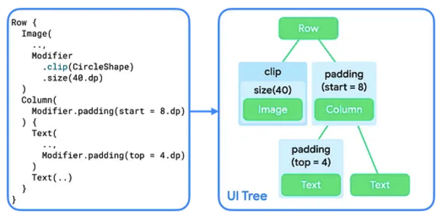

Việc thêm nhiều công cụ sửa đổi vào một thành phần kết hợp sẽ tạo ra một chuỗi các công cụ sửa đổi. Khi bạn xâu chuỗi nhiều nút sửa đổi, mỗi nút sửa đổi sẽ bao bọc phần còn lại của chuỗi và nút bố cục bên trong. Ví dụ: khi bạn xâu chuỗi một `clip` và một nút sửa đổi `size`, nút sửa đổi `clip` sẽ bao bọc nút sửa đổi `size`, sau đó nút này sẽ bao bọc nút bố cục `Image`.

Trong giai đoạn bố cục, [thuật toán](../UIArchitecture/3_Phases.md#layout) duyệt cây vẫn giữ nguyên, nhưng mỗi nút sửa đổi cũng được truy cập. Bằng cách này, công cụ sửa đổi có thể thay đổi các yêu cầu về kích thước và vị trí của công cụ sửa đổi hoặc nút bố cục mà nó bao bọc.


<details>
  <summary style="color: orange;">
  <b>
  Ví dụ khác
  </b>
  </summary>
  
  <p>
  
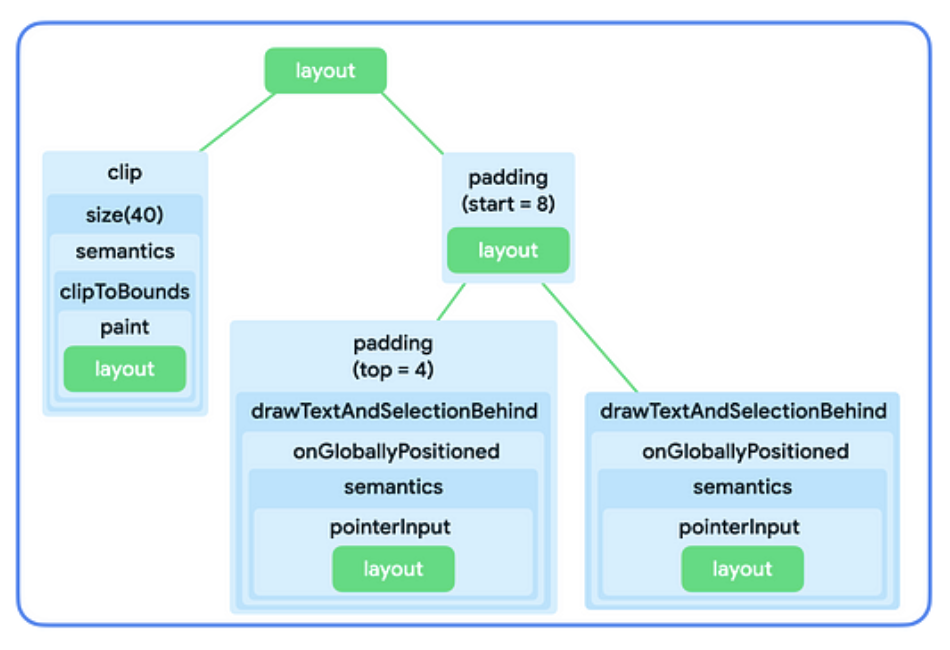
Như được hiển thị trong Hình 2, bản thân việc triển khai các thành phần kết hợp Hình ảnh và Văn bản bao gồm một chuỗi các công cụ sửa đổi bao bọc một nút bố cục duy nhất. Việc triển khai Hàng và Cột chỉ đơn giản là các nút bố cục mô tả cách sắp xếp các nút con của chúng.

  </p>
</details>

Để tóm tắt:
- Công cụ sửa đổi bao bọc một công cụ sửa đổi hoặc nút bố cục duy nhất.
- Nút bố trí có thể bố trí nhiều nút con.


## Ràng buộc trong giai đoạn bố trí

Giai đoạn bố trí tuân theo [thuật toán ba bước](../UIArchitecture/3_Phases.md#layout) để tìm chiều rộng, chiều cao và tọa độ x, y của từng nút bố cục:

`Constraints` giúp tìm kích thước phù hợp cho các nút trong hai bước đầu tiên của thuật toán. `Constraints` xác định giới hạn tối thiểu và tối đa cho chiều rộng và chiều cao của nút. Khi nút quyết định kích thước của nó, kích thước đo được của nó sẽ nằm trong phạm vi kích thước này.


### Các loại ràng buộc

Một ràng buộc có thể là một trong những điều sau đây:

- **Bounded**: Nút có chiều rộng và chiều cao tối đa và tối thiểu.
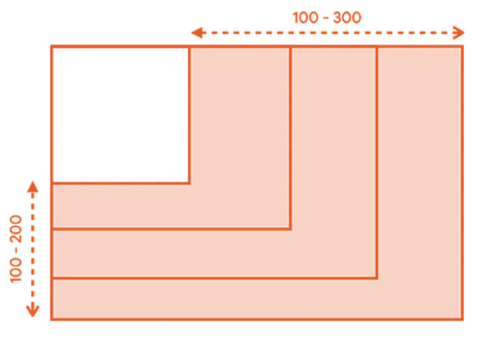
- **Không giới hạn**: Nút không bị giới hạn ở bất kỳ kích thước nào. Giới hạn chiều rộng và chiều cao tối đa được đặt thành vô cùng.
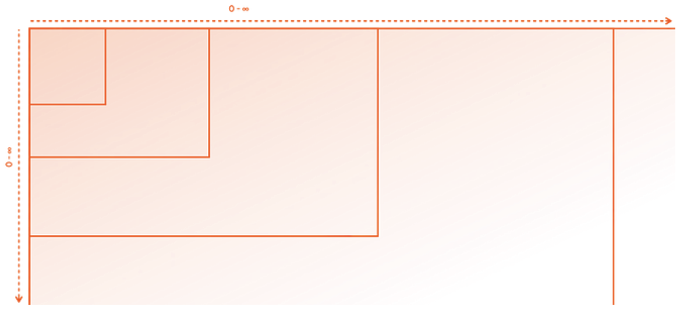
- **Chính xác**: Nút được yêu cầu tuân theo yêu cầu về kích thước chính xác. Giới hạn tối thiểu và tối đa được đặt thành cùng một giá trị.
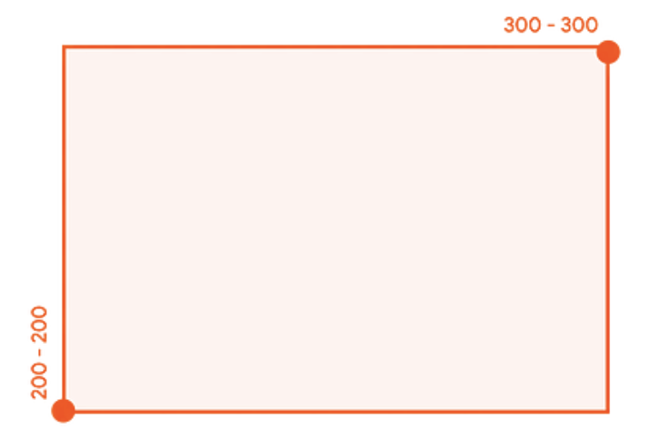
- **Kết hợp**: Nút tuân theo sự kết hợp của các loại ràng buộc trên. Ví dụ: một ràng buộc có thể giới hạn chiều rộng trong khi cho phép chiều cao tối đa không giới hạn hoặc đặt chiều rộng chính xác nhưng cung cấp chiều cao giới hạn.
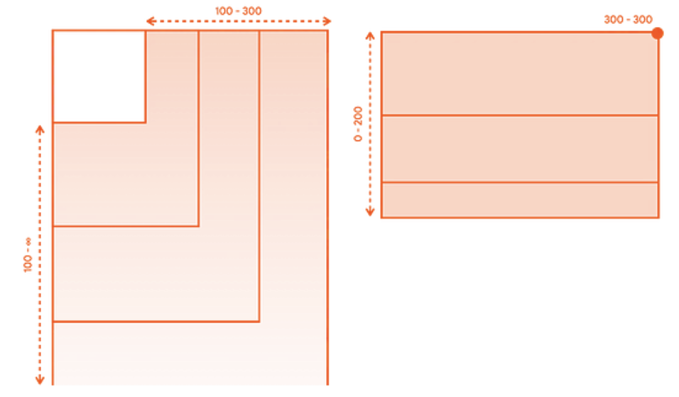

### Cách truyền các ràng buộc từ cha mẹ sang con cái

Trong bước đầu tiên của thuật toán được mô tả trong [Ràng buộc trong giai đoạn bố cục](./2_ConstraintsAndModifierOrder.md#constraints-in-the-layout-phase), các ràng buộc được truyền từ cha mẹ sang con trong cây UI.

Khi nút cha đo lường các nút con của nó, nó sẽ cung cấp các ràng buộc này cho từng nút con để cho chúng biết chúng được phép lớn hay nhỏ. Sau đó, khi nó quyết định kích thước của chính mình, nó cũng tuân theo các ràng buộc do chính cha mẹ của nó truyền lại.

thuật toán hoạt động theo cách sau:

1. Để quyết định kích thước mà nó thực sự muốn chiếm giữ, nút gốc trong cây UI đo lường các nút con của nó và chuyển tiếp các ràng buộc tương tự tới nút con đầu tiên của nó.
2. Nếu phần tử con là phần tử sửa đổi không ảnh hưởng đến phép đo, thì nó sẽ chuyển tiếp các ràng buộc đến phần sửa đổi tiếp theo. Các ràng buộc được truyền nguyên trạng xuống chuỗi sửa đổi trừ khi đạt được một công cụ sửa đổi tác động đến phép đo. Các ràng buộc sau đó được thay đổi kích thước cho phù hợp.
3. Sau khi đạt đến một nút không có bất kỳ nút con nào (được gọi là "nút lá"), nó sẽ quyết định kích thước của nó dựa trên các ràng buộc đã được truyền vào và trả về kích thước đã giải quyết này cho nút cha của nó.
4. Cha mẹ điều chỉnh các ràng buộc của nó dựa trên số đo của con này và gọi con tiếp theo với các ràng buộc đã điều chỉnh này.
5. Sau khi đo tất cả nút con của nút cha, nút cha sẽ quyết định kích thước của chính nó và thông báo điều đó cho nút cha của chính nó.
6. Bằng cách này, toàn bộ cây sẽ được duyệt theo chiều sâu. Cuối cùng, tất cả các nút đã quyết định kích thước của chúng và bước đo lường đã hoàn tất.

[Video ví dụ](https://youtube.com/watch?v=OeC5jMV342A&t=204s)

### Công cụ sửa đổi ảnh hưởng đến các ràng buộc
#### Công cụ sửa đổi `size`

<details>
  <summary style="color: orange;">
  <b>
Các phần sau đây mô tả các công cụ sửa đổi cụ thể có tác động đến các ràng buộc.
  </b>
  </summary>
  
  <p>
  
Ví dụ: cây UI sau đây phải được hiển thị trong vùng chứa `300dp` bởi `200dp`. Các ràng buộc được giới hạn, cho phép chiều rộng trong khoảng `100dp` và `300dp` và chiều cao trong khoảng `100dp` và `200dp`:

<div style="display: flex; align-items: center;">
  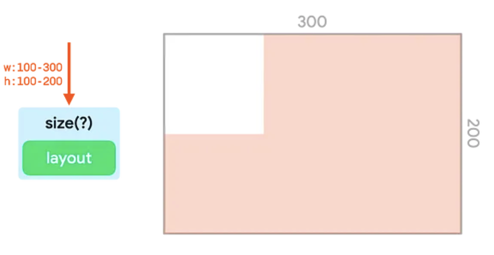
  <p>
  
  ```kotlin
@Composable
fun BoundedConstraintsExample() {
    Box(
        modifier = Modifier
            .size(300.dp, 200.dp)
            .background(Color.Red),
        contentAlignment = Alignment.TopStart
    ) {
        Box(
            modifier = Modifier
                .widthIn(min = 100.dp, max = 300.dp)
                .heightIn(min = 100.dp, max = 200.dp)
                .background(Color.White)
        ) {
            Text(
                text = "Bounded Box",
                color = Color.Black,
                modifier = Modifier.align(Alignment.Center)
            )
        }
    }
}
  ```

  </p>


</div>

Công cụ sửa đổi kích thước điều chỉnh các ràng buộc đến để khớp với giá trị được truyền cho nó. Trong ví dụ này, giá trị là 150dp:

<div style="display: flex; align-items: center;">
  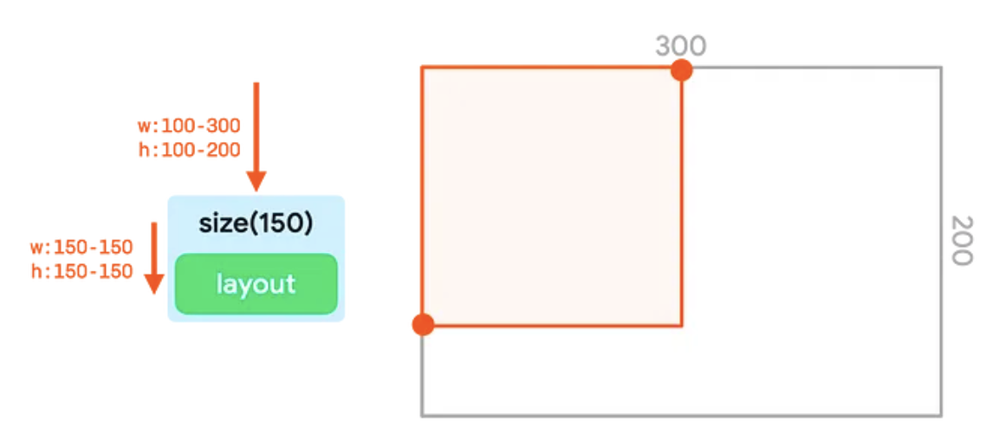
  <p>

```kotlin
@Composable
fun FixedSizeExample() {
    Box(
        modifier = Modifier
            .size(300.dp, 200.dp)
            .background(Color.Red)
    ) {
        Box(
            modifier = Modifier
                .size(150.dp)
                .background(Color.White)
        ) {
            Text(
                text = "150dp Box",
                color = Color.Black,
                modifier = Modifier.align(Alignment.Center)
            )
        }
    }
}
```
  </p>
</div>

Nếu chiều rộng và chiều cao nhỏ hơn giới hạn ràng buộc nhỏ nhất hoặc lớn hơn giới hạn ràng buộc lớn nhất, thì công cụ sửa đổi sẽ khớp với các ràng buộc được truyền một cách chặt chẽ nhất có thể trong khi vẫn tuân thủ các ràng buộc được truyền vào:

- Ràng buộc nhỏ nhất
```kotlin
Box(
        modifier = Modifier
            .size(300.dp, 200.dp)
            .background(Color.Red)
    ) {
        Box(
            modifier = Modifier
                .widthIn(min = 100.dp, max = 300.dp)
                .heightIn(min = 100.dp, max = 200.dp)
                .size(50.dp)
                .background(Color.White)
        ) {
            Text(
                text = "Too Small",
                color = Color.Black,
            )
        }
    }
```
- Lớn hơn giới hạn ràng buộc lớn nhất
```kotlin
Box(
    modifier = Modifier
        .size(300.dp, 200.dp)
        .background(Color.Red)
) {
    Box(
        modifier = Modifier
            .widthIn(min = 100.dp, max = 300.dp)
            .heightIn(min = 100.dp, max = 200.dp)
            .size(400.dp)
            .background(Color.White)
    ) {
        Text(
            text = "Too Large",
            color = Color.Black,
        )
    }
}
```

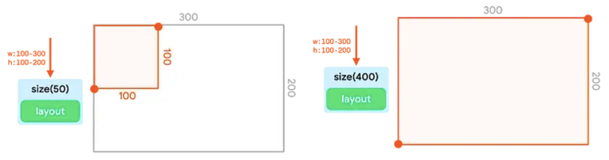


Lưu ý rằng việc xâu chuỗi các công cụ sửa đổi nhiều kích thước không hoạt động. Công cụ sửa đổi kích thước đầu tiên đặt cả giới hạn tối thiểu và tối đa thành một giá trị cố định. Ngay cả khi công cụ sửa đổi kích thước thứ hai request kích thước nhỏ hơn hoặc lớn hơn, nó vẫn cần tuân thủ các giới hạn chính xác được truyền vào để không ghi đè các giá trị đó:

<div style="display: flex; align-items: center;">
  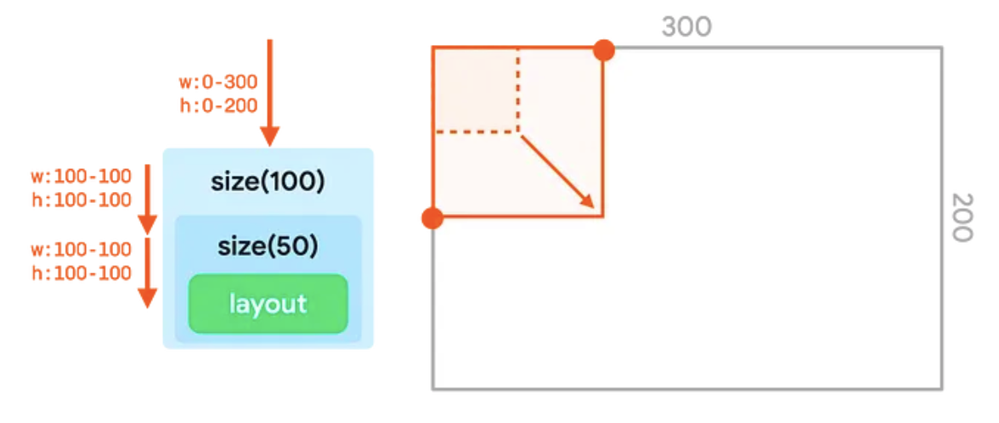
  <p>

```kotlin
@Composable
fun ChainedSizeModifiersExample() {
    Box(
        modifier = Modifier
            .size(300.dp, 200.dp)
            .background(Color.Red)
    ) {
        Box(
            modifier = Modifier
                .size(100.dp)
                .background(Color.White)
                .then(Modifier.size(50.dp))
        ) {
            Text(
                text = "Chained Size",
                color = Color.Black,
            )
        }
    }
}
```

  </p>
</div>

Một chuỗi gồm hai bộ sửa đổi kích thước, trong đó giá trị thứ hai được truyền vào (50dp) không ghi đè giá trị đầu tiên (100dp).

  </p>
</details>

#### Công cụ sửa đổi `requiredSize`

Sử dụng công cụ sửa đổi requiredSize thay vì kích thước nếu bạn cần nút của mình ghi đè các ràng buộc đến. Công cụ sửa đổi requiredSize thay thế các ràng buộc đến và chuyển kích thước bạn chỉ định làm giới hạn chính xác.

<div style="display: flex; align-items: center;">
  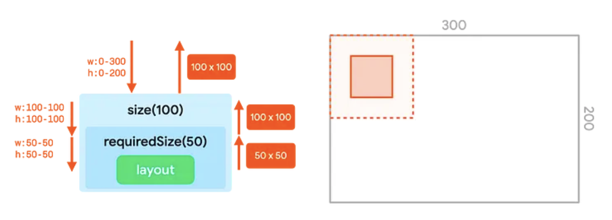
  <p>

```kotlin
@Composable
fun RequiredSizeModifierExample() {
    Box(
        modifier = Modifier
            .size(300.dp, 200.dp)
            .background(Color.Gray)
    ) {
        Box(
            modifier = Modifier
                .size(100.dp)
                .requiredSize(50.dp)
                .background(Color.Red)
        ) {
            Text(
                text = "Hello",
                modifier = Modifier.align(Alignment.Center)
            )
        }
    }
}
```

  </p>
</div>

#### Công cụ sửa đổi `width` và `height`


Công cụ sửa đổi `size` điều chỉnh cả `width` và `height` của các ràng buộc. Với chiều rộng `modifier`, bạn có thể đặt `width` cố định nhưng không quyết định `height`. Tương tự, với `height` `modifier`, bạn có thể đặt `height` cố định nhưng không quyết định `width`:

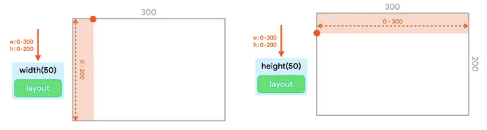


#### Công cụ sửa đổi `sizeIn`

Công cụ sửa đổi sizeIn cho phép bạn đặt các giới hạn tối thiểu và tối đa chính xác cho chiều rộng và chiều cao. Sử dụng công cụ sửa đổi sizeIn nếu bạn cần kiểm soát chi tiết các ràng buộc.

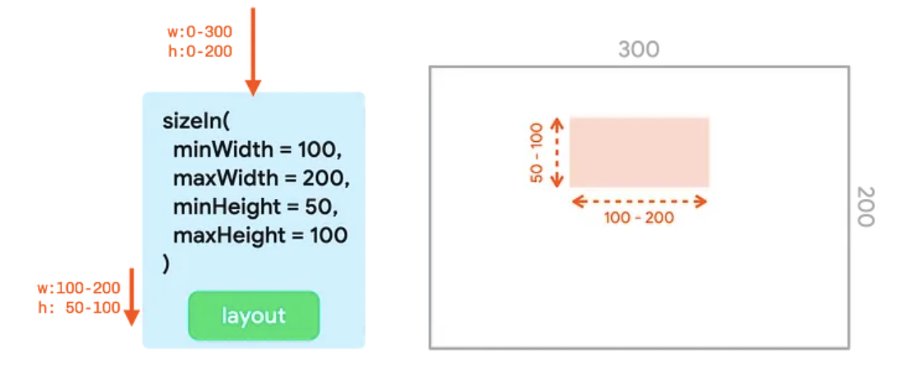