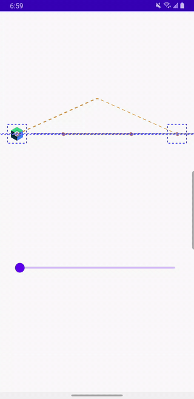

# Bố cục ràng buộc

`ConstraintLayout` là bố cục cho phép bạn đặt các thành phần kết hợp tương ứng với các thành phần kết hợp khác trên màn hình. Nó là một giải pháp thay thế cho việc sử dụng nhiều `Row`, `Column`, `Box` lồng nhau và các thành phần bố cục tùy chỉnh khác. `ConstraintLayout` rất hữu ích khi triển khai bố cục lớn hơn với các yêu cầu căn chỉnh phức tạp hơn.

**Cân nhắc sử dụng `ConstraintLayout` trong các trường hợp sau:**

- Để tránh lồng nhiều Cột và Hàng cho các thành phần định vị trên màn hình nhằm cải thiện khả năng đọc mã.
- Để định vị các thành phần kết hợp so với các thành phần kết hợp khác hoặc định vị các thành phần kết hợp dựa trên nguyên tắc, rào cản hoặc chuỗi.

**Trong hệ thống View, ConstraintLayout là cách được đề xuất để tạo bố cục lớn và phức tạp, vì hệ thống phân cấp chế độ xem phẳng mang lại hiệu suất tốt hơn so với các chế độ xem lồng nhau. Tuy nhiên, đây không phải là vấn đề đáng lo ngại trong Compose, Compose có khả năng xử lý hiệu quả các hệ thống phân cấp bố cục sâu.**

[Thông tin thêm về Bố cục ràng buộc](https://developer.android.com/develop/ui/compose/layouts/constraintlayout)


## MotionLayout dành cho Compose tiếp quản

Tập ràng buộc có thể được định nghĩa theo 2 cách:

1. MotionScenes Bên trong MotionLayout.
2. Cách tiếp cận JSON5.

Cả hai cách tiếp cận đều có ưu và nhược điểm.

### Mô tả quy trình của MotionScene trong MotionLayout

Nhược điểm của việc sử dụng phương pháp này là khi nội dung phát triển, nó có thể trở nên khó hiểu.


<details>
  <summary style="color: orange;">
  <b>
  Chúng ta hãy xem ví dụ:
  </b>
  </summary>
  
```kotlin
@Composable
fun MyMotionLayout() {
    val motionScene = remember { MotionScene() }

    MotionLayout(
        modifier = Modifier.fillMaxSize(),
        motionScene = motionScene
    ) {
        Box(
            modifier = Modifier
                .constrainAs(box) {
                    start.linkTo(parent.start)
                    top.linkTo(parent.top)
                    end.linkTo(parent.end)
                    bottom.linkTo(parent.bottom)
                }
        ) {
            // Add your UI elements here
        }
    }

    // Define the start and end constraint sets
    motionScene.constraints(
        createConstraints(
            R.id.box,
            start = ConstraintSet {
                // Define your start constraints here
            },
            end = ConstraintSet {
                // Define your end constraints here
            }
        )
    )

    // Define the motion animations
    motionScene.transition(
        createTransition(
            R.id.box,
            fromState = R.id.start,
            toState = R.id.end
        ) {
            // Define your motion animations here
        }
    )
}
```


</details>


### Phương pháp tiếp cận JSON5

Cách tiếp cận chính được đề xuất 

<details>
  <summary style="color: orange;">
  <b>
    Ví dụ tích hợp 
  </b>
  </summary>
  
  <p>
  
Trước hết, hãy tạo tệp JSON5 cho MotionScene tại `res/raw/motion_scene.json5`

Cấu trúc của tập tin sẽ giống như thế này:

```kotlin
{
  ConstraintSets: {
    start: {
      ....
    },
    end: {
      ....
    }
  }
}
```

Ở đây phần đầu chứa tất cả các ràng buộc cho trạng thái chuyển động ban đầu và phần cuối bao gồm các ràng buộc cho trạng thái cuối cùng.

Bây giờ chúng ta phải kết hợp nội dung tệp JSON5 vào tệp soạn thảo.

Sử dụng openRawResource, bạn có thể khởi tạo tệp JSON5 đang nằm trong thư mục thô.

Bạn có thể thực hiện việc liên kết các đối tượng MotionScene với thành phần kết hợp thích hợp theo cách này.

```kotlin
val context = LocalContext.current
val motionScene = remember {
    context.resources
        .openRawResource(R.raw.motion_scene)
        .readBytes()
        .decodeToString()
}

MotionLayout(
    motionScene = MotionScene(content = motionScene),
) { ... }

```


  </p>
</details>

### Lộ MotionScene

Tệp MotionScene bao gồm các thành phần sau:

1. **ConstraintSets**:
- ConstraintSets là các khối xây dựng của MotionScene. Chúng xác định các thuộc tính bố cục và kiểu dáng của các phần tử UI.
- ConstraintSet chứa một tập hợp các ràng buộc, trong đó chỉ định vị trí, kích thước, lề, phần đệm và các thuộc tính bố cục khác của từng phần tử UI.

2. **Chuyển tiếp**:
- Chuyển tiếp xác định hình ảnh động hoặc chuyển tiếp giữa hai ConstraintSets. Chúng chỉ định thời lượng, độ giãn và các thuộc tính hoạt ảnh khác.
- Một Transition có thể chứa nhiều KeyFrame, xác định các trạng thái trung gian của hoạt ảnh hoặc chuyển tiếp.

3. **KeyFrames**:
- KeyFrames xác định các trạng thái trung gian của Chuyển tiếp. Chúng chỉ định các thuộc tính của các phần tử UI tại các điểm cụ thể trong hoạt ảnh hoặc chuyển tiếp.
-A KeyFrame có thể chứa một tập hợp PropertySets, chỉ định các thuộc tính của các phần tử UI.

4. **PropertySets**:
- PropertySets chỉ định thuộc tính của các phần tử UI trong KeyFrame.
- Chúng có thể chứa các thuộc tính như vị trí, kích thước, lề, phần đệm, màu nền, màu văn bản, v.v.


### Tìm hiểu sâu về phép biến đổi process

Hãy coi Transitions như một thùng chứa số lượng chuyển tiếp tùy ý theo nhu cầu.

Mỗi Transition được đặt một tên. Tên “mặc định” là đặc biệt và xác định quá trình chuyển đổi ban đầu.

Một minh họa về một quá trình chuyển đổi được đưa ra dưới đây. Hãy xem cách thức và những thuộc tính nào đang được sử dụng trong khối Chuyển tiếp.


```kotlin
Transitions: {
    default: {
            from: 'start',
            to: 'end',
            pathMotionArc: 'startHorizontal',
            duration: 900
            staggered: 0.4,
            onSwipe: {
                    anchor: 'box1',
                    maxVelocity: 4.2,
                    maxAccel: 3,
                    direction: 'end',
                    side: 'start',
                    mode: 'velocity'
            }
            KeyFrames: {
            KeyPositions: [
                {
                target: ['a'],
                frames: [25, 50, 75],
                percentX: [0.4, 0.8, 0.1],
                percentY: [0.4, 0.8, 0.3]
                }
            ],
            KeyCycles: [
                {
                    target: ['a'],
                    frames: [0, 50, 100],
                    period: [0 , 2 , 0],
                    rotationX: [0, 45, 0],
                    rotationY: [0, 45, 0], 
                }
            ]
        }
    }
}
```

### Điều khoản chuyển tiếp 🔎

**từ** — id của ConstraintSet cho biết điểm bắt đầu.
**to** — id của ConstraintSet kết thúc tại.
**duration** — thời gian để quá trình chuyển đổi diễn ra.
**pathMotionArc** — di chuyển theo một phần tư cung elip.
**so le** — các vật thể di chuyển theo kiểu so le. Hoặc dựa trên vị trí bắt đầu hoặc giá trị dao động.
**onSwipe** — bật cử chỉ kéo để điều khiển quá trình chuyển đổi.
**KeyFrames** — sửa đổi các điểm giữa các lần chuyển đổi.

### Một số thuộc tính khóa Transition thường dùng

1. **Alpha**:

Bạn có thể áp dụng khung thuộc tính alpha trong “KeyAttributes” bên trong tập lệnh JSON5.

```
alpha: [0.3, 0.5, 0.9, 0.5, 0.3]
```

2. **Chế độ hiển thị**:

Bạn có thể áp dụng thuộc tính này cho các chế độ xem con mà chúng tôi xác định là đối tượng ở phần đầu và phần cuối ConstraintSets.

3. **Tỷ lệ**:

- Để thay đổi tỷ lệ của hình ảnh khi nó di chuyển? Đó là lúc các thuộc tính scaleX và scaleY xuất hiện.
- ScaleX — Để chia tỷ lệ một đối tượng giống như một hình ảnh, theo chiều ngang.
- ScaleY — Để chia tỷ lệ đối tượng theo chiều dọc.
- Bạn có thể áp dụng các thuộc tính chia tỷ lệ theo cách sau như được hiển thị bên dưới bên trong KeyAttributes:

```
scaleX: [1, 2, 2.5, 2, 1],
scaleY: [1, 2, 2.5, 2, 1]
```

4. **Độ cao**:

Nó cung cấp độ cao tự giải thích, đúng không!

5. **Xoay**:

- **rotationX** — Để xoay/lật/xoay một đối tượng trên trục X.
- **rotationY** — Để xoay/lật/xoay một đối tượng trên trục Y.

6. **Dịch**:

Nó cho phép bạn điều khiển vị trí của View trên một trục khác.
- **translationX** — Để định vị theo chiều ngang.
- **translationY** — Để định vị theo chiều dọc.
- **translationZ** — Giá trị chuyển tiếp được thêm vào độ cao của nó.

7. **Thuộc tính tùy chỉnh**:

Compose cung cấp một loạt thuộc tính tùy chỉnh có thể được sử dụng để đạt được tùy chỉnh bổ sung trong UI của bạn. Tuy nhiên, điều quan trọng cần lưu ý là các thuộc tính này cần được trích xuất và đặt thủ công.

Bộ thuộc tính tùy chỉnh điển hình:

```
custom: {
    background: '#0000FF',
    textColor: '#FFFFFF',
    textSize: 12
}
```

### Gỡ lỗi đường dẫn hoạt ảnh

Để đảm bảo hoạt ảnh chính xác, MotionLayout cung cấp phương tiện gỡ lỗi hiển thị đường dẫn hoạt ảnh của tất cả các thành phần liên quan.

Để kích hoạt tính năng gỡ lỗi, chúng ta chỉ cần thực hiện điều đó với tham số “gỡ lỗi”.

Lưu ý rằng theo mặc định, giá trị gỡ lỗi được đặt thành **EnumSet.of(MotionLayoutDebugFlags.NONE)**



Ở đây bạn có thể thấy rằng các đường dẫn được biểu thị bằng một đường chấm.

Những đường chấm này sẽ hữu ích đặc biệt khi bạn đang xử lý hoạt ảnh phức tạp đồng thời tìm kiếm độ chính xác và nhất quán trên các thiết bị có kích thước và độ phân giải khác nhau.