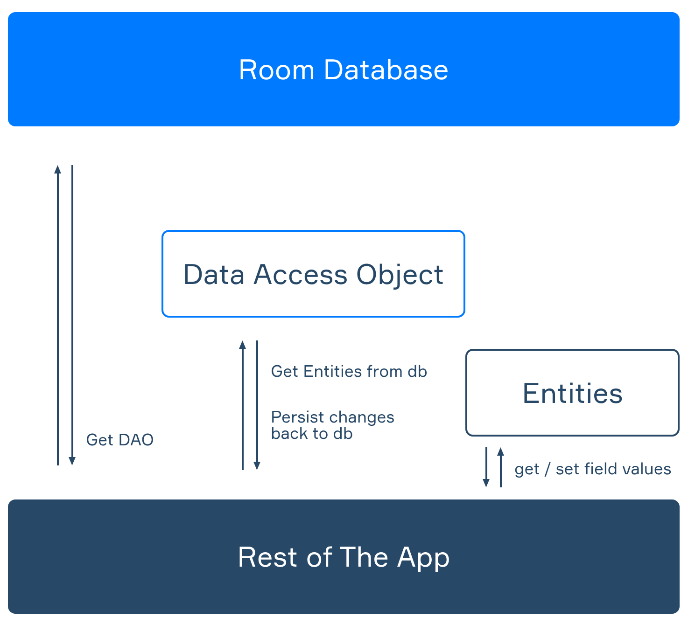

#Room

Bạn đã biết cách làm việc với **SQLite** trong Android bằng cách sử dụng SQLiteOpenHelper. Đây là một cách tiếp cận phổ biến có thể được sử dụng trong mọi tình huống, nhưng đôi khi nó tạo ra rất nhiều mã boilerplate.

Để giải quyết những loại vấn đề này, Google cung cấp một bộ thư viện Jetpack đặc biệt. Chúng được thiết kế để giúp cuộc sống trở nên dễ dàng hơn bằng cách giúp các nhà phát triển thực hiện theo các phương pháp hay nhất, tránh các lỗi khác nhau và đạt được kết quả mong muốn với ít dòng mã hơn.

**Room** là một phần của framework này. Đó là giao diện cấp cao dành cho các liên kết cấp thấp với SQLite.

## Những lợi ích

Room là thư viện **ORM** (Ánh xạ quan hệ đối tượng) dành cho Android.

> [!NOTE]
> ORM là một kỹ thuật lập trình giúp chuyển đổi dữ liệu từ ngôn ngữ OOP sang định dạng được sử dụng bởi relational database và ngược lại. Vì vậy, ORM là liên kết giữa cơ sở dữ liệu và mã. Nó cho phép chúng ta chèn các đối tượng được tạo trong chương trình vào cơ sở dữ liệu, lấy chúng, thực hiện các thao tác với chúng, v.v.

Như đã đề cập, Room giảm số dòng chúng ta cần viết. Nó tạo ra sự trừu tượng hóa trên SQLite để giúp truy cập cơ sở dữ liệu dễ dàng hơn và các chú thích của nó giúp đơn giản hóa mã.

Room cũng thực hiện kiểm tra truy vấn SQL tại thời gian biên dịch. Điều này có thể giúp phát hiện lỗi trước khi khởi chạy ứng dụng. Ví dụ: **không có những kiểm tra này, nếu bạn viết sai tên cột trong truy vấn của mình bằng cách sử dụng SQLite API tiêu chuẩn, bạn sẽ gặp lỗi trong thời gian chạy thay vì thời gian biên dịch.**

## Linh kiện Room



Để sử dụng Room, chúng ta phải triển khai các thành phần `Database`, `Dao` và `Entity`.

## Thực thể

Bước đầu tiên để đạt được mục tiêu của chúng tôi là triển khai `Entity`.
Đây chỉ đơn giản là một lớp phản ánh một bảng cơ sở dữ liệu:

```kotlin
@Entity(tableName = "people")
data class Person(
        @ColumnInfo(name = "name") var name: String,
        @ColumnInfo(name = "age") var age: Int,
        @PrimaryKey(autoGenerate = true) var id: Int = 0
)
```
Chúng tôi gắn thẻ lớp `Person` bằng chú thích `@Entity` của thư viện Room. 
Trong tham số của chú thích, chúng tôi chỉ định tên của bảng `people`. Chúng tôi muốn đặt thuộc tính `id` thành **khóa chính** của bảng và sử dụng chú thích `@PrimaryKey` với `autoGenerate = true` trong các tham số để tự động tăng.
Nếu không, chúng tôi sẽ không có thuộc tính `PRIMARY KEY` được tăng tự động trong cơ sở dữ liệu và chúng tôi biết rằng thuộc tính đó phải là duy nhất.
Chú thích `@ColumnInfo(name = "name")` được sử dụng để chỉ định tên cột nếu chúng ta muốn nó khác với tên thuộc tính. Trong trường hợp của chúng tôi, các tên giống nhau, nghĩa là chúng tôi có thể xóa dòng này. Chú thích `@Ignore` có thể được sử dụng để chỉ ra hàm tạo hoặc thuộc tính không nên được sử dụng khi làm việc với cơ sở dữ liệu.

## Cơ sở dữ liệu

Tiếp theo, chúng tôi tạo một lớp trừu tượng dựa trên `RoomDatabase`. Trong các tham số chú thích, chúng tôi chỉ định phiên bản của cơ sở dữ liệu và các lớp thực thể:

```kotlin
@Database(entities = [Person::class], version = 1)
abstract class AppDatabase : RoomDatabase() {
    abstract fun getPersonDao(): PersonDao
}
```
Nếu chúng ta muốn sử dụng nhiều lớp để lưu trữ dữ liệu, chúng ta sẽ chuyển chúng cách nhau bằng dấu phẩy trong ngoặc vuông.

Các đối tượng `RoomDatabase` rất đắt tiền, vì vậy chúng tôi triển khai quyền truy cập vào chúng thông qua lớp `Application`.
Điều này được biết đến như một design pattern đơn lẻ.

Để đề cập đến đối tượng ứng dụng chịu trách nhiệm về toàn bộ ứng dụng, chúng ta phải chỉ định lớp này trong tệp kê khai:

```xml
<application
        android:name=".YourApplication"
```


Trong `Room.databaseBuilder`, chúng tôi chuyển bối cảnh ứng dụng (`this` vì lớp của chúng tôi kế thừa từ `Application`), chính lớp trừu tượng của chúng tôi và tên của tệp cơ sở dữ liệu SQLite sẽ được tạo:

```kotlin
class SomeApplication : Application() {
    val database: AppDatabase by lazy {
        Room.databaseBuilder(
            this,
            AppDatabase::class.java,
            "database.db"
        ).build()
    }
}
```

> [!CAUTION]
> Điều quan trọng cần biết là Room không cho phép bạn thực hiện các thao tác trong thread chính! Cố gắng thực hiện việc này sẽ dẫn đến lỗi sau: java.lang.IllegalStateException: Không thể truy cập cơ sở dữ liệu trên thread chính vì nó có thể khóa UI trong một thời gian dài.

đối với tình huống thử nghiệm, bạn có thể sử dụng `.allowMainThreadQueries()` mà không cần cảnh báo ở trên.
Ví dụ:

```kotlin
        Room.databaseBuilder(
            this,
            AppDatabase::class.java,
            "database.db"
        ).allowMainThreadQueries().build()
```

Room sẽ tạo mã cần thiết cho chúng tôi nếu chúng tôi làm theo các hướng dẫn cần thiết. Chúng tôi đã tạo hàm `getPersonDao` sẽ trả về `PersonDao`.

##DAO

**DAO** (đối tượng truy cập dữ liệu) chịu trách nhiệm xác định các phương thức cho phép bạn tương tác với cơ sở dữ liệu. Đây là một giao diện và chúng tôi gắn nhãn nó là `@Dao`.

Bên trong, chúng tôi xác định các chức năng khác nhau (CRUD và hơn thế nữa).
Chúng tôi đánh dấu chúng bằng các chú thích tương ứng và Room thực hiện phần còn lại.

Room không cung cấp chú thích tích hợp cho mọi trường hợp sử dụng.
Khi không có chú thích cụ thể.
chúng ta có thể sử dụng `@Query` và chuyển cho nó một truy vấn SQL.

Ví dụ: `deleteAll()` sẽ xóa tất cả dữ liệu trong cơ sở dữ liệu, `getAllPeople()` sẽ trả về mọi bản ghi và `getPeopleWithAge(age: Int)` sẽ trả về người dùng ở một độ tuổi nhất định:

```kotlin
@Dao
interface PersonDao {
    @Insert
    fun insert(vararg people: Person)

    @Delete
    fun delete(person: Person)

    @Query("DELETE FROM people")
    fun deleteAll()

    @Query("SELECT * FROM people")
    fun getAllPeople(): List<Person>

    @Query("SELECT * FROM people WHERE age = :age")
    fun getPeopleWithAge(age: Int): List<Person>

    @Query("SELECT * FROM people WHERE name LIKE :prefix || '%'")
    fun getPeopleWhereNameStartsWith(prefix: String): List<Person>

    @Query("SELECT name FROM people")
    fun getNames(): List<String>

    @Query("SELECT name as first, age as second FROM people")
    fun getPairs(): List<StringIntPair>
}
```

`getPairs()` cho biết cách trả về các giá trị của lớp tùy chỉnh `StringIntPair`, có tên trường khớp với bí danh của tên cột mà chúng tôi đã chọn bằng thao tác `SELECT`:

```kotlin
data class StringIntPair(val first: String, var second: Int)
```
Với giao diện đã được xác định, tất cả những gì chúng tôi phải làm bây giờ là đưa phiên bản cơ sở dữ liệu của chúng tôi vào Activity của bạn.


