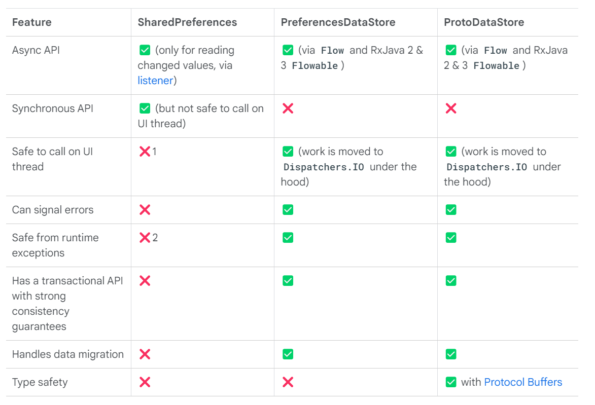

#DataStore

Jetpack `DataStore` là giải pháp lưu trữ dữ liệu cho phép bạn **lưu trữ các cặp khóa-giá trị hoặc đối tượng được nhập** bằng bộ đệm protocol.

> [!NOTE]
> Bộ đệm protocol là cơ chế trung lập về ngôn ngữ (độc lập với ngôn ngữ), cơ chế mở rộng trung lập về nền tảng để tuần tự hóa dữ liệu có cấu trúc

`DataStore` sử dụng coroutine Kotlin và `Flow` để lưu trữ dữ liệu một cách không đồng bộ, nhất quán và mang tính giao dịch.

> [!TIP]
> Nếu bạn hiện đang sử dụng `SharedPreferences` để lưu trữ dữ liệu, hãy cân nhắc chuyển sang `DataStore`.
> Nếu bạn cần hỗ trợ các tập dữ liệu lớn hoặc phức tạp, cập nhật một phần hoặc tính toàn vẹn tham chiếu, hãy cân nhắc sử dụng `Room` thay vì `DataStore`. 
> `DataStore` lý tưởng cho các tập dữ liệu nhỏ, đơn giản và không hỗ trợ cập nhật một phần hoặc tính toàn vẹn tham chiếu.

## Tùy chọn DataStore và Proto DataStore

`DataStore` cung cấp hai cách triển khai khác nhau:

- **Preferences DataStore** lưu trữ và truy cập dữ liệu bằng khóa. 
Việc triển khai này không yêu cầu lược đồ được xác định trước và nó không cung cấp sự an toàn về kiểu.

- **Proto DataStore** lưu trữ dữ liệu dưới dạng phiên bản của loại dữ liệu tùy chỉnh. 
Việc triển khai này yêu cầu bạn xác định một lược đồ bằng cách sử dụng bộ đệm protocol, nhưng nó cung cấp sự an toàn về kiểu.

## Sử dụng DataStore trong mã đồng bộ

> [!CAUTION]
> Tránh chặn các thread trên quá trình đọc dữ liệu `DataStore` bất cứ khi nào có thể.
> Chặn UI thread có thể gây ra ANR hoặc UI bị giật và việc chặn các thread khác có thể dẫn đến bế tắc.

Một trong những lợi ích chính của `DataStore` là API không đồng bộ, 
nhưng không phải lúc nào cũng khả thi khi thay đổi mã xung quanh của bạn thành không đồng bộ.

Nếu bạn thực sự cần mã đồng bộ để đọc dữ liệu:

- Giới hạn phạm vi của nó ở coroutine lifecycle gần nhất, nếu không quản lý nó theo cách thủ công lifecycle.
- Bạn có thể sử dụng `runBlocking()` để đọc dữ liệu đồng bộ từ DataStore (không khuyến nghị, Vì việc thực hiện các thao tác I/O đồng bộ trên UI thread có thể gây ra ANR hoặc UI bị giật)

### Ma trận đặc trưng

## Thẩm quyền giải quyết

- [Kho dữ liệu](https://developer.android.com/topic/libraries/architecture/datastore)
- [Lớp học lập trình](https://developer.android.com/codelabs/android-preferences-datastore)

