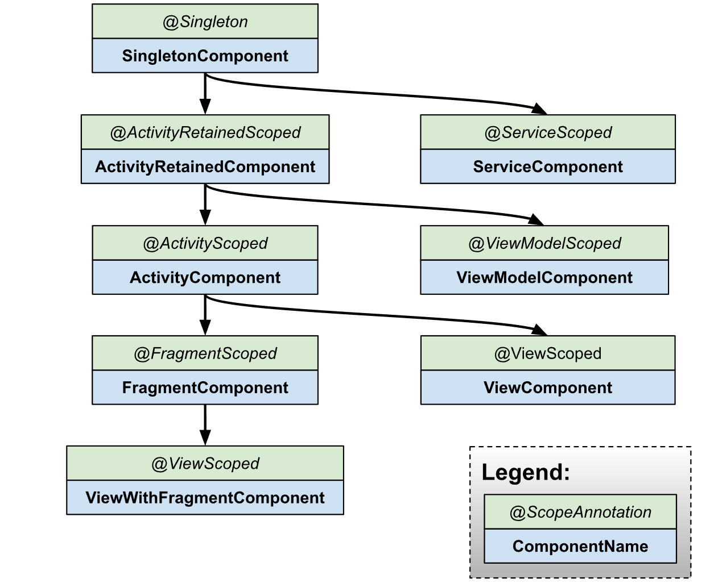

#Hilt

Hilt là thư viện dependency injection dành cho Android giúp giảm boilerplate khi thực hiện dependency injection thủ công trong dự án của bạn.

## Lớp ứng dụng Hilt

Tất cả các ứng dụng sử dụng Hilt phải chứa lớp Ứng dụng được chú thích bằng `@HiltAndroidApp`.

`@HiltAndroidApp` kích hoạt quá trình tạo mã của Hilt, bao gồm một lớp cơ sở cho ứng dụng của bạn đóng vai trò là vùng chứa phụ thuộc cấp ứng dụng.

Thành phần Hilt được tạo này được gắn vào lifecycle của đối tượng Ứng dụng và cung cấp các phần phụ thuộc cho nó. Ngoài ra, nó là thành phần chính của ứng dụng, có nghĩa là các thành phần khác có thể truy cập vào các phần phụ thuộc mà nó cung cấp.

## Đưa phần phụ thuộc vào các lớp Android

Sau khi Hilt được thiết lập trong lớp `Application` của bạn và có sẵn thành phần cấp ứng dụng, Hilt có thể cung cấp các phần phụ thuộc cho các lớp Android khác có chú thích `@AndroidEntryPoint`:

```kotlin
@AndroidEntryPoint
class ExampleActivity : AppCompatActivity() { ... }
```

Hilt hiện hỗ trợ các lớp Android sau:

- Ứng dụng (bằng cách sử dụng `@HiltAndroidApp`)
- ViewModel (bằng cách sử dụng `@HiltViewModel`)
- Activity
- Fragment
- View
- Dịch vụ
- BroadcastReceiver


> [!NOTE]
> Nếu bạn chú thích một lớp Android bằng `@AndroidEntryPoint` thì bạn cũng phải chú thích các lớp Android phụ thuộc vào nó. Ví dụ: nếu bạn chú thích một đoạn thì bạn cũng phải chú thích bất kỳ hoạt động nào mà bạn sử dụng đoạn đó.

> [!WARNING]
> Các ngoại lệ sau đây áp dụng cho việc hỗ trợ Hilt cho các lớp Android:
> Hilt chỉ hỗ trợ các hoạt động mở rộng `ComponentActivity`, chẳng hạn như `AppCompatActivity`.
> Hilt chỉ hỗ trợ các đoạn mở rộng `androidx.Fragment`.


`@AndroidEntryPoint` tạo thành phần Hilt riêng lẻ cho từng lớp Android trong dự án của bạn.

Các thành phần này có thể nhận phần phụ thuộc từ các lớp cha tương ứng của chúng như được mô tả trong **Phân cấp thành phần**.


Để có được các phần phụ thuộc từ một thành phần, hãy sử dụng chú thích `@Inject` để thực hiện field injection:

```kotlin
@AndroidEntryPoint
class ExampleActivity : AppCompatActivity() {

  @Inject lateinit var analytics: AnalyticsAdapter
  ...
}
```

> [!NOTE]
> Các lớp mà Hilt chèn vào có thể có các lớp cơ sở khác cũng sử dụng tính năng chèn. Các lớp đó không cần chú thích `@AndroidEntryPoint` nếu chúng là lớp trừu tượng.


## Xác định các ràng buộc Hilt

Một ràng buộc chứa thông tin cần thiết để cung cấp các thể hiện của một loại dưới dạng phụ thuộc.

Một cách để cung cấp thông tin ràng buộc cho Hilt là **constructor injection**. 
Sử dụng chú thích `@Inject` trên hàm tạo của một lớp để cho Hilt biết cách cung cấp các phiên bản của lớp đó:

```kotlin
class AnalyticsAdapter @Inject constructor(
  private val service: AnalyticsService
) { ... }
```

Các tham số của hàm tạo có chú thích của một lớp là các phần phụ thuộc của lớp đó. 
Trong ví dụ, `AnalyticsAdapter` có `AnalyticsService` làm phần phụ thuộc. 
Do đó, Hilt cũng phải biết cách cung cấp các phiên bản của `AnalyticsService`.

Tại thời điểm xây dựng, Hilt tạo các thành phần Dagger cho các lớp Android. 
Sau đó, Dagger duyệt qua mã của bạn và thực hiện các bước sau:

- Xây dựng và xác nhận các biểu đồ phụ thuộc, đảm bảo không có phụ thuộc nào không thỏa mãn và không có chu kỳ phụ thuộc.
- Tạo các lớp mà nó sử dụng tại runtime để tạo các đối tượng thực tế và các phần phụ thuộc của chúng.

## Mô-đun Hilt

### 1. Lý do sử dụng

Đôi khi một kiểu không thể được thêm vào hàm tạo. Điều này có thể xảy ra vì nhiều lý do. 

Ví dụ: bạn không thể đưa vào hàm tạo một giao diện. Bạn cũng không thể đưa vào hàm tạo một kiểu mà bạn không sở hữu, chẳng hạn như một lớp từ thư viện bên ngoài. 

Trong những trường hợp này, bạn có thể cung cấp cho Hilt thông tin ràng buộc bằng cách sử dụng các mô-đun Hilt.

### 2. Tích hợp

Mô-đun Hilt là lớp được chú thích bằng `@Module`.
Nó thông báo cho Hilt cách cung cấp các phiên bản của một số loại nhất định.
bạn phải chú thích các mô-đun Hilt bằng `@InstallIn` để cho Hilt biết mỗi mô-đun sẽ được sử dụng hoặc cài đặt trong lớp Android nào.

### Chèn các phiên bản giao diện bằng @Binds
 
Hãy xem xét ví dụ `AnalyticsService`. Nếu `AnalyticsService` là một giao diện thì bạn không thể đưa nó vào hàm tạo. 
Thay vào đó, hãy cung cấp cho Hilt thông tin liên kết bằng cách tạo một hàm trừu tượng được chú thích bằng `@Binds` bên trong mô-đun Hilt.

Chú thích `@Binds` cho Hilt biết triển khai nào sẽ sử dụng khi cần cung cấp một phiên bản của giao diện.

```kotlin
interface AnalyticsService {
  fun analyticsMethods()
}

// Constructor-injected, because Hilt needs to know how to
// provide instances of AnalyticsServiceImpl, too.
class AnalyticsServiceImpl @Inject constructor(
  ...
) : AnalyticsService { ... }

@Module
@InstallIn(ActivityComponent::class)
abstract class AnalyticsModule {

  @Binds
  abstract fun bindAnalyticsService(
    analyticsServiceImpl: AnalyticsServiceImpl
  ): AnalyticsService
}
```

Hàm chú thích cung cấp thông tin sau cho Hilt:

- Kiểu trả về của hàm cho Hilt biết hàm cung cấp các phiên bản của giao diện nào.
- Tham số chức năng cho Hilt biết cần cung cấp triển khai nào.

Mô-đun Hilt AnalyticsModule được chú thích bằng `@InstallIn(ActivityComponent.class)` vì bạn muốn Hilt đưa phần phụ thuộc đó vào `ExampleActivity`. Chú thích này có nghĩa là tất cả các phần phụ thuộc trong `AnalyticsModule` đều có sẵn trong tất cả hoạt động của ứng dụng.

### Chèn phiên bản bằng @Provides

Constructor injection cũng không thể thực hiện được nếu bạn không sở hữu lớp học vì nó đến từ thư viện bên ngoài 
(các lớp như cơ sở dữ liệu `Retrofit`, `OkHttpClient` hoặc `Room`) hoặc nếu các phiên bản phải được tạo bằng builder pattern.

Hãy xem xét ví dụ trước. 
Nếu bạn không trực tiếp sở hữu lớp `AnalyticsService`, 
bạn có thể cho Hilt biết cách cung cấp các phiên bản thuộc loại này bằng cách tạo một hàm bên trong mô-đun Hilt và chú thích hàm đó bằng `@Provides`.

Hàm chú thích cung cấp thông tin sau cho Hilt:

- Kiểu trả về của hàm cho Hilt biết hàm cung cấp phiên bản của loại nào.
- Các tham số hàm cho Hilt biết các phụ thuộc của loại tương ứng.
- Phần thân hàm cho Hilt biết cách cung cấp một phiên bản của loại tương ứng. Hilt thực thi phần thân hàm mỗi khi nó cần cung cấp một phiên bản của loại đó.

Ví dụ:
```kotlin
@Module
@InstallIn(ActivityComponent::class)
object AnalyticsModule {

  @Provides
  fun provideAnalyticsService(
    // Potential dependencies of this type
  ): AnalyticsService {
      return Retrofit.Builder()
               .baseUrl("https://example.com")
               .build()
               .create(AnalyticsService::class.java)
  }
}
```

### Cung cấp nhiều ràng buộc cho cùng một loại

Trong trường hợp bạn cần Hilt để cung cấp các triển khai khác nhau cùng loại làm phần phụ thuộc, bạn phải cung cấp cho Hilt nhiều liên kết. 
Bạn có thể xác định nhiều ràng buộc cho cùng một loại bằng bộ hạn định.


Vòng loại là chú thích mà bạn sử dụng để xác định ràng buộc cụ thể cho một loại khi loại đó có nhiều ràng buộc được xác định.

```kotlin
@Qualifier
@Retention(AnnotationRetention.BINARY)
annotation class AuthInterceptorOkHttpClient

@Qualifier
@Retention(AnnotationRetention.BINARY)
annotation class OtherInterceptorOkHttpClient
```


Sau đó, Hilt cần biết cách cung cấp một phiên bản của loại tương ứng với từng vòng loại. 
Trong trường hợp này, bạn có thể sử dụng mô-đun Hilt với `@Provides`. 
Cả hai phương thức đều có cùng kiểu trả về, nhưng bộ hạn định gắn nhãn chúng là hai liên kết khác nhau:


```kotlin
@Module
@InstallIn(SingletonComponent::class)
object NetworkModule {

  @AuthInterceptorOkHttpClient
  @Provides
  fun provideAuthInterceptorOkHttpClient(
    authInterceptor: AuthInterceptor
  ): OkHttpClient {
      return OkHttpClient.Builder()
               .addInterceptor(authInterceptor)
               .build()
  }

  @OtherInterceptorOkHttpClient
  @Provides
  fun provideOtherInterceptorOkHttpClient(
    otherInterceptor: OtherInterceptor
  ): OkHttpClient {
      return OkHttpClient.Builder()
               .addInterceptor(otherInterceptor)
               .build()
  }
}
```

Bạn có thể thêm loại cụ thể mà bạn cần bằng cách chú thích trường hoặc tham số với bộ hạn định tương ứng:

```kotlin
// As a dependency of another class.
@Module
@InstallIn(ActivityComponent::class)
object AnalyticsModule {

  @Provides
  fun provideAnalyticsService(
    @AuthInterceptorOkHttpClient okHttpClient: OkHttpClient
  ): AnalyticsService {
      ....
  }
}

// As a dependency of a constructor-injected class.
class ExampleServiceImpl @Inject constructor(
  @AuthInterceptorOkHttpClient private val okHttpClient: OkHttpClient
) : ...

// At field injection.
@AndroidEntryPoint
class ExampleActivity: AppCompatActivity() {

  @AuthInterceptorOkHttpClient
  @Inject lateinit var okHttpClient: OkHttpClient
}
```
### Vòng loại được xác định trước trong Hilt

Hilt cung cấp một số vòng loại được xác định trước. 
Ví dụ: vì bạn có thể cần lớp Ngữ cảnh từ ứng dụng hoặc hoạt động, Hilt cung cấp các bộ hạn định `@ApplicationContext` và `@ActivityContext`.

## Các thành phần được tạo cho các lớp Android

Đối với mỗi lớp Android mà bạn có thể thực hiện field injection, sẽ có một thành phần Hilt được liên kết mà bạn có thể tham khảo trong chú thích `@InstallIn`. 
Mỗi thành phần Hilt chịu trách nhiệm đưa các liên kết của nó vào lớp Android tương ứng.


| Thành phần Hilt | Đầu phun cho |
|-------------------------------|---------------------------------------------|
| SingletonComponent | Ứng dụng |
| ActivityRetainedComponent | Không áp dụng |
| ViewModelComponent | ViewModel |
| ActivityComponent | Activity |
| FragmentComponent | Fragment |
| ViewComponent | View |
| ViewWithFragmentComponent | View được chú thích bằng @WithFragmentBindings |
| ServiceComponent | Dịch vụ |


> [!NOTE]
> Hilt không tạo thành phần cho bộ thu phát sóng vì Hilt đưa bộ thu phát sóng trực tiếp từ SingletonComponent.

### Tuổi thọ của linh kiện

Hilt tự động tạo và hủy các phiên bản của các lớp thành phần được tạo theo lifecycle của các lớp Android tương ứng.


| Thành phần được tạo | Được tạo tại | Bị phá hủy tại |
|------------------------------|------------------------------------------|--------------|
| SingletonComponent | Ứng dụng#onCreate() | Ứng dụng bị phá hủy |
| ActivityRetainedComponent | Activity#onCreate() | Activity#onDestroy() |
| ViewModelComponent | ViewModel được tạo | ViewModel bị phá hủy |
| ActivityComponent | Activity#onCreate() | Activity#onDestroy() |
| FragmentComponent | Fragment#onAttach() | Fragment#onDestroy() |
| ViewComponent | View#super() | View bị phá hủy |
| ViewWithFragmentComponent | View#super() | View bị phá hủy |
| ServiceComponent | Dịch vụ#onCreate() | Dịch vụ#onDestroy() |

> [!NOTE]
> ActivityRetainedComponent tồn tại nhờ các thay đổi về cấu hình, do đó, nó được tạo ở `Activity#onCreate()` đầu tiên và bị hủy ở `Activity#onDestroy()` cuối cùng.

## Phạm vi thành phần

Theo mặc định, tất cả các liên kết trong Hilt đều không có phạm vi. 
Điều này có nghĩa là mỗi khi ứng dụng của bạn yêu cầu liên kết, Hilt sẽ tạo một phiên bản mới của loại cần thiết.

Tuy nhiên, Hilt cũng cho phép liên kết trong phạm vi một thành phần cụ thể. 

**Hilt chỉ tạo một liên kết có phạm vi một lần cho mỗi phiên bản của thành phần mà liên kết đó có phạm vi và tất cả các yêu cầu cho liên kết đó đều có chung một phiên bản.**


| Lớp Android | Thành phần được tạo | Phạm vi |
|-----------------------------------||---------------------------------------|--------------------------|
| Ứng dụng | SingletonComponent | @Singleton |
| Activity | ActivityRetainedComponent | @ActivityRetainedScoped |
| ViewModel | ViewModelComponent | @ViewModelScoped |
| Activity | ActivityComponent | @ActivityScoped |
| Fragment | FragmentComponent | @FragmentScoped |
| View | ViewComponent | @ViewScoped |
| View được chú thích bằng @WithFragmentBindings | ViewWithFragmentComponent | @ViewScoped |
| Dịch vụ | ServiceComponent | @ServiceScoped |


> [!WARNING]
> Việc sử dụng phạm vi cho một phần phụ thuộc (chẳng hạn như `@Singleton` hoặc `@ActivityRetainedScoped`) có thể sử dụng nhiều bộ nhớ hơn vì đối tượng sẽ ở trong bộ nhớ cho đến khi thành phần của nó bị hủy. 
> Bạn nên tránh sử dụng phạm vi trừ khi cần thiết.
> Chỉ sử dụng các liên kết có phạm vi khi:
> - Đối tượng có trạng thái bên trong cần được sử dụng lại trong một phạm vi nhất định.
> - Đối tượng cần được chia sẻ và đồng bộ ở nhiều nơi khác nhau.
> - Đối tượng đắt tiền hoặc tạo ra chậm.

## Phân cấp thành phần

Việc cài đặt một mô-đun vào một thành phần cho phép các liên kết của nó được truy cập dưới dạng phần phụ thuộc của các liên kết khác trong thành phần đó hoặc trong bất kỳ thành phần con nào bên dưới nó trong hệ thống phân cấp thành phần:



## Chèn phần phụ thuộc vào các lớp không được Hilt hỗ trợ

Hilt hỗ trợ các lớp Android phổ biến nhất. 
Tuy nhiên, bạn có thể cần thực hiện field injection trong các lớp mà Hilt không hỗ trợ.

Ví dụ: Hilt không hỗ trợ trực tiếp các nhà cung cấp nội dung. 
Nếu bạn muốn content provider sử dụng Hilt để nhận một số phần phụ thuộc, bạn cần xác định một giao diện được chú thích bằng `@EntryPoint` cho từng loại liên kết mà bạn muốn và bao gồm các vòng loại.
Sau đó thêm `@InstallIn` để chỉ định thành phần cần cài đặt điểm vào như sau:


```kotlin
class ExampleContentProvider : ContentProvider() {

  @EntryPoint
  @InstallIn(SingletonComponent::class)
  interface ExampleContentProviderEntryPoint {
    fun analyticsService(): AnalyticsService
  }

  ...
}
```


Để truy cập điểm vào, hãy sử dụng phương thức tĩnh thích hợp từ `EntryPointAccessors`

```kotlin
class ExampleContentProvider: ContentProvider() {
    ...

  override fun query(...): Cursor {
    val appContext = context?.applicationContext ?: throw IllegalStateException()
    val hiltEntryPoint =
      EntryPointAccessors.fromApplication(appContext, ExampleContentProviderEntryPoint::class.java)

    val analyticsService = hiltEntryPoint.analyticsService()
    ...
  }
}
```

## Hilt và Dao găm

Vì hệ điều hành Android khởi tạo nhiều lớp framework của riêng nó nên việc sử dụng Dagger trong ứng dụng Android yêu cầu bạn phải viết một lượng đáng kể boilerplate.

Hilt giảm mã boilerplate liên quan đến việc sử dụng Dagger trong ứng dụng Android. 

Hilt tự động tạo và cung cấp những thông tin sau:

- **Các thành phần để tích hợp các lớp Android framework** với Dagger mà nếu không bạn sẽ cần phải tạo thủ công.
- **Chú thích phạm vi** để sử dụng với các thành phần mà Hilt tạo tự động.
- **Các liên kết được xác định trước** để thể hiện các lớp Android như `Application` hoặc `Activity`.
- **Bộ hạn định được xác định trước** để đại diện cho `@ApplicationContext` và `@ActivityContext`.


