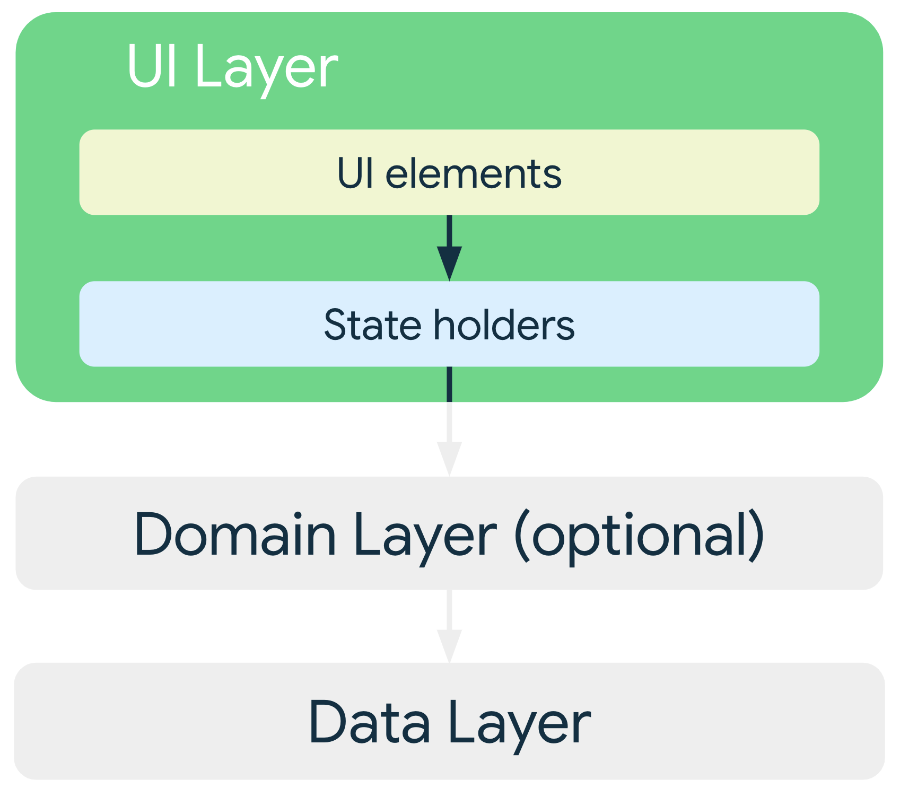
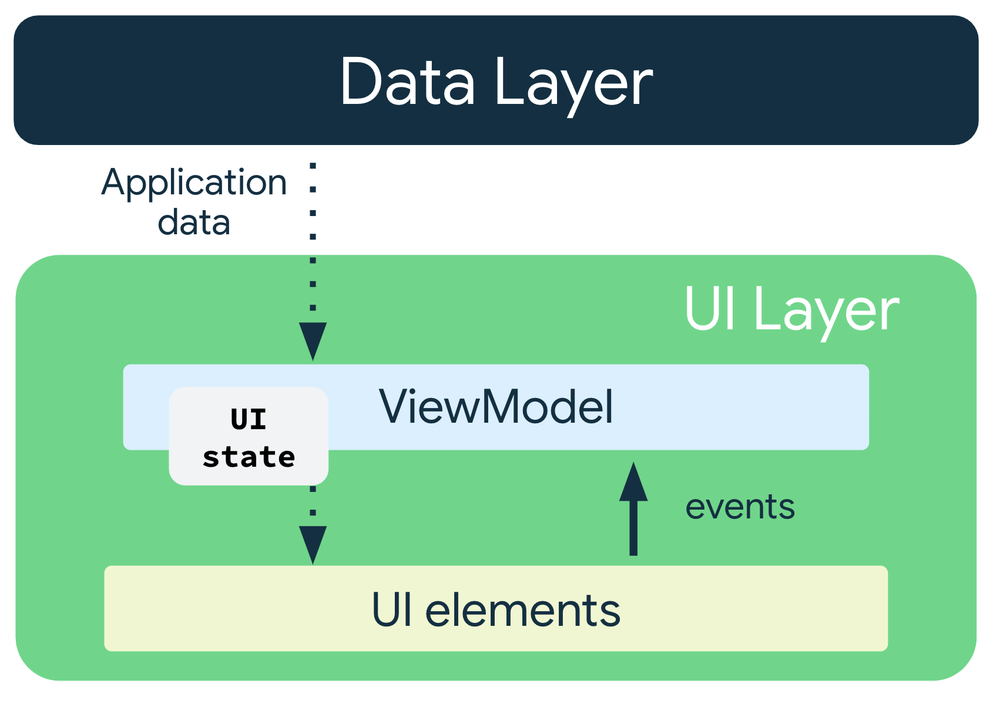

Lớp # UI

Vai trò của lớp UI (hoặc lớp trình bày) là hiển thị dữ liệu ứng dụng trên màn hình. Thuật ngữ UI đề cập đến các phần tử UI chẳng hạn như các hoạt động và phân đoạn hiển thị dữ liệu, không phụ thuộc vào loại API mà chúng sử dụng để thực hiện việc này (Chế độ xem hoặc Jetpack Compose).

Bất cứ khi nào dữ liệu thay đổi, do tương tác của người dùng (chẳng hạn như nhấn nút) hoặc đầu vào bên ngoài (chẳng hạn như network response), UI sẽ cập nhật để phản ánh các thay đổi.

Lớp UI được tạo thành từ hai thứ:
- Phần tử UI hiển thị dữ liệu trên màn hình. Bạn xây dựng các phần tử này bằng cách sử dụng Chế độ xem hoặc hàm Jetpack Compose.
- Chủ sở hữu trạng thái (chẳng hạn như các lớp `ViewModel`) lưu giữ dữ liệu, hiển thị dữ liệu đó cho UI và xử lý logic.



Lớp UI phải thực hiện các bước sau:
- Sử dụng dữ liệu ứng dụng và chuyển đổi thành dữ liệu mà UI có thể dễ dàng hiển thị.
- Sử dụng dữ liệu UI-có thể hiển thị và chuyển đổi nó thành các phần tử UI để trình bày cho người dùng.
- Sử dụng các sự kiện đầu vào của người dùng từ các phần tử UI đã được tập hợp đó và phản ánh tác động của chúng trong dữ liệu UI nếu cần.
- Lặp lại các bước từ 1 đến 3 trong thời gian cần thiết.

## Xác định trạng thái UI

UI là những gì người dùng nhìn thấy, trạng thái UI là những gì ứng dụng cho biết họ nên thấy


Hãy xem xét nghiên cứu trường hợp; để đáp ứng các yêu cầu của ứng dụng Tin tức,
thông tin cần thiết để hiển thị đầy đủ UI có thể được gói gọn trong `NewsUiState` data class được xác định như sau:

```kotlin
data class NewsUiState(
    val isSignedIn: Boolean = false,
    val isPremium: Boolean = false,
    val newsItems: List<NewsItemUiState> = listOf(),
    val userMessages: List<Message> = listOf()
)

data class NewsItemUiState(
    val title: String,
    val body: String,
    val bookmarked: Boolean = false,
    ...
)
```

## Tính bất biến

Trạng thái Immutable UI đảm bảo tính nhất quán bằng cách cung cấp single source of truth bất kỳ lúc nào. 
UI chỉ nên đọc và hiển thị trạng thái, không sửa đổi trạng thái đó trừ khi đó là nguồn dữ liệu duy nhất. 
Việc sửa đổi trạng thái trực tiếp trong UI có thể gây ra sự không nhất quán và lỗi.
Việc sử dụng các lớp dữ liệu immutable giúp ngăn chặn những vấn đề như vậy bằng cách tránh nhiều nguồn thông tin xác thực.

> [!TIP]
> Chỉ các nguồn hoặc chủ sở hữu dữ liệu mới chịu trách nhiệm cập nhật dữ liệu mà họ tiết lộ.

### Quy ước đặt tên trong hướng dẫn này

Quy ước như sau:

`functionality + UiState`.

Ví dụ: trạng thái của màn hình hiển thị tin tức có thể được gọi là `NewsUiState`,
và trạng thái của một mục tin tức trong danh sách các mục tin tức có thể là `NewsItemUiState`.

## Quản lý trạng thái với Unidirectional Data Flow

Thay vì xử lý trực tiếp những thay đổi này trong UI, người hòa giải nên tương tác với process, áp dụng logic và cập nhật nguồn dữ liệu tương ứng.

Đây là lúc Unidirectional Data Flow (UDF) xuất hiện—một architectural pattern thực thi một cách tiếp cận có cấu trúc để quản lý các thay đổi trạng thái trong khi vẫn giữ UI tập trung vào trách nhiệm cốt lõi của nó.

### Chủ sở hữu nhà nước

Các lớp chịu trách nhiệm tạo ra trạng thái UI và chứa logic cần thiết cho nhiệm vụ đó được gọi là chủ sở hữu trạng thái.

cách triển khai điển hình là một phiên bản của `ViewModel`,
Nó cung cấp quyền truy cập vào data layer, xử lý các sự kiện UI và tạo các trạng thái cập nhật.
Ngoài ra, nó còn tồn tại sau những thay đổi về cấu hình, đảm bảo tính bền vững của dữ liệu trong các sự kiện như xoay màn hình.

Sự tương tác giữa UI và lớp `ViewModel` của nó phần lớn có thể được hiểu là **đầu vào sự kiện** và **đầu ra trạng thái** tiếp theo của nó, mối quan hệ có thể được biểu diễn như trong sơ đồ sau:



Mẫu trong đó trạng thái giảm xuống và các sự kiện tăng lên được gọi là unidirectional data flow (UDF). 
Ý nghĩa của mẫu này đối với kiến ​​trúc ứng dụng như sau:

- `ViewModel` giữ và hiển thị trạng thái được `UI` sử dụng. Trạng thái `UI` là dữ liệu ứng dụng được chuyển đổi bởi `ViewModel`.
- `UI` thông báo cho `ViewModel` về các sự kiện của người dùng.
- `ViewModel` xử lý các hành động của người dùng và cập nhật trạng thái.
- Trạng thái cập nhật được đưa trở lại `UI` để hiển thị.
- Điều trên được lặp lại đối với bất kỳ sự kiện nào gây ra đột biến trạng thái.

## Hiển thị trạng thái UI

Vì bạn đang sử dụng UDF để quản lý việc tạo trạng thái nên bạn có thể coi trạng thái được tạo là một luồng.
Do đó, bạn nên hiển thị trạng thái UI trong ngăn chứa dữ liệu có thể quan sát được như LiveData hoặc StateFlow.
Lý do cho điều này là để UI có thể phản ứng với bất kỳ thay đổi nào được thực hiện ở trạng thái mà không cần phải lấy dữ liệu trực tiếp từ `ViewModel` theo cách thủ công.

```kotlin
class NewsViewModel(
    private val repository: NewsRepository,
    ...
) : ViewModel() {

    private val _uiState = MutableStateFlow(NewsUiState())
    val uiState: StateFlow<NewsUiState> = _uiState.asStateFlow()

    private var fetchJob: Job? = null

    fun fetchArticles(category: String) {
        fetchJob?.cancel()
        fetchJob = viewModelScope.launch {
            try {
                val newsItems = repository.newsItemsForCategory(category)
                _uiState.update {
                    it.copy(newsItems = newsItems)
                }
            } catch (ioe: IOException) {
                // Handle the error and notify the UI when appropriate.
                _uiState.update {
                    val messages = getMessagesFromThrowable(ioe)
                    it.copy(userMessages = messages)
                 }
            }
        }
    }
}
```
### Những cân nhắc bổ sung

Ngoài hướng dẫn trước đó, hãy cân nhắc những điều sau khi hiển thị trạng thái UI:
- Đối tượng trạng thái UI sẽ xử lý các trạng thái có liên quan với nhau. một số logic kinh doanh có thể yêu cầu kết hợp nhiều nguồn.

```kotlin
data class NewsUiState(
    val isSignedIn: Boolean = false,
    val isPremium: Boolean = false,
    val newsItems: List<NewsItemUiState> = listOf()
)

val NewsUiState.canBookmarkNews: Boolean get() = isSignedIn && isPremium
```
Trong khai báo này, khả năng hiển thị của nút đánh dấu là thuộc tính dẫn xuất của hai thuộc tính khác.
- Quyết định hiển thị trạng thái UI dưới dạng một luồng hay nhiều luồng tùy thuộc vào mối quan hệ giữa các mục dữ liệu được phát ra.
  - Luồng đơn, Đảm bảo tính nhất quán và thuận tiện của dữ liệu bằng cách cung cấp trạng thái UI mới nhất bất kỳ lúc nào. Người tiêu dùng luôn nhận được trạng thái đầy đủ và cập nhật.
  - Nhiều luồng
    - **Các loại dữ liệu không liên quan**, Nếu một số trạng thái UI hoàn toàn độc lập thì việc gộp chúng lại với nhau có thể không hiệu quả.
    - **Khác biệt trạng thái UI**, Càng có nhiều trường trong đối tượng `UiState` thì luồng đó càng có nhiều khả năng phát ra do một trong các trường của nó được cập nhật. Bởi vì các chế độ xem không có cơ chế khác biệt để hiểu liệu các lần phát xạ liên tiếp là khác nhau hay giống nhau nên mỗi lần phát xạ đều gây ra một bản cập nhật cho chế độ xem. Điều này có nghĩa là việc giảm thiểu bằng cách sử dụng API Flow hoặc các phương pháp như `distinctUntilChanged()` trên `LiveData` có thể cần thiết.

## Tiêu thụ trạng thái UI

Khi sử dụng chủ sở hữu dữ liệu có thể quan sát trong UI, hãy đảm bảo bạn xem xét lifecycle của UI.
Điều này rất quan trọng vì UI không nên quan sát trạng thái UI khi chế độ xem không được hiển thị cho người dùng

Khi sử dụng `LiveData`, `LifecycleOwner` sẽ ngầm giải quyết các mối lo ngại về lifecycle. Khi sử dụng các luồng, tốt nhất bạn nên xử lý vấn đề này bằng coroutine scope và `repeatOnLifecycle` API thích hợp:

```kotlin
class NewsActivity : AppCompatActivity() {

    private val viewModel: NewsViewModel by viewModels()

    override fun onCreate(savedInstanceState: Bundle?) {
        ...

        lifecycleScope.launch {
            repeatOnLifecycle(Lifecycle.State.STARTED) {
                viewModel.uiState.collect {
                    // Update UI elements
                }
            }
        }
    }
}
```
### Hiển thị các hoạt động đang diễn ra

```kotlin
data class NewsUiState(
    val isFetchingArticles: Boolean = false,
    ...
)
```

```kotlin
class NewsActivity : AppCompatActivity() {

    private val viewModel: NewsViewModel by viewModels()

    override fun onCreate(savedInstanceState: Bundle?) {
        ...

        lifecycleScope.launch {
            repeatOnLifecycle(Lifecycle.State.STARTED) {
                // Bind the visibility of the progressBar to the state
                // of isFetchingArticles.
                viewModel.uiState
                    .map { it.isFetchingArticles }
                    .distinctUntilChanged()
                    .collect { progressBar.isVisible = it }
            }
        }
    }
}
```


