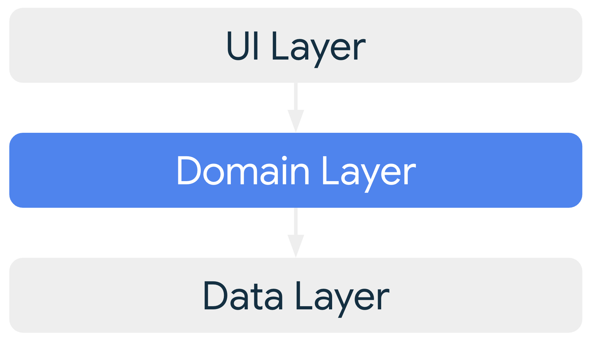
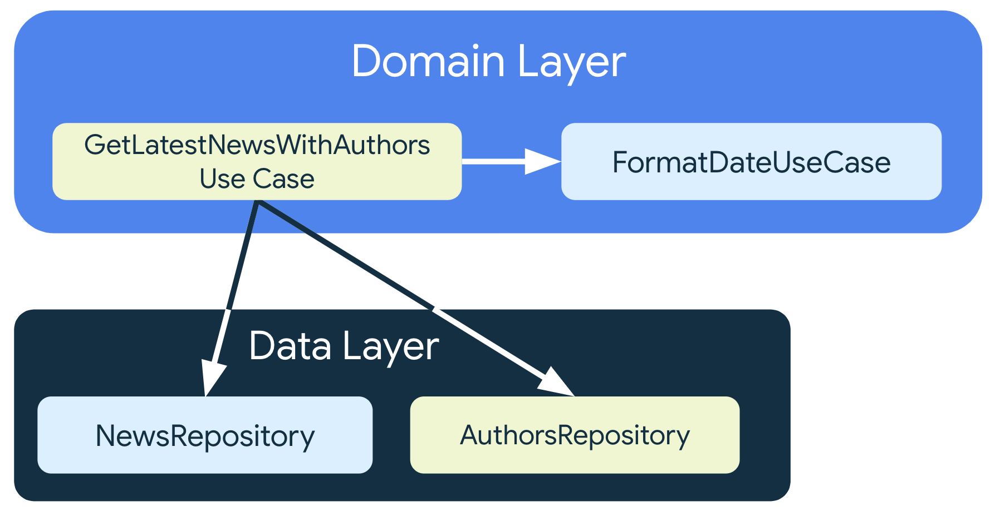

#Domain layer

domain layer chịu trách nhiệm đóng gói logic nghiệp vụ phức tạp hoặc logic nghiệp vụ đơn giản được nhiều `ViewModels` sử dụng lại.
Lớp này là tùy chọn vì không phải tất cả ứng dụng đều có những yêu cầu này.
Bạn chỉ nên sử dụng khi cần thiết



Các lớp trong lớp này thường được gọi là **trường hợp sử dụng** hoặc **người tương tác**. **Mỗi trường hợp sử dụng phải chịu trách nhiệm về một chức năng duy nhất**.


domain layer cung cấp các lợi ích sau:

- Nó tránh trùng lặp mã.
- Nó cải thiện khả năng đọc trong các lớp sử dụng lớp domain layer.
- Nó cải thiện khả năng kiểm tra của ứng dụng.
- Nó tránh các lớp học đông người bằng cách cho phép bạn phân chia trách nhiệm.

## Quy ước đặt tên trong hướng dẫn này

Quy ước như sau:

`verb in present tense + noun/what (optional) + UseCase`

## Sự phụ thuộc

Trong kiến ​​trúc ứng dụng điển hình, các lớp trường hợp sử dụng phù hợp giữa `ViewModels` từ lớp `UI` và `Repositories` từ lớp `Data`.
Điều này có nghĩa là các lớp ca sử dụng thường phụ thuộc vào các lớp `Repository` và chúng giao tiếp với lớp `UI` giống như cách `Repositories` thực hiện

```kotlin
class GetLatestNewsWithAuthorsUseCase(
  private val newsRepository: NewsRepository,
  private val authorsRepository: AuthorsRepository
) { /* ... */ }
```

Bởi vì các trường hợp sử dụng chứa logic có thể tái sử dụng nên chúng cũng có thể được sử dụng bởi các trường hợp sử dụng khác. Việc có nhiều cấp độ sử dụng trong domain layer là điều bình thường. 

```kotlin
class GetLatestNewsWithAuthorsUseCase(
  private val newsRepository: NewsRepository,
  private val authorsRepository: AuthorsRepository,
  private val formatDateUseCase: FormatDateUseCase
) { /* ... */ }
```



## Các trường hợp sử dụng cuộc gọi trong Kotlin

Trong Kotlin, bạn có thể làm cho các thể hiện của lớp trường hợp sử dụng có thể gọi được dưới dạng hàm bằng cách xác định hàm `invoke()` bằng công cụ sửa đổi `operator`. Xem ví dụ sau:

```kotlin
class FormatDateUseCase(userRepository: UserRepository) {

    private val formatter = SimpleDateFormat(
        userRepository.getPreferredDateFormat(),
        userRepository.getPreferredLocale()
    )

    operator fun invoke(date: Date): String {
        return formatter.format(date)
    }
}
```

Bạn cũng có thể quá tải `invoke()` với các chữ ký khác nhau trong lớp của mình. Bạn sẽ gọi trường hợp sử dụng từ ví dụ trên như sau:

```kotlin
class MyViewModel(formatDateUseCase: FormatDateUseCase) : ViewModel() {
    init {
        val today = Calendar.getInstance()
        val todaysDate = formatDateUseCase(today)
        /* ... */
    }
}
```

##Lifecycle

Các trường hợp sử dụng không có lifecycle riêng. Thay vào đó, chúng nằm trong phạm vi lớp sử dụng chúng.
Điều này có nghĩa là bạn có thể gọi các trường hợp sử dụng từ các lớp trong lớp UI, từ các dịch vụ hoặc từ chính lớp Ứng dụng.
Vì các trường hợp sử dụng không được chứa dữ liệu mutable nên bạn nên tạo một phiên bản mới của lớp trường hợp sử dụng mỗi khi bạn chuyển nó dưới dạng phần phụ thuộc.

## Luồng

Các trường hợp sử dụng từ domain layer phải an toàn để gọi từ thread chính.
Nếu các lớp ca sử dụng thực hiện các hoạt động chặn trong thời gian dài, chúng chịu trách nhiệm di chuyển logic đó sang thread thích hợp.

Ví dụ sau đây cho thấy một trường hợp sử dụng thực hiện công việc của nó trên nền thread:

```kotlin
class GetLatestNewsWithAuthorsUseCase(
  private val newsRepository: NewsRepository,
  private val authorsRepository: AuthorsRepository,
  private val defaultDispatcher: CoroutineDispatcher = Dispatchers.Default
) {
    suspend operator fun invoke(): List<ArticleWithAuthor> =
        withContext(defaultDispatcher) {
            val news = newsRepository.fetchLatestNews()
            val result: MutableList<ArticleWithAuthor> = mutableListOf()
            // This is not parallelized, the use case is linearly slow.
            for (article in news) {
                // The repository exposes suspend functions
                val author = authorsRepository.getAuthor(article.authorId)
                result.add(ArticleWithAuthor(article, author))
            }
            result
        }
}
```

## Nhiệm vụ chung

- **Logic nghiệp vụ đơn giản có thể tái sử dụng**, Bạn nên gói gọn logic nghiệp vụ có thể lặp lại có trong lớp UI trong một lớp ca sử dụng. Điều này giúp dễ dàng áp dụng mọi thay đổi ở mọi nơi sử dụng logic. Nó cũng cho phép bạn kiểm tra logic một cách riêng biệt.

- **Kết hợp các kho lưu trữ**
- **Người dùng khác**, Ngoài lớp UI, domain layer có thể được sử dụng lại bởi các lớp khác như `Services` và lớp `Application`. Hơn nữa, nếu các nền tảng khác như TV hoặc Wear chia sẻ cơ sở mã với ứng dụng di động thì lớp UI của họ cũng có thể sử dụng lại các trường hợp sử dụng để nhận được tất cả các lợi ích nói trên của domain layer.
- **Hạn chế truy cập Data layer**, Ưu điểm của việc thực hiện hạn chế này là nó ngăn UI của bạn bỏ qua logic domain layer


