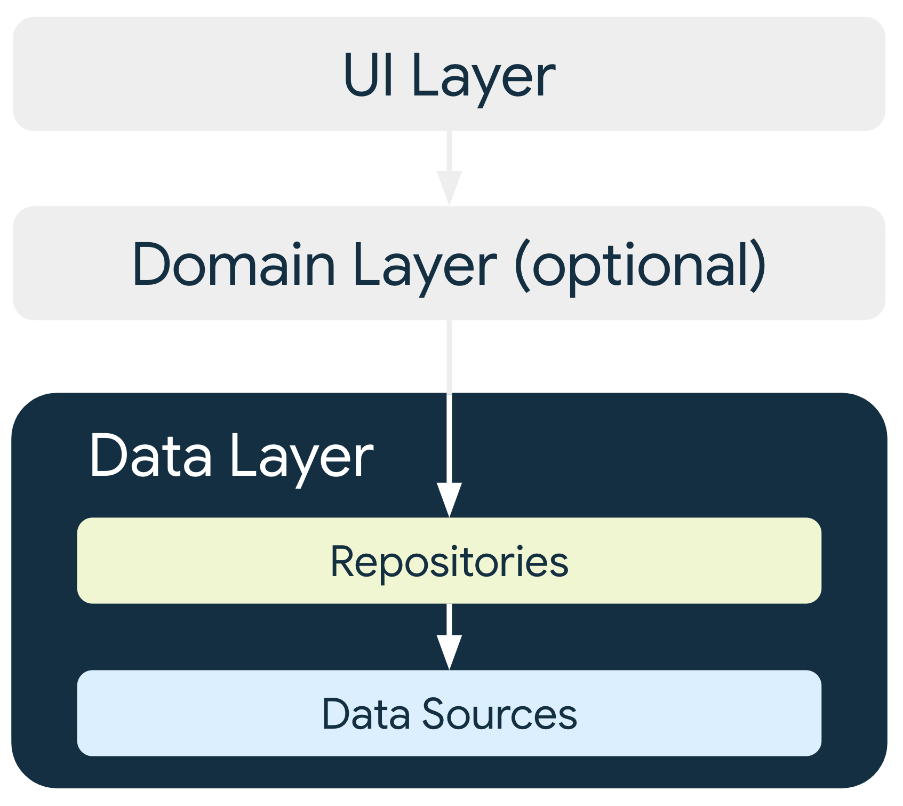
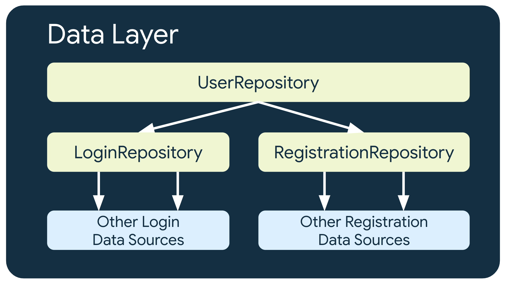

#Data layer

data layer của ứng dụng chứa logic nghiệp vụ.
Logic nghiệp vụ là thứ mang lại giá trị cho ứng dụng của bạn—nó được tạo thành từ các quy tắc xác định cách ứng dụng của bạn tạo, lưu trữ và thay đổi dữ liệu.

data layer được tạo từ các repository mà mỗi kho có thể chứa từ 0 đến nhiều nguồn dữ liệu.
Bạn nên tạo một lớp repository cho từng loại dữ liệu khác nhau mà bạn xử lý trong ứng dụng của mình.
Ví dụ: bạn có thể tạo lớp MoviesRepository cho dữ liệu liên quan đến phim hoặc lớp PaymentsRepository cho dữ liệu liên quan đến thanh toán.



Các lớp Repository chịu trách nhiệm thực hiện các nhiệm vụ sau:

- Hiển thị dữ liệu cho phần còn lại của ứng dụng.
- Tập trung các thay đổi vào dữ liệu.
- Tóm tắt các nguồn dữ liệu từ phần còn lại của ứng dụng.
- Chứa logic nghiệp vụ.


Mỗi lớp nguồn dữ liệu chỉ có trách nhiệm làm việc với một nguồn dữ liệu, có thể là tệp, nguồn mạng hoặc cơ sở dữ liệu cục bộ.
Các lớp nguồn dữ liệu là cầu nối giữa ứng dụng và hệ thống để vận hành dữ liệu.

**Dữ liệu được lớp này hiển thị phải là immutable** để các lớp khác không thể giả mạo dữ liệu, điều này có nguy cơ khiến các giá trị của nó ở trạng thái không nhất quán. 

## Hiển thị API

Các lớp trong data layer thường hiển thị các chức năng để thực hiện các lệnh gọi Tạo, Đọc, Cập nhật và Xóa (CRUD) một lần hoặc để được thông báo về các thay đổi dữ liệu theo thời gian. data layer sẽ hiển thị những thông tin sau cho từng trường hợp sau:

- **Thao tác một lần**: data layer sẽ hiển thị các chức năng tạm dừng trong Kotlin; và đối với Java programming language, data layer sẽ hiển thị các hàm cung cấp callback để thông báo kết quả của thao tác hoặc các loại RxJava Đơn, Có thể hoặc Hoàn thành.

- **Để được thông báo về những thay đổi dữ liệu theo thời gian**: data layer sẽ hiển thị các luồng trong Kotlin; và đối với Java programming language, data layer sẽ hiển thị callback phát ra dữ liệu mới hoặc loại RxJava có thể quan sát hoặc có thể lưu chuyển.

```kotlin
class ExampleRepository(
    private val exampleRemoteDataSource: ExampleRemoteDataSource, // network
    private val exampleLocalDataSource: ExampleLocalDataSource // database
) {

    val data: Flow<Example> = ...

    suspend fun modifyData(example: Example) { ... }
}
```
Nguồn dữ liệu mẫu

```kotlin
class ExampleRemoteDataSource(
    private val exampleApi: ExampleApi,
    private val ioDispatcher: CoroutineDispatcher
) {
    /**
     * Fetches example data from the network.
     */
    suspend fun fetchExampleData(): List<Example> =
        withContext(ioDispatcher) {
            exampleApi.fetchExampleData()
        }
}

// Makes example-related network synchronous requests.
interface ExampleApi {
    fun fetchExampleData(): List<Example>
}
```

> [!TIP]
> Việc dựa vào các interface giúp việc triển khai API có thể hoán đổi được trong ứng dụng của bạn.

## Quy ước đặt tên trong hướng dẫn này

Quy ước như sau:

`type of data + Repository`

Các lớp nguồn dữ liệu được đặt tên theo dữ liệu mà chúng chịu trách nhiệm và nguồn chúng sử dụng. Quy ước như sau:

`type of data + type of source + DataSource`

> [!TIP]
> Không đặt tên nguồn dữ liệu dựa trên chi tiết triển khai. ví dụ: UserSharedPreferencesDataSource—vì các repository sử dụng nguồn dữ liệu đó sẽ không biết cách lưu dữ liệu.
> Nếu tuân theo quy tắc này, bạn có thể thay đổi cách triển khai nguồn dữ liệu (ví dụ: di chuyển từ SharedPreferences sang DataStore) mà không ảnh hưởng đến lớp gọi nguồn đó.

## Nhiều cấp độ repository


Trong một số trường hợp liên quan đến các yêu cầu kinh doanh phức tạp hơn, một repository có thể cần phải phụ thuộc vào các repository khác.
Điều này có thể là do dữ liệu liên quan là sự tổng hợp từ nhiều nguồn dữ liệu hoặc do trách nhiệm cần được gói gọn trong một lớp repository khác.

Ví dụ: repository xử lý dữ liệu xác thực người dùng, `UserRepository`, có thể phụ thuộc vào các repository khác như `LoginRepository` và `RegistrationRepository` để đáp ứng các yêu cầu của nó.



## Nguồn sự thật

Trên thực tế, dữ liệu được hiển thị từ repository phải luôn là dữ liệu đến trực tiếp từ nguồn sự thật.

## Luồng

Việc gọi các nguồn dữ liệu và repository phải an toàn khi gọi từ main thread

##Lifecycle

Nếu trách nhiệm của lớp là quan trọng đối với toàn bộ ứng dụng, bạn có thể giới hạn một phiên bản của lớp đó thành lớp `Application`.
Điều này làm cho phiên bản tuân theo lifecycle của ứng dụng.

Ngoài ra, nếu bạn chỉ cần sử dụng lại phiên bản tương tự trong một luồng cụ thể trong ứng dụng của mình
Ví dụ: luồng đăng ký hoặc đăng nhập—khi đó, bạn nên đưa phiên bản vào phạm vi lớp sở hữu lifecycle của luồng đó.
Ví dụ: bạn có thể xác định phạm vi `RegistrationRepository` chứa dữ liệu trong bộ nhớ tới `RegistrationActivity` hoặc navigation graph của luồng đăng ký.

## Đại diện cho các mô hình kinh doanh

Các mô hình dữ liệu mà bạn muốn hiển thị từ data layer có thể là tập hợp con thông tin bạn nhận được từ các nguồn dữ liệu khác nhau.
Lý tưởng nhất là các nguồn dữ liệu khác nhau—cả mạng và cục bộ—chỉ trả về thông tin mà ứng dụng của bạn cần

Ví dụ:

```kotlin
data class ArticleApiModel(
    val id: Long,
    val title: String,
    val content: String,
    val publicationDate: Date,
    val modifications: Array<ArticleApiModel>,
    val comments: Array<CommentApiModel>,
    val lastModificationDate: Date,
    val authorId: Long,
    val authorName: String,
    val authorDateOfBirth: Date,
    val readTimeMin: Int
)
```

Đó là một cách thực hành tốt để tách các lớp mô hình và yêu cầu repository của bạn chỉ hiển thị dữ liệu mà các lớp khác trong hệ thống phân cấp yêu cầu

đây là cách bạn có thể cắt bớt `ArticleApiModel` khỏi mạng để hiển thị lớp mô hình `Article` cho miền và các lớp UI:

```kotlin
data class Article(
    val id: Long,
    val title: String,
    val content: String,
    val publicationDate: Date,
    val authorName: String,
    val readTimeMin: Int
)
```

Việc tách các lớp mô hình có lợi theo những cách sau:
- Tiết kiệm bộ nhớ ứng dụng bằng cách giảm dữ liệu xuống chỉ còn những gì cần thiết.
- Nó điều chỉnh các loại dữ liệu ngoài cho phù hợp với các loại dữ liệu mà ứng dụng của bạn sử dụng, ví dụ: ứng dụng của bạn có thể sử dụng một loại dữ liệu khác để biểu thị ngày tháng.
- Nó cung cấp separation of concerns tốt hơn—ví dụ: các thành viên của một nhóm lớn có thể làm việc riêng lẻ trên mạng và các lớp tính năng UI nếu lớp mô hình được xác định trước.

Tối thiểu, bạn nên tạo mô hình mới trong mọi trường hợp nguồn dữ liệu nhận được dữ liệu không khớp với những gì phần còn lại của ứng dụng mong đợi.

## Các loại thao tác dữ liệu

data layer có thể xử lý các loại hoạt động khác nhau tùy theo mức độ quan trọng của chúng

### Hoạt động theo định hướng UI-

Các thao tác định hướng UI- chỉ phù hợp khi người dùng ở trên một màn hình cụ thể và chúng bị hủy khi người dùng rời khỏi màn hình đó.
Một ví dụ đang hiển thị một số dữ liệu thu được từ cơ sở dữ liệu.

Các hoạt động định hướng UI- thường được kích hoạt bởi lớp UI và tuân theo lifecycle của người gọi
Ví dụ: lifecycle của `ViewModel`.

### Hoạt động hướng ứng dụng

Các hoạt động hướng đến ứng dụng có liên quan miễn là ứng dụng được mở.
Nếu ứng dụng bị đóng hoặc process bị tắt, các hoạt động này sẽ bị hủy.
Một ví dụ là lưu trữ kết quả của một network request để có thể sử dụng sau này nếu cần.

###Hoạt động theo định hướng kinh doanh

Hoạt động định hướng kinh doanh không thể bị hủy bỏ. Họ sẽ sống sót sau cái chết của process.
Một ví dụ là hoàn tất việc tải lên một bức ảnh mà người dùng muốn đăng lên hồ sơ của họ.

Khuyến nghị cho các hoạt động định hướng kinh doanh là sử dụng `WorkManager`.

## Phơi bày lỗi

Tương tác với repository và nguồn dữ liệu có thể thành công hoặc tạo ra ngoại lệ khi xảy ra lỗi.
Đối với coroutine, bạn nên sử dụng [cơ chế xử lý lỗi tích hợp của Kotlin](https://kotlinlang.org/docs/exception-handling.html); trong Flow, hãy sử dụng toán tử `catch`.

Đối với các lỗi có thể được kích hoạt bởi các chức năng tạm dừng, hãy sử dụng khối `try/catch` khi thích hợp

## Nhiệm vụ chung

1. **Thực hiện network request**
2. **Triển khai cache dữ liệu trong bộ nhớ**
3. **Lưu và truy xuất dữ liệu từ đĩa**, Nếu dữ liệu bạn đang làm việc cần tồn tại sau khi process chết, thì bạn cần lưu trữ dữ liệu đó trên đĩa theo một trong các cách sau:
   1. Đối với các tập dữ liệu lớn cần được truy vấn, cần tính toàn vẹn tham chiếu hoặc cần cập nhật một phần, hãy lưu dữ liệu trong cơ sở dữ liệu Room.
   2. Đối với các tập dữ liệu nhỏ chỉ cần truy xuất và đặt (không phải truy vấn hoặc cập nhật một phần), hãy sử dụng `DataStore`.
   3. Đối với các khối dữ liệu như đối tượng JSON, hãy sử dụng tệp.
4. **Lên lịch tác vụ bằng WorkManager**, Giả sử một yêu cầu mới khác được đưa ra cho ứng dụng Tin tức: ứng dụng phải cung cấp cho người dùng tùy chọn tìm nạp tin tức mới nhất một cách thường xuyên và tự động miễn là thiết bị đang sạc và kết nối với mạng không đo lượng dữ liệu.
`WorkManager` giúp dễ dàng lên lịch công việc không đồng bộ và đáng tin cậy, đồng thời có thể đảm nhiệm việc quản lý ràng buộc. Đó là thư viện được đề xuất cho công việc bền bỉ. 
5. 


