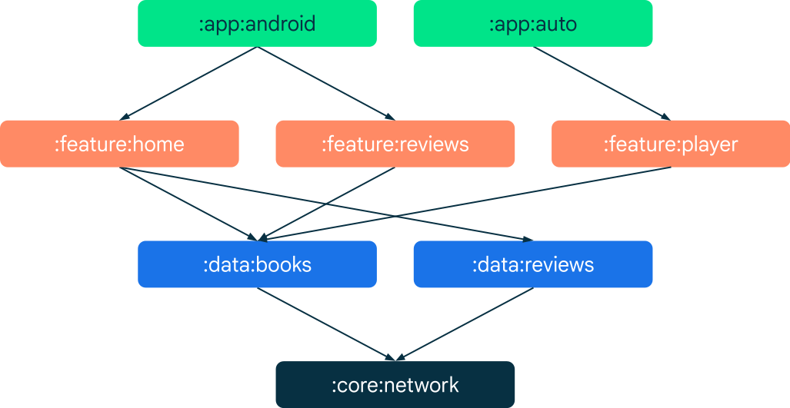

# Hướng dẫn mô-đun hóa ứng dụng Android

Một dự án có nhiều mô-đun Gradle được gọi là dự án nhiều mô-đun. 

## Vấn đề về codebase ngày càng gia tăng

Trong cơ sở mã ngày càng phát triển, khả năng mở rộng, khả năng đọc và chất lượng mã tổng thể thường giảm theo thời gian. 
Điều này xảy ra do kích thước của cơ sở mã ngày càng tăng mà người bảo trì không thực hiện các biện pháp tích cực để thực thi một cấu trúc có thể dễ dàng bảo trì. **Mô-đun hóa** là một phương tiện cấu trúc cơ sở mã của bạn theo cách cải thiện khả năng bảo trì và giúp tránh những vấn đề này.

## Mô-đun hóa là gì?

Mô-đun hóa là phương pháp tổ chức một cơ sở mã thành **các phần được liên kết lỏng lẻo và khép kín**. 
Mỗi phần là một mô-đun. **Mỗi mô-đun độc lập và phục vụ mục đích rõ ràng**. 
Bằng cách chia một vấn đề thành các vấn đề nhỏ hơn và dễ giải quyết hơn, bạn sẽ giảm được sự phức tạp của việc thiết kế và duy trì một hệ thống lớn.

## Lợi ích của việc mô-đun hóa

- **Khả năng sử dụng lại**: Mô-đun hóa tạo cơ hội chia sẻ mã và xây dựng nhiều ứng dụng từ cùng một nền tảng. 
Các mô-đun là các khối xây dựng hiệu quả. 
Ứng dụng phải là tổng hợp các tính năng của chúng, trong đó các tính năng được sắp xếp thành các mô-đun riêng biệt. 
Chức năng mà một mô-đun nhất định cung cấp có thể được bật hoặc không trong một ứng dụng cụ thể. Ví dụ: `:feature:news` có thể là một phần của phiên bản đầy đủ hương vị và ứng dụng mặc nhưng không phải là một phần của phiên bản demo.

- **Kiểm soát mức độ hiển thị nghiêm ngặt**: Các mô-đun cho phép bạn dễ dàng kiểm soát những gì bạn hiển thị với các phần khác trong cơ sở mã của mình. Bạn có thể đánh dấu mọi thứ trừ giao diện chung của mình là nội bộ hoặc riêng tư để ngăn không cho sử dụng nó bên ngoài mô-đun.

- **Phân phối có thể tùy chỉnh**: *Play Feature Delivery* sử dụng các khả năng nâng cao của gói ứng dụng, cho phép bạn phân phối một số tính năng nhất định của ứng dụng theo điều kiện hoặc theo yêu cầu.

## Những cạm bẫy thường gặp

Mức độ chi tiết của cơ sở mã của bạn là mức độ nó bao gồm các mô-đun. 
Một cơ sở mã chi tiết hơn có nhiều mô-đun nhỏ hơn. **Khi thiết kế một cơ sở mã được mô-đun hóa, bạn nên quyết định mức độ chi tiết**. 
**Để làm như vậy, hãy tính đến kích thước cơ sở mã của bạn và độ phức tạp tương đối của nó**. 
Quá chi tiết sẽ khiến chi phí chung trở thành gánh nặng và quá thô sẽ làm giảm lợi ích của việc mô-đun hóa.

Một số cạm bẫy phổ biến như sau:

- **Quá chi tiết**: Mỗi mô-đun đều mang lại một lượng chi phí nhất định dưới dạng độ phức tạp của bản dựng tăng lên và mã boilerplate. 
Cấu hình bản dựng phức tạp gây khó khăn cho việc giữ cấu hình nhất quán giữa các mô-đun. 
**Quá nhiều mã boilerplate dẫn đến cơ sở mã cồng kềnh và khó bảo trì. Nếu chi phí chung cản trở những cải tiến về khả năng mở rộng, bạn nên cân nhắc việc hợp nhất một số mô-đun**.

- **Quá thô**: Ngược lại, nếu mô-đun của bạn phát triển quá lớn, bạn có thể kết thúc bằng một khối nguyên khối khác và bỏ lỡ những lợi ích mà tính mô-đun mang lại. Ví dụ: trong một dự án nhỏ, bạn có thể đặt data layer bên trong một mô-đun duy nhất. Nhưng khi nó phát triển, có thể cần phải tách các kho lưu trữ và nguồn dữ liệu thành các mô-đun độc lập.

- **Quá phức tạp**: Việc mô-đun hóa dự án của bạn không phải lúc nào cũng hợp lý. Yếu tố chi phối là kích thước của cơ sở mã. **Nếu bạn không mong đợi dự án của mình phát triển vượt quá một ngưỡng nhất định thì khả năng mở rộng và tăng thời gian xây dựng sẽ không được áp dụng.**

## Mô-đun hóa có phải là kỹ thuật phù hợp với tôi không?

**Nếu bạn cần những lợi ích của khả năng sử dụng lại**, kiểm soát khả năng hiển thị nghiêm ngặt hoặc sử dụng `Play Feature Delivery` thì việc mô-đun hóa là điều cần thiết đối với bạn. 
Nếu bạn không làm như vậy nhưng vẫn muốn hưởng lợi từ khả năng mở rộng, quyền sở hữu, encapsulation hoặc thời gian xây dựng được cải thiện thì việc mô-đun hóa là điều đáng xem xét.

