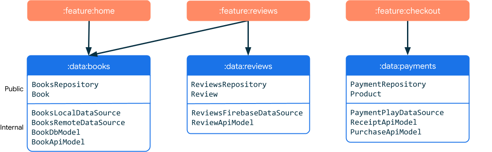
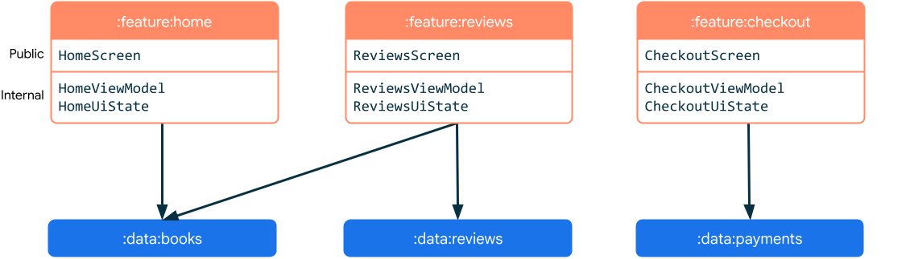
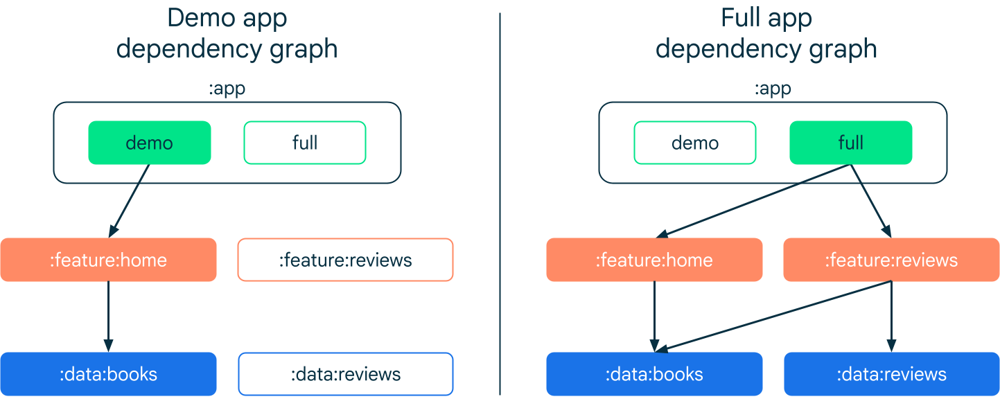
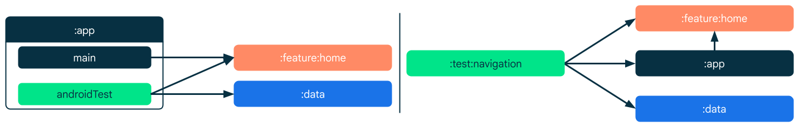
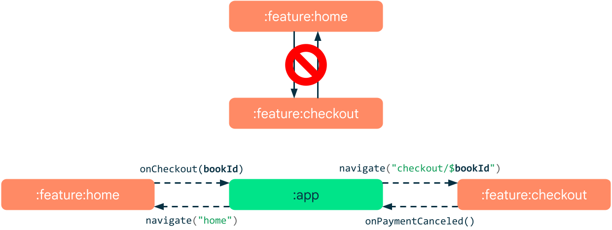
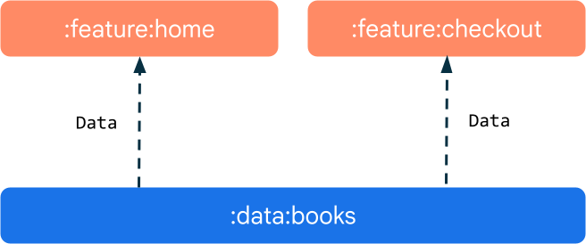
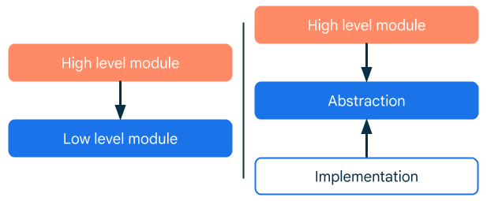

# Các mẫu mô đun hóa phổ biến

Không có chiến lược mô-đun hóa duy nhất phù hợp với tất cả các dự án. Do tính chất linh hoạt của Gradle nên có rất ít hạn chế về cách bạn có thể tổ chức một dự án. 

Trang này cung cấp thông tin tổng quan về một số quy tắc chung và các mẫu phổ biến mà bạn có thể sử dụng khi phát triển ứng dụng Android đa mô-đun.

## Nguyên tắc gắn kết cao và khớp nối thấp

Theo [quy tắc chung](/ComputerScience/00_Fundamentals/00_Essentials/02_SoftwareConstruction/04_DesignPrinciple/01_SOLIDPrinciple/00_CouplingAndCohesion.md), bạn nên cố gắng đạt được độ ghép thấp và độ gắn kết cao:

- **Khả năng ghép nối thấp** có nghĩa là các mô-đun phải độc lập với nhau nhất có thể để những thay đổi đối với một mô-đun không có hoặc có tác động tối thiểu đến các mô-đun khác. **Các mô-đun không được có kiến ​​thức về hoạt động bên trong của các mô-đun khác.**

- **Độ gắn kết cao** có nghĩa là các mô-đun phải bao gồm mã collection hoạt động như một hệ thống. Họ phải có trách nhiệm được xác định rõ ràng và nằm trong giới hạn của một số lĩnh vực kiến ​​thức nhất định. Hãy xem xét một ứng dụng ebook mẫu. Có thể không phù hợp khi kết hợp mã liên quan đến sổ sách và thanh toán trong cùng một mô-đun vì chúng là hai miền chức năng khác nhau

> [!TIP]
> Nếu hai mô-đun phụ thuộc nhiều vào kiến thức của nhau thì đó có thể là một dấu hiệu tốt cho thấy chúng thực sự hoạt động như một hệ thống. Ngược lại, nếu hai phần của một mô-đun không tương tác với nhau thường xuyên thì chúng có thể phải là các mô-đun riêng biệt.

## Các loại mô-đun

Cách bạn sắp xếp các mô-đun chủ yếu phụ thuộc vào **cấu trúc ứng dụng** của bạn. 

### Mô-đun dữ liệu

Mô-đun dữ liệu thường chứa repository, nguồn dữ liệu và các lớp mô hình. Ba trách nhiệm chính của mô-đun dữ liệu là:

1. **Đóng gói tất cả dữ liệu và logic nghiệp vụ của một miền nhất định**: Mỗi mô-đun dữ liệu phải chịu trách nhiệm xử lý dữ liệu đại diện cho một miền nhất định. Nó có thể xử lý nhiều loại dữ liệu miễn là chúng có liên quan với nhau.
2. **Hiển thị repository dưới dạng API bên ngoài**: API công khai của mô-đun dữ liệu phải là repository vì chúng chịu trách nhiệm hiển thị dữ liệu cho phần còn lại của ứng dụng.
3. **Ẩn tất cả các chi tiết triển khai và nguồn dữ liệu từ bên ngoài**: Chỉ các kho dữ liệu từ cùng một mô-đun mới có thể truy cập được các nguồn dữ liệu. Họ vẫn ẩn náu bên ngoài. Bạn có thể thực thi điều này bằng cách sử dụng từ khóa hiển thị riêng tư hoặc nội bộ của Kotlin.

### Mô-đun tính năng

`feature` là một phần chức năng riêng biệt của ứng dụng, thường tương ứng với một màn hình hoặc một loạt màn hình có liên quan chặt chẽ với nhau, chẳng hạn như quy trình đăng ký hoặc thanh toán. 
Nếu ứng dụng của bạn có điều hướng ở thanh dưới cùng thì có khả năng mỗi đích đến là `feature`.

`Features` được liên kết với màn hình hoặc đích đến trong ứng dụng của bạn. 
Do đó, chúng có thể có UI và `ViewModel` được liên kết để xử lý logic và trạng thái của chúng. 
Một `feature` không nhất thiết phải bị giới hạn ở một chế độ xem hoặc đích điều hướng. **Các mô-đun tính năng phụ thuộc vào mô-đun dữ liệu**.

### Mô-đun ứng dụng

Mô-đun ứng dụng là điểm truy cập vào ứng dụng. Chúng phụ thuộc vào các mô-đun tính năng và thường cung cấp điều hướng gốc. 

Một mô-đun ứng dụng có thể được biên dịch thành nhiều tệp nhị phân khác nhau nhờ các biến thể bản dựng.

Nếu ứng dụng của bạn nhắm mục tiêu nhiều loại thiết bị, chẳng hạn như Android Auto, Wear hoặc TV, hãy xác định mô-đun ứng dụng cho từng loại. 
Điều này giúp tách biệt các dependency dành riêng cho nền tảng.

### Các mô-đun chung

Các mô-đun phổ biến, còn được gọi là mô-đun lõi, chứa mã mà các mô-đun khác thường sử dụng. 
Chúng làm giảm sự dư thừa và không đại diện cho bất kỳ lớp cụ thể nào trong kiến ​​trúc của ứng dụng. Sau đây là ví dụ về các mô-đun phổ biến:

- **Mô-đun UI**: Nếu bạn sử dụng các thành phần UI tùy chỉnh hoặc xây dựng thương hiệu phức tạp trong ứng dụng của mình, bạn nên cân nhắc việc đóng gói tiện ích collection của mình vào một mô-đun để tất cả các tính năng có thể sử dụng lại. Điều này có thể giúp làm cho UI của bạn nhất quán trên các tính năng khác nhau. Ví dụ: nếu chủ đề của bạn được tập trung, bạn có thể tránh được việc tái cấu trúc đau đớn khi xảy ra quá trình đổi thương hiệu.
- **Mô-đun phân tích**: Việc theo dõi thường được quyết định bởi các yêu cầu kinh doanh mà ít quan tâm đến software architecture. Trình theo dõi phân tích thường được sử dụng trong nhiều thành phần không liên quan. Nếu đó là trường hợp của bạn, bạn nên có một mô-đun phân tích chuyên dụng.
- **Mô-đun mạng**: Khi nhiều mô-đun yêu cầu kết nối mạng, bạn có thể cân nhắc việc có một mô-đun dành riêng để cung cấp http client. Nó đặc biệt hữu ích khi client của bạn yêu cầu cấu hình tùy chỉnh.
- **Mô-đun tiện ích**: Tiện ích, còn được gọi là trình trợ giúp, thường là các đoạn mã nhỏ được sử dụng lại trong ứng dụng. Ví dụ về các tiện ích bao gồm trình trợ giúp kiểm tra, chức năng định dạng tiền tệ, trình xác thực email hoặc toán tử tùy chỉnh.

### Mô-đun thử nghiệm

Mô-đun thử nghiệm là các mô-đun Android chỉ được sử dụng cho mục đích thử nghiệm.
Các mô-đun chứa mã kiểm tra, tài nguyên kiểm tra và các dependency kiểm tra chỉ cần thiết để chạy kiểm tra và không cần thiết trong runtime của ứng dụng.
Các mô-đun thử nghiệm được tạo để tách mã dành riêng cho thử nghiệm khỏi ứng dụng chính, giúp mã mô-đun dễ quản lý và bảo trì hơn.

#### Các trường hợp sử dụng cho mô-đun thử nghiệm

- **Mã kiểm tra được chia sẻ**: Nếu bạn có nhiều mô-đun trong dự án của mình và một số mã kiểm tra có thể áp dụng cho nhiều mô-đun, bạn có thể tạo một mô-đun kiểm tra để chia sẻ mã. Điều này có thể giúp giảm sự trùng lặp và làm cho mã kiểm tra của bạn dễ bảo trì hơn. Mã kiểm tra được chia sẻ có thể bao gồm các lớp hoặc hàm tiện ích, chẳng hạn như xác nhận hoặc đối sánh tùy chỉnh, cũng như dữ liệu kiểm tra, chẳng hạn như JSON response mô phỏng.

- **Cấu hình bản dựng sạch hơn**: Mô-đun thử nghiệm cho phép bạn có cấu hình bản dựng rõ ràng hơn vì chúng có thể có tệp `build.gradle` riêng. Bạn không cần phải làm lộn xộn tệp `build.gradle` của mô-đun ứng dụng với các cấu hình chỉ liên quan đến thử nghiệm.

- **Thử nghiệm tích hợp**: Mô-đun thử nghiệm có thể được sử dụng để lưu trữ các thử nghiệm tích hợp dùng để kiểm tra sự tương tác giữa các phần khác nhau trong ứng dụng của bạn, bao gồm user interface, logic nghiệp vụ, network request và truy vấn cơ sở dữ liệu.

- **Ứng dụng quy mô lớn**: Mô-đun thử nghiệm đặc biệt hữu ích cho các ứng dụng quy mô lớn có cơ sở mã phức tạp và nhiều mô-đun. Trong những trường hợp như vậy, các mô-đun kiểm tra có thể giúp cải thiện khả năng tổ chức và bảo trì mã.

## Giao tiếp giữa mô-đun với mô-đun

Các mô-đun hiếm khi tồn tại hoàn toàn tách biệt và thường dựa vào các mô-đun khác và giao tiếp với chúng. 
Điều quan trọng là phải giữ mức độ ghép nối ở mức thấp ngay cả khi các mô-đun hoạt động cùng nhau và trao đổi thông tin thường xuyên. 
Đôi khi việc giao tiếp trực tiếp giữa hai mô-đun là không mong muốn như trong trường hợp có ràng buộc về kiến ​​trúc. 
Nó cũng có thể là không thể, chẳng hạn như với sự phụ thuộc theo chu kỳ.

Để khắc phục vấn đề này, bạn có thể có mô-đun thứ ba làm trung gian giữa hai mô-đun khác. 
Mô-đun hòa giải có thể nghe tin nhắn từ cả hai mô-đun và chuyển tiếp chúng nếu cần. 
Trong trường hợp này, bộ hòa giải là mô-đun sở hữu navigation graph (thường là mô-đun ứng dụng). 
Trong ví dụ này, chúng tôi sử dụng điều hướng để truyền dữ liệu từ tính năng trang chủ sang tính năng thanh toán bằng thành phần Navigation.

**Bạn không nên chuyển đối tượng làm đối số điều hướng. Thay vào đó, hãy sử dụng các id đơn giản mà các tính năng có thể sử dụng để truy cập và tải các tài nguyên mong muốn từ data layer**. Bằng cách này, bạn giữ khớp nối ở mức thấp và không vi phạm nguyên tắc single source of truth.

##Dependency inversion

Dependency inversion là khi bạn sắp xếp mã của mình sao cho phần trừu tượng tách biệt với việc triển khai cụ thể.

- **Tính trừu tượng**: Một hợp đồng xác định cách các thành phần hoặc mô-đun trong ứng dụng của bạn tương tác với nhau. Các mô-đun trừu tượng xác định API trong hệ thống của bạn và chứa các interface và mô hình.

- **Triển khai cụ thể**: Các mô-đun phụ thuộc vào mô-đun trừu tượng và triển khai hành vi trừu tượng.

Các mô-đun dựa vào hành vi được xác định trong mô-đun trừu tượng chỉ nên phụ thuộc vào chính sự trừu tượng đó, thay vì các triển khai cụ thể.

