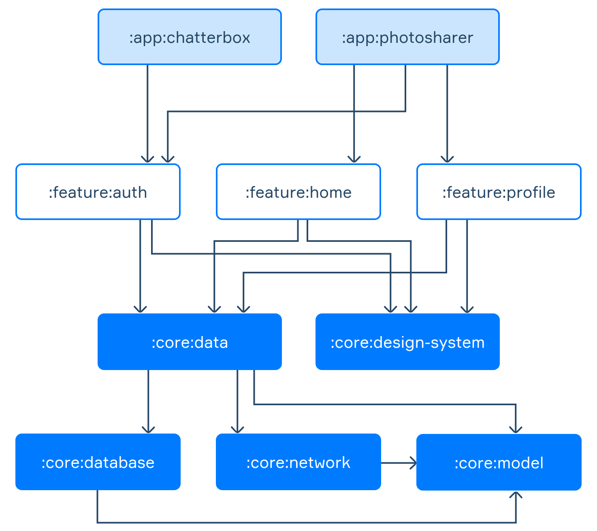
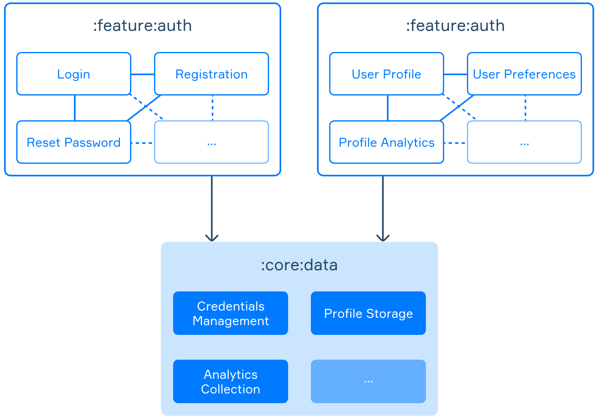
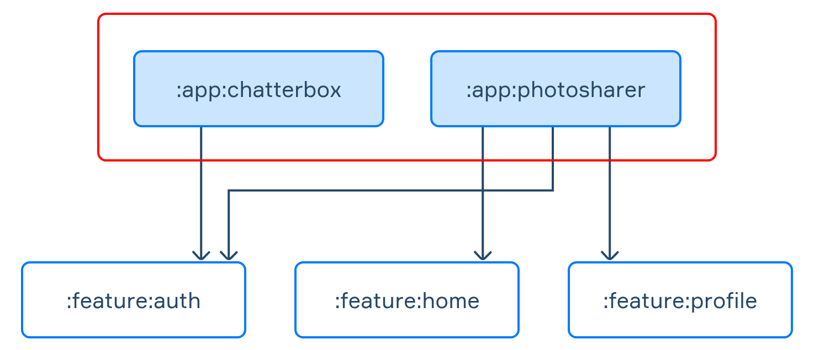
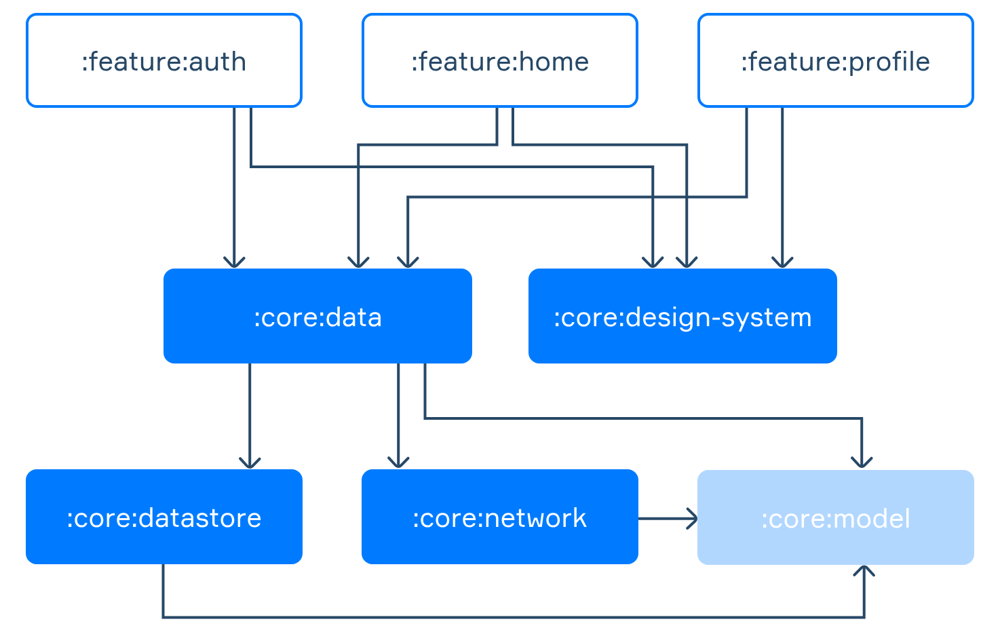
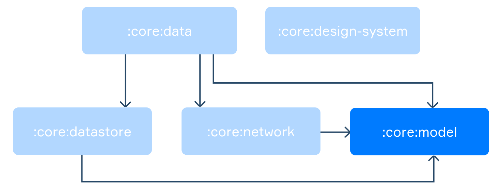
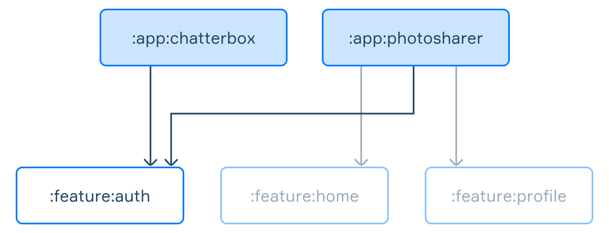
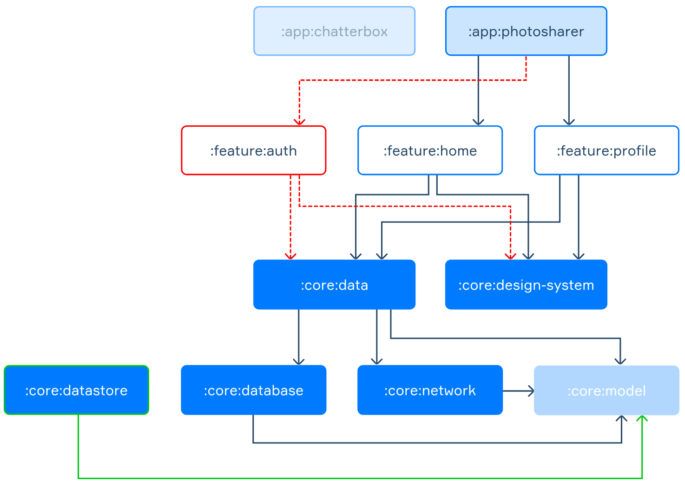

# mô-đun

Khi phát triển ứng dụng, codebase có xu hướng phát triển khi các tính năng của ứng dụng tăng lên. Điều này thường dẫn đến độ phức tạp của mã, khó bảo trì và giảm tốc độ xây dựng. Một cách để quản lý sự tăng trưởng này là thông qua mô-đun hóa.

Mô-đun hóa bao gồm việc chia mã ứng dụng của bạn thành nhiều mô-đun, có thể được duy trì và phát triển riêng biệt.

## Mô-đun là gì?

**Mô-đun** là các vùng chứa riêng lẻ chứa các phần cụ thể của cơ sở mã của bạn. Chúng là các thực thể riêng biệt trong một dự án và có thể được biên dịch độc lập.

Trong sơ đồ này, chúng ta có các nhóm mô-đun khác nhau, chẳng hạn như `:app`, `:feature` và `:core`, và mỗi mô-đun này thực hiện một công việc cụ thể. Các mô-đun xử lý việc ghi sổ những gì đang diễn ra đằng sau hậu trường các tính năng của chúng tôi, quản lý mọi thứ từ các phần riêng lẻ của ứng dụng đến các tính năng chuyên biệt và các tác vụ nền quan trọng như xử lý dữ liệu, thiết kế và kết nối mạng. Cùng với nhau, các mô-đun này tổ chức cơ sở mã thành các đơn vị chức năng và riêng biệt.

## Khớp nối thấp và độ gắn kết cao

Nhìn vào sơ đồ này:

**Khớp nối thấp** có nghĩa là mỗi mô-đun phụ thuộc ít nhất có thể vào các mô-đun khác. Các mô-đun `:feature:auth`, `:feature:profile` và `:core:data` được thiết kế để hoạt động cùng nhau nhưng về cơ bản vẫn độc lập. 

Lựa chọn thiết kế này nâng cao tính linh hoạt của hệ thống, cho phép thay đổi hoặc bổ sung một mô-đun mà không yêu cầu thay đổi các mô-đun khác. Nó thúc đẩy một cơ sở mã có tổ chức hơn, trong đó mỗi mô-đun tập trung vào một chức năng cụ thể và sự tương tác giữa các mô-đun được giữ ở mức tối thiểu cần thiết.

**Độ gắn kết cao** có nghĩa là mọi thứ bên trong một mô-đun đều liên quan chặt chẽ đến mục đích cụ thể của nó.

- `:feature:auth` chịu trách nhiệm xác thực người dùng. Nó chứa các chức năng liên quan đến đăng nhập, đăng ký và đặt lại mật khẩu. Mô-đun này có thể sử dụng `:core:data` để quản lý và lưu trữ thông tin xác thực nhưng không cần biết gì về các tính năng khác như `:feature:profile`. 
Sự gắn kết trong mô-đun này đảm bảo rằng tất cả các nhiệm vụ liên quan đến xác thực được kết hợp chặt chẽ với nhau, cung cấp một bộ chức năng thống nhất và có thể quản lý được.

- `:feature:profile` quản lý hồ sơ người dùng, tùy chọn người dùng và phân tích hồ sơ. 
Nó có thể tương tác với `:core:data` để lưu trữ và phân tích dữ liệu collection. 
Tuy nhiên, nó không cần biết gì về các tính năng khác như `:feature:auth`, duy trì ranh giới rõ ràng và khả năng ghép nối thấp với các mô-đun khác.

- `:core:data` đảm nhiệm mọi hoạt động liên quan đến dữ liệu, bao gồm quản lý thông tin đăng nhập, lưu trữ và phân tích collection. Nó có thể được sử dụng bởi bất kỳ mô-đun tính năng nào yêu cầu xử lý dữ liệu, như `:feature:auth` để xác thực hoặc `:feature:profile` để quản lý hồ sơ người dùng. Nhưng nó không cần biết chính xác những mô-đun tính năng đó đang làm gì với dữ liệu.

## Các loại mô-đun

Dưới đây là các loại mô-đun chúng tôi sẽ tập trung vào:

- **Mô-đun ứng dụng** về cơ bản là ứng dụng Android của bạn. Nó bao gồm mã, tài nguyên và tệp cấu hình cần thiết để xây dựng ứng dụng chạy trên thiết bị.

Chúng tôi có hai mô-đun ứng dụng `:app:chatterbox` và `:app:photosharer` hoặc hai ứng dụng khác nhau. Các mô-đun này chịu trách nhiệm xác định cấu hình cơ bản và điều phối các mô-đun tính năng.

- **Mô-đun thư viện Android** được thiết kế riêng cho Android và chứa cả mã và tài nguyên dành riêng cho Android. Nó được sử dụng để tạo các thành phần dành riêng cho ứng dụng Android.

- **Mô-đun Kotlin** chung hơn, chỉ chứa mã Kotlin và có thể được sử dụng trong mọi môi trường hỗ trợ Kotlin, bao gồm nhưng không giới hạn ở Android. Nếu bạn cần một mô-đun chỉ chứa logic thuần túy mà không có bất kỳ sự phụ thuộc nào vào Android framework, bạn có thể muốn tạo một mô-đun Kotlin.

## Lợi ích của việc mô-đun hóa

- **Cách ly mã**. Cách thực hành này tách các phần khác nhau của cơ sở mã thành các mô-đun hoặc thành phần khác nhau, giảm sự phụ thuộc và tương tác giữa chúng.
- **Khả năng tái sử dụng**. Hãy xem xét mô-đun xác thực người dùng.
Khi mô-đun này được phát triển, nó có thể được sử dụng lại không chỉ trong ứng dụng PhotoSharer này mà còn trong bất kỳ ứng dụng nào khác yêu cầu xác thực người dùng.
Điều này giúp tiết kiệm thời gian phát triển và đảm bảo tính nhất quán của ứng dụng.

- **Khả năng mở rộng** là khả năng sửa đổi, mở rộng hoặc định cấu hình lại các phần của ứng dụng mà không tác động tiêu cực đến các thành phần khác. 
Nếu chúng tôi quyết định xóa thành phần `:feature:auth` khỏi ứng dụng hoặc thêm thành phần `Datastore` mới, chúng tôi có thể thực hiện điều đó một cách dễ dàng.

- **Bản dựng Gradle nhanh**. Trong ứng dụng mô-đun sử dụng Gradle, các mô-đun có thể được xây dựng song song, tăng tốc toàn bộ quá trình xây dựng process, đặc biệt là trên bộ xử lý đa lõi.

- **Khả năng kiểm tra**. Mỗi mô-đun trong ứng dụng có thể được kiểm tra độc lập. 
Ví dụ: mô-đun `:feature:auth` có thể được kiểm tra riêng biệt với mô-đun `:feature:home` hoặc `:feature:profile `.
Điều này thúc đẩy thử nghiệm hiệu quả và giảm phạm vi của các vấn đề tích hợp tiềm ẩn.

## Chiến lược kiến ​​trúc trong module hóa

Khi thiết kế kiến ​​trúc của một ứng dụng, việc mô đun hóa có thể được tiếp cận theo nhiều cách khác nhau.
Hai cách tiếp cận chính là mô-đun hóa theo tính năng và theo lớp.

- **Mô-đun hóa theo tính năng** thường thích hợp hơn cho các ứng dụng trong đó các tính năng riêng biệt có thể được phát triển và duy trì độc lập.
Nó tăng cường khả năng tách biệt và mở rộng mã nhưng có thể dẫn đến một số trùng lặp.

- **Mô-đun hóa theo lớp** thường phù hợp hơn với các ứng dụng phân tách rõ ràng các loại tác vụ khác nhau,
chẳng hạn như kết xuất UI, xử lý logic nghiệp vụ và quản lý dữ liệu. Nó có thể thúc đẩy khả năng sử dụng lại nhưng có thể dẫn đến sự liên kết chặt chẽ hơn giữa các lớp.
Chúng ta có thể tạo các mô-đun riêng cho lớp trình bày, domain layer và data layer. Mỗi lớp có thể xác định các API và phần phụ thuộc của riêng mình.

 
Việc lựa chọn giữa các phương pháp này phụ thuộc vào nhu cầu và kiến ​​trúc cụ thể của dự án.
**Hiểu được cả hai phương pháp cho phép bạn chọn hoặc thậm chí kết hợp chúng một cách hiệu quả nhất cho ứng dụng cụ thể của mình.**

> [!NOTE]
> Lưu ý rằng trong ví dụ của chúng tôi, chúng tôi sử dụng phương pháp kết hợp để mô-đun hóa, kết hợp cả mô-đun dựa trên tính năng và dựa trên lớp để có kiến trúc toàn diện và linh hoạt.

## Thứ tự hợp lý của các bước để triển khai mô-đun hóa vào một ứng dụng hiện có

1. Xác định vùng có độ gắn kết cao và vùng khớp nối thấp
2. Quyết định phương pháp mô đun hóa (theo tính năng hoặc lớp)
3. Chia ứng dụng dựa trên tính năng hoặc lớp
4. Refactor codebase để giới thiệu các module
5. Kiểm tra từng mô-đun riêng lẻ
